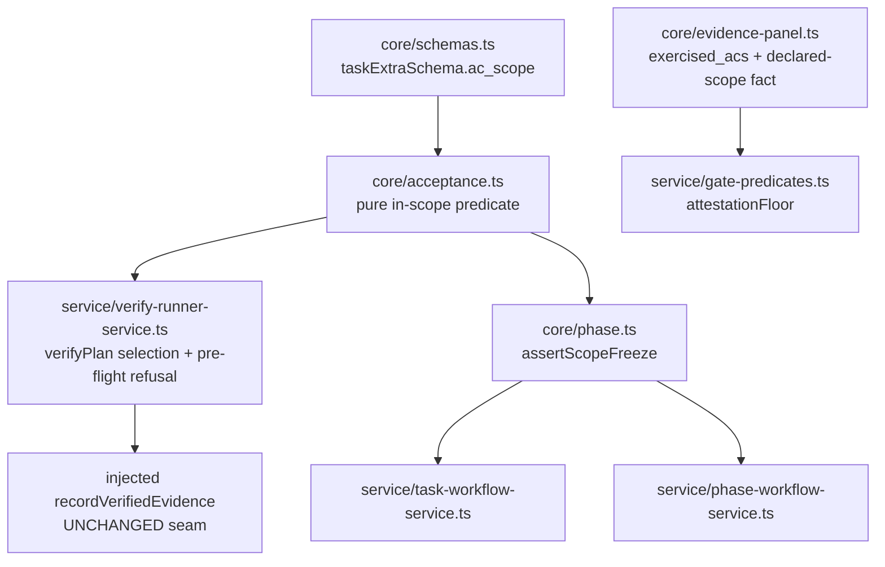

## Context

`adr-plan-close-predicates-must-measure-invariants-not-proxies` replaced a plan-wide evidence ratio with a per-claimed-AC attested-coverage conjunct as `plan-close`'s default teeth. Dogfooding that slice produced eight findings; re-measuring the first one before building its fix falsified its stated cause and exposed a deeper defect in the same mechanism (`knowledge-re-measuring-finding-1-falsified-its-cause-lore`).

Measured at commit `8227dd1` (current `main`):

1. `lore verify --ac <id>` WORKS — single value, repeated values, unknown id (exit 4, `Validation failed on field 'acIds'`), plus a no-flag control run, all per contract. There is no flag bug. The earlier diagnosis ("silently inert, the fifth false-oracle vector") was wrong.
2. `lore verify <plan>` with NO `--ac` executes EVERY declared script-mode AC and writes one runner-attested entry per AC onto the SINGLE task `resolveTargetTask` picks (`verify-runner-service.ts:415-429`, `:442-450`, loop at `:488`). No output names the scope it just claimed — the run emits only the trust-tier, draft-spec and execution-root warnings.
3. `deriveClaimedAcCoverage` (`packages/core/src/evidence-panel.ts:175-182`) defines the claimed set as `mode === "script" && refs.length > 0`. **The audited evidence circularly defines its own audit scope.**
4. Consequence on `plan-implementation-plan-close-predicates-measure-invariants`: all 8 tasks carry exactly 16 attested entries covering all 16 distinct ACs, each set sharing ONE timestamp — 8 plan-wide runs, 128 attested entries. `extra.verification_evidence` is append-only, so per-task scope fidelity for that plan is permanently unrecoverable.
5. Therefore the coverage conjunct is satisfiable by ONE plan-wide command, over a set authored by the very run being checked.
6. `attestationFloor` condition 1 (every evidence-bearing task needs >= 1 attested entry) plus a runner writing to exactly one task per run makes N plan-wide runs the cheapest way to close an N-task plan — N x M command executions, each widening another task's claim to the whole spec. This is the mechanism behind finding 8's cost question, and the answer is sharper than the question: condition 1 does not merely cost N runs, it FORCES the scope inflation that destroys per-task fidelity.

This decision was reviewed from four independent perspectives (coupling, cohesion, reuse/extension, testability) before being recorded. Three of the reviewers' corrections changed the draft; they are captured under Perspective Tensions Resolved and in D8.

## Decision

Give the task→AC mapping a single declared owner (the task), make the runner's DEFAULT write scope that declaration instead of the whole spec, and demote the conjunct whose only remaining job was incentivising plan-wide runs. Reject the permissive-plus-warning variant as the primary mechanism, and reject reusing the phase tier's scope field.

## Module Boundary

- **Public API (new)**: `task.extra.ac_scope?: string[]` on `taskExtraSchema`; one pure predicate in `@lore/core` deciding AC-in-scope membership, consumed by `VerifyRunnerService` and (for the freeze rule) by both the Task and Phase workflow services.
- **Internal**: the runner's per-AC selection/refusal logic; the gate's fact derivation.
- **Dependencies**: none new. Tasks already flow into the runner through `PlanBundle.tasks`, so no new port and no constructor widening. `@lore/core` stays a browser-safe leaf (pure predicate, no IO).

## Public Interface

- `taskExtraSchema.ac_scope?: z.array(z.string().min(1))` — reusing the SHAPE of `phaseExtraSchema.ac_scope` (`phase.ts:217`), deliberately NOT `planAcScopeSchema`'s `.min(1)` (`schemas.ts:376`). The asymmetry is resolved in favour of the phase shape because an empty array is a meaningful task state (see D1).
- A pure membership predicate beside `computeAcCoverage` in `acceptance.ts` — no store, no config, `Result`-free (a boolean query, per CQS).
- `attestationFloor`'s signature is UNCHANGED. Condition 1's computation stays; only its blocking role changes.
- `recordVerifiedEvidence`'s injected seam is UNCHANGED — refusal happens BEFORE the call, mirroring the existing `NEEDS_APPROVAL` abort at `verify-runner-service.ts:493-517`.

## Dependency Graph

No edge points from a lower layer to a higher one; no service imports another service; `PlanBundle` is not widened.

## Design Decisions

| # | Decision | Rationale | Trade-off |
|---|---|---|---|
| D1 | Add `task.extra.ac_scope?: string[]`, empty array ALLOWED and strictly distinct from an ABSENT field | The task is the tier that actually receives evidence, so it is the tier that must declare what it claims. Empty = "this task claims no AC" (a real state for planning/refactor tasks); absent = "scope unknown" (D2) | A third copy of the same shape (plan/phase/task); mitigated by hosting the predicates once in core rather than duplicating logic |
| D2 | When the resolved target task has NO `ac_scope`, `lore verify` REFUSES and requires an explicit `--ac`, naming the fixing command | An unknown scope must never be silently promoted to full scope — that is precisely today's defect. A hard requirement needs no backfill of existing tasks and has an unambiguous RED | Existing plans need `--ac` (or a scope declaration) until authored; deliberate, since the alternative is inheriting the permissive default |
| D3 | A default run (no `--ac`) selects `ac_scope` ∩ declared script ACs. An explicit `--ac` id outside scope refuses the WHOLE run pre-flight, before executing any command | Pre-flight refusal mirrors the existing unknown-AC-id check (`:418-426`) and cannot leave a partially-attested task. Skip-and-continue was considered and rejected: it produces a run that silently did less than asked | A caller wanting a wider run must widen the declaration, not the flag |
| D4 | Rename `ClaimedAcCoverage.claimed_acs` → `exercised_acs`; add a SEPARATE declared-scope-based fact. Never conflate them, and no fallback from one to the other | The current name asserts a claim nobody made. A silent fallback to the evidence-derived set for legacy docs would reintroduce the circularity under a new name | Two facts to render instead of one; the dashboard Evidence tab and the gate both read the SSOT, so they change together |
| D5 | Condition 1 is DEMOTED from a blocking conjunct to a reported, non-blocking fact — its computation is retained | Retiring it outright would drop a failure class condition 2 structurally cannot see: a task with un-`ac_ref`'d self-reported entries and zero attested ones. Keeping it as a fact preserves detection without forcing N runs | `plan-close` blocks on less than before; the AC-granular conjunct plus D2/D3 carry the fidelity |
| D6 | Record the plan-wide-run shape in the coverage predicate's `known_false_pass` field, with the measured 8x16 instance | The contract table exists to carry exactly this, and it currently reads "(none recorded)". A known false-pass that is not recorded is indistinguishable from none | Admits a shipped predicate's limitation in a surface users read — which is the point |
| D7 | The 128 already-written wide attestations are NOT migrated, rewritten, or deleted | `verification_evidence` is append-only by invariant. The plan is already archived, so nothing re-gates it; the entries remain honest history of what the runner executed, merely wider in scope than the tasks warranted | Any future scope-fidelity analysis over that one plan reads an overstated claim; recorded here so it is never mistaken for data |
| D8 | Wire `assertScopeFreeze` as the single scope-edit invariant for BOTH tiers as part of this change | Measured: `assertScopeFreeze` (`phase.ts:274-300`) has ZERO production call sites — only its definition and `phase-scope-freeze.test.ts`. A tested-but-unwired invariant is a FALSE-ASSURANCE vector: anyone who greps it concludes evidenced scope ids are protected, and nothing stops a scope from shrinking today | Couples this decision to a pre-existing dead-invariant defect; accepted because adding a second scope field while the first field's guard is inert would multiply the false assurance |

## Perspective Tensions Resolved

| Tension | Perspectives | Resolution | Why |
|---|---|---|---|
| Reuse `phase.extra.ac_scope` vs a new task-level field | Reuse/Extension (reuse what exists) vs Coupling (`planBundleSchema` = `{plan, spec?, tasks[], knowledge_links?}`, `assessment.ts:824` — no `phases`) | New `task.extra.ac_scope`; reuse the Zod SHAPE only | Reaching the phase tier from the runner would widen `PlanBundle` and add a runner→phase dependency, hitting assess and phase-completion for a fact the task already carries |
| "Reuse the phase mechanism" | Reuse/Extension corrected its own premise: `appendEvidenceEntry` (`phase-workflow-service.ts:616-639`) validates `ac_ref` only against the parent spec's FULL declared set via `resolveDeclaredAcIds`, never against the phase's own `ac_scope`; `recordChecklistVerifiedEvidence` is itself unwired to any surface | The refusal predicate is built NEW | There is no behavioural prior art at any tier — only a field shape. Citing the phase tier as prior art would have been a false reuse claim |
| Third copy of the concept = over-engineering | Cohesion (a third copy needs its own freeze invariant to stay honest) vs Coupling (only path removing the circular ownership) | Accept the third field, host freeze + membership as ONE pure core predicate shared by both tiers | The duplication that actually costs is duplicated LOGIC, not a declared field per tier |
| Retire condition 1 | Testing (most test-invasive: `attestation-floor.test.ts` AC-069-1 `:179-199`, AC-PCI-7/8 `:447-503`, the pure-planning REGRESSION `:408-427`, and `evidence-panel.test.ts` AC-075-11 `:230-241` all encode today's behaviour as correct) vs Cohesion (retiring it drops an unguarded failure class) | Demote, do not delete (D5) | Those suites must be deliberately rewritten, never silently dropped; a demotion changes fewer of them than a deletion and keeps the detection |
| Permissive-plus-warning as the cheap option | Testing: a test asserting `warnings[]` non-emptiness ALREADY passes today (the draft-spec warning at `verify-runner-service.test.ts:453-470`), so a careless implementation yields a FALSE GREEN | Rejected as the primary mechanism. If a diagnostic is added at all it must be a structured field (following the `completeness`/`binary_freshness` precedent at `:229-236`), never free text | An AC that cannot go red is the exact defect class this ADR replaces |

## Consequences

- `lore verify` becomes stricter: a task with no declared scope cannot be verified without an explicit `--ac`. This is a deliberate, loud migration cost.
- `plan-close` blocks on strictly less than before (D5) while measuring strictly more (D3/D4) — the point of the governing ADR.
- The coverage predicate's contract table stops claiming a clean record it does not have (D6).
- One pre-existing dead invariant gets wired (D8), removing a false-assurance vector that a grep-based reader would otherwise trust.
- The testability bar is met by construction: the refusal is assertable through the EXISTING `recordVerifiedEvidence` DI seam (`recorder.callCount` stays flat for an out-of-scope AC, the same pattern as the `NEEDS_APPROVAL` test at `verify-runner-service.test.ts:544-565`) — a vitest unit test, no store and no compiled-binary e2e required.

## Quality Gate Verification (lore-design `module` mode)

- [x] **No circular dependencies** — see Dependency Graph; `@lore/core` stays a leaf, no service→service import, `PlanBundle` not widened.
- [x] **Every module has a single clear responsibility** — task declares scope; core owns the membership + freeze predicates; the runner consults and refuses; the gate reads facts it does not compute.
- [x] **Public API sufficient for black-box testing** — the existing injected `recordVerifiedEvidence` seam proves refusal by non-invocation; no new port needed because tasks already arrive via `PlanBundle.tasks`.
- [x] **Dependencies injectable** — no new constructor dependency; the pure predicate is importable and testable standalone.

## Open Item Deliberately NOT Decided Here

Whether an evidence entry should carry the commit it was measured at (finding 3 of `knowledge-eight-findings-from-building-and-closing-the-plan`). That question is orthogonal: this ADR decides WHOSE scope an attestation belongs to; provenance decides WHERE it was measured. Deciding both in one record would couple two independent root causes.
