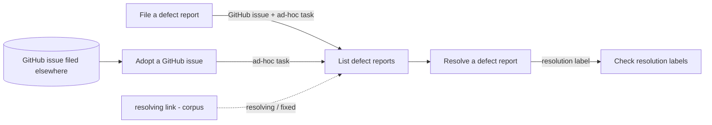
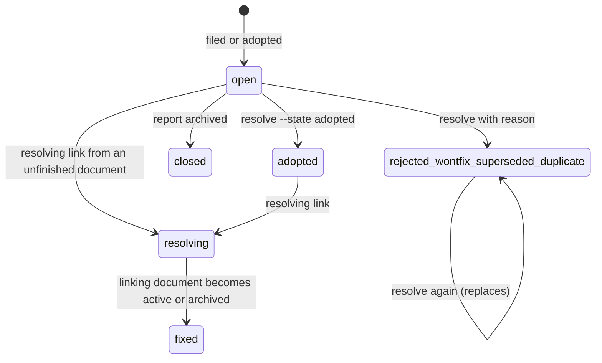

## Issue loop

The issue loop is how a defect in lore, met by a project that uses lore, reaches the people who fix lore and comes back closed. A reporter files a defect report to a GitHub repository chosen in the project's settings; the same filing creates a claimable task in the reporter's corpus; anyone can list the reports with a resolution computed from the corpus; an existing GitHub issue can be adopted into a task; and a report is resolved with a reason, which is mirrored onto GitHub as a label. A separate check shows where the labels on GitHub and the corpus disagree.

Written for the baseline issue-loop migration on 2026-10-09, against the product as built at commit a248efe0. Every rule was checked against the code and rehearsed offline against a local stand-in for the GitHub command-line tool (no issue was filed on GitHub). A rule is held at established only when a live check-decided acceptance criterion would fail if the rule were false; a rule whose behaviour is measured in code (file and line recorded) but that no criterion yet cites to confirm it is held at observed (BR-623); every other rule is unconfirmed or undecided with its question written down.

### Boundary

**Inside**
- Choosing where reports go, as far as filing, listing and adopting read it: the consent rule, the vendor intake, the retired form
- Filing a defect report: required fields, triage labels, what is published, the duplicate hint, retry recognition, the filing log, the task it creates
- Listing defect reports, from GitHub or from this corpus, and how each report's resolution is computed
- Checking the resolution labels on GitHub against the corpus
- Adopting a listed GitHub issue into a claimable task
- Recording an explicit resolution and mirroring it onto GitHub as a label, and closing a report's GitHub issue when the work that resolves it is archived

**Outside**
- Creating the resolving link itself (`link --type resolves`) and the check that it may only point at a defect report: **corpus**. This branch owns only what the link does to a report's resolution.
- Claiming, working and archiving the task a report becomes: **execution**. Archiving matters here only because an archived report with nothing else recorded reads closed.
- Flagging stale reports, reports whose fix landed but which were never closed, and adoptions whose owner is gone (`status --check-issues`): **hygiene**.
- The hint printed on other commands' failures that points agents at reporting a defect: **context** (it belongs to each failing command's output).
- Who an actor is (explicit, environment, session, computer user name): **session**. This branch owns only what is published about that actor.
- Writing the filing destination into the project's settings at setup: **distribution**.
- Rejecting a defect report in review: **review**. Today it does not change the report's resolution (written here as an unconfirmed rule).

### Children

| Node | What it does | Kind | Rule prefix |
|---|---|---|---|
| File a defect report | Send a defect report to the chosen GitHub repository and get a claimable task for it | leaf | IFIL |
| List defect reports | See every report with its computed resolution | leaf | ILST |
| Check resolution labels | Find where the GitHub labels disagree with the corpus | leaf | IDRF |
| Adopt a GitHub issue | Turn one listed GitHub issue into a claimable task | leaf | IADP |
| Resolve a defect report | Record a resolution with a reason and mirror it onto GitHub | leaf | IRSV |

Split and merge decisions:

- Filing and adopting are separate leaves although both create the same kind of task. Filing creates the GitHub issue; adopting only reads one that exists, and is refused for anything not filed through lore.
- Listing and the label check are separate leaves although both are modes of one command. The listing shows the corpus's view; the check compares it with GitHub's and has its own outcome (exit 11). Folding them would hide that a label is never read as truth.
- How a resolution is computed lives in the list leaf, where readers meet it. Resolving owns only what it records; the precedence among recorded states, links and archiving is one rule, not two.
- The consent rule for the filing destination is written once in the file leaf and restated as each other leaf's own refusal, because the outcomes differ: filing and adopting refuse, listing falls back to this corpus.
- GitHub failure kinds (not logged in, network, rate limit) are one rule in the file leaf; the other leaves' census sites for them point there.
- The listing switch of the filing command is not a leaf. It hands over to the list leaf, with two differences written there.

### How they fit together

### Ubiquitous language

The terms are defined in this branch's glossary. The ones most often confused:

- **Adopt an issue** (create the missing task for a GitHub issue) versus the **adopted resolution** (name the plan or task that now owns a report). Same word, unrelated actions.
- **Closed on GitHub** versus the **closed resolution**. Closing an issue on GitHub changes nothing in the corpus; the closed resolution means the report's own task was archived with nothing else recorded.
- **Fixed** versus **resolved**. Fixed can only be reached through a resolving link from a document that is active or archived; it is never recorded by hand.
- **Not ingested** versus **open**. A not-ingested issue has no task in this corpus; an open report has one with nothing recorded yet. Both are unfinished.

### Cross-cutting notes

**Consent before anything leaves the machine.** Nothing is filed until the project's shared settings name a destination; the refusal says what would be sent.

**The corpus is the authority, GitHub is the mirror.** A report's resolution is computed from the corpus. The resolution label on GitHub is written by resolving and, for a fixed report, when the work that resolves it is archived (which also closes the issue); it is never read back as truth; a hand-edited label shows up as drift.

**GitHub is reached only through the GitHub command-line tool of the caller's machine,** with the caller's own login, and only for the repository in project settings: personal overrides in the environment are ignored.

**The agent tool route files too.** It shares the filing steps with the command line but takes no tags and requires the actor to be named; its refusals come back as tool errors, not exit codes.

**Known suspected defects held here as unconfirmed rules:** a different report with an already-used title is not filed (IFIL); an unreadable filing log silently turns retry recognition off (IFIL); only the first 100 GitHub issues are read (ILST); a report rejected in review still reads open (ILST); every report never resolved through the resolve command reads as drift, including one filed a moment ago (IDRF); an archived or deprecated owner is accepted for the adopted resolution (IRSV); a label failure after a recorded resolution exits 4 like a refusal (IRSV); resolving overwrites a concurrent change to the same report (IRSV). Five acceptance criteria of the governing specs name test files that no longer exist, and one filters to no test at all (listed in the leaves' open questions).
