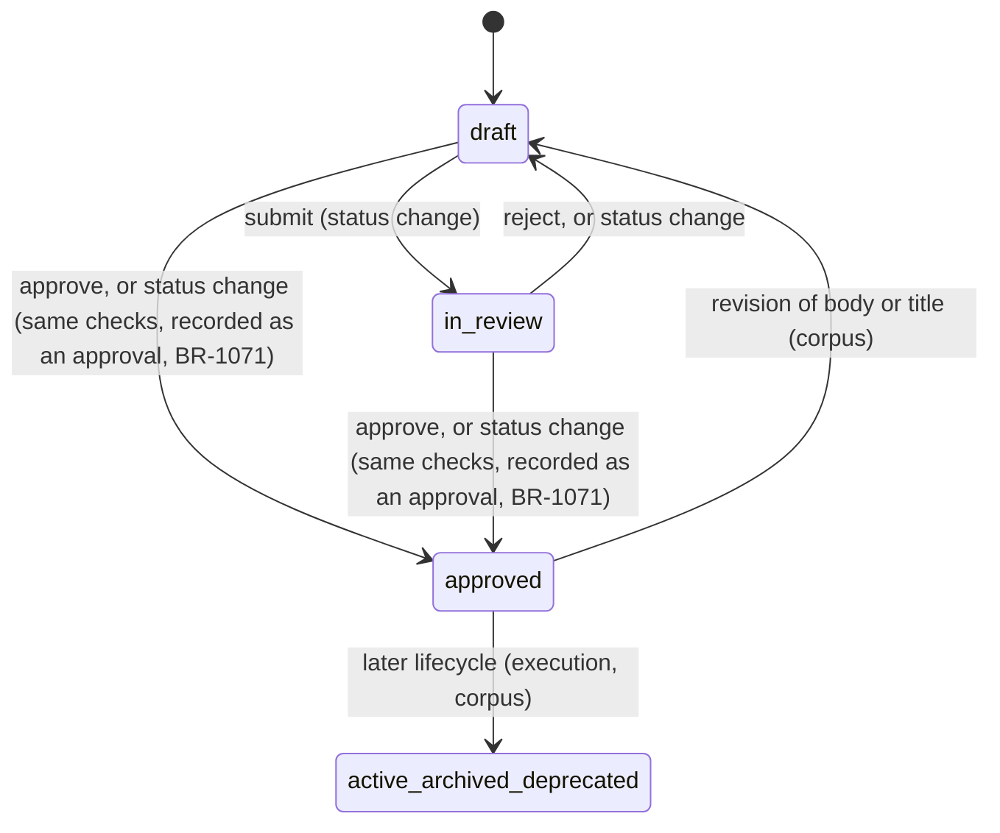
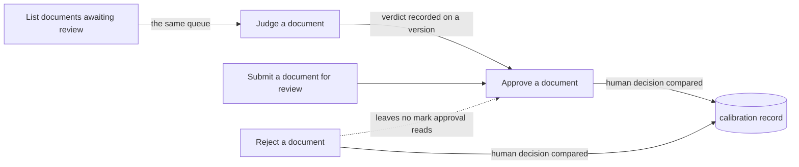

## Review

Review is how a document earns the status "approved". A document is judged (mechanical checks first, then an AI judge), and a person then approves it or sends it back. This branch covers the judgment, the approval, the rejection, the list of documents waiting, and the moves among the review statuses (draft, in review, approved).

Written for the baseline review-branch migration on 2026-10-09, against the product as built at the commit that landed the claim-scoped corpus authoring slice. Every rule was checked against the code and, where it is cheap to do, against a live throwaway corpus. A rule is held at established only when a live check-decided acceptance criterion would fail if the rule were false; a rule whose behaviour is measured in code (file and line recorded) but that no criterion yet cites to confirm it is held at observed (BR-623); every other rule is undecided or unconfirmed with its question written down.

### Boundary

**Inside**
- Judging one document, or the whole review queue: mechanical checks, the AI judge, what is recorded
- Approving a draft or in-review document, including the judgment requirement, escalation block and the audited overrides
- Rejecting a draft or in-review document
- Listing the documents that wait for review
- Moving a document among draft, in review and approved by a status change, and what no request can do (take an approved document back to draft)
- Recording the human decision against the judgment it follows (the record itself, not its statistics)

**Outside**
- The spec-specific admission conditions (minimum criteria, measurable wording, check-kind coverage): **specification**, leaf "Approve a spec". The plan conditions: **execution**, leaf "Plan the work". This branch only runs them in the right order and adds nothing to them.
- Generic creation, revision, linking, invalidation and deletion of documents: **corpus**. Corpus owns the rule that revising an approved document's body or title takes it back to draft. One rule about that demotion is still held here, on "Submit a document for review": a rewrite with identical text also demotes (BR-312, suspected defect, issue 66). It was placed here before the corpus branch was written and is meant to move to corpus; until it moves, the corpus branch does not restate it.
- Probing documents for silent staleness (the staleness mode of the review command): **hygiene**.
- Calibration statistics, automatic approval of ledger records and the sweep that approves existing ones: **autonomy**.
- Moving a document on after approval (active, archived, deprecated), and archiving a task or closing a plan: **execution** and **corpus**.

### Children

| Node | What it does | Kind | Rule prefix |
|---|---|---|---|
| Judge a document | Ask for an independent verdict on one version of a document | leaf | JUDG |
| Approve a document | Admit a draft or in-review document as approved | leaf | APRV |
| Reject a document | Send a draft or in-review document back, with a reason | leaf | RJCT |
| List documents awaiting review | See what is waiting for review | leaf | PEND |
| Submit a document for review | Move a document among draft, in review and approved by a status change | leaf | SUBM |

Split and merge decisions:

- Judging and approving are separate leaves. A judgment is advice that changes nothing; an approval changes the document. Merging them would hide the one fact readers get wrong: a reject verdict does not stop anything by itself, only the approval leaf's gate reads it.
- Approving and rejecting are separate leaves although both are a human decision. They differ in constraint (approval is gated by judgments and by type; rejection is gated by nothing but status) and in effect (approval adds a version; rejection adds none).
- The overrides are folded into "Approve a document". They are flags of the same action, not separate actions, and each has too few rules for a leaf.
- "List documents awaiting review" is a leaf, unlike the read-only queries of the specification branch, because it carries its own behaviour: what it hides by default and what it cannot see.
- "Submit a document for review" owns the status moves done by a plain status change. It does not declare a new action of its own beyond putting a document in review; its weight is in the moves that are refused and the direct road to approved, which runs the approval checks (BR-1071).
- Calibration is not a leaf. Recording the comparison is a by-product of approving and rejecting, one rule in each leaf; the statistics belong to autonomy.

### How they fit together

### Ubiquitous language

The terms are defined in this branch's glossary. The ones most often confused:

- **Judgment** (advice on one version) versus **approval** (the status change). A reject judgment blocks an approval only for the document types the project lists as judged.
- **Reject verdict** (what a judgment says) versus **rejecting** (what a reviewer does). They are unconnected: rejecting a document does not need a judgment and a reject verdict does not reject the document.
- **In review** (a status) versus **in the review queue** (a list). A document in review is not in the queue.
- **Independent judgment** (not made by the AI that wrote the document) versus **independent reviewer** (nothing requires the approver to differ from the author).

### Cross-cutting notes

**Review is a recorded process, not a flag.** Every judgment, approval and rejection leaves an audit entry naming who did it. An approval also leaves a version in the document's history; a rejection does not.

**The judgment requirement applies on every route that approves through review** (command line, agent tool route, web route), because they share one approval action, and on a direct status change to approved, which runs that same action (BR-1071). The audited overrides exist on the command line only.

**A project may change what review requires.** The list of judged types, the reading limits given to the judge, and whether AI may be used on a given surface are project settings; their values are in "Current values" of each leaf, not inside rules.

**Concurrent changes are arbitrated against the version the reviewer read.** A reviewer whose version is no longer current is refused, not merged.

**What is not on any route.** There is no request that takes an approved document back to draft. The only way back is a revision of its body or title, which is corpus behaviour.

**Direct status change is a second road to approved.** Since 2026-10-12 it runs the approval action itself: the same judgment requirement, spec and plan conditions and citation check, the same exit code and refusal, and it is recorded as an approval; a call that also changes another field is refused (BR-1071, `spec-approval-and-plan-closure-go-through-the-same-checks-on` D1, D4; issues 65 and 50 fixed). It is described in "Submit a document for review".

**Known suspected defects held here as unconfirmed rules:** approval ignores a reject verdict outside the judged types (64); a rewrite with identical text demotes (66); rejecting an in-review document says its status remains draft (67); documents in review are in no list (68); archiving rules disagree with comments (69; BR-313 on "Submit a document for review", held here because a draft is archived by the same direct status change that leaf describes); approving or rejecting a deleted document succeeds (70); a mechanical reject stays binding after a fix that does not change the version (41); the judge sees part of a long document (34, 40); confidence carries almost no information (9).
