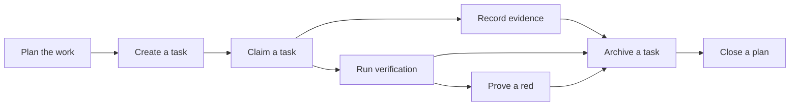

## Execution

Execution is how approved work actually gets done and proven done: a plan breaks a governing spec into phases and tasks, one actor at a time takes a task, records what it ran and what came out, a trusted runner re-runs the spec's checks to attest results, and a task is archived only when its evidence clears the archival conditions. A plan is closed when it meets the closure conditions; closing does not wait for every task to finish. An open task nobody has freshly claimed is archived with it only if it meets the archival conditions; otherwise it stays open and is listed as skipped with the condition that refused it, and the archive sweep applies the same check to a closed plan's leftover tasks (BR-1072, `spec-approval-and-plan-closure-go-through-the-same-checks-on` D5-D8).

Excavated for baseline pilot v3 (2026-10-08) by two read-only agents from the product as built at main ad8c8e3f; every rule was checked against code, and a rule is held at established or observed only when a live check-decided criterion would fail if the rule were false (method v2, `adr-an-acceptance-criterion-is-placed-by-the-business-outcome`). Rules without such a criterion are unconfirmed and carry an open question in their leaf.

### Boundary

**Inside**
- Creating a plan under a spec, its phases, and the conditions for approving a plan
- Which tasks are ready to work on (computed, never hand-marked)
- Creating a task, declaring which acceptance criteria it claims, reserving files for it
- Claiming a task, the claim's lease, taking over a stale claim, releasing a claim
- Recording evidence on a task, including evidence the tool ran and captured itself
- The trusted verification run: which criteria it runs, approval of new commands, attested pass and fail
- Proving a check can fail by running a falsifier (the attested red)
- Archiving a task and the evidence conditions it must meet
- Closing a plan and the conditions that closure checks

**Outside**
- Declaring criteria, their verification mode and their falsifiers: **specification**. Execution runs what specification declared.
- Review judgment and approval mechanics in general: **review**. Execution only owns the plan-specific admission conditions and the task's archival walk.
- Sessions, seats and handoffs: **session**. A claim names an actor and a working copy; who that actor is across sessions is session's.
- Health, drift and stale-claim sweeps: **hygiene**.
- What an agent is shown about a task when it starts (feeds, bundles): **context**.
- Phase documents, a separate document type claimed, evidenced and archived through the same commands by a separate phase workflow: **no branch describes them yet** (Q1). The phases inside this branch are only named groupings on a plan.

### Children

| Node | What it does | Kind | Rule prefix |
|---|---|---|---|
| Plan the work | Break a spec into a plan with phases; approve the plan; see what is ready | leaf | PLAN |
| Create a task | Open a task under a plan and declare its criteria scope and files | leaf | TASK |
| Claim a task | Take a task so one actor works on it; release it | leaf | CLAM |
| Record evidence | Record what was run on a task and what came out | leaf | EVID |
| Run verification | Have the trusted runner run the task's criteria and attest results | leaf | VRFY |
| Prove a red | Run a criterion's falsifier and attest that its check fails | leaf | PRRD |
| Archive a task | Walk a finished task to archived once its evidence qualifies | leaf | ARCT |
| Close a plan | Archive a plan once its work and evidence meet the closure conditions | leaf | PCLS |

### How they fit together

### Ubiquitous language

The terms are defined in this branch's glossary. The ones most often confused:

- **Release** (drops the claim only; the task stays in the ready set) versus **archive** (walks the task to archived; only then does it leave the ready set).
- **Self-reported evidence** (the caller states the result) versus **captured evidence** (the tool ran the command and observed the exit code) versus **runner-attested evidence** (the trusted runner ran a declared criterion's own command). Captured and runner-attested rows both carry an attestation today; only the runner's is tied to a declared criterion.
- **Attested red** (a falsifier run whose check failed with the declared code) versus a **self-reported red** (an expected-fail row the caller recorded).
- **Waiver** (given when archiving one task; lifts only that task's attested-pass requirement) versus **attestation exemption** (declared on a plan with a kind and a reason; lets the plan close without runner-attested evidence).
- **File anchor** (a task reserving files against concurrent claims) versus **code anchor** (a spec bound to implementing code, owned by specification).

### Open questions

| # | Question | Kind | Owner |
|---|---|---|---|
| Q1 | Phase documents are claimed, given evidence and archived through the same commands as tasks, handed to a separate phase workflow with its own claim check, but no branch describes that workflow. Should they become a leaf of this branch, or a branch of their own? | undecided | product |
