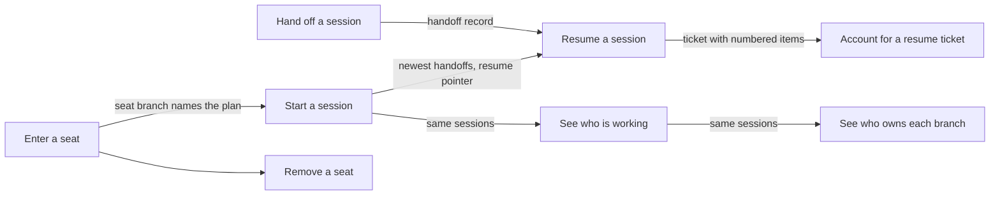

## Session

A session is one run of an agent or a person on the corpus. This branch covers how a session finds out where things stand when it opens, how it leaves a handoff for the next session, how the next session resumes from that handoff and is held to account for it, how a session takes a plan-bound seat, and how any session sees who else is working and who owns which branch.

Written for the baseline session-branch migration on 2026-10-09, against the product as built at the commit that landed the claim-scoped corpus authoring slice. Every rule was checked against the code; the suspected defects were also reproduced on a throwaway corpus and repository. A rule is held at established only when a live check-decided acceptance criterion names a test that would fail if the rule were false; a rule whose behaviour is measured in code (file and line recorded) but that no criterion yet cites to confirm it is held at observed (BR-623); every other rule is undecided or unconfirmed with its question written down.

### Boundary

**Inside**
- The session start snapshot and its compact injection (what it shows, what it leaves out, the seat-scoped resume pointer), and the seat briefing a session in a linked working copy receives at start
- Writing a handoff, and the rule that only the handoff command may create one
- Resuming from a handoff: which handoff is chosen, what the ticket shows, the closing statements
- The accounting duty: when it arises, what accounts for an item, what the stop check answers
- Taking, returning to, listing and removing a plan seat, and guarding the removal of any worktree against someone still working in it
- Listing sessions with their liveness, and the territory of worktrees and branches

**Outside**
- Claiming, releasing and archiving tasks, the claim time limit and anchor conflicts between claims: **execution** (leaf "Claim a task"). This branch only reads claims.
- Automatic approval of ledger records such as handoffs, and the switch that turns it off: **autonomy**. The other checkpoints of the feed command (the rule slices fed before producing a document) are also autonomy's; only the session-resume checkpoint is here.
- Archiving superseded or expired handoffs (the archive sweep) and invalidating documents: **hygiene**.
- Generic document creation, reading, identifier resolution and the foreign-corpus write guard: **corpus**. The handoff's exemption from that guard is held here because it is a property of handoffs.
- The memory-file health line shown in the snapshot: **context**. The seat briefing a session in a linked working copy receives at start is held here, on "Start a session" (BR-1019, moved from context on 2026-10-10).
- The review queue itself (what waits for review): **review**, leaf "List documents awaiting review". The snapshot's own waiting count is held here because it differs from that queue (suspected defect).
- Installing the session-start and stop hooks that call these commands: **distribution**.

### Children

| Node | What it does | Kind | Rule prefix |
|---|---|---|---|
| Start a session | See where the corpus stands when a session opens, and receive the seat briefing in a linked working copy | leaf | SNBT |
| Hand off a session | Leave a handoff for the next session | leaf | SNHO |
| Resume a session | Pick up the newest handoff as a resume ticket | leaf | SNRS |
| Account for a resume ticket | Be held to account for every item of a handed ticket before stopping | leaf | SNAC |
| Enter a seat | Take, or return to, a plan-bound worktree | leaf | SNSE |
| Remove a seat | Remove a seat's worktree, guard any worktree's removal by who is inside, and list the seats | leaf | SNSR |
| See who is working | List sessions at work with their liveness | leaf | SNWH |
| See who owns each branch | Sort every worktree and branch by who holds it | leaf | SNTR |

Split and merge decisions:

- Writing a handoff and resuming from it are separate leaves: different actors (the outgoing and the incoming session), different commands, and one writes while the other only reads.
- The accounting duty is its own leaf, not part of resuming. It is checked by a different subcommand at a different moment (when the session tries to stop), it reads no corpus, and its rules are about what a session writes back, not about what it is shown.
- Seats are split into entering (taking and returning) and removing. Taking a seat is gated by the main checkout and the plan's conflicts; removing is gated by whether the work is merged and, for any worktree, by whether someone is still working in it. Listing seats is folded into removing because the one fact it adds, whether a seat is merged, is the fact removal is decided on.
- Listing sessions and the territory are separate leaves although both read the same sessions: one answers "is that session still running", the other "may I touch that branch", and they fail in different ways.
- The snapshot's compact injection is folded into "Start a session"; it is a view of the same snapshot, not a separate action.

### How they fit together

### Ubiquitous language

The terms are defined in this branch's glossary. The ones most often confused:

- **Stale** (a claim is old) versus **dead** (its process is gone). A stale session can be alive; a fresh one can be dead.
- **Unmeasured** (the owner cannot be compared) versus **unowned** (nobody claims it). Only unowned is safe to act on.
- **Session start snapshot** (corpus-wide state) versus **resume ticket** (one thread the user chose). The snapshot never tells a session which thread to resume.
- **Handoff** (the record) versus **resume ticket** (the record as printed for resumption).

### Cross-cutting notes

**Nothing here is a worklist.** Every field of the snapshot except the caller's own claims spans every plan, actor and session. The resume pointer is left out of the automatic injection so the user, not the product, chooses which thread a session picks up.

**Reading is free; only two things write.** The snapshot, resuming, the session list and the territory write no document, version or audit entry. Writing a handoff creates one document. Listing or showing sessions writes a heartbeat file on the local machine, outside the corpus. Seats change git state only.

**The verdict of the stop check travels in what it prints, never in its exit status.** It always exits 0.

**Known suspected defects held here as unconfirmed rules:** the snapshot's waiting count counts every draft, 271 against 75 in the review queue on this repository (BR-330); archived tasks stay among the caller's claims and are counted as claimed (BR-331); resuming hands out archived or invalidated handoffs (BR-354); a seat can be taken for a document that is not a plan (BR-370); removing a seat keeps its branch (BR-376); a running session reads as dead to its peers (BR-386); a failed branch listing silently drops branches from the territory (BR-398).
