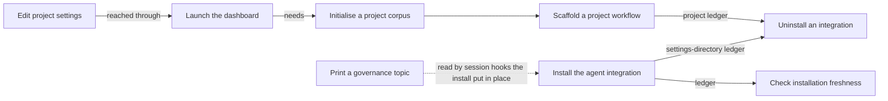

## Distribution

Distribution is how the product gets into a machine and into a project, how a person starts its local interfaces, and how a person adjusts the project's settings from them: initialising a project corpus, installing the agent integration into the AI tool's settings directory, scaffolding a project's governed workflow, uninstalling either of them, checking that what is installed matches what the program ships, printing the shipped governance texts, launching the dashboard, and reading and saving the project's and the machine's settings from the dashboard.

Written for the baseline distribution-branch migration (method v2, fast mode) on 2026-10-09, against the product at commit a248efe0. Every rule was read against the code (file and line kept in the build data). A rule is established only when a live script-mode criterion of an approved spec names a test that fails if the rule is false, including the exit code the rule states; a rule whose behaviour is measured in code (file and line recorded) but that no criterion yet cites may be held at observed (BR-623); this branch's leaves keep such rules at unconfirmed with the measurement written in their question, which is equally valid; every other rule is unconfirmed or undecided with its question written down.

### Boundary

**Inside**
- Creating an empty project corpus (initialise)
- Installing, previewing, re-converging and uninstalling the agent integration in an agent settings directory
- Scaffolding and un-scaffolding a project's governed workflow files, and the install ledgers both of these keep
- The freshness check of an installed integration, including the exit code it reports for the defect channel probe
- Printing a governance topic exactly as shipped with the running program
- Launching the dashboard: packaged or development topology, sign-in link, local address, stop
- Reading and saving the project's and the machine's settings files from the dashboard: which settings are read-only there, when a save is refused, and which saved settings apply at once versus after a restart

**Outside**
- What the rules files, project instructions sections and language settings say, and when an agent sees them: **context**. This branch only records that setting up a project triggers that refresh and that its failure fails the run.
- What the governance texts say and how session-start hooks use them: **context** and **session**. This branch owns only that the text printed is the text shipped.
- Everything the dashboard's web routes do once a browser is signed in (reading, creating, editing, linking, approving, plan progress), except the settings page, which is this branch's "Edit project settings" leaf: the branch of each object (**corpus**, **review**, **execution**, **specification**, **autonomy**). The dashboard is a surface, not a branch.
- Request authentication of the shared web service behind both the dashboard and the standalone server, including which callers may save settings: **sync**.
- What each individual setting means and which command reads it: the branch that owns that command. This branch owns only reading and saving the values from the dashboard.
- The defect-report channel itself (how a report is filed, which tracker receives it): **issue-loop**. This branch owns only how the freshness check folds the channel probe into its exit code.
- Sharing a corpus across machines: **sync**.

### Children

| Node | What it does | Kind | Rule prefix |
|---|---|---|---|
| Initialise a project corpus | Create an empty corpus in the current directory | leaf | DSIN |
| Install the agent integration | Put the shipped integration into an agent settings directory, or preview it | leaf | DSIS |
| Scaffold a project workflow | Put the governed-workflow files into the current project | leaf | DSPJ |
| Uninstall an integration | Reverse an install or a scaffold through its ledger | leaf | DSUN |
| Check installation freshness | Compare an installed integration with the shipped assets, read-only | leaf | DSCK |
| Print a governance topic | Print one shipped governance text verbatim | leaf | DSGV |
| Launch the dashboard | Start the local web interface and sign the browser in | leaf | DSDB |
| Edit project settings | Read and save the project's or the machine's settings from the dashboard | leaf | SETS |

Split and merge decisions:

- Installing and scaffolding are separate leaves although one command does both. They target different places (the user's agent settings directory versus the project), keep separate ledgers, and differ in failure policy: an install stops at the first failed write, a scaffold attempts every step and reports each.
- Uninstalling is one leaf for both targets. The two reversals follow the same contract (ledger only, restore or remove, ledger deleted last, refuse when no ledger) and differ only in place.
- The preview of an install is folded into "Install the agent integration": it is a mode of the same action that writes nothing, with one rule.
- The freshness check is its own leaf: it is the only mode that changes nothing but a cache, and it has its own exit-code contract (0 in sync, 3 stale).
- Printing a governance topic is a leaf here, not in context, because its only promise is version identity with the shipped program; the content is context's.
- The dashboard is one leaf. Packaged and development modes are two topologies of one action (launch); their few differences are rules of the leaf.
- Editing project settings is its own leaf, here rather than in the branch of each setting. No other branch owns the settings files as a whole: initialising a project creates the project's settings file, and the dashboard that edits it is launched here. Its promise is about the file (read-only settings, refused saves leave it unchanged, the applies-now versus needs-restart split), not about what any one setting means. Its rule prefix is SETS rather than a DS prefix because the leaf was written from the product requirements for settings before it was placed in this branch, and rule ids are never reissued.

### How they fit together

### Ubiquitous language

The terms are in this branch's glossary. The ones most often confused:

- **Install** (agent settings directory, the user's machine) versus **scaffold** (the project). The same command does both depending on how it is asked.
- **Diverged** (the user changed a managed file) versus **outdated** (the program now ships something newer). An install overwrites outdated files and leaves diverged ones alone unless told otherwise.
- **Install ledger** (what the product wrote) versus **backup run** (copies of what was there before).
- **Packaged dashboard** (one process, built interface) versus **development mode** (two processes, live interface server).

### Cross-cutting notes

**Nothing here writes to the corpus's documents.** No command of this branch creates, edits or audits a document; initialising creates an empty corpus. Their observable results are files on disk (including the settings files a settings save rewrites), exit codes and printed receipts.

**Every ledger-keeping mode asks first.** Installing, scaffolding and both uninstalls ask for confirmation when run interactively; a non-interactive run must say yes explicitly or it is refused (BR-811). Initialising and saving settings from the dashboard do not ask: initialising creates only an empty corpus, and a settings save is itself the person's explicit action on the page, guarded by its own refusals (BR-988).

**Ledgers are the only source of truth for reversal and checking.** What is not in a ledger is never removed or checked, which is why the rules files the project setup writes through the context refresh are left behind by uninstall (suspected defect, BR-845).

**Known suspected defects held here as unconfirmed rules:** a failed initialise leaves a half-made corpus that blocks the retry (BR-810); the overwrite-diverged option is silently ignored outside install (BR-819); the freshness check treats an unreadable ledger as absent (BR-848) and probes the vendor's tracker even for a self-hosted channel (BR-850); setting up a project replaces an existing git hooks setting and uninstall does not restore it (BR-837); a corrupt project ledger is treated as absent while a corrupt install ledger is refused (BR-838); a governance text that cannot be read reports an input error (BR-857); the dashboard reuses a cached key without checking it still exists (BR-867), drops an unreadable machine settings file silently (BR-868) and may crash where no browser opener exists (BR-870).
