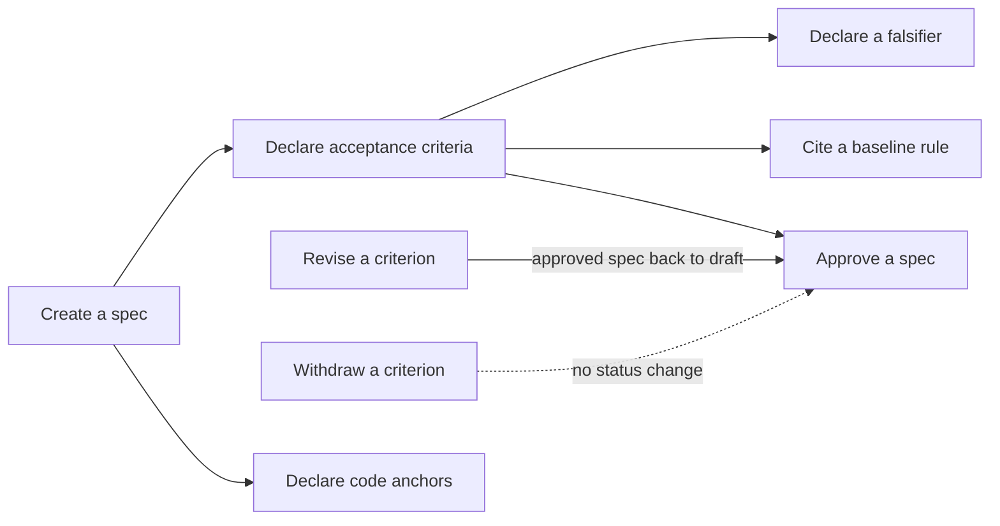

## Specification and Acceptance

A spec is the written contract for one piece of work on the product: what will be built and how "done" will be decided. This branch covers making that contract: creating a spec, giving it acceptance criteria, stating how a criterion could be proved wrong, binding the spec to the code that implements it, citing the baseline rules a criterion helps to prove, and the spec-specific conditions a spec must meet before it may be approved.

### Boundary

**Inside**
- Creating a spec and the conditions a new spec must meet, including that a spec has no parent document (BR-1, BR-2)
- Declaring, revising and withdrawing a spec's acceptance criteria
- Declaring a falsifier for an acceptance criterion
- Binding a spec to the code that implements it (code anchors)
- Citing baseline rules from an acceptance criterion
- The spec-specific conditions an approval has to meet (minimum number of criteria, measurable wording, coverage by the kinds of check the project requires)
- The two limits on editing a spec directly, held on the leaf "Approve a spec" because they keep what approval judged meaningful: the kind values a spec may carry (BR-246), and that a direct edit can never add, drop, reword or reorder criteria (BR-247)
- Which of the above take an approved spec back to draft

**Outside**
- Generic document creation, revision, linking and invalidation: **corpus**. Revising a spec's body or title is a corpus revision, and corpus owns the rule that revision takes an approved document back to draft. Only the spec-specific limits on such an edit (BR-246, BR-247) are held here.
- Review judgment, approval and rejection mechanics, lifecycle transitions in general: **review**. This branch only adds the spec-specific admission conditions on top.
- Baseline nodes, rules, rule lifecycle and computed rule state: **product-baseline**. This branch only owns the act of citing a rule from a criterion.
- Running a criterion's check, recording evidence, the attested pass and the attested red produced by running a falsifier: **execution**.
- Detecting that a code anchor no longer matches the code (drift): **hygiene**.

### Children

| Node | What it does | Kind | Rule prefix |
|---|---|---|---|
| Create a spec | Open a new spec with no parent document; it joins the product trees only through its criteria's citations | leaf | SPCR |
| Declare an acceptance criterion | Add one criterion that decides "done" for the spec | leaf | ACDC |
| Revise an acceptance criterion | Change an existing criterion in place, keeping its id | leaf | ACRV |
| Withdraw an acceptance criterion | Remove a criterion from the spec | leaf | ACWD |
| Declare a falsifier | State the change to the code that must make a criterion's check fail | leaf | FALS |
| Declare a code anchor | Bind the spec to a file, folder or exported name in the code | leaf | ANCH |
| Approve a spec | Admit a spec as the governing contract for its work | leaf | SPAP |
| Cite a baseline rule | Say which baseline rule a criterion helps to prove | leaf | CITE |

Split and merge decisions:

- "Declare AC" is split into three leaves (declare, revise, withdraw). As one leaf its sentence needs "add, change or remove", and the three produce different effects on an approved spec: adding and removing leave it approved, revising takes it back to draft. Merging would hide exactly the asymmetry readers get wrong.
- "Declare a falsifier" is its own leaf although today it is never a separate action: a falsifier is only supplied while declaring or revising a criterion. It has its own event and its own rules.
- Removing a code anchor is folded into "Declare a code anchor". It has two rules, too few for a leaf.
- "Approve a spec" holds the spec-specific refusals, because a gate belongs inside the leaf it constrains. It overlaps the review branch's generic approval leaf (open question in that leaf).
- "Cite a baseline rule" is its own leaf. Citation is an action introduced by the baseline work, with its own constraint set (the citation gate and its exemptions) and its own event.

### How they fit together

### Ubiquitous language

The terms are defined in this branch's glossary. The ones most often confused:

- **Acceptance criterion** (per spec, verifies work) versus **business rule** (baseline, describes the business and outlives any spec).
- **Requirement reference** (an item in the requirements document a criterion says it covers) versus **citation** (a baseline rule a criterion says it helps prove). They are different numbering systems and neither is checked against the other.
- **Falsifier** (the declared change that must break a check) versus **attested red** (the recorded result of running it, owned by execution).
- **Code anchor** (binds a spec to implementing code) versus a task's file anchor (reserves files for concurrent work, owned by execution).

### Cross-cutting notes

**Read-only queries owned here (not leaves).** None has rules of its own; each is governed by the rules of the leaf that produced the data.
- List a spec's criteria, in declaration order. When work exists under the spec it also shows each criterion's coverage and its dangling evidence references (evidence pointing at criterion ids no longer declared). Before any plan exists, coverage is "nothing to measure against", distinct from zero coverage. Evidence recorded under an earlier version of a check command is reported separately from evidence under the current one.
- List a spec's code anchors.
- Pending missing-test declarations: a project-wide count and list, recomputed from the project's files every time it is asked.
- Pre-flight check: "would this candidate spec pass creation or approval?" without writing anything.
- The drift report over code anchors belongs to hygiene.

**Every refusal here holds on every route that can perform the action**, unless the rule says otherwise. The deliberate exceptions are the missing-test declaration check and the open questions listed on the declare and approve leaves.

**A project may switch off a gate.** The spec-creation check, the spec-approval check, and the approval check's wording part and check-kind-coverage part can each be switched off in a project's settings. Each action that passes while a gate is switched off is recorded as "gate skipped". A personal bypass switch exists only for the stand-alone pre-flight check and never lets a real write through.

**Concurrent edits to one spec's criteria are arbitrated against the version the writer read.** The writer whose starting version is no longer current is refused, not merged. No criterion is silently lost.

**Every change to criteria or anchors leaves a version entry** in the spec's history, whether or not it changes the spec's status.

**Every added or revised criterion passes through the citation gate.** In this repository the gate enforces on all twelve branches (read 2026-10-10). On an enforced branch a criterion that cites no live rule is refused, unless it cites nothing and holds an unexpired exemption (BR-959); a citation of a missing, deprecated or retired rule is refused whatever exemption it holds. Where the gate only reports or is off, such citations are stored with a warning and counted. The leaf "Cite a baseline rule" holds the gate's rules, modes, arming and exemptions.

**A spec has no parent; it belongs through citations.** A spec is created without a parent document and is never filed under one: it belongs to the product trees only through its criteria's citations of business rules (BR-n) and architecture standard rules (AS-n), many to many (BR-1, BR-2; architecture standard AS-18). Creating a spec with a parent, or filing it under a document by a parent link, is refused with outcome code 4 and nothing is written (BR-2); that refusal comes from the shape of the request, before the creation check runs (BR-7). Every other document type keeps its parent rules (BR-701), a spec read shows no parent chain and no siblings (BR-718), and imported specs are created with no parent (BR-789). Every structural view of specs (which leaf or standard a spec serves, coverage) is computed from citations, never from a parent. This replaces ADR-041's earlier wording that a spec hangs under the leaf it implements (owner decision D5; closed as Q1 on "Create a spec"). It is the target contract and not yet built: the code still requires the requirements document as a spec's parent (AS-18 current reality, recorded as architecture debt AD-5), so BR-1 and BR-2 are held at unconfirmed on "Create a spec" until slice 3b's criterion AC-BLS3B-1 lands with a runner-recorded pass.

**Acceptance format.** There are no feature files. Acceptance is expressed as spec acceptance criteria that cite these rules.
