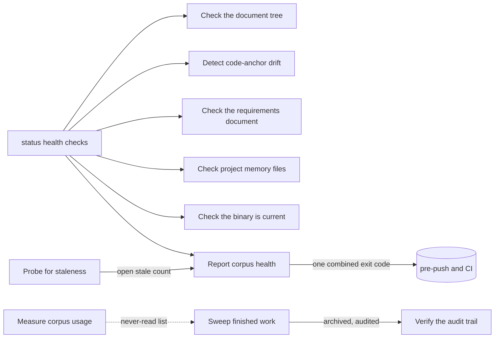

## Hygiene

Hygiene is how the corpus and the project around it are kept honest over time. Nothing here creates or changes the meaning of a document. This branch reports what has gone wrong (structure, links to code, requirement coverage, sizes, memory files, the program's own build, open defect reports, the baseline tree), sweeps finished work into the archive, asks an AI whether old knowledge still holds, verifies the audit trail, and measures how the corpus is used.

Written for the baseline hygiene-branch migration (fast mode) on 2026-10-09, against the product as built at commit a248efe0. Every rule was read against the code; a few were also run on a throwaway corpus. A rule is established only when a live check-decided acceptance criterion would fail if the rule were false; a rule whose behaviour is measured in code (file and line recorded) but that no criterion yet cites to confirm it is held at observed (BR-623); every other rule is unconfirmed or undecided with its question written down.

### Boundary

**Inside**
- The health checks of the status command: tree layout (and its repair), code-anchor drift, requirement coverage and size budgets, memory files, the program's build, open defect reports, baseline-tree integrity, and the plain health report with its member lists
- Sweeping finished handoffs and leftover tasks into the archive
- Probing knowledge documents and decision records for staleness, and listing the open stale candidates
- Querying and verifying the audit trail, and anchoring its chain
- Measuring how the corpus is used (reads, searches, gate refusals)

**Outside**
- Declaring and removing code anchors: **specification** (leaf "Declare a code anchor"). This branch only detects drift.
- Judging, approving and rejecting documents, and the review queue: **review**. The staleness probe shares the review command but is a different mode with its own judgment kind.
- Archiving a task on purpose, and the automatic archiving of a plan's tasks and handoffs when the plan closes: **execution**. The sweep here only collects what those left behind.
- Invalidating a stale document: **corpus**. The probe only prints the command.
- Filing, resolving and closing defect reports: **issue-loop**. This branch only reports reports left open too long or never closed.
- Baseline nodes, rules, glossary and site coverage: **product-baseline**. This branch only reports integrity findings on that tree.
- Writing memory files and their budget settings, and installing the pre-push hook that runs these checks: **context** and **distribution**.
- Automatic approval of ledger records (another mode of the review command) and calibration statistics: **autonomy**.

### Children

| Node | What it does | Kind | Rule prefix |
|---|---|---|---|
| Check the document tree | Compare the tree with the declared layout, and optionally repair it | leaf | HTRE |
| Detect code-anchor drift | Find code anchors that no longer match the code | leaf | HDRF |
| Check the requirements document | Find uncovered P0 requirements and size-budget breaches | leaf | HREQ |
| Check project memory files | Find memory files over their limits or carrying broken pointers | leaf | HMEM |
| Check the binary is current | Tell whether the running program was built from this checkout's HEAD | leaf | HBIN |
| Report corpus health | Combine the checks into one result, report open defect reports and baseline integrity, list the members behind each count | leaf | HHLT |
| Sweep finished work into the archive | List or archive finished handoffs and leftover tasks | leaf | HARC |
| Probe documents for staleness | Ask an AI whether old knowledge still holds, and list the open stale candidates | leaf | HSTL |
| Query the audit trail | Read who did what to which document | leaf | HAUQ |
| Verify the audit trail | Check the trail is complete and untampered, and pin its head | leaf | HAUV |
| Measure corpus usage | Count reads, searches and gate refusals over a time window | leaf | HUSE |

Split and merge decisions:

- The status command is split into six leaves by what is checked, not by flag. Each check has its own subject, its own findings and its own question an owner would decide; as one leaf its sentence would need "and" six times.
- Requirement coverage and the requirements-document size budget are one leaf: both are findings about the same document type, asked for by the same reader, and each has too few rules alone.
- The two memory-file checks (limits and corpus pointers) are one leaf: they share the files, the adoption mode and the advisories; they differ only in whether the corpus is read.
- The tree repair is folded into "Check the document tree": it is the same comparison followed by a move, and it never runs on its own.
- Open defect reports and baseline integrity are folded into "Report corpus health" with the combining rules: each is one or two rules, and their subject belongs to another branch.
- The audit trail is split into query and verify: a query is a read anyone does for a document; verification is a tamper and completeness check with its own result and its own pinned anchor. Anchoring is folded into verification because it exists only to be checked against.
- Usage measurement is its own leaf although it is report-only: its window, its member lists and its silence about bad input are its own.

### How they fit together

### Ubiquitous language

The terms are defined in this branch's glossary. The ones most often confused:

- **Finding** (fails the check) versus **advisory note** (never changes the result). A memory-file finding becomes an advisory note in warn adoption mode.
- **Stale candidate** (an AI flag that stays open) versus **invalidated** (a decision someone recorded). The probe never invalidates.
- **Leftover task** (swept here) versus a task archived on purpose (execution) or by its plan closing (execution).
- **Anchor drift** (detected here) versus declaring an anchor (specification).

### Cross-cutting notes

**Health checks are reports.** Each check writes nothing, except the tree repair. A finding fails the run with exit code 3; a broken input a check needs (an unreadable tree layout, an unknown member list name) gives exit code 4; a storage failure gives 1.

**Checks compose.** Asking for several checks that read the corpus runs all of them and prints every section; any finding gives 3. Three checks stand alone and win over the others when combined: the build check first, then the member lists, then the memory-file limits check (which never opens the corpus).

**The plain report never fails.** Without a check named, the status command prints counts and exits 0 whatever they say.

**Times given as text are not checked.** A time window given in a form the product cannot read is used as-is, so the result is silently empty (suspected defect, observed on the audit query and the usage report).

**Known suspected defects held here as unconfirmed rules:** the tree repair raises a document's version without a history entry; the tree repair passes with an open-plan finding left; the repair flag alone is ignored; drift skips anchors it cannot read without a finding; a requirements document whose list cannot be read passes; the leftover-task rule reads the parent instead of plan membership; the sweep and the tree repair write without the foreign-corpus guard other writes use; the sweep exits 0 when every archive failed; staleness probes archived and deprecated documents; unreadable time windows are silently empty; a defect report on a deprecated task is flagged forever.
