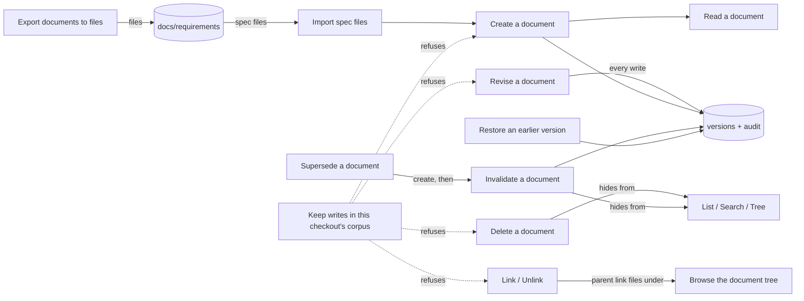

## Corpus

The corpus branch is the generic life of a document: creating it, reading it, finding it, changing it, linking it, retracting it, deleting it, looking at its history and restoring an earlier version, and moving documents between the corpus and files on disk. Every other branch builds on these actions; when a type adds its own conditions (a spec's admission, a task's plan, a plan's close) those conditions live in that type's leaf, and this branch only holds the rules that apply to every document.

Written for the baseline corpus-branch migration on 2026-10-09 (fast mode), against the product as built at the commit that landed the claim-scoped corpus authoring slice. Every rule was checked against the code, and most behaviour that a rule calls an outcome was also observed on a throwaway corpus. A rule is held at established only when a live check-decided acceptance criterion would fail if the rule were false; a rule whose behaviour is measured in code (file and line recorded) but that no criterion yet cites to confirm it is held at observed (BR-623); every other rule is unconfirmed or undecided with its question written down.

### Boundary

**Inside**
- Creating a document of any type: the request shape, the filing rules every type shares, the name it gets, what is recorded
- Superseding a knowledge record or decision record by a new one in one request
- Reading a document and resolving every kind of reference to it (shared by all actions of all branches)
- Revising a document's title, body, priority, tags, name and details, and what a revision does to an approved document
- Accepting a proposed decision record
- Deleting a document
- Listing, searching and browsing the tree of documents
- Adding and removing links between documents
- Reading a document's history and comparing two versions; restoring an earlier version
- Invalidating a document and undoing it
- Exporting documents to files, importing spec files, importing a version-1 corpus, and the in-place upgrades of stored documents
- Refusing writes that would land in another checkout's corpus without declared intent

**Outside**
- Status moves among draft, in review and approved, and what approval requires: **review** (leaves "Submit a document for review", "Approve a document"). The status map itself is written there (BR-307).
- Spec-specific creation and approval conditions, criteria, citations, code anchors: **specification**.
- Task, plan and phase specifics, claims, evidence, readiness, plan close and the phase upgrades: **execution**.
- Baseline nodes, rules, glossary, site maps and the requirements outline: **product-baseline**.
- Automatic approval of ledger records (also on revision): **autonomy**.
- Handoffs and session state: **session**. Staleness probing and the calibration an invalidation records after one: **hygiene**.
- The resolves link and issue documents: **issue-loop**.
- The governing-skill provenance link written after a creation, and feeding packs: **context**.
- Replicating the corpus to other machines: **sync**. Installing the product: **distribution**.

### Children

| Node | What it does | Kind | Rule prefix |
|---|---|---|---|
| Create a document | Add a new document of any type | leaf | DCCR |
| Supersede a document | Replace a knowledge record or decision record by a new one in one request | leaf | DCSU |
| Read a document | Show one document, named in any accepted way | leaf | DCRD |
| Revise a document | Change a document's title, body, priority, tags, name or details | leaf | DCRV |
| Accept a decision record | Mark a proposed decision as accepted | leaf | DCAD |
| Delete a document | Hide a document from every list | leaf | DCDL |
| List documents | See the documents that match some filters | leaf | DCLS |
| Search documents | Find documents by the words they contain | leaf | DCSR |
| Browse the document tree | See documents under their parents | leaf | DCTR |
| Link two documents | Record a typed relation from one document to another | leaf | DCLK |
| Unlink two documents | Remove the relations from one document to another | leaf | DCUL |
| Read a document's history | See the versions of a document and compare two | leaf | DCHS |
| Restore an earlier version | Bring back the content of an earlier version | leaf | DCRS |
| Invalidate a document | Retract a document from a moment on, or undo that | leaf | DCIV |
| Export documents to files | Write one Markdown file per document | leaf | DCEX |
| Import spec files | Create specs in the corpus from Markdown files | leaf | DCIM |
| Import a version-1 corpus | Bring in the predecessor's documents once | leaf | DCMG |
| Upgrade the corpus in place | Bring stored documents to the current shape | leaf | DCUP |
| Keep writes in this checkout's corpus | Refuse a write that crosses into another checkout's corpus | leaf | DCFW |

Split and merge decisions:

- Create and Supersede are separate leaves although both are the create command. Supersede is a different result for the user (an old document is retracted) and has its own failure mode (the new document is kept when the retraction fails).
- Revise and Accept a decision record are separate leaves although both are the edit command. Accepting is a decision with its own value rules and its own idempotence; it is not a free-form edit.
- Status changes done with the edit command are not here: they are review's (and plan close is execution's). Revise only says what a content change does to an approved document.
- Reading and resolving a reference are one leaf. Resolving is how every action of every branch finds its document; it has no command of its own, so it lives with the plainest reader. Other leaves map its sites as owned by "Read a document".
- History and comparison are one leaf (log and diff): both are read-only views of the same versions. Restore is separate because it writes.
- List, search and tree are three leaves: each has its own visibility rule (list and search hide invalidated documents, the tree does not) and its own refusals.
- Link and unlink are two leaves: unlink has its own suspected defects (it does not undo a parent) and its own no-op behaviour.
- Undoing an invalidation is folded into "Invalidate a document": it is a flag of the same action and has one rule (BR-780).
- Export, spec import, version-1 import and the in-place upgrades are four leaves: different direction, different source, different refusals.
- The foreign-corpus refusal is a leaf of its own. It applies to five commands of this branch and three of execution; every one of them maps its sites to this leaf. It declares one command (unlink) so that coverage measures it.

### How they fit together

### Ubiquitous language

The terms are defined in this branch's glossary. The ones most often confused:

- **Name** (the address, changed only by a rename) versus **title** (free text, changed by revision). Revising the title never renames.
- **Recorded author** ('system' on every route but the browser session) versus **acting identity** (kept only in the audit trail). The author filter of the list reads the first.
- **Deletion** (hidden everywhere, no way back) versus **invalidation** (hidden from lists and search by default, readable, reversible).
- **Parent** (one, recorded on the document) versus **parent link** (an entry in the links). Today they can disagree: removing the link leaves the parent.

### Cross-cutting notes

**Every accepted write leaves a version and an audit entry**, except a link or an unlink, which leave only an audit entry, and the version-1 import, which leaves no audit entry. Read-only actions write nothing.

**Every action names its document the same way**: permanent id, unique id prefix, name, or number ("Read a document"). An unknown reference is exit code 3, an ambiguous prefix exit code 4.

**Deleted documents are hidden but not gone.** Naming one directly still reads it, edits it and invalidates it; no action brings it back. These are held as suspected defects in their leaves.

**The command line exit codes** used by this branch: 0 success, 1 storage or file failure, 2 usage error (missing or unknown option value), 3 not found, 4 refused, 5 out of date, 6 AI failure.

**Known suspected defects held here as unconfirmed rules:** deleted documents stay readable and editable (BR-717, BR-731, BR-782); deleting twice is a storage error (BR-742); no recovery after deletion (BR-741); an edit that changes nothing still writes a version (BR-723); an empty title is accepted on edit (BR-726); the author filter finds nothing (BR-747); unknown list filters are silently empty (BR-748); a second parent link keeps the first (BR-759); loose links to self and to deleted documents (BR-761); unlink does not undo a parent (BR-765) and reports a no-op as a removal (BR-764); restore reopens closed documents (BR-772), names the wrong actor (BR-773) and bypasses the criterion actions (BR-774); a missing import folder is treated as empty (BR-792); the version-1 import skips the audit trail (BR-796); four write actions are not covered by the foreign-corpus refusal (BR-806).
