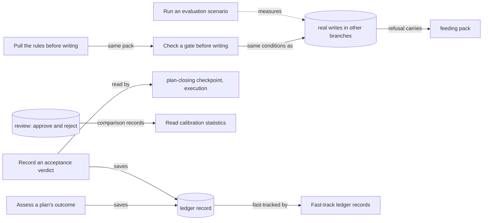

## Autonomy

Autonomy is what lets the work advance without a person in the loop: the product judges finished plans by itself, measures how far its own AI judgment can be trusted, records the result of acceptance runs, checks its own health, enforces deterministic checkpoints on every write, hands an agent the rules before it writes, and keeps records of events from piling up in the review queue.

Written for the baseline autonomy-branch migration on 2026-10-09, against the product as built at the commit that landed the claim-scoped corpus authoring slice. Every rule was checked against the code, and most refusals and exit codes were also observed in a throwaway corpus. A rule is held at established only when a live check-decided acceptance criterion would fail if the rule were false; a rule whose behaviour is measured in code (file and line recorded) but that no criterion yet cites to confirm it is held at observed (BR-623); every other rule is unconfirmed or undecided with its question written down.

### Boundary

**Inside**
- Assessing a plan's outcome with an AI judge, and what an assessment records
- Reading calibration statistics (human decisions compared with AI judgments)
- Recording and reading a plan's acceptance verdict, and what counts as must-have accepted
- Running the evaluation scenarios
- The general mechanics of every checkpoint: on and off settings, the bypass variable, pre-flight checks, feeding packs, rule source, refusal shape, the skip and pass audit entries
- Feeding: the governing rules of any checkpoint, the task-start pack and the phase-start pack
- The ledger fast-track at creation and edit time, and the backfill sweep

**Outside**
- Each checkpoint's own conditions: spec creation and approval (**specification**, leaves "Create a spec" and "Approve a spec"); plan approval, task creation, claims and plan closing (**execution**, leaves "Plan the work", "Create a task", "Claim a task", "Close a plan"); the review-judgment checkpoint (**review**, "Approve a document"). Closing a plan reads the acceptance verdict defined here.
- Writing the human-versus-AI comparison records: **review** (approve and reject). This branch only reads them.
- Judging a single document and the review queue that hides ledger records: **review**.
- The session-resume feed and writing handoffs: **session**. Handoffs are ledger records, so their fast-track is defined here.
- Staleness probes and the staleness kind of calibration record: **hygiene**.
- The health checks of the status command and their repair (tree layout, anchor drift, coverage, size budgets, memory files): **hygiene**. The evaluation scenarios here are separate, stand-alone pass or fail measurements that repair nothing.
- What an agent is shown in bundles, fragments and the session-start injection: **context**. Feeding (the governing rules of a checkpoint and the start packs) is here, not in context.
- Generic creation, revision and linking of records, and identifier resolution: **corpus**.
- Reporting a problem upstream (the hint a refusal prints only points at it): **issue-loop**.

**Why these areas sit in this branch.** The root's one-line scope for this branch summarises the Inside list above; the context branch's Outside list names this branch's leaf "Pull the rules before writing" as the owner of feeding, and the hygiene branch's Inside list covers only the status command's health checks, leaving the evaluation scenarios here. The reasons for each placement:

- Feeding is here because it returns the same feeding pack a checkpoint returns with a refusal; splitting it from the checkpoints would give the pack two owners.
- The evaluation scenarios are here because they are the product measuring itself without a person, the same purpose as calibration; they share no command, setting or refusal with hygiene's checks.
- Checkpoint mechanics and acceptance verdicts are here because they are what lets work advance unattended: a checkpoint replaces a reviewer's refusal, and an acceptance verdict replaces a person's sign-off at plan close.

### Children

| Node | What it does | Kind | Rule prefix |
|---|---|---|---|
| Assess a plan's outcome | Get an AI judgment of whether a plan met its spec | leaf | AUAS |
| Read calibration statistics | See how far human decisions agree with the AI judge | leaf | AUCA |
| Record an acceptance verdict | Record and read a plan's user-acceptance result | leaf | AUUA |
| Run an evaluation scenario | Measure one aspect of corpus health | leaf | AUEV |
| Check a gate before writing | Learn a checkpoint's answer, and how checkpoints refuse, skip and record | leaf | AUGT |
| Pull the rules before writing | Get the governing rules or a start pack ahead of the work | leaf | AUFD |
| Fast-track ledger records | Keep records of events approved without review | leaf | AULG |

Split and merge decisions:

- Assessing and acceptance are separate leaves. An assessment is an AI opinion that blocks nothing by itself; an acceptance verdict is a structured record the plan-closing checkpoint reads. They share only the fact that both are ledger records.
- Calibration is a read-only leaf here; recording a comparison is one rule each in the review branch's approve and reject leaves.
- Gates and feeding are separate leaves although they share the feeding pack: a gate answers yes or no and can refuse; feeding never refuses the work and also serves the task-start and phase-start packs, which have no gate.
- The checkpoint conditions are not leaves here. Each condition constrains another branch's action and lives with it; this branch owns only what every checkpoint does alike.
- Evaluation is one leaf for six scenarios: each is a single pass or fail measurement with no constraint of its own beyond what it measures.
- The ledger fast-track is a leaf of its own, not part of the corpus branch, because it is the reason records of events never wait for a reviewer; its sweep is a mode of the review command.

### How they fit together

### Ubiquitous language

The terms are defined in this branch's glossary. The ones most often confused:

- **Assessment** (an AI opinion on a whole plan, saved, blocking nothing) versus **review judgment** (an AI opinion on one document, read by approval) versus **acceptance verdict** (a structured user-acceptance result the plan-closing checkpoint reads).
- **Pre-flight check** (asking, nothing written to documents) versus **checkpoint on a write** (the same conditions, enforced, refusing the write).
- **Gate bypass variable** (affects only pre-flight checks) versus **switched-off checkpoint** (affects real writes, audited).
- **Feed** (advice before the work) versus **feeding pack** (the same text returned with a refusal).
- **Ledger record** (approved at once) versus a durable record such as a spec or decision (waits for review).

### Cross-cutting notes

**Nothing here needs a person, and most of it needs no AI.** Only assessing a plan needs AI to reach its result. Gates, feeds, acceptance verdicts, calibration, evaluation and the fast-track are deterministic. The one other AI call is advice: after a spec-approval pre-flight check passes, an AI opinion on the spec is printed, and it never changes the check's outcome (see the next note).

**What leaves a trace.** An assessment and an acceptance verdict are new records with a version and an audit entry. A fast-track adds an audit entry marked as such. A gate skip or a gate pass on a real write adds an audit entry; a refusal adds none (only an optional trace row). Pre-flight checks, feeds, calibration and evaluation write nothing, except the bypass audit entry and the migration scenario (suspected defect).

**Advice never changes an exit code.** The AI opinion after a spec-approval pre-flight check, the stale-assessment warning and the oversized-diff warning are printed and change nothing.

**Census coverage of the acceptance and evaluation commands.** Since the census fix (issue 94) the site census reaches the acceptance subcommands (`uat record`, `uat show`) and the six evaluation subcommands, and both leaves declare them. Measured on 2026-10-10 both leaves are still incomplete: 6 gaps for the acceptance leaf and 16 for the evaluation leaf, all store-level refusals the census began to reach when it learned to follow injected functions (issue 104). They are listed in each leaf.

**Known suspected defects held here as unconfirmed rules:** the migration scenario imports into the live corpus and never scans for secrets; the search scenario uses fixed queries naming Lore's own documents; an unknown document type in the calibration filter is not refused; the calibration table hides the judgment kind; a feed's unresolvable parent is dropped in silence; an invalidated skill record still feeds; the pre-flight feeding pack points a fresh project at a script it does not have; an invalidated acceptance verdict is still read; a saved acceptance verdict can be rewritten on the agent tool route.
