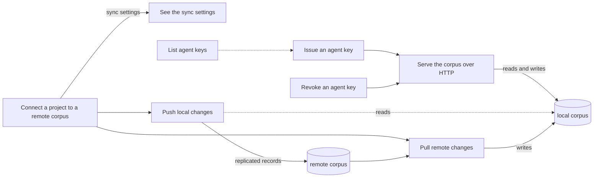

## Sync

Sync is how a corpus reaches beyond one checkout: connecting a project to a shared remote corpus, pushing local records to it, pulling remote changes back, and letting agents and people on other processes read and write the corpus over HTTP with an agent key or a browser session.

Written for the baseline sync-branch migration on 2026-10-09 (fast mode), against the product as built at commit a248efe0. Every rule was checked against the code and, where it was cheap and needed no real remote, against a throwaway corpus (no remote database was ever contacted). A rule is held at established only when a live check-decided acceptance criterion would fail if the rule were false; a rule whose behaviour is measured in code (file and line recorded) but that no criterion yet cites to confirm it is held at observed (BR-623); every other rule is unconfirmed or undecided, with its question written down.

### Boundary

**Inside**
- The sync settings: writing them, showing them, and what other commands do with them
- Pushing local records to the remote corpus and pulling remote changes back
- Starting the HTTP server, and who may call it: agent keys, browser sessions, refusal of unauthenticated requests, which surface may write through it
- Issuing, listing and revoking agent keys

**Outside**
- What each verb does once a request reaches it over HTTP (create, revise, link, approve, restore and so on): **corpus**, **review**, **specification**, **execution**. The server only carries the request; the census sites it reaches are mapped to those leaves.
- The dashboard: launching it, its local sign-in exchange, its packaged pages and its multi-project mode: **distribution** (leaf "Launch the dashboard"). Editing project or machine settings from the dashboard's settings screen belongs with the feature each setting configures.
- Keeping writes inside this checkout's own corpus: **corpus** (leaf "Keep writes in this checkout's corpus").
- Installing the project files and the agent integration: **distribution**.

### Children

| Node | What it does | Kind | Rule prefix |
|---|---|---|---|
| Connect a project to a remote corpus | Write the sync settings; what every other command then does with them | leaf | SYCF |
| See the sync settings | Show whether sync is off, disabled or on, and with which settings | leaf | SYST |
| Push local changes to the remote | Copy local records to the remote corpus | leaf | SYPS |
| Pull remote changes | Bring the remote corpus's changes into the local file | leaf | SYPL |
| Serve the corpus over HTTP | Start the server and decide who may call it | leaf | SYSV |
| Issue an agent key | Create a named key for an agent | leaf | SYKC |
| List agent keys | See every key and whether it is active | leaf | SYKL |
| Revoke an agent key | Withdraw a key so it stops working | leaf | SYKR |

Split and merge decisions:

- Push and pull are separate leaves. They move records in opposite directions, by different means (row copy versus replica catch-up), and fail differently.
- Connecting and seeing the settings are separate leaves: one writes the settings file, the other changes nothing. The rule about what every other command does with the settings sits with connecting, because it is the consequence of switching sync on.
- The three key commands are three leaves (single verb each). Issuing and revoking change who may call the server; listing changes nothing but has its own rule about what it never shows.
- Request authentication is folded into "Serve the corpus over HTTP": it is the server's constraint, and the key leaves only change the set of valid keys.
- The dashboard's local sign-in is not a leaf here: it is how a person launches the dashboard, owned by distribution. This branch owns only how a session, once opened, is checked on each request.

### How they fit together

### Ubiquitous language

The terms are defined in this branch's glossary. The ones most often confused:

- **Sync switched on** (a setting) versus **working against the remote** (what actually happens). Today only push and pull use the remote; every other command, the HTTP server included, works on the local corpus even when sync is on (BR-925).
- **Push** (adds rows the remote lacks) versus **mirroring** (making the remote equal to the local corpus). Push does not update a row the remote already has (BR-932).
- **Agent key** (a credential for the HTTP server) versus **access token** (a credential for the remote corpus). They are unrelated.

### Cross-cutting notes

**Every refusal in this branch exits 1.** The sync and key commands do not use the product's exit-code mapping: a missing setting, an invalid address, a duplicate name and an unknown key all exit 1, where other commands would exit 4 or 3.

**Nothing in this branch leaves an audit entry or a version row** except what the HTTP server's verbs record through their own leaves. Writing the sync settings, pushing, pulling, issuing and revoking keys are invisible in the audit trail.

**No remote was contacted while writing this branch.** Every push and pull rule about a live remote (what lands there, partial failure, replica catch-up) is code-read only and held unconfirmed.

**Known suspected defects held here as unconfirmed rules:** corpus commands ignore sync and write locally without notice (issue 84); a malformed sync section silently drops all project settings for other commands; the interval silently falls back to 60; push never updates rows already on the remote, so later edits and key revocations do not reach it; judgments, calibration and baseline rules are never pushed; approvals and rejections over HTTP are attributed to no one; the per-key write limit is stored but never applied; key commands use exit 1 for every refusal.
