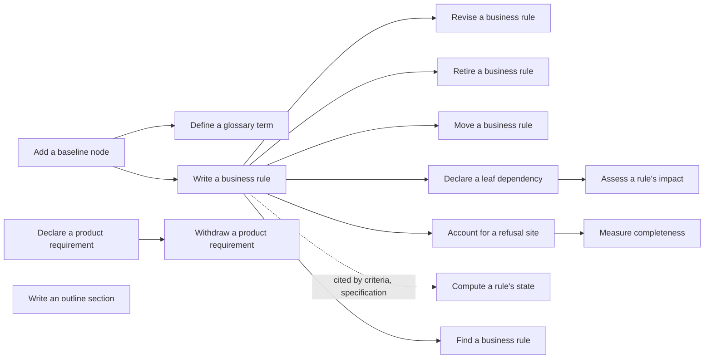
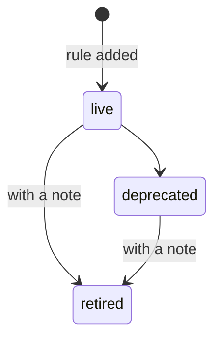

## Product baseline

The product baseline describes what Lore does in two trees. The business tree has a root, branches for business areas, and leaves that each hold the numbered rules of one business action. The architecture tree has a root, sections, module cards, standards whose rules carry four parts (current reality, target rule, current exceptions, migration), and a debt registry whose entries those exceptions name. This branch covers keeping both trees: adding nodes, defining vocabulary, writing, revising, retiring and moving rules, declaring dependencies, accounting for every refusal a command can produce, measuring completeness, computing each rule's verification state, and finding rules and the effect of changing them. Rules of both trees share one never-reused id registry: business rules are BR-n, standard rules AS-n and debt entries AD-n (BR-979, BR-1002). Completeness measurement and branch arming consider business nodes only (BR-979). It also covers the two structured inventories on the product's requirements document that sit above the trees: the numbered product requirements, and the outline sections, which are now read-only history replaced by the baseline tree (BR-694, BR-985).

Every rule was checked against the code (commit a248efe0, read on 2026-10-09); most were also probed on a throwaway corpus. A rule is held at established only when a live check-decided acceptance criterion would fail if the rule were false. Every other rule is held at undecided or unconfirmed, with its question written down in its leaf; no rule of this branch is held at observed. The four levels are defined in the glossary under Confidence.

### Boundary

**Inside**
- Creating nodes of either tree (business root, branch and leaf; architecture root, section, module card, standard and debt registry) and relabelling them
- Defining and removing glossary terms
- Adding a rule to a business leaf, an architecture standard (with its four parts) or a debt registry, revising it, moving it to another leaf, deprecating and retiring it
- Declaring a leaf's dependencies on rules
- Mapping refusal sites to rules, declaring a leaf's commands, the census and the completeness measurement
- Computing a rule's verification state, and the read-only listing of both trees
- Showing and finding rules, and the impact of changing one
- Sampling how many citations, or how many non-business site exclusions, really hold (citation fidelity)
- Who may write a branch from a separate worktree (corpus scope), for the baseline writes above
- Declaring, listing and withdrawing product requirements on the requirements document
- Listing the stored outline sections, and refusing every retired outline write (writing, removing, or exempting a plan from the outline-sync check)

**Outside**
- Citing a rule from an acceptance criterion, which rule families may be cited (a business rule or a standard rule may; a debt entry may not, BR-980), the citation gate and the action that adopts its mode and armed branches (BR-987): **specification**, leaf "Cite a baseline rule". This branch owns the rules being cited and their lifecycle and state; it does not own the act of citing or the gate.
- Declaring which requirement an acceptance criterion covers, and spec creation: **specification**.
- Generic creation, revision of body or title, linking, deletion of documents, and the general refusal of a write from a separate worktree: **corpus**. Corpus owns the rule that revising an approved document's body takes it back to draft; the demotion caused by this branch's dedicated actions is written here.
- Approving or rejecting a baseline node or a requirements document: **review**.
- The plan-close check itself: **execution**, leaf "Close a plan". The outline-sync exemption it used to read is retired; its refusal is recorded on this branch's outline leaf because the retired action is still invoked through the outline commands (BR-985).
- The evidence and runner records a rule's state is computed from: **execution**.
- The corpus status report's checks over the tree (rules with implementation detail, registry mismatch, requirement coverage, the outline budget check): **hygiene**. Only the rule-state counts it prints are described here.

### Children

| Node | What it does | Kind | Label |
|---|---|---|---|
| Add a baseline node | Create a node of either tree (business or architecture), and relabel it | leaf | BNOD |
| Define a glossary term | Add or remove a term on a root or branch | leaf | BGLS |
| Write a business rule | Add a new numbered rule to a business leaf (BR), an architecture standard (AS, four parts) or a debt registry (AD) | leaf | BRAD |
| Revise a business rule | Change a rule's wording, confidence, enforcement or examples | leaf | BRRV |
| Retire a business rule | Deprecate or retire a rule | leaf | BRLC |
| Move a business rule | Relocate a rule to another leaf, keeping its id | leaf | BRMV |
| Declare a leaf dependency | Record the rules a leaf relies on | leaf | BDPN |
| Account for a refusal site | Map a command's refusal sites to rules and declare the leaf's commands | leaf | BMAP |
| Measure completeness | List refusal sites and check that a leaf or branch accounts for all of them | leaf | BCOV |
| Compute a rule's state | Show both trees and each rule's verification state | leaf | BSTA |
| Find a business rule | Show one rule, or find rules by spec, file or text | leaf | BFND |
| Assess a rule's impact | List what depends on a rule before changing it | leaf | BIMP |
| Declare a product requirement | Add a numbered requirement to the requirements document | leaf | BRQD |
| Withdraw a product requirement | Remove a requirement from the requirements document | leaf | BRQW |
| Write an outline section | List the read-only outline sections; refuse every retired outline write | leaf | BOUT |
| Sample citation fidelity | Measure how many sampled citations, or site exclusions, really hold | leaf | FID |

Split and merge decisions:

- Revising, retiring and moving a rule are separate leaves although one command does all three. Each produces a different result for a reader (new wording, a closed rule, a rule in another place) and each has its own refusals: retiring needs a note and only moves forward, moving needs a different leaf and changes two leaves at once.
- Relabelling is folded into "Add a baseline node": it has one or two rules, too few for a leaf.
- Removing a glossary term is folded into "Define a glossary term" for the same reason.
- The outline leaf keeps its name although no outline write is accepted any more: it holds the listing that still works and the refusal of the retired writes, so a reader looking for the old action finds why it is refused.
- The architecture tree has no leaves of its own in this branch. Creating its nodes is a mode of "Add a baseline node", adding standard rules and debt entries is a mode of "Write a business rule", and listing it is part of "Compute a rule's state": each is the same action as for the business tree, with the differences written as rules of that leaf (BR-612, BR-613, BR-979, BR-1002).
- Withdrawing a product requirement is its own leaf, following the specification branch's split of declare and withdraw: removal has a constraint that adding does not (it is refused while a criterion still covers the requirement).
- The census and the completeness check are one leaf: the census is only ever read to decide completeness, and the two share their refusals.
- The plain listing of the tree is folded into "Compute a rule's state": it is the same command, and its one rule (BR-674) covers only the order, the columns shown, the refusal of a bad subtree root and the omission of deleted nodes.
- Sampling citation fidelity is its own leaf: it reads citations and site maps but writes neither, and its result (a stored fidelity record) is different from every other leaf's.
- Cross-cutting rules about every dedicated write to a node (re-application after a concurrent change, writing from a worktree, demotion of an approved node, refusal of general edits) live on "Write a business rule", the most used writer; the other writer leaves map their sites to them.

### How they fit together

### Ubiquitous language

The terms are defined in this branch's glossary. The ones most often confused:

- **Rule lifecycle** (live, deprecated, retired: set by an author) versus **verification state** (contradicted, stale, verified, unknown, unverified: computed from evidence). Showing a rule prints its lifecycle under the word "state"; the tree with states prints the verification state.
- **Business rule** (describes the product, lives on a leaf) versus **acceptance criterion** (verifies one piece of work, lives on a spec, cites rules) versus **product requirement** (states what the product is for, lives on the requirements document).
- **Dependency** (a leaf relies on a rule) versus **citation** (a criterion helps prove a rule).
- **Not measured** (a site the census cannot identify) versus **gap** (an identified site no rule or reason accounts for).

### Cross-cutting notes

**Every dedicated write is recorded.** Each change to a node or a requirement adds one version to the document's history and one audit entry. Baseline writes record the acting identity; requirement writes record the author as "system" (suspected defect, see those leaves).

**Approved documents.** A dedicated change to an approved baseline node takes it back to draft first. A change to the requirements of an approved requirements document leaves it approved.

**Concurrent sessions.** Writes to one node are checked against the version read; a collision is re-applied on the fresh version a few times and then refused, never silently overwritten. Rule ids stay unique across any number of concurrent sessions.

**Working from a separate worktree.** Baseline writes to a branch are admitted from a worktree only under a claim whose corpus scope covers that branch. Creating a node, or editing a node's body, is not admitted by the scope (suspected gap).

**Deleted documents.** A deleted leaf's rules disappear from every read and cannot be edited, but their ids are never reissued. Relabelling a deleted node is still accepted (suspected defect).

**The census works only from source.** Listing sites and measuring completeness analyse the product's source code and refuse to run from an installed program or outside a source checkout.

**Citations are enforced.** Every new or revised acceptance criterion must cite a live rule, while untouched older criteria are not refused: the citation gate (specification, "Cite a baseline rule") is armed in enforce on all twelve branches since 2026-10-09. A rule's verification state is still computed when asked and reported, never stored.

**Known suspected defects held here as unconfirmed rules:** a rule full of implementation detail is accepted with no warning; re-adding an existing dependency writes a version; relabelling a deleted node succeeds; a worktree scope does not admit node creation; requirement writes record "system" as author; an unreadable stored requirement list is read as empty and the next addition replaces it; withdrawing a requirement checks only specs directly under the requirements document; an unknown rule id is answered with a hint about listing documents.
