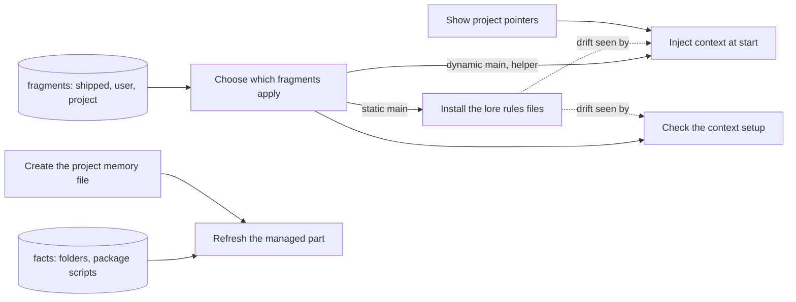

## Context

Context is how a project's standing instructions reach an AI session. Lore writes the project memory file's managed part and the lore rules files from facts and fragments, injects the dynamic fragments when a session or a helper agent starts, and checks that all of it is in step. This branch covers the `context` command (create, refresh) and the `fragments` command (render, check, pointers).

Written for the baseline context-branch migration on 2026-10-09, against the product as built at that day's main. Every rule was checked against the code and, where cheap, on a throwaway project. A rule is held at established only when a live check-decided acceptance criterion would fail if the rule (including any exit code it states) were false.

### Boundary

**Inside**
- Creating the project memory file with its managed part and a hand-written part
- Regenerating the managed part without touching hand-written text, and the write-time size and structure gate
- Writing, keeping and removing the lore rules files for the project and for the user
- Choosing which fragments apply where (places, override, disable, audience, language)
- Rendering the start-of-session and helper-start injection, its limits, and the stale notice
- Checking fragments, limits, rules-file drift and language agreement
- Printing the project pointers for a helper agent's start text
- The context bundle: one agent-tool call that returns a document with its parent, linked specs, related decisions and active plans. The root places bundles here. No leaf of this branch states it yet; that gap is open question Q1 below.

**Outside**
- What a memory file must contain, its line and byte limits, the required sections and the adoption mode, as checked by the status command: **hygiene**, leaf "Check project memory files". This branch runs the same check before it writes and adds nothing to it.
- Installing the start hooks, shipping the fragments and agent definitions, writing the language into the assistant's settings, scaffolding a memory file template and the rules-only refresh that setup runs: **distribution**.
- The corpus snapshot that the pointers summarise, and the resume hook: **session**, leaf "Start a session".
- Finding the project's corpus from the current folder: **corpus**.
- Whether AI is on by default for a given caller: **autonomy**.
- Feeding: the governing rules for a checkpoint and the task-start and phase-start packs are **autonomy**'s, leaf "Pull the rules before writing", as the root's branch table places them; the session-resume feed is **session**'s. This branch does not restate them, so that it does not hold a second copy that could drift.

### Children

| Node | What it does | Kind | Rule prefix |
|---|---|---|---|
| Create the project memory file | Write a first memory file with a managed part and a hand-written part | leaf | CXIN |
| Refresh the managed part | Regenerate the managed part, keeping hand-written text and hand edits | leaf | CXZN |
| Install the lore rules files | Write, keep and remove lore rules files for the project or the user | leaf | CXRL |
| Choose which fragments apply | Decide which fragments reach which target | leaf | CXSL |
| Inject context at start | Hand the dynamic and helper fragments to a starting session or helper agent | leaf | CXHK |
| Check the context setup | Report limits, drift, illegal overrides and language disagreement | leaf | CXCK |
| Show project pointers | Print a few lines on where the project stands for a helper agent | leaf | CXPT |

Split and merge decisions (D15 and D16 are decisions of the spec `spec-context-fragments-config-driven-layered-rule-injection`):

- One command, `context refresh`, is split into two leaves. Regenerating the memory file's managed part and installing the rules files have different inputs (facts versus fragments), different targets, different refusals, and since decision D16 a different fate when the memory file is refused (refresh leaf, BR-887). Merging them would hide that a refused refresh can still change the rules files.
- Choosing fragments is a leaf of its own although no command does only that. The same choice decides what refresh writes, what the hooks inject and what check verifies; writing it three times would let the three drift apart, which is exactly the defect class this branch carries.
- Create and refresh are separate leaves. Create is refused on an existing file and may use AI; refresh never uses AI and is the only one that gates the write and writes rules files.
- The pointers are a leaf, not part of injection. They come from a different source (the corpus snapshot), fail differently (silently, never a banner) and are a separate verb.
- Command-line usage errors of the `context` command (missing or unknown topic, misplaced options, no lore project), for both create and refresh, are folded into the create leaf (BR-872, BR-873, BR-874) instead of a usage leaf; the refresh leaf points there. Usage errors of the `fragments` command as a whole (no action or an unknown one), and render's missing or unknown start target, are folded into "Inject context at start" (BR-912), because they are refused before any action runs; the check and pointers leaves cover only what their own action does.

### How they fit together

### Ubiquitous language

The terms are defined in this branch's glossary. The ones most often confused:

- **Managed part** (inside the memory file, regenerated) versus **lore rules file** (a separate file per static fragment). Since decision D15 no fragment text goes into the memory file.
- **Static** (lives in a rules file, read every session) versus **dynamic** (injected when a session starts).
- **Skipped** (a hand-edited section or file left alone) versus **pruned** (a lore rules file whose fragment is gone, deleted).

### Cross-cutting notes

**No corpus writes.** Neither command opens the corpus database. Nothing here creates a document, a version entry or an audit entry; every effect is on files on disk.

**Hand edits are kept, not merged.** Everything lore generates carries a fingerprint. Text that no longer matches is left exactly as it is and reported as skipped, never overwritten, and lore does not offer a way to take it back under management except deleting it.

**Two different failure styles.** The writer verbs (`context init`, `context refresh`) and `fragments check` fail loudly with an exit code. The hook verb (`fragments render`), once given a valid start target, never fails: it exits 0 and carries a short notice naming the error, because a hook that blocks or prints nothing would silently cost a session its rules. The pointers verb prints nothing on failure. A request with no action, an unknown action or an unknown start target is a usage error, exit 2, for every verb.

**Known suspected defects held here as unconfirmed rules:** a hand-edited lore rules file whose fragment is gone is deleted (BR-893); a hand-edited lore rules file makes every session report stale and the advice cannot clear it (BR-910); refresh with the user scope ignores a moved settings folder (BR-895); check never compares the user's rules files (BR-917); a hand-written section inside the managed part disappears unreported (BR-884); a broken package file reads as "no scripts" with no warning (BR-883); create spends an AI call before refusing an existing file (BR-876).

### Open questions

| # | Question | Kind | Owner |
|---|---|---|---|
| Q1 | The context bundle, which the root places in this branch, has no leaf yet, so its behaviour is not stated anywhere in the tree. Which leaf should state it: a new leaf here, or "Read a document" in corpus? | undecided | product |
