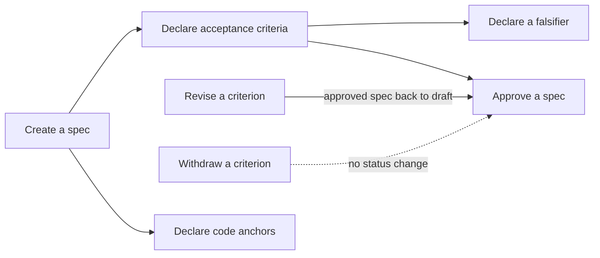
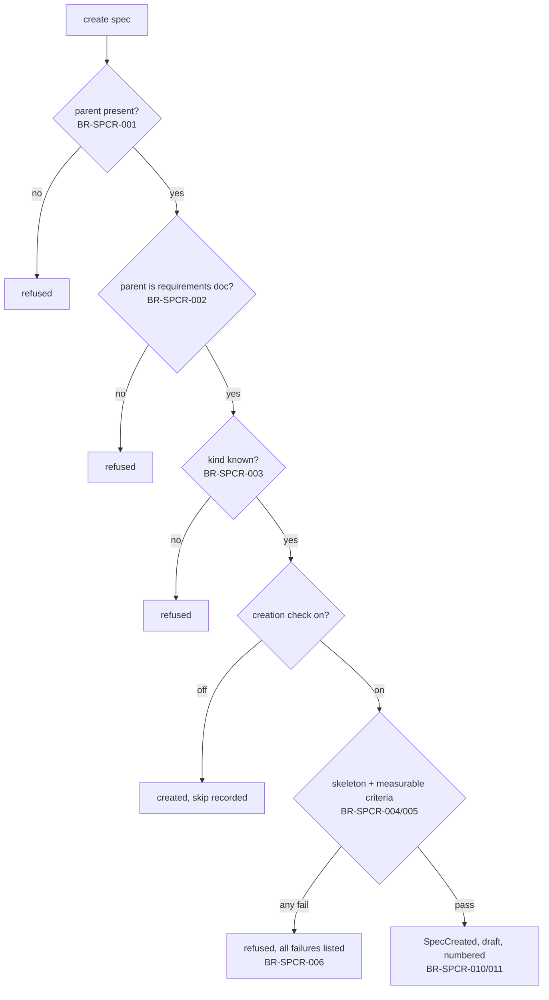
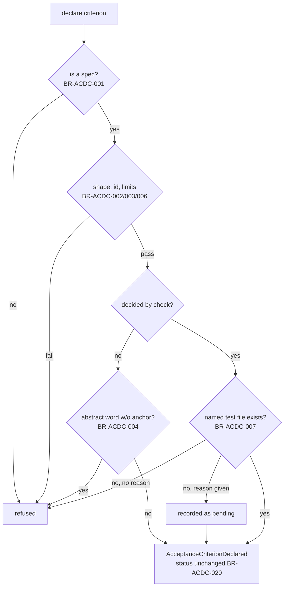
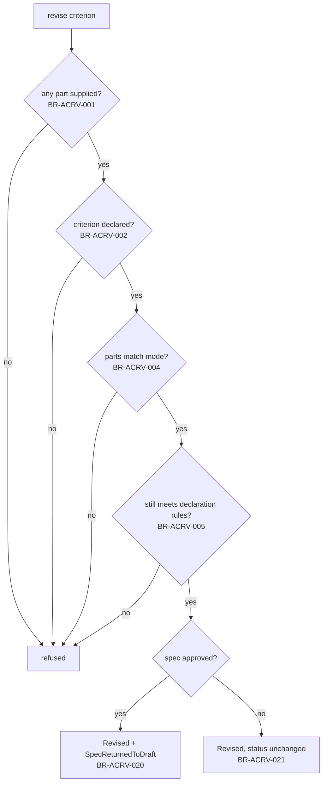
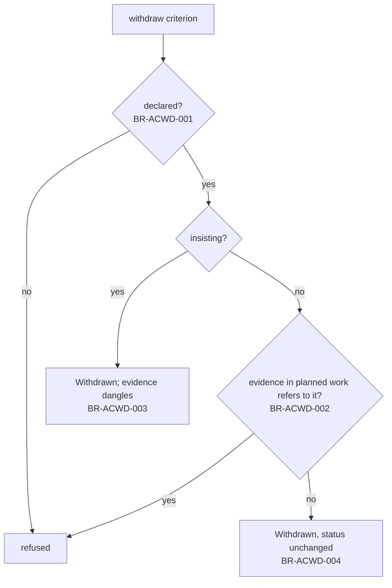
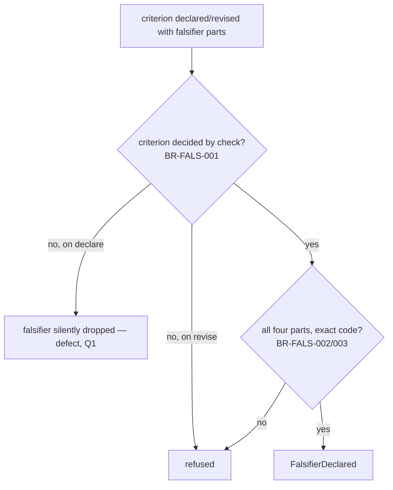
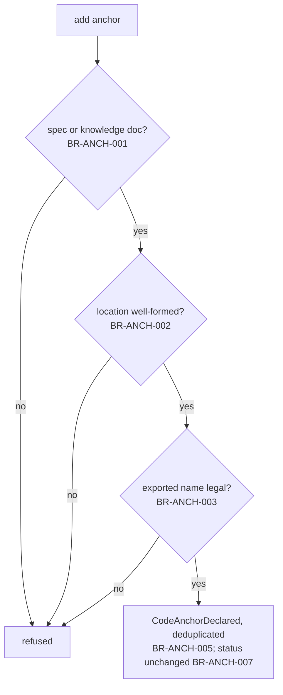
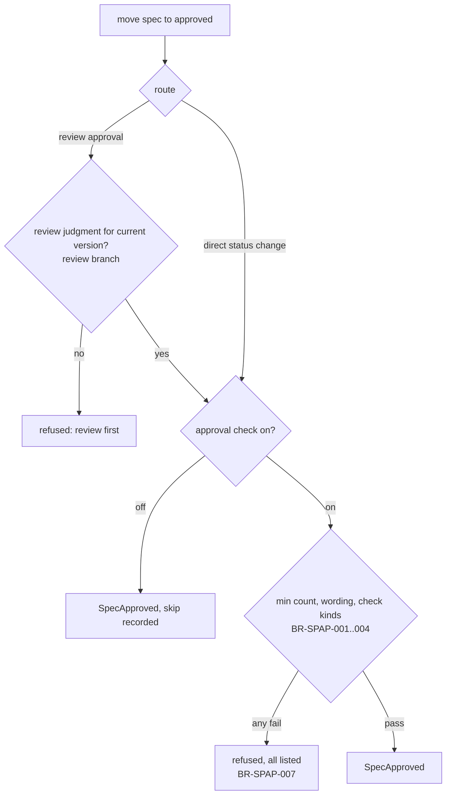

# Specification branch — experiment draft (input to slice-1 pilot, NOT authoritative)

Produced 2026-10-07 by experiment A2 (`knowledge-baseline-product-shape-validation-ledger-a1-spec-to`) under `adr-the-product-is-a-baseline-tree-specs-are-implementations`. Excavated from code at main `67db6557`; every 🟢 was checked against code or a throwaway corpus at that commit and may have drifted since. Rule-id prefixes (BR-SPCR / ACDC / ACRV / ACWD / FALS / ANCH / SPAP) were chosen by the drafter, not allocated — re-allocate in the pilot. 28 Open questions include 3 reproduced-or-reported defects (issues #29, #30). Per the PRD (spec-product-baseline-architecture-trees-the-product-s-current, slice 1 / BL-7), the pilot must freeze a NEW probe set before revising these leaves.


---

<!-- file: README.md -->

---
kind: branch
domain: lore
path: specification
name: 规格与验收 (Specification & Acceptance)
updated: 2026-10-07
---

## Specification & Acceptance

A spec is the written contract for one piece of work on the product: what will
be built and how "done" will be decided. This branch covers making that contract —
creating a spec, giving it acceptance criteria, stating how each criterion could
be proved wrong, binding it to the code that implements it — and the
spec-specific conditions a spec has to meet before it may be approved.

### Boundary

**Inside**
- Creating a spec and the conditions a new spec must meet
- Declaring, revising and withdrawing a spec's acceptance criteria
- Declaring a falsifier for an acceptance criterion
- Binding a spec to the code that implements it (code anchors)
- The spec-specific conditions an approval has to meet (minimum number of criteria,
  wording that can be measured, coverage by the kinds of check the project requires)
- Which of the above changes take an approved spec back to draft

**Outside**
- Generic document creation, revision, linking and invalidation — **corpus**.
  Revising a spec's body or title is a corpus revision, and corpus owns the rule
  that revision takes an approved document back to draft.
- Review judgment, approval/rejection mechanics, lifecycle transitions in general —
  **review**. This branch only adds the spec-specific admission conditions on top.
- Baseline leaves and their business rules — **baseline**. Today a spec does not
  hang under a baseline leaf and its criteria do not cite baseline rules (see
  Cross-cutting notes, "Target state not yet built").
- Running a criterion's check, recording evidence, the attested pass and the
  attested red produced by running a falsifier — **execution**.
- Detecting that a code anchor no longer matches the code (drift) — **hygiene**.

### Children

| Node | What it does | Kind | Status |
|---|---|---|---|
| [Create a spec](create-spec.md) | Open a new spec under the product's requirements document | leaf | 🟢 draft |
| [Declare an acceptance criterion](declare-ac.md) | Add one criterion that decides "done" for the spec | leaf | 🟢 draft |
| [Revise an acceptance criterion](revise-ac.md) | Change an existing criterion in place, keeping its id | leaf | 🟢 draft |
| [Withdraw an acceptance criterion](withdraw-ac.md) | Remove a criterion from the spec | leaf | 🟢 draft |
| [Declare a falsifier](declare-falsifier.md) | State the change to the code that must make a criterion's check fail | leaf | 🟢 draft |
| [Declare a code anchor](declare-code-anchor.md) | Bind the spec to a file, folder or exported name in the code | leaf | 🟢 draft |
| [Approve a spec](approve-spec.md) | Admit a spec as the governing contract for its work | leaf | 🟡 draft (boundary with review open) |

Split/merge decisions against the candidate list (create spec; declare AC; declare
falsifier; declare code anchor):

- **"Declare AC" split into three** (declare / revise / withdraw). As one leaf, its
  sentence needed "add, change or remove" (fails L1), and the three produce
  different events with *different* effects on an approved spec: adding and
  removing leave it approved, revising takes it back to draft. Merging would hide
  exactly the asymmetry readers get wrong.
- **"Declare falsifier" kept as its own leaf** although today it is never its own
  action — a falsifier is only ever declared as part of declaring or revising a
  criterion. It passes L3/L4 on its own (`FalsifierDeclared` is a sentence a
  practitioner would say) and its rules (all four parts, an exact outcome) do not
  belong to criteria in general.
- **Code-anchor removal folded into "Declare a code anchor"**, not a leaf. It has
  two rules, which is below the size of a leaf. This bends L1 (the sentence
  needs "or remove"); the split alternative would be a two-rule
  "Withdraw a code anchor" leaf.
- **"Approve a spec" added** (not in the candidate list) to hold the spec-promote
  refusals, because the owner rule is "a gate is a guaranteed rule inside the leaf
  it constrains", and that gate constrains spec approval. It overlaps the review
  branch's generic "approve" leaf; see that leaf's Q1.

### How they fit together



### Ubiquitous language

| Term | Meaning | Often confused with |
|---|---|---|
| Spec (规格) | The written contract for one piece of work: what is built and how "done" is decided. Has a kind and a lifecycle status. | **Requirements document** (the product-level document a spec currently hangs under). **Baseline leaf** (baseline branch): the durable business rule set a spec will, in the target state, implement. A spec is per piece of work, and a leaf lasts beyond any one piece of work. |
| Requirements document (需求文档) | The product's top-level requirements document. Today it is the only legal parent of a spec. | Baseline root (baseline branch). |
| Spec kind (规格类别) | One of four: *feature* (user-facing behaviour), *tech* (technical design), *design* (visual/interaction design), *domain overview* (narrative overview of a product area, carries no implementation contract). Absent means *feature*. | "Type" of document (spec vs plan vs task) — corpus's term. |
| Acceptance criterion, AC (验收条件) | One statement on a spec that decides part of "done", with an id unique within that spec and a declared way of being verified. | **Business rule** (baseline branch): a criterion is per spec and verifies work. A rule describes the business and lasts beyond any one spec. **Requirement** (below). |
| Requirement reference (覆盖的需求) | An id of a requirement item in the requirements document that a criterion says it covers. | Business rule ids (baseline); not the same numbering and not checked against it. |
| Verification mode (验证方式) | How a criterion is decided: *by check* (a command is run and its outcome decides), *by AI judgment* (a judge applies a written rubric), *by a person* (a human decides; optional note). | Execution's "verify" — the act of running the check. Here it is only the declared means. |
| Check kind (判定器类别) | For a by-check criterion, what kind of check it is: type check, test, static analysis, build, end-to-end, or other. | Verification mode. |
| Falsifier (证伪器) | For a by-check criterion: a named change to one file, plus the exact outcome the check must then end with. It proves the check can tell broken from working. | A failing test in general. Execution's **attested red**, which is the *result* of running a falsifier. |
| Code anchor (代码锚点) | A binding from a spec (or a knowledge document) to a file, a folder, or a named export in the project's code. | A task's **file anchor** (execution), which reserves files for concurrent work and is not a claim about what implements a spec. |
| Oracle generation (判定器代次) | A counter on a by-check criterion that goes up each time its check command is rewritten, so that evidence gathered under an older command can be told apart. | Document version (corpus), which goes up on every edit. |
| Minimum criteria count (最少验收条件数) | The fewest criteria a spec of a given kind must have before it may be approved. | — |
| Required check kinds (必需判定器) | Per spec kind, the check kinds that at least one by-check criterion must cover before approval. | — |
| Pending missing-test declaration (未兑现的缺测声明) | A by-check criterion that named a test file that did not yet exist, declared with a stated reason. It counts as pending until that file exists. | — |

### Cross-cutting notes

**Read-only queries owned here (D5 — not leaves).** All of these are governed by
the rules of the leaves that produced the data. None of them has rules of its own.
- *List a spec's criteria*: in declaration order. When the spec has work under
  it, it also shows each criterion's pass/fail coverage. It lists "dangling"
  evidence references that point at criterion ids no longer declared (produced
  by BR-ACWD-003). Before any plan exists, coverage is "nothing to measure
  against", which is distinct from "zero coverage".
- *List a spec's code anchors.*
- *Pending missing-test declarations*: a project-wide count and list, recomputed
  from the project's files every time it is asked (BR-ACDC-007).
- *Pre-flight gate check*: asking "would this candidate spec pass creation /
  approval?" without writing anything.
- *Drift report* over code anchors is a query owned by **hygiene**, fed by
  BR-ANCH-*.

**Every refusal here holds on every route that can perform the action**, unless a
rule's `enforced_by` says otherwise. The exceptions are deliberate and listed:
BR-ACDC-007, plus Open questions on declare-ac and approve-spec.

**A project may switch off a gate.** The spec-creation check, the spec-approval
check, and its "measurable wording" and "check-kind coverage" parts can each be
switched off per project by whoever maintains the project's settings. Each
action that passes while a gate is off is recorded as "gate skipped". A personal
"skip the gates" switch exists only for the stand-alone pre-flight check. It
never lets a real write through: a refused write still says the switch does not
apply.

**Concurrent edits to one spec's criteria are arbitrated against the version the
writer read.** If two sessions change the same spec's criteria at the same time,
the one whose starting version is no longer current is refused, not merged. No
criterion is silently lost.

**Every change to criteria or anchors leaves a version entry** in the spec's
history, attributed to the system, whether or not it changes the spec's status.

**Target state not yet built (ADR-041).** The owner has decided that specs will
hang under baseline leaves and that every acceptance criterion must cite a live
business rule, refused by a gate. None of this exists today. Specs hang under the
requirements document, criteria may optionally cite requirement items, and
nothing checks those. Every rule in this branch describes the current behaviour.
The target appears only as Open questions (create-spec Q1, declare-ac Q1).

**Rule-id prefixes** (not assigned in the branch plan; chosen here — check
against other branches before merge): BR-SPCR create-spec · BR-ACDC declare-ac ·
BR-ACRV revise-ac · BR-ACWD withdraw-ac · BR-FALS declare-falsifier ·
BR-ANCH declare-code-anchor · BR-SPAP approve-spec.

**Acceptance format.** By owner decision there are no `.feature` files. Each rule
carries 1–3 one-line boundary examples. Acceptance will be expressed as spec ACs
in lore, so every leaf's Coverage table is empty until those exist.

---

<!-- file: create-spec.md -->

---
kind: leaf
domain: lore
path: specification/create-spec
name: 创建规格 (Create a spec)
owners:
  product: TBD
  backend: TBD
  qa: TBD
entry: An author (person or agent) opens a new spec for a piece of work, naming its parent and its kind
consumers:
  - specification/declare-ac (criteria are declared on an existing spec)
  - specification/approve-spec
  - execution (plans hang under a spec)
updated: 2026-10-07
status: draft
---

## Create a spec

> An author creates a spec under the product's requirements document.

### Ubiquitous language

| Business term | Meaning | Note |
|---|---|---|
| Section skeleton (章节骨架) | At least one second-level section heading in the spec body | Its presence is the only thing checked about the body's structure. Nothing checks *which* sections exist. |
| Spec number (规格编号) | A permanent sequential number among specs, shown as the spec's short human id | Separate from the spec's readable name, which can be edited |

### Behaviour

**Command** — an author creates a spec: title, body, parent, optionally a kind,
optionally initial acceptance criteria and code anchors.
**Constraint** — legal parent, known kind, a section skeleton, measurable wording
on any criteria supplied.
**Domain event** — `SpecCreated` (规格已建立), in draft.

### Rules

#### Admission

| ID | Rule | Confidence | enforced_by |
|---|---|---|---|
| BR-SPCR-001 | A spec cannot be created without a parent document. | 🟢 | guaranteed |
| BR-SPCR-002 | A spec's parent must be the requirements document. A decision record, plan, task, knowledge document or another spec is refused as a parent. | 🟢 | guaranteed |
| BR-SPCR-003 | A spec's kind must be one of feature, tech, design or domain overview. A spec created without a kind is a feature spec. | 🟢 | guaranteed |
| BR-SPCR-004 | A spec whose body has no section skeleton is refused. | 🟢 | guaranteed |
| BR-SPCR-005 | When acceptance criteria are supplied at creation, each must meet the measurable-wording rule of BR-ACDC-004. One that does not refuses the whole creation. | 🟢 | guaranteed |
| BR-SPCR-006 | A refusal by the creation check names every condition the candidate failed, not only the first, and quotes the rule text the spec is held to. | 🟢 | guaranteed |

Examples
- BR-SPCR-001 — given no parent; when the author creates a spec; then refused "a spec requires a parent", nothing is created.
- BR-SPCR-002 — given a decision record as parent; when creating a spec; then refused, naming the requirements document as the only allowed parent.
- BR-SPCR-002 — given the requirements document as parent; when creating; then accepted.
- BR-SPCR-003 — given kind "bogus"; when creating; then refused, listing the four kinds. Given no kind; then created as a feature spec.
- BR-SPCR-004 — given a body "no heading here"; when creating; then refused "missing skeleton". Given a body that is only `## A`; then accepted.
- BR-SPCR-005 — given an initial human-decided criterion "the UI is fast"; when creating; then the whole creation is refused, naming that criterion and the word "fast".
- BR-SPCR-006 — given a body without skeleton *and* an unmeasurable initial criterion; when creating; then one refusal listing both.

#### Identity and starting state

| ID | Rule | Confidence | enforced_by |
|---|---|---|---|
| BR-SPCR-010 | A new spec starts in draft. | 🟢 | guaranteed |
| BR-SPCR-011 | Every spec except a domain overview receives the next spec number, and keeps it for life. A domain overview receives no number. | 🟢 | guaranteed |
| BR-SPCR-012 | Two specs created at the same moment never share a number. The one that loses the race takes the next free number, compared against the numbers taken at the moment it is saved. | 🟢 | guaranteed |
| BR-SPCR-013 | Code anchors supplied at creation are held to the same rules as anchors declared later (BR-ANCH-001..004). | 🟢 | guaranteed |

Examples
- BR-SPCR-010 — given a valid candidate; when created; then its status is draft, never approved, even when it carries criteria.
- BR-SPCR-011 — given the last numbered spec is 1; when a feature spec is created, then it is spec 2. When a domain overview is created next, it has no number, and the following feature spec is 3.
- BR-SPCR-012 — given two sessions create a spec at the same instant; then both succeed, with consecutive, distinct numbers.

#### When two rules both apply

| Situation | Which rule decides | Why |
|---|---|---|
| Missing parent / wrong parent / unknown kind **and** missing skeleton | BR-SPCR-001 / -002 / -003, alone | These are checked on the shape of the request before the creation check runs. The author sees only the structural refusal, and the skeleton refusal appears on the next attempt. (Verified by probe.) |

### Current values

| Rule | What can be adjusted | Value | Who may change it | Read at |
|---|---|---|---|---|
| BR-SPCR-004, -005, -006 | Whether the creation check runs at all for this project | on (default for a new project and in this repo) | project settings maintainer (each skip is recorded) | 2026-10-07, fresh project + lore repo |
| BR-SPCR-005 | Whether the measurable-wording part of the creation check runs | on | project settings maintainer | 2026-10-07, same |

### Decision path



### Blast radius

| Direction | What | Why it matters |
|---|---|---|
| **Emits** | `SpecCreated` → plans may now hang under the spec | A plan's own approval assumes its spec exists and is approved |
| **Shares state** | The spec number sequence is shared with every other spec creation | BR-SPCR-012 |
| **Consumes** | The requirements document from corpus | BR-SPCR-002 assumes exactly one such document is the product's parent |

### Depends on

| Depends on | Because |
|---|---|
| `specification/declare-ac.md` BR-ACDC-004 | Criteria supplied at creation use the same measurable-wording rule |
| `specification/declare-code-anchor.md` BR-ANCH-001..004 | Anchors supplied at creation use the same anchor rules |
| corpus — "create a document" (no rule id yet; branch drafted in parallel) | Generic document creation, readable names and version history are corpus's rules |

### Coverage

| Rules | Scenarios | Tests |
|---|---|---|
| BR-SPCR-001..013 | — (no .feature by owner decision; ACs pending) | — |

### Open questions

| # | Question | Rules | Kind | Owner |
|---|---|---|---|---|
| Q1 | ADR-041 decides that a spec hangs under a baseline leaf, not the requirements document. Is the legal parent "a baseline leaf only", or "leaf or requirements document" during migration? And what happens to a spec that fits no leaf? | BR-SPCR-002 | 🟡 Undecided | product (owner) |
| Q2 | The creation check only looks for *a* section heading. A one-line body with `## x` passes. Should a spec kind require particular sections? | BR-SPCR-004 | 🟡 Undecided | product |
| Q3 | Criteria supplied at creation are checked for measurable wording, but not for named test files existing (BR-ACDC-007 applies only on the declare route). Intended? | BR-SPCR-005 | 🟡 Undecided | product |

### Retired rule ids

None.

### Changes

| Date | What | Why | Rules |
|---|---|---|---|
| 2026-10-07 | Leaf drafted from excavation | Validation experiment A2/A3 | BR-SPCR-001..013 |

---

<!-- file: declare-ac.md -->

---
kind: leaf
domain: lore
path: specification/declare-ac
name: 声明验收条件 (Declare an acceptance criterion)
owners:
  product: TBD
  backend: TBD
  qa: TBD
entry: An author adds one acceptance criterion to an existing spec, choosing how it will be verified
consumers:
  - specification/approve-spec (counts and checks the declared criteria)
  - execution (work under the spec records evidence against criterion ids)
updated: 2026-10-07
status: draft
---

## Declare an acceptance criterion

> An author declares one acceptance criterion on a spec.

### Ubiquitous language

| Business term | Meaning | Note |
|---|---|---|
| Abstract quality word (抽象质量词) | A word claiming a quality with no measurable meaning on its own, from a fixed product list (below) | Matched as a whole word, so "fast" is not found inside "faster", "breakfast" or "fast-track" |
| Measurable anchor (可测锚点) | Any digit, a comparison sign (`<`, `>`, `=`, `≤`, `≥`), a percentile marker such as P95, or a unit such as ms, s, MB, KB, GB, px, % or req/s | Its presence anywhere in the text counts, even if it is unrelated to the abstract word |

### Behaviour

**Command** — an author declares a criterion on a spec: an id, a statement, a
verification mode, and the mode's details (check kind and command, rubric, or
note). Optionally it names requirement items it covers.
**Constraint** — id shape and uniqueness, size limits, measurable wording, named
test files exist (or the absence is declared).
**Domain event** — `AcceptanceCriterionDeclared` (验收条件已声明).

### Rules

#### Admission

| ID | Rule | Confidence | enforced_by |
|---|---|---|---|
| BR-ACDC-001 | A criterion can only be declared on a spec. Declaring one on any other kind of document is refused. | 🟢 | guaranteed |
| BR-ACDC-002 | A criterion id has the form `AC-` followed by one or more groups of capital letters and digits separated by hyphens, and must be unique within its spec. | 🟢 | guaranteed |
| BR-ACDC-003 | A spec holds at most 50 criteria. A statement is 1–2000 characters, a check command 1–1000, a rubric 1–2000, a person's note at most 500. | 🟢 | guaranteed |
| BR-ACDC-004 | A criterion decided by a person, or by AI judgment, is refused when its statement contains an abstract quality word and no measurable anchor. For AI judgment, a measurable anchor in the rubric also satisfies this. | 🟢 | both |
| BR-ACDC-005 | A criterion decided by a check is never refused for abstract wording, whatever its statement says. | 🟢 | guaranteed |
| BR-ACDC-006 | A criterion decided by a check names its check kind (type check, test, static analysis, build, end-to-end, other) and the exact command. One decided by AI judgment carries a rubric. One decided by a person may carry a note. | 🟢 | guaranteed |
| BR-ACDC-007 | A check whose command names a test file that does not exist is refused, unless the author gives a non-empty reason (for example, the test is to be written red-first). With a reason, the criterion is recorded as a pending missing-test declaration until that file exists. | 🟢 | prompt-only |
| BR-ACDC-008 | A criterion may name requirement items it covers. Names that match no requirement are accepted and simply cover nothing. | 🟢 | guaranteed |
| BR-ACDC-009 | A criterion id is unique only within its own spec. Two specs may each declare the same id. | 🟢 | guaranteed |

Abstract quality words (fixed product list; changes only with a lore release):

```
fast slow clean simple robust modern elegant intuitive seamless scalable performant
efficient secure quick snappy lightweight user-friendly good better best optimal nice
high-quality "high quality"
快 简洁 优雅 现代化 高质量 健壮 好用 高效 流畅
```

Examples
- BR-ACDC-002 — given id `ac-1`; when declared; then refused with the expected shape. Given `AC-OK-1` already on the spec; when `AC-OK-1` is declared again; then refused "must be unique".
- BR-ACDC-003 — given a spec with 50 criteria; when a 51st is declared; then refused and the spec is unchanged.
- BR-ACDC-004 — given a person-decided "The UI is fast"; then refused, naming "fast". Given "P95 < 200ms, fast"; then accepted. Given "fast-track approval works"; then accepted (not a whole word).
- BR-ACDC-004 — given AI-judged statement "output is clean" with rubric "fewer than 3 lint findings"; then accepted (anchor in rubric).
- BR-ACDC-005 — given a check-decided "The UI is fast" whose command always succeeds; when declared; then accepted.
- BR-ACDC-007 — given a test command naming a file that is absent and no reason; then refused. Given the same with reason "red-first"; then accepted and counted pending. When the file is later created, the pending count drops on the next read with no further action.
- BR-ACDC-008 — given a criterion covering requirement `R-999`, which does not exist; when declared; then accepted.

#### Effect on the spec

| ID | Rule | Confidence | enforced_by |
|---|---|---|---|
| BR-ACDC-020 | Declaring a criterion never changes the spec's status. An approved spec stays approved. | 🟢 | guaranteed |
| BR-ACDC-021 | Each declaration adds one entry to the spec's version history. | 🟢 | guaranteed |
| BR-ACDC-022 | If two sessions change the same spec's criteria at the same moment, the one whose starting version is no longer current is refused. Both changes are never merged, and neither is silently lost. | 🟢 | guaranteed |

Examples
- BR-ACDC-020 — given an approved spec; when a well-formed criterion is declared; then the spec is still approved and now has one more criterion.
- BR-ACDC-022 — given two sessions read version 3 and each declare a different criterion; then one lands as version 4 and the other is refused as stale.

#### When two rules both apply

| Situation | Which rule decides | Why |
|---|---|---|
| A malformed id **and** an unmeasurable statement | BR-ACDC-002 / -003 / -006 (shape) first | Shape is checked before wording, then the named-file check. The author sees one refusal per attempt, in that order. |

### Current values

| Rule | What can be adjusted | Value | Who may change it | Read at |
|---|---|---|---|---|
| BR-ACDC-004 | Whether the measurable-wording check runs as part of the creation and approval checks | on | project settings maintainer | 2026-10-07, fresh project + lore repo |

The check on the declare route itself cannot be switched off. Only the backstop
copies inside the creation and approval checks can.

### Decision path



### Blast radius

| Direction | What | Why it matters |
|---|---|---|
| **Emits** | `AcceptanceCriterionDeclared` → approve-spec counts it; execution can record evidence against its id | Evidence refers to criteria by id only (BR-ACDC-009 makes that id spec-local) |
| **Shares state** | The spec's criteria list is also written by revise-ac and withdraw-ac | BR-ACDC-022 arbitrates |
| **Consumes** | Requirement items in the requirements document | BR-ACDC-008: never validated |

### Depends on

| Depends on | Because |
|---|---|
| `specification/create-spec.md` BR-SPCR-010 | Declaring assumes the spec exists |

### Coverage

| Rules | Scenarios | Tests |
|---|---|---|
| BR-ACDC-001..022 | — (ACs pending) | — |

### Open questions

| # | Question | Rules | Kind | Owner |
|---|---|---|---|---|
| Q1 | ADR-041 requires every criterion to cite a live business rule from a baseline leaf, refused by a gate. Today a criterion may cite requirement items and nothing checks them (BR-ACDC-008). What must a criterion cite, and how many? Does citing replace requirement items or sit beside them? | BR-ACDC-008 | 🟡 Undecided | product (owner) |
| Q2 | A check-decided criterion is never checked for wording (BR-ACDC-005). "The UI is fast", checked by a command that always succeeds, is accepted and will pass. Is a check that cannot fail acceptable at declaration, or is the falsifier (declare-falsifier) meant to catch it? Today a falsifier is optional. | BR-ACDC-005 | 🟡 Undecided | product |
| Q3 | The named-test-file check runs only on the command-line route. No other route can declare a single criterion. But a generic document edit through the agent or web route replaces the spec's structured data wholesale, and may be able to replace the whole criteria list. That would skip this check, the wording check, and any status change. Not probed. Can a generic edit replace criteria? | BR-ACDC-004, -007 | 🟡 Unconfirmed | engineering → product |
| Q4 | A criterion can be declared on an **archived** spec, and the declaration succeeds (probe). Should a terminal spec refuse new criteria? | BR-ACDC-020 | 🟡 Undecided | product |
| Q5 | A criterion id is only unique within a spec (BR-ACDC-009). A bare id such as `AC-OX-6` in a handoff therefore resolves to nothing. North Star property 3 (addressability) asks otherwise. Should ids be unique project-wide, or always be quoted together with their spec? | BR-ACDC-009 | 🟡 Undecided | product |
| Q6 | A falsifier given on a person-decided or AI-judged criterion is **silently dropped**: the declaration succeeds without it (probe). On revise, the same input is refused. Defect, recorded in declare-falsifier Q1. | — | defect | engineering |

### Retired rule ids

None.

### Changes

| Date | What | Why | Rules |
|---|---|---|---|
| 2026-10-07 | Leaf drafted from excavation | Validation experiment A2/A3 | BR-ACDC-001..022 |

---

<!-- file: revise-ac.md -->

---
kind: leaf
domain: lore
path: specification/revise-ac
name: 修订验收条件 (Revise an acceptance criterion)
owners:
  product: TBD
  backend: TBD
  qa: TBD
entry: An author changes one existing criterion of a spec in place
consumers:
  - specification/approve-spec (a revised approved spec must be approved again)
  - execution (evidence under an older check command is reported as earlier-generation)
updated: 2026-10-07
status: draft
---

## Revise an acceptance criterion

> An author revises one acceptance criterion of a spec in place.

### Ubiquitous language

No terms beyond the branch table (see *oracle generation* there).

### Behaviour

**Command** — an author names a spec and one of its criteria and supplies one or
more replacement parts: statement, covered requirement items, and, depending on
the criterion's mode, check kind / command / falsifier, rubric, or note.
**Constraint** — the criterion exists, its id and mode never change, every part
supplied matches its mode, and the result meets all declaration rules.
**Domain event** — `AcceptanceCriterionRevised` (验收条件已修订). If the spec was
approved, it is also `SpecReturnedToDraft`.

### Rules

#### Admission

| ID | Rule | Confidence | enforced_by |
|---|---|---|---|
| BR-ACRV-001 | A revision must change at least one part. A revision that supplies nothing is refused. | 🟢 | both |
| BR-ACRV-002 | Revising a criterion the spec does not declare is refused, and the refusal lists the ids the spec does declare. | 🟢 | guaranteed |
| BR-ACRV-003 | A criterion's id and verification mode cannot be revised. Changing the mode means withdrawing the criterion and declaring a new one. | 🟢 | guaranteed |
| BR-ACRV-004 | A part that belongs to a different mode is refused, and the refusal names both the part and the criterion's actual mode. Check kind, command and falsifier belong to a check. A rubric belongs to AI judgment. A note belongs to a person. | 🟢 | guaranteed |
| BR-ACRV-005 | The revised criterion must still meet every declaration rule: shape and limits (BR-ACDC-002, -003, -006) and named test files (BR-ACDC-007, also re-checked when only the statement changes). | 🟢 | guaranteed |
| BR-ACRV-006 | Covered requirement items, when supplied, replace the previous list entirely. An empty list clears it. | 🟢 | guaranteed |
| BR-ACRV-007 | Every other criterion on the spec, and everything else about the spec, is left exactly as it was. | 🟢 | guaranteed |

Examples
- BR-ACRV-001 — given a revision with no parts; then refused, listing the parts that can be changed.
- BR-ACRV-002 — given spec criteria AC-OK-1 and AC-OK-4; when revising AC-OK-9; then refused "not declared — declared ids: AC-OK-1, AC-OK-4".
- BR-ACRV-004 — given AC-OK-4 decided by a person; when a new check command is supplied; then refused "command only applies to a check-mode criterion — AC-OK-4 is mode person".
- BR-ACRV-006 — given a criterion covering R-1 and R-2; when revised with covers = [R-3]; then it covers only R-3.

#### Effect on the spec and on evidence

| ID | Rule | Confidence | enforced_by |
|---|---|---|---|
| BR-ACRV-020 | Revising any part of a criterion of an **approved** spec returns the spec to draft, in the same change. | 🟢 | guaranteed |
| BR-ACRV-021 | Revising a criterion of a spec in any other status (draft, in review, active, archived, deprecated) leaves the status unchanged. | 🟢 | guaranteed |
| BR-ACRV-022 | When a revision changes a check's command, the criterion moves to its next generation. Evidence recorded under an earlier command remains, and is reported as belonging to an earlier generation. No other revision changes the generation, and a generation number is never reused or reset. | 🟢 | guaranteed |
| BR-ACRV-023 | A revision never edits, deletes or hides any recorded evidence. | 🟢 | guaranteed |
| BR-ACRV-024 | A revised falsifier replaces the previous falsifier as a whole. All of its parts must be supplied again together (see BR-FALS-002). | 🟢 | guaranteed |
| BR-ACRV-025 | Each revision adds one entry to the spec's version history. If it returned the spec to draft, the entry says so. If the status did not move, it says nothing about status. | 🟢 | guaranteed |
| BR-ACRV-026 | Concurrent changes to the same spec's criteria are arbitrated as in BR-ACDC-022. | 🟢 | guaranteed |

Examples
- BR-ACRV-020 — given an approved spec; when only one criterion's statement is reworded; then the spec is draft.
- BR-ACRV-021 — given an active spec; when a criterion's statement is reworded; then the spec stays active.
- BR-ACRV-022 — given a criterion at generation 1 with two passing evidence entries; when its command is rewritten; then it is generation 2 and both entries are reported as generation 1. When the identical command is set again, it is still generation 2.

### Current values

None.

### Decision path



### Blast radius

| Direction | What | Why it matters |
|---|---|---|
| **Emits** | `SpecReturnedToDraft` → nothing under the spec can be claimed or promoted until it is approved again | One reworded criterion blocks every task under the spec |
| **Emits** | Generation change → execution's coverage reporting | Evidence gathered before the rewrite stops counting as current |
| **Shares state** | The criteria list with declare-ac and withdraw-ac | BR-ACRV-026 |

### Depends on

| Depends on | Because |
|---|---|
| `specification/declare-ac.md` BR-ACDC-002, -003, -006, -007 | A revised criterion is held to the declaration rules |
| `specification/declare-ac.md` BR-ACDC-022 | Same concurrency arbitration |
| `specification/declare-falsifier.md` BR-FALS-002 | A revised falsifier must be complete |
| review — "approve a document" (no rule id yet) | Returning to draft means the review branch's approval has to happen again |

### Coverage

| Rules | Scenarios | Tests |
|---|---|---|
| BR-ACRV-001..026 | — (ACs pending) | — |

### Open questions

| # | Question | Rules | Kind | Owner |
|---|---|---|---|---|
| Q1 | Revising a criterion of an **active** spec changes the governing contract but leaves the spec active, with no fresh approval (BR-ACRV-021). Only approved specs go back to draft. Is a contract change on active work meant to need no re-approval? | BR-ACRV-021 | 🟡 Undecided | product |
| Q2 | Revising a criterion of an archived or deprecated spec succeeds. Should terminal specs refuse it? | BR-ACRV-021 | 🟡 Undecided | product |
| Q3 | Revising only the statement or the covered items of an approved spec also returns it to draft, the same as rewriting the check. Is a wording-only change meant to cost a full re-approval? | BR-ACRV-020 | 🟡 Unconfirmed | product |

### Retired rule ids

None.

### Changes

| Date | What | Why | Rules |
|---|---|---|---|
| 2026-10-07 | Leaf drafted from excavation | Validation experiment A2/A3 | BR-ACRV-001..026 |

---

<!-- file: withdraw-ac.md -->

---
kind: leaf
domain: lore
path: specification/withdraw-ac
name: 撤回验收条件 (Withdraw an acceptance criterion)
owners:
  product: TBD
  backend: TBD
  qa: TBD
entry: An author removes one criterion from a spec
consumers:
  - execution (evidence that pointed at the criterion becomes dangling)
updated: 2026-10-07
status: draft
---

## Withdraw an acceptance criterion

> An author withdraws one acceptance criterion from a spec.

### Ubiquitous language

| Business term | Meaning | Note |
|---|---|---|
| Dangling evidence reference (悬空证据引用) | Evidence recorded against a criterion id the spec no longer declares | Shown when a spec's criteria are listed. It is never cleaned up automatically. |

### Behaviour

**Command** — an author withdraws a named criterion from a spec, optionally insisting
even though evidence refers to it.
**Constraint** — the criterion exists, and evidence from the spec's planned work does
not refer to it unless the author insists.
**Domain event** — `AcceptanceCriterionWithdrawn` (验收条件已撤回).

### Rules

| ID | Rule | Confidence | enforced_by |
|---|---|---|---|
| BR-ACWD-001 | Withdrawing a criterion the spec does not declare is refused. | 🟢 | guaranteed |
| BR-ACWD-002 | Withdrawing a criterion is refused while any task in a plan under the spec has evidence referring to it, unless the author explicitly insists. The refusal names one such task. | 🟢 | guaranteed |
| BR-ACWD-003 | When the author insists, the criterion is removed and the evidence is left untouched. Its references become dangling and are shown with the spec's criteria. | 🟢 | guaranteed |
| BR-ACWD-004 | Withdrawing a criterion never changes the spec's status. An approved spec stays approved. | 🟢 | guaranteed |
| BR-ACWD-005 | Each withdrawal adds one entry to the spec's version history. Concurrent changes are arbitrated as in BR-ACDC-022. | 🟢 | guaranteed |
| BR-ACWD-006 | A pending missing-test declaration belonging to a withdrawn criterion stops counting as pending. Withdrawal is a valid way to settle it. | 🟢 | guaranteed |

Examples
- BR-ACWD-002 — given task T has a passing evidence entry for AC-OK-1; when AC-OK-1 is withdrawn; then refused, naming T and how to insist.
- BR-ACWD-003 — given the same, with the author insisting; then AC-OK-1 is gone, T's evidence still names AC-OK-1, and AC-OK-1 is listed as dangling.
- BR-ACWD-004 — given an approved spec with two criteria; when one is withdrawn; then the spec is still approved with one criterion.

### Current values

None.

### Decision path



### Blast radius

| Direction | What | Why it matters |
|---|---|---|
| **Emits** | `AcceptanceCriterionWithdrawn` → approve-spec's count drops | An approved spec can fall below its minimum criteria count and remain approved (Q1) |
| **Shares state** | Task evidence (execution) | BR-ACWD-003 leaves it in place |

### Depends on

| Depends on | Because |
|---|---|
| `specification/declare-ac.md` BR-ACDC-022 | Same concurrency arbitration |
| `specification/declare-ac.md` BR-ACDC-007 | Pending missing-test declarations come from there |

### Coverage

| Rules | Scenarios | Tests |
|---|---|---|
| BR-ACWD-001..006 | — (ACs pending) | — |

### Open questions

| # | Question | Rules | Kind | Owner |
|---|---|---|---|---|
| Q1 | Withdrawing criteria from an approved spec leaves it approved (BR-ACWD-004), even when that takes it below the minimum count or uncovers a required check kind it was approved with. Adding leaves it approved too, but revising returns it to draft. Is this asymmetry intended? Approval then certifies the criteria as they stood when approved, not as a reader sees them now. | BR-ACWD-004 | 🟡 Undecided | product |
| Q2 | The evidence guard (BR-ACWD-002) only looks at tasks in plans under the spec. Evidence from unplanned ("ad hoc") tasks governed by the spec does not protect a criterion. Engineering already names this as a known gap. Should it be closed? | BR-ACWD-002 | 🟡 Undecided | product |

### Retired rule ids

None.

### Changes

| Date | What | Why | Rules |
|---|---|---|---|
| 2026-10-07 | Leaf drafted from excavation | Validation experiment A2/A3 | BR-ACWD-001..006 |

---

<!-- file: declare-falsifier.md -->

---
kind: leaf
domain: lore
path: specification/declare-falsifier
name: 声明证伪器 (Declare a falsifier)
owners:
  product: TBD
  backend: TBD
  qa: TBD
entry: While declaring or revising a check-decided criterion, the author also states the change to the code that must make the check fail
consumers:
  - execution (running a falsifier produces an attested red)
updated: 2026-10-07
status: draft
---

## Declare a falsifier

> An author declares a falsifier for a check-decided acceptance criterion.

Today a falsifier is never its own action. It is always supplied as part of
declaring (declare-ac) or revising (revise-ac) a criterion. It is a separate leaf
because it has its own event and its own rules (see branch README, split
decisions).

### Ubiquitous language

| Business term | Meaning | Note |
|---|---|---|
| Expected outcome code (预期结果码) | The exact whole number the criterion's check must end with when run against the changed file | Never "any failure". A check that fails with a different code does not confirm the falsifier. |
| Stale falsifier (失效证伪器) | A falsifier whose "text to find" is no longer in the named file | Found when the falsifier is run, never when it is declared |

### Behaviour

**Command** — an author supplies four parts with a check-decided criterion: the
file to change, the exact text to find in it, the text to replace its first
occurrence with, and the expected outcome code.
**Constraint** — check-decided criterion only; all four parts together; an exact
expected outcome.
**Domain event** — `FalsifierDeclared` (证伪器已声明).

### Rules

| ID | Rule | Confidence | enforced_by |
|---|---|---|---|
| BR-FALS-001 | A falsifier belongs only to a criterion decided by a check. | 🟢 | guaranteed |
| BR-FALS-002 | A falsifier has four parts, all required together: the file (named relative to the project), the text to find (non-empty), the replacement (may be empty), and the expected outcome code. A falsifier missing any part is refused, naming the missing part. | 🟢 | guaranteed |
| BR-FALS-003 | The expected outcome is one exact whole number. "Any non-success" is not expressible. | 🟢 | guaranteed |
| BR-FALS-004 | The replacement applies to the first occurrence of the text to find only. | 🟢 | guaranteed |
| BR-FALS-005 | Whether the file exists, and whether it still contains the text to find, is not checked when the falsifier is declared. It is checked when the falsifier is run, and a stale falsifier is then refused, never counted as confirmed. | 🟢 | guaranteed |
| BR-FALS-006 | A falsifier is optional. A criterion without one is valid and is verified exactly as before, but asking to run its falsifier is refused, naming the missing declaration. | 🟢 | guaranteed |
| BR-FALS-007 | Declaring a falsifier never changes how the criterion's ordinary pass/fail verification behaves. | 🟢 | guaranteed |
| BR-FALS-008 | Revising a falsifier replaces it as a whole. There is no way to change one part and keep the others. | 🟢 | guaranteed |

Examples
- BR-FALS-001 — given a person-decided criterion; when revising it with a falsifier; then refused "falsifier only applies to a check-mode criterion".
- BR-FALS-002 — given only the file part; when declaring the criterion; then refused, naming "text to find" as required. Given all four with an empty replacement; then accepted.
- BR-FALS-003 — given expected outcome "non-zero"; then refused (not a whole number). Given 7; then accepted.
- BR-FALS-005 — given a falsifier naming a file that does not exist yet; when declared; then accepted. When later run, it is refused as stale.
- BR-FALS-008 — given a falsifier expecting code 1; when the author revises only the expected code to 2; then refused for missing parts, and the stored falsifier is unchanged.

### Current values

None.

### Decision path



### Blast radius

| Direction | What | Why it matters |
|---|---|---|
| **Emits** | `FalsifierDeclared` → execution may run it to produce an attested red | The attested red is the only machine evidence that a criterion's check can fail |
| **Shares state** | The criterion (declare-ac / revise-ac) | A falsifier is stored as part of its criterion. Withdrawing the criterion withdraws it. |

### Depends on

| Depends on | Because |
|---|---|
| `specification/declare-ac.md` BR-ACDC-006 | Only check-decided criteria carry a command a falsifier can break |
| `specification/revise-ac.md` BR-ACRV-020 | Adding or changing a falsifier on an approved spec is a criterion revision and returns it to draft. Declaring one with a new criterion does not. |
| execution — "run a falsifier / attested red" (no rule id yet) | Runs in a scratch copy. It refuses stale falsifiers and records the result. |

### Coverage

| Rules | Scenarios | Tests |
|---|---|---|
| BR-FALS-001..008 | — (ACs pending) | — |

### Open questions

| # | Question | Rules | Kind | Owner |
|---|---|---|---|---|
| Q1 | **Defect.** When a falsifier is supplied while *declaring* a criterion decided by a person or by AI judgment, the declaration succeeds and the falsifier is silently discarded (probe). Revising refuses the same input. Should declaring also refuse? | BR-FALS-001 | defect → 🟡 Unconfirmed (proposed: refuse) | engineering |
| Q2 | A falsifier is optional (BR-FALS-006), so a criterion whose check cannot fail (declare-ac Q2) can still be approved. Should some spec kinds require a falsifier on every check-decided criterion before approval? | BR-FALS-006 | 🟡 Undecided | product |
| Q3 | A file outside the project (`../x`) or an absolute path is not refused at declaration, unlike code anchors (BR-ANCH-002). Running the falsifier always treats the path as relative to the project. Should declaration refuse it? | BR-FALS-002 | 🟡 Undecided | engineering → product |

### Retired rule ids

None.

### Changes

| Date | What | Why | Rules |
|---|---|---|---|
| 2026-10-07 | Leaf drafted from excavation | Validation experiment A2/A3 | BR-FALS-001..008 |

---

<!-- file: declare-code-anchor.md -->

---
kind: leaf
domain: lore
path: specification/declare-code-anchor
name: 声明代码锚点 (Declare a code anchor)
owners:
  product: TBD
  backend: TBD
  qa: TBD
entry: After the code exists, an author binds a spec to the file, folder or exported name that implements it
consumers:
  - hygiene (drift detection reads the declared anchors)
updated: 2026-10-07
status: draft
---

## Declare a code anchor

> An author declares a code anchor on a spec.

This leaf also holds the two rules for removing an anchor. That bends L1, because
the sentence would need "or remove". The split alternative is a two-rule
"Withdraw a code anchor" leaf, judged too small to stand alone (see branch README).

### Ubiquitous language

| Business term | Meaning | Note |
|---|---|---|
| Folder anchor (目录锚点) | An anchor naming a folder rather than a file, written with a trailing slash | Cannot name an exported name |
| Exported name (导出名) | A name the file makes available to other code, written after `#` | Plain letters, digits, `_` and `$`, not starting with a digit. Test titles and non-Latin names cannot be anchored. |

### Behaviour

**Command** — an author adds one or more anchors to a spec (or removes them).
**Constraint** — spec or knowledge document only; well-formed, project-relative
location; an exported name only on a file.
**Domain event** — `CodeAnchorDeclared` (代码锚点已声明) / `CodeAnchorRemoved`.

### Rules

#### Declaring

| ID | Rule | Confidence | enforced_by |
|---|---|---|---|
| BR-ANCH-001 | Code anchors can be declared on a spec or a knowledge document. Any other document, a plan for example, is refused. | 🟢 | guaranteed |
| BR-ANCH-002 | An anchor's location is relative to the project root. One that starts at the filesystem root or steps outside the project is refused, and so is one longer than 512 characters. A trailing slash makes it a folder anchor. | 🟢 | guaranteed |
| BR-ANCH-003 | An anchor may name one exported name in a file. A folder anchor naming an exported name is refused, and so is a name that is not a plain identifier (spaces, punctuation, non-Latin letters). | 🟢 | guaranteed |
| BR-ANCH-004 | The file, folder or exported name does not have to exist when the anchor is declared. A mismatch is reported later as drift (hygiene), and declaring is never refused for it. | 🟢 | guaranteed |
| BR-ANCH-005 | Declaring adds to the spec's anchors. An anchor already present is not added twice, and existing anchors keep the order they were first declared in. | 🟢 | guaranteed |
| BR-ANCH-006 | Two anchors in the same file naming different exported names are two separate anchors, and both are kept. | 🟢 | guaranteed |
| BR-ANCH-007 | Adding or removing anchors never changes the spec's status. An approved spec stays approved. | 🟢 | guaranteed |

Examples
- BR-ANCH-001 — given a plan; when an anchor is added to it; then refused, naming spec, knowledge and task as the documents that take anchors (the task's are file anchors, owned by execution).
- BR-ANCH-002 — given `../x.ts`; then refused "must not contain .. segments". Given `/etc/x.ts`; then refused "must be relative". Given `src/`; then accepted as a folder anchor.
- BR-ANCH-003 — given `src/#Foo`; then refused (a folder cannot name an export). Given `src/a.ts#my test: x`; then refused. Given `src/a.ts#Foo`; then accepted.
- BR-ANCH-004 — given `src/nope.ts`, which does not exist; when declared; then accepted, and the next drift report lists it as file missing.
- BR-ANCH-005 — given the spec already anchors `src/a.ts#Foo`; when `src/a.ts#Foo` is added again; then the anchor list is unchanged.

#### Removing

| ID | Rule | Confidence | enforced_by |
|---|---|---|---|
| BR-ANCH-010 | Removing an anchor removes exactly that anchor and leaves the others in order. | 🟢 | guaranteed |
| BR-ANCH-011 | Removing an anchor the spec does not have succeeds and changes nothing. | 🟢 | guaranteed |

Examples
- BR-ANCH-011 — given a spec anchoring only `src/a.ts#Foo`; when `src/zzz.ts` is removed; then success, and the spec still anchors `src/a.ts#Foo`.

### Current values

None.

### Decision path



### Blast radius

| Direction | What | Why it matters |
|---|---|---|
| **Emits** | `CodeAnchorDeclared` → hygiene's drift check | Every anchor is checked against the code on each drift report |
| **Consumes** | The project's code layout | BR-ANCH-004: declaring ahead of the code produces drift at once, so anchors are meant to be declared after the code lands |

### Depends on

| Depends on | Because |
|---|---|
| hygiene — "drift detected" (no rule id yet) | Owns what counts as drift (file/folder missing, folder empty, name missing, file-vs-folder mismatch, unreadable) |

### Coverage

| Rules | Scenarios | Tests |
|---|---|---|
| BR-ANCH-001..011 | — (ACs pending) | — |

### Open questions

| # | Question | Rules | Kind | Owner |
|---|---|---|---|---|
| Q1 | Anchors can be added to an **archived** spec, and archived specs' anchors are still checked for drift (probe), so retired work can raise drift alarms. Should terminal specs refuse new anchors, be left out of drift checks, or both? | BR-ANCH-001, -007 | 🟡 Undecided | product |
| Q2 | Removing an anchor that is not there reports success (BR-ANCH-011), so a typo in a removal is never noticed. Should it be refused, or at least reported as "nothing removed"? | BR-ANCH-011 | 🟡 Undecided | product |
| Q3 | An anchor cannot name a test by its title (BR-ANCH-003), so "which test covers this criterion" can only point at a whole test file. Is anchoring at file level enough for tracing criteria to tests? | BR-ANCH-003 | 🟡 Undecided | product |
| Q4 | Nothing ties an anchor to a particular criterion. Anchors belong to the spec as a whole. Is per-criterion tracing a requirement? | — | 🟡 Undecided | product |

### Retired rule ids

None.

### Changes

| Date | What | Why | Rules |
|---|---|---|---|
| 2026-10-07 | Leaf drafted from excavation | Validation experiment A2/A3 | BR-ANCH-001..011 |

---

<!-- file: approve-spec.md -->

---
kind: leaf
domain: lore
path: specification/approve-spec
name: 批准规格 (Approve a spec)
owners:
  product: TBD
  backend: TBD
  qa: TBD
entry: A spec moves into approved — through review approval, or by directly setting its status
consumers:
  - execution (plans and tasks under the spec may only be promoted or claimed while it is approved)
updated: 2026-10-07
status: draft
---

## Approve a spec

> A spec is admitted as the approved contract for its work.

Scope: only the **spec-specific** admission conditions. The review judgment,
reviewer rules and status transitions in general belong to the review branch's
approval leaf (see Q1).

### Ubiquitous language

No terms beyond the branch table (*minimum criteria count*, *required check kinds*).

### Behaviour

**Command** — a reviewer approves a spec, or an author sets a draft or in-review
spec's status to approved.
**Constraint** — enough criteria for the spec's kind, every criterion measurably
worded, and every check kind the spec's kind requires covered.
**Domain event** — `SpecApproved` (规格已批准).

### Rules

#### Admission

| ID | Rule | Confidence | enforced_by |
|---|---|---|---|
| BR-SPAP-001 | A spec can only become approved when it declares at least the minimum criteria count for its kind. The refusal names the minimum and the kind. | 🟢 | guaranteed |
| BR-SPAP-002 | A spec kind's minimum may be set to zero, which waives the requirement. A kind with no minimum set requires one. | 🟢 | guaranteed |
| BR-SPAP-003 | A spec can only become approved when every criterion decided by a person or by AI judgment meets the measurable-wording rule (BR-ACDC-004). This catches criteria that arrived by any route. | 🟢 | guaranteed |
| BR-SPAP-004 | For each check kind the spec's kind requires, the spec must have at least one check-decided criterion of that check kind. Criteria decided by AI judgment or by a person never count. If the spec's kind requires none, nothing is required. | 🟢 | guaranteed |
| BR-SPAP-005 | The spec is judged against its kind at the moment of approval. A spec with no kind recorded is judged as a feature spec. | 🟢 | guaranteed |
| BR-SPAP-006 | These conditions hold on every route into approved: review approval, and directly setting the status. | 🟢 | guaranteed |
| BR-SPAP-007 | A refused approval lists every unmet condition of this leaf together: too few criteria, each unmeasurable criterion with its offending word, and each missing check kind with how to cover it. | 🟢 | guaranteed |
| BR-SPAP-008 | The conditions are checked only on an actual move into approved. Setting an already-approved spec to approved again is not re-checked. | 🟢 | guaranteed |

Examples
- BR-SPAP-001 — given a feature spec with no criteria; when set to approved; then refused "needs >= 1 for spec kind feature". Given one person-decided criterion "x 1"; then approved.
- BR-SPAP-002 — given a project where domain overview's minimum is 0; when a domain-overview spec with no criteria is approved; then approved.
- BR-SPAP-004 — given the feature kind requires a test check, and the spec has only a person-decided criterion; then refused "missing check kind test". Adding one test-check criterion lets it be approved.
- BR-SPAP-007 — given no criteria **and** a required test check; then one refusal naming both.

#### What an approval survives

| ID | Rule | Confidence | enforced_by |
|---|---|---|---|
| BR-SPAP-020 | Changing an approved spec's kind leaves it approved. The approval is not re-judged against the new kind's minimum or required check kinds. | 🟢 | guaranteed |
| BR-SPAP-021 | An approved spec stays approved when criteria are added (BR-ACDC-020) or withdrawn (BR-ACWD-004), anchors change (BR-ANCH-007), or only priority or tags change. It returns to draft when a criterion is revised (BR-ACRV-020), or when its body or title is revised (corpus). | 🟢 | guaranteed |

Examples
- BR-SPAP-020 — given an approved feature spec with one person-decided criterion, in a project where design requires an end-to-end check; when its kind is changed to design; then it stays approved without any end-to-end criterion.
- BR-SPAP-021 — given an approved spec; when its body is edited; then draft. When instead a criterion is added; then still approved.

#### When two rules both apply

| Situation | Which rule decides | Why |
|---|---|---|
| Review approval of a spec that has no review judgment for its current version (review branch) **and** too few criteria (BR-SPAP-001) | The review-judgment refusal, alone | It is checked first and stops the approval. The criteria shortfall shows up only after a judgment exists. Verified by probe. |
| Directly setting status to approved, same spec | BR-SPAP-001 | The review-judgment requirement is not applied on this route at all (Q2) |

### Current values

| Rule | What can be adjusted | Value | Who may change it | Read at |
|---|---|---|---|---|
| BR-SPAP-001/002 | Minimum criteria count per spec kind | New project: 1 for every kind. Lore repo: feature 1, tech 1, design 1, domain overview 0. | project settings maintainer | 2026-10-07 |
| BR-SPAP-004 | Required check kinds per spec kind | New project: none. Lore repo: feature → test; tech → test; design → end-to-end; domain overview → none. | project settings maintainer | 2026-10-07 |
| BR-SPAP-001..008 | Whether the approval check runs at all | on (new project and lore repo) | project settings maintainer (skips recorded) | 2026-10-07 |
| BR-SPAP-003 | Whether its measurable-wording part runs | on | project settings maintainer | 2026-10-07 |
| BR-SPAP-004 | Whether its check-kind-coverage part runs | on | project settings maintainer | 2026-10-07 |

### Decision path



### Blast radius

| Direction | What | Why it matters |
|---|---|---|
| **Emits** | `SpecApproved` → plans under the spec may be promoted, and their tasks claimed | Every downstream claim is gated on the spec being approved |
| **Consumes** | Per-kind minimums and required check kinds from the project's settings | BR-SPAP-001/004 change meaning when those settings change, and approved specs are not re-judged |
| **Shares an outcome** | Review approval and direct status change both end in approved | Their refusals differ (Q2) |

### Depends on

| Depends on | Because |
|---|---|
| `specification/declare-ac.md` BR-ACDC-004 | The wording rule re-applied at approval |
| `specification/declare-ac.md` BR-ACDC-020, `withdraw-ac.md` BR-ACWD-004, `revise-ac.md` BR-ACRV-020, `declare-code-anchor.md` BR-ANCH-007 | Which later changes an approval survives (BR-SPAP-021) |
| review — "approve a document" (no rule id yet) | Review judgment, transitions, who may approve |
| corpus — "revise a document" (no rule id yet) | Body/title revision returns an approved document to draft |

### Coverage

| Rules | Scenarios | Tests |
|---|---|---|
| BR-SPAP-001..021 | — (ACs pending) | — |

### Open questions

| # | Question | Rules | Kind | Owner |
|---|---|---|---|---|
| Q1 | Does this leaf belong here, or are its rules a section of the review branch's "approve" leaf? The owner rule puts a gate inside the leaf it constrains, and this gate constrains only spec approval. But the review branch also has an approve leaf, so two leaves share one event. | all | 🟡 Undecided | product (owner) |
| Q2 | **Probable defect.** Setting a spec's status straight to approved skips the review-judgment requirement that review approval enforces (probe: a never-reviewed spec reached approved). Is the direct route meant to exist for specs, and if so, should it also need a judgment? | BR-SPAP-006 | 🟡 Undecided | product + engineering |
| Q3 | Changing an approved spec's kind is not re-judged (BR-SPAP-020). A spec can be approved as a lenient kind and then reclassified as a stricter one. Should a kind change return it to draft? | BR-SPAP-020 | 🟡 Undecided | product |
| Q4 | Approval certifies the criteria as they stood at that moment. Later additions and withdrawals (BR-SPAP-021) and changes to the per-kind settings are not re-judged. A reader of an approved spec cannot tell whether it would pass approval today. Should approval carry the state it judged (North Star: "a verdict carries the state it describes")? | BR-SPAP-021 | 🟡 Undecided | product |
| Q5 | ADR-041 adds a further condition: every criterion must cite a live baseline rule. Is that checked at creation, at declaration, at approval, or at all three? | — | 🟡 Undecided | product (owner) |

### Retired rule ids

None.

### Changes

| Date | What | Why | Rules |
|---|---|---|---|
| 2026-10-07 | Leaf drafted from excavation | Validation experiment A2/A3 | BR-SPAP-001..021 |
