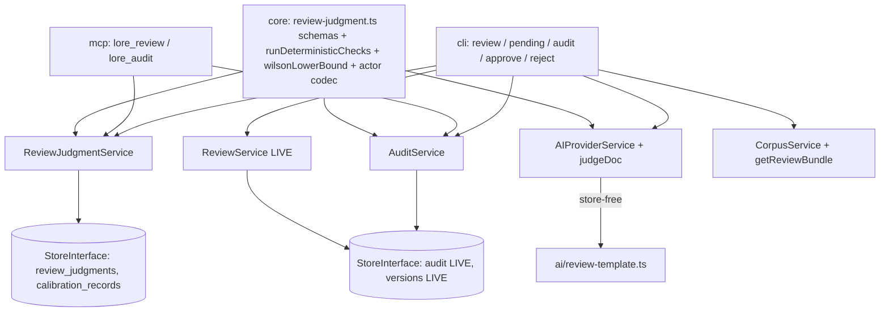

# SPEC-034 — Structured review judgment + triage queue

> Kind: tech. Parent: PRD-001 §14 (v0.6). Delivers D1 (ReviewJudgment schema + judge), D2-triage (confidence-gated escalation, NO execution), D6-CLI (triage queue).
> Declared dependencies: SPEC-032 (check-tree pre-check; degrades to skipped+warning when blueprint absent). Sibling: SPEC-035 (audit + calibration) — designed as one unit, shared decision table below.
> Consumer: plan → test → implement. Design reviewed by 4 parallel perspectives (coupling/cohesion/reuse/testing), all findings applied 2026-07-06.

## 0. Implementation reality (verified — do not rebuild)

| Capability | Status | Location |
|---|---|---|
| `audit` table (append-only) + `appendAuditEntry` + `queryAudit(filters)` | **LIVE** (write + read, all 3 stores) | `001-initial.sql`; `store-interface.ts:184-188` |
| Audit writers: create/update/delete (CorpusService), approve/reject (ReviewService), restore (VersionService) | **LIVE** | `grep 'appendAuditEntry' src/service/` |
| Audit coverage gap: `TaskWorkflowService` claim/release/evidence write NO audit | **GAP** | verified 2026-07-06 |
| Audit read surface (CLI/MCP) | **ABSENT** — `queryAudit` has zero adapter consumers | verified |
| LLM-as-judge seam: bundle read → `AIProviderService.assessPlan` → extract JSON → one corrective retry → persist | **LIVE pattern** (SPEC-026) | `ai-provider-service.ts`, `assessment.ts`, `assess-template.ts` |
| Hermetic judge spawn (env sanitize) | **LIVE** (SPEC-030) | `ai/hermetic-spawn.ts` |
| `ReviewService.pending/approve/reject` + `expected_version` optimistic locking | **LIVE** (SPEC-005) | `review-service.ts` |
| Deterministic check primitives: Zod schemas, `isValidParentType`, `parseTreeBlueprint`+`checkTree`, link queries | **LIVE** (check-tree arming = SPEC-032, declared dependency) | `@lore/core`, `tree-check-service.ts` |
| `review_judgments` / `calibration_records` tables | **ABSENT** | — |

**Benchmark grounding** [EVIDENCE] [B] deepwiki langfuse/langfuse — "score records carry `{value, dataType, source(API|ANNOTATION|EVAL), comment, configId, authorUserId}`, attached by traceId/observationId; human annotation distinguished from eval-generated via `source`". Validates: (a) judgment (EVAL-analog) and human calibration (ANNOTATION-analog) as distinct records discriminated by source/actor, (b) config-referenced constraints, (c) append-only score streams. [CONFIDENCE] HIGH for the pattern; our domain is narrower (two dedicated tables instead of one polymorphic scores table — fewer moving parts for 2 record kinds).

---


## SPEC-034 — Structured review judgment + triage queue (D1, D2-triage, D6-CLI)

### 1. Module boundary

- **Public API**: `ReviewJudgmentService` (record/read judgments, triage view assembly), `AIProviderService.judgeDoc()`, `runDeterministicChecks()` pure fn, `lore review` / upgraded `lore pending` CLI, `lore_review` MCP tool.
- **Internal**: judge prompt template, JSON extraction/validation, triage badge rendering.
- **Dependencies**: StoreInterface (new judgment methods), existing AI provider registry (SPEC-017/020/030), core check primitives, SPEC-032 blueprint (for the check-tree pre-check — **declared dependency**; pre-check degrades to `skipped` with a warning when `lore.tree.yaml` is absent, never silently passes).

### 2. Data model (`@lore/core` Zod SSOT: `review-judgment.ts`)

```typescript
export const REVIEW_DECISIONS = ["approve", "reject", "escalate"] as const;
export type ReviewDecision = (typeof REVIEW_DECISIONS)[number];

export const judgeIdentitySchema = z.object({
  provider: z.string().min(1),        // "cli" | "http" | ...
  model: z.string().min(1),           // resolved model id
  prompt_version: z.string().min(1),  // REVIEW_PROMPT_VERSION const, bumped on template change
});
export type JudgeIdentity = z.infer<typeof judgeIdentitySchema>; // I1 compares this exact tuple

export const checkResultSchema = z.object({
  check: z.enum(["schema", "parent_contract", "tree_position", "link_integrity", "evidence_completeness"]),
  outcome: z.enum(["pass", "fail", "skipped"]),   // skipped = prerequisite absent (e.g. no blueprint) — NEVER silent
  detail: z.string().optional(),
});

export const reviewJudgmentSchema = z.object({
  id: z.string(),                     // ULID
  doc_id: z.string(),
  doc_version: z.number().int(),      // judgment is version-pinned
  decision: z.enum(REVIEW_DECISIONS),
  confidence: z.number().min(0).max(1),
  reasons: z.array(z.object({
    dimension: z.string(),            // e.g. "completeness", "consistency", "contract"
    finding: z.string(),
    evidence_ref: z.string().optional(),
  })).min(1),
  checks: z.array(checkResultSchema), // deterministic pre-checks, run BEFORE the LLM
  blocking_questions: z.array(z.string()), // REQUIRED non-empty iff decision === "escalate" (superRefine)
  judge: judgeIdentitySchema,
  created_at: z.string(),
  created_by: z.string(),             // actor who invoked the review
});
```

LLM output schema = `reviewJudgmentSchema` minus `{id, doc_id, doc_version, judge, created_at, created_by}` (mirrors SPEC-026: the model cannot know its own identity/clock — service layers those on after parse). `extractAssessmentJson` is reused as-is from `@lore/core` (already tolerant of fences/prose).

Calibration SSOT lives in `packages/core/src/calibration.ts`: `calibrationRecordSchema` (Zod — the DDL below is its projection, never the other way round) + `wilsonLowerBound(successes, n)` co-located with its owning schema (assessment.ts precedent: pure fns next to their schema, no standalone stats.ts until a second consumer exists).

Prompt template module is version-keyed from day one: `ai/review-template.ts` exports `REVIEW_TEMPLATES: Record<string, ReviewTemplateFn>` (one entry now, active version = `REVIEW_PROMPT_VERSION` const) — SPEC-038 A/B adds entries instead of restructuring the module.

### 3. DDL (`migrations/migration-003.ts`, additive — never edit shipped migrations)

```sql
CREATE TABLE review_judgments (
  id            TEXT PRIMARY KEY,             -- ULID
  doc_id        TEXT NOT NULL REFERENCES docs(id),
  doc_version   INTEGER NOT NULL,
  decision      TEXT NOT NULL CHECK(decision IN ('approve','reject','escalate')),
  confidence    REAL NOT NULL CHECK(confidence >= 0 AND confidence <= 1),
  reasons       TEXT NOT NULL,                -- JSON array
  checks        TEXT NOT NULL,                -- JSON array
  blocking_questions TEXT NOT NULL DEFAULT '[]',
  judge_provider TEXT NOT NULL,
  judge_model    TEXT NOT NULL,
  judge_prompt_version TEXT NOT NULL,
  created_at    TEXT NOT NULL,
  created_by    TEXT NOT NULL
);
CREATE INDEX idx_judgments_doc ON review_judgments(doc_id, created_at DESC);
CREATE INDEX idx_judgments_prompt ON review_judgments(judge_prompt_version);
```

Access patterns: (a) latest judgment for doc@version → `idx_judgments_doc`; (b) per-prompt-version aggregation (SPEC-035 stats) → `idx_judgments_prompt`. Append-only: no UPDATE/DELETE path exposed on StoreInterface.

### 4. Flow & seams (mirrors SPEC-026 exactly)

```
adapters/cli/commands/review.ts        (thin pipe, orchestrates)
  │ 1. CorpusService.getReviewBundle(idOrSlug)      ← read orchestration in CorpusService (getPlanBundle precedent)
  │      → {doc, parent?, links[], blueprint?}       (blueprint absent → check skipped)
  │ 2. runDeterministicChecks(bundle)                ← pure fn in @lore/core (referentially transparent)
  │      any FAIL → judgment recorded WITHOUT LLM call: decision=reject, confidence=1.0, checks[] carry the failures
  │ 3. AIProviderService.judgeDoc(bundle, checks, opts)  ← store-free; prompt via ai/review-template.ts;
  │      char budgets ai.review.* (NFR-15); extract → validate → ONE corrective retry → AI_PROVIDER_ERROR
  │ 4. ReviewJudgmentService.record(judgment)        ← owns persistence; also writes AuditEvent action="judge"
  ▼
lore pending                                         ← triage view: ReviewService.pending() ⋈ latest judgment per doc
```

- **Batch**: `lore review --pending` = loop over pending docs, ≤N judge calls (NFR-15), per-doc failures collected not fatal (exit 6 only if ALL fail).
- **AI surface rule**: like `lore assess` (SPEC-026 precedent), the command name IS the AI intent — SPEC-024's per-surface agent-off default does NOT brake `lore review`; only explicit `ai.default_per_surface.<surface>=false` config requires `--ai`; `--no-ai` exits 2. Deterministic-check-fail short-circuit is NOT an AI path (no provider touched).
- **Triage rendering**: `lore pending` rows gain `[AI: approve 0.93]` / `[AI: escalate ✋2Q]` / `[unreviewed]` badges (SPEC-025 claim-badge precedent); `--escalated` filter shows only escalations, each with its `blocking_questions` — this is the owner's "only what AI can't decide" queue. Stale marker when judgment.doc_version < doc.version.

### 5. Service (`judgment-service.ts` — new, stateless)

Named `JudgmentService` — NOT "ReviewJudgmentService" — to avoid prefix collision with the existing SPEC-005 `ReviewService` (human workflow). It owns the judgment-lifecycle data family: `review_judgments` AND `calibration_records` (calibration rows are judgment-derived — FK to judgment; one owner for the family, honestly documented).

```typescript
export class JudgmentService {
  constructor(private readonly store: StoreInterface, private readonly telemetry: Telemetry) {}
  record(j: NewReviewJudgment): Promise<Result<ReviewJudgment, LoreError>>;      // + audit "judge"
  latestFor(docId: DocId): Promise<Result<ReviewJudgment | null, LoreError>>;
  listFor(docId: DocId): Promise<Result<ReviewJudgment[], LoreError>>;
  recordCalibration(input: NewCalibrationRecord): Promise<Result<CalibrationRecord, LoreError>>; // version-pin enforced here
  computeCalibrationStats(filter?: {doc_type?: DocType; prompt_version?: string}):
    Promise<Result<CalibrationStats[], LoreError>>;  // {doc_type, prompt_version, n, agreement_rate, wilson_lower_bound, window}
}
```

`computeCalibrationStats` is the SINGLE aggregation owner — `lore calibration --stats` is a thin pipe over it, and SPEC-036's circuit breaker calls the same method (named downstream consumer; extracting the seam now prevents a guaranteed logic fork). Never touches doc status — execution stays human (SPEC-036 is the future auto-execution spec, ADR-gated). Alternative considered: separate `CalibrationService` — rejected: calibration rows are meaningless without their judgment FK; splitting doubles DI wiring for one write + one read method.

### 6. MCP / config

- MCP: `lore_review {id, by}` (by required — MCP precedent), `lore_pending` gains `include_judgments: boolean`.
- Config: `ai.review: {max_doc_chars: 12000, max_context_chars: 8000}` (assess budget precedent). No thresholds here — those are SPEC-036.

---


## Dependency graph (both specs)



No cycles: core ← services ← adapters, strictly one-way. AIProviderService stays store-free; ReviewJudgmentService/AuditService are store-only (no AI); adapters compose.

## Design decisions

| # | Decision | Choice | Alternative rejected | Rationale |
|---|---|---|---|---|
| D1 | Judge seam | Mirror SPEC-026: AIProviderService.judgeDoc + new ReviewJudgmentService + adapter orchestration | Extend ReviewService with AI | ReviewService would gain an AI dependency, breaking store-only services + no-cross-service-call invariants; SPEC-026 seam is proven |
| D2 | Pre-checks | Pure fn `runDeterministicChecks` in @lore/core | Method on service | Referentially transparent, black-box testable, reusable by SPEC-036 auto-execution |
| D3 | Calibration trigger | Implicit on approve/reject (version-pinned) | Explicit `lore calibrate` command | Calibration as byproduct of existing behavior = no missed records, no new chore; explicit command guarantees data holes |
| D4 | Audit actor | String encoding `ai:{provider}:{model}:{prompt_version}` + codec in core | Schema migration adding actor columns | Append-only table schema stability; codec is SSOT; columns can come later with data-proven need |
| D5 | Verify semantics | versions-anchored reconcile + `audit.verify_since` watermark | "All transitions ever" | Historical holes (pre-SPEC-035) would fail the oracle permanently; watermark = strict forward, honest backward |
| D6 | Calibration query shape | Denormalized doc_type + (doc_type, created_at DESC) index | JOIN docs per aggregation | O(window) single-index scan honors NFR-2; append-only ⇒ denormalization can't drift |
| D7 | Judgment execution | Judgments NEVER change doc status in R1 | Auto-approve high-confidence now | PRD 14.3: shadow first; execution is SPEC-036, ADR-gated on calibration data |
| D8 | Service naming & ownership | `JudgmentService` owns judgment + calibration family; stats aggregation is its method | `ReviewJudgmentService` name / separate CalibrationService / stats inline in CLI | Name collision with SPEC-005 ReviewService; calibration is judgment-FK'd derived data; stats seam shared with SPEC-036 prevents logic fork |
| D9 | Verify join key | Exact `(doc_id, action, details.version)` match; writers upgraded to record version | Timestamp ±2s tolerance | Fuzzy time-matching absorbs write-ordering drift instead of proving co-writing; exact join is order-independent |

**Accepted debt (flagged, non-blocking)**: `CorpusService` is a growing read-orchestration hub (tree/getPlanBundle/getReviewBundle, ~960 lines); the pattern is consistent but unbounded — future refactor candidate (extract a `BundleAssembler`), not this spec's scope. `SyncDocsService(corpusService)` already bends the no-cross-service-call norm once; D1's rationale rests on the AIProviderService-store-free invariant, which remains unbent.

## Cross-cutting concerns

- **Security (STRIDE-lite)**: judge prompt embeds doc content — same trust boundary as SPEC-026 (corpus content → own AI provider; no third-party exfiltration beyond the already-configured provider). MDX is NOT resolved in judge input (raw content only) — no placeholder-driven data amplification. Actor strings are write-time constants, not user input paths; `parseAuditActor` treats unknown formats as opaque human names (no injection surface).
- **Performance**: NFR-15 budgets (`ai.review.*`); batch = ≤N calls; calibration/judgment reads all index-backed; verify walk is O(versions since watermark) — acceptable for a CLI-invoked oracle, not a hot path.
- **Observability**: judgment telemetry event (`ai.review` — assess precedent: provider, duration, decision, confidence); judge call count visible per NFR-15.
- **Privacy**: no new PII — actors are existing usernames/provider ids; audit content references doc ids, not content copies.

## Quality gates (module mode)

- [x] No circular dependencies (core ← service ← adapter one-way; two new services store-only)
- [x] Single responsibility per module (judgment persistence ≠ audit query ≠ AI invocation ≠ orchestration)
- [x] Public API black-box testable (pure fns: runDeterministicChecks, wilsonLowerBound, actor codec; Result-returning services; seeding via StoreInterface)
- [x] Dependencies injectable (services take StoreInterface + Telemetry; provider via existing registry DI)

## Test dimensions (handoff to tester)

HAPPY (judge → judgment persisted → pending badge; approve on judged doc → calibration confirmed) / NEGATIVE (--no-ai exits 2; escalate without blocking_questions rejected by Zod; calibration skipped on version mismatch) / BOUNDARY (empty pending batch; confidence 0 and 1; window with n<50) / ERROR (provider failure after retry → exit 6, no judgment row; malformed judge JSON → one retry; calibration write failure → stderr warning, exit 0) / STATE (verify watermark before/after; stale judgment badge after doc edit) / REGRESSION (existing approve/reject/pending behavior unchanged when no judgment exists; audit verify passes on fresh corpus).

**Hermeticity (MANDATORY, learned from assess.test.ts N3 incident 2026-07-06)**: extract the fail-fast stub-`claude` PATH-shim `beforeEach` from `assess.test.ts` into a shared helper (`tests/helpers/stub-claude.ts`); EVERY integration test spawning the CLI on an AI-intent command (`review`, `assess`) MUST use it — a test that resolves the real `claude` binary is a defect, not an environment quirk. Known registry limitation (from `assess-ai.bun.test.ts`): the provider registry has no `kind: "in-memory"` branch, so CLI-level judge-path coverage uses the fake-binary + bun:sqlite pattern, not `InMemoryAIProvider` — tester should follow that file's precedent, not fight it.

## Downstream handoff (implement)

- New files: `packages/core/src/review-judgment.ts`, `packages/core/src/calibration.ts` (calibrationRecordSchema + wilsonLowerBound co-located), `packages/core/src/audit-actor.ts`, `packages/lore/src/ai/review-template.ts` (version-keyed `REVIEW_TEMPLATES` registry), `packages/lore/src/service/judgment-service.ts`, `packages/lore/src/service/audit-service.ts`, `packages/lore/src/store/migrations/migration-003.ts`, `packages/lore/src/adapters/cli/commands/review.ts`, `.../audit.ts`, `.../calibration.ts`, `packages/lore/tests/helpers/stub-claude.ts` (extracted from assess.test.ts).
- Changed: `store-interface.ts` (+5 methods) + 3 store impls, `pending.ts` (badges), `approve.ts`/`reject.ts` (calibration hook + partial-failure warning), `task-workflow-service.ts` (audit writes), all audit writers (+`details.version`), `ai-provider-service.ts` (judgeDoc), `ai.ts` (review budgets), `config.ts` (audit.verify_since), MCP `tools.ts` (lore_review, lore_audit — mind ADR-tsc-memory: pre-declared z.object schemas, no inline raw shapes), `app.ts` (wire 2 services), `assess.test.ts` (switch to shared stub helper).
- Implementation order: migration-003 + core schemas → store methods → services → judgeDoc + template → CLI → MCP. SPEC-034 before SPEC-035's calibration half (FK dependency); SPEC-035's audit half (TWF writes + audit CLI + verify) is independent and can parallelize.


## Code anchors

- packages/lore/src/service/judgment-service.ts
- packages/core/src/review-judgment.ts
