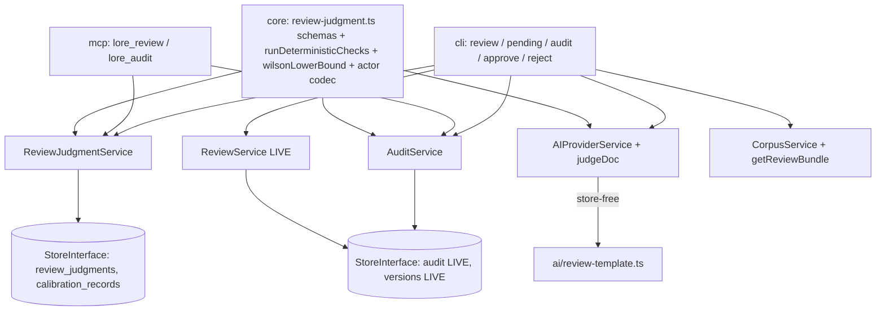

# SPEC-035 — Audit trail + calibration data

> Kind: tech. Parent: PRD-001 §14 (v0.6). Delivers D3 (audit query surface + coverage completion + verify oracle), D4 (calibration records + stats).
> Declared dependencies: SPEC-034 (review_judgments FK for the calibration half; the audit half is independent and parallelizable). Sibling: SPEC-034 — designed as one unit, shared decision table below.
> Consumer: plan → test → implement. Design reviewed by 4 parallel perspectives (coupling/cohesion/reuse/testing), all findings applied 2026-07-06.

## 0. Implementation reality (verified — do not rebuild)

| Capability | Status | Location |
|---|---|---|
| `audit` table (append-only) + `appendAuditEntry` + `queryAudit(filters)` | **LIVE** (write + read, all 3 stores) | `001-initial.sql`; `store-interface.ts:184-188` |
| Audit writers: create/update/delete (CorpusService), approve/reject (ReviewService), restore (VersionService) | **LIVE** | `grep 'appendAuditEntry' src/service/` |
| Audit coverage gap: `TaskWorkflowService` claim/release/evidence write NO audit | **GAP** | verified 2026-07-06 |
| Audit read surface (CLI/MCP) | **ABSENT** — `queryAudit` has zero adapter consumers | verified |
| LLM-as-judge seam: bundle read → `AIProviderService.assessPlan` → extract JSON → one corrective retry → persist | **LIVE pattern** (SPEC-026) | `ai-provider-service.ts`, `assessment.ts`, `assess-template.ts` |
| Hermetic judge spawn (env sanitize) | **LIVE** (SPEC-030) | `ai/hermetic-spawn.ts` |
| `ReviewService.pending/approve/reject` + `expected_version` optimistic locking | **LIVE** (SPEC-005) | `review-service.ts` |
| Deterministic check primitives: Zod schemas, `isValidParentType`, `parseTreeBlueprint`+`checkTree`, link queries | **LIVE** (check-tree arming = SPEC-032, declared dependency) | `@lore/core`, `tree-check-service.ts` |
| `review_judgments` / `calibration_records` tables | **ABSENT** | — |

**Benchmark grounding** [EVIDENCE] [B] deepwiki langfuse/langfuse — "score records carry `{value, dataType, source(API|ANNOTATION|EVAL), comment, configId, authorUserId}`, attached by traceId/observationId; human annotation distinguished from eval-generated via `source`". Validates: (a) judgment (EVAL-analog) and human calibration (ANNOTATION-analog) as distinct records discriminated by source/actor, (b) config-referenced constraints, (c) append-only score streams. [CONFIDENCE] HIGH for the pattern; our domain is narrower (two dedicated tables instead of one polymorphic scores table — fewer moving parts for 2 record kinds).

---


## SPEC-035 — Audit trail + calibration data (D3, D4)

### 1. Module boundary

- **Public API**: `AuditService` (query + verify), `lore audit` CLI, calibration auto-capture inside approve/reject flow, `lore calibration --stats` read surface, `lore_audit` MCP tool.
- **Internal**: actor encoding helpers, verify reconciliation walk.
- **Dependencies**: existing `audit` table + `queryAudit` (LIVE — this spec adds zero audit-storage schema), `review_judgments` (SPEC-034 — **declared dependency**), new `calibration_records` table.

### 2. Audit: close the gaps (no new table)

- **Coverage fix**: `TaskWorkflowService.addEvidence/claim/release` append audit entries (actions `evidence`, `claim`, `release`); `ReviewJudgmentService.record` appends `judge`. Action vocabulary becomes: `create|update|delete|approve|reject|restore|claim|release|evidence|judge`.
- **Actor encoding (zero schema change)**: humans stay plain usernames; AI judges encode as `ai:{provider}:{model}:{prompt_version}` via `formatJudgeActor()/parseAuditActor()` in `@lore/core` (SSOT — nobody hand-rolls the string). `judgment_ref` rides in the existing `details` JSON.
- **CLI**: `lore audit <doc>` (per-doc decision trail: who/what/when/basis, joined judgment summary), `lore audit --actor <a> --action <x> --since <t> --json` (filters map 1:1 to live `AuditFilters`).
- **`lore audit --verify` (completeness oracle, EXACT join)**: anchor = `versions` table (append-only ground truth). SPEC-035 upgrades every audit writer to include `details.version` (the doc version the action produced) — so for every version row with `action ∈ {create,update,approve,reject,restore}` and `created_at >= audit.verify_since`, verify demands an audit entry matching `(doc_id, action, details.version)` EXACTLY. No timestamp-tolerance fuzzy matching: a ±2s window would silently absorb write-ordering drift between the two non-transactional inserts instead of proving co-writing — the exact version join makes ordering irrelevant. Watermark `audit.verify_since` (config, default = SPEC-035 deploy date) makes the oracle strict going forward without being permanently failed by known-historical holes (pre-SPEC-035 TaskWorkflow silence, v1-migration imports; pre-watermark entries also lack `details.version`). Exit 0 clean / exit 4 with itemized misses.

### 3. Calibration (`calibration_records`, append-only)

```sql
CREATE TABLE calibration_records (
  id            TEXT PRIMARY KEY,             -- ULID
  judgment_id   TEXT NOT NULL REFERENCES review_judgments(id),
  doc_id        TEXT NOT NULL REFERENCES docs(id),
  doc_type      TEXT NOT NULL,                -- denormalized from docs at write time (append-only ⇒ no drift);
                                              -- buys single-index window scans, no join (NFR-2)
  human_outcome TEXT NOT NULL CHECK(human_outcome IN ('confirmed','overridden')),
  delta_reasons TEXT NOT NULL DEFAULT '[]',   -- JSON; why the human differed (optional free-ish, still array-shaped)
  actor         TEXT NOT NULL,
  created_at    TEXT NOT NULL
);
CREATE INDEX idx_calibration_window ON calibration_records(doc_type, created_at DESC);
CREATE INDEX idx_calibration_judgment ON calibration_records(judgment_id);
```

**Write trigger — implicit, not a new human chore**: when `lore approve/reject` executes on a doc that has a judgment for the CURRENT doc version, the command computes the pairing and writes the record automatically:

| Human action | AI decision | human_outcome |
|---|---|---|
| approve | approve | confirmed |
| approve | reject/escalate | overridden |
| reject | reject | confirmed |
| reject | approve/escalate | overridden |

- **Version-pinned rule**: judgment.doc_version ≠ current doc.version → NO record (the judgment saw a different document; wrong data is worse than missing data). The pending badge already shows staleness.
- **Partial-failure contract (adapter-sequenced two-call)**: `approve.ts` runs `ReviewService.approve` → on ok, `JudgmentService.recordCalibration`. Calibration write failure NEVER un-approves (doc state is primary; calibration is derived data) and NEVER silently drops: the command prints an explicit `warning: approved, but calibration record failed: <error>` to stderr, emits a telemetry event, and still exits 0 (approve succeeded). Fail-loud without inverting priorities.
- Escalations: the human's subsequent approve/reject on an escalated doc records outcome with `delta_reasons` seeded from which blocking_questions the action answered (best-effort; empty allowed).
- `--calibration-note "<why>"` optional flag on approve/reject feeds `delta_reasons` — zero-friction default, structured when the owner cares.

### 4. Stats read surface (feeds SPEC-036 later; read-only here)

`lore calibration --stats [--json]`: per doc_type × judge_prompt_version → `{n, agreement_rate, wilson_lower_bound(0.95 CI), window: last 50}`. Wilson bound computed in a pure `@lore/core` fn (`wilsonLowerBound(successes, n)`) with direct unit tests — PRD 14.3's gate math becomes importable, not reimplemented. Bounded-window query via `idx_calibration_window` — O(window) per type, never full-table (PRD 14.2 commitment).

**Seeding path (testability, PRD 14.2)**: `StoreInterface.insertCalibrationRecord` / `insertJudgment` are the REAL production write paths — `JudgmentService.record`/`recordCalibration` call them (exactly the `insertVersion` precedent: dual production+seed use, no "test-only by convention" fiction). Invariants that must hold regardless of caller (Zod shape validation) live in the store methods; invariants that are service policy (version-pin check) live in `JudgmentService` and are documented as such — a direct store write bypasses policy knowingly, which is precisely what test seeding needs.

### 5. Service split

`AuditService` (new, ~120 lines): `query(filters)`, `verify(since?)` — the reconcile walk versions⋈audit. Kept separate from ReviewJudgmentService: audit spans ALL actions (SRP), judgment service owns judgment/calibration rows only. Calibration write lives in ReviewJudgmentService (`recordCalibration`), invoked by the approve/reject CLI command after ReviewService returns ok — adapter-sequenced, consistent with "composition in adapters" (app.ts wiring precedent; services never cross-call).

---


## Dependency graph (both specs)



No cycles: core ← services ← adapters, strictly one-way. AIProviderService stays store-free; ReviewJudgmentService/AuditService are store-only (no AI); adapters compose.

## Design decisions

| # | Decision | Choice | Alternative rejected | Rationale |
|---|---|---|---|---|
| D1 | Judge seam | Mirror SPEC-026: AIProviderService.judgeDoc + new ReviewJudgmentService + adapter orchestration | Extend ReviewService with AI | ReviewService would gain an AI dependency, breaking store-only services + no-cross-service-call invariants; SPEC-026 seam is proven |
| D2 | Pre-checks | Pure fn `runDeterministicChecks` in @lore/core | Method on service | Referentially transparent, black-box testable, reusable by SPEC-036 auto-execution |
| D3 | Calibration trigger | Implicit on approve/reject (version-pinned) | Explicit `lore calibrate` command | Calibration as byproduct of existing behavior = no missed records, no new chore; explicit command guarantees data holes |
| D4 | Audit actor | String encoding `ai:{provider}:{model}:{prompt_version}` + codec in core | Schema migration adding actor columns | Append-only table schema stability; codec is SSOT; columns can come later with data-proven need |
| D5 | Verify semantics | versions-anchored reconcile + `audit.verify_since` watermark | "All transitions ever" | Historical holes (pre-SPEC-035) would fail the oracle permanently; watermark = strict forward, honest backward |
| D6 | Calibration query shape | Denormalized doc_type + (doc_type, created_at DESC) index | JOIN docs per aggregation | O(window) single-index scan honors NFR-2; append-only ⇒ denormalization can't drift |
| D7 | Judgment execution | Judgments NEVER change doc status in R1 | Auto-approve high-confidence now | PRD 14.3: shadow first; execution is SPEC-036, ADR-gated on calibration data |
| D8 | Service naming & ownership | `JudgmentService` owns judgment + calibration family; stats aggregation is its method | `ReviewJudgmentService` name / separate CalibrationService / stats inline in CLI | Name collision with SPEC-005 ReviewService; calibration is judgment-FK'd derived data; stats seam shared with SPEC-036 prevents logic fork |
| D9 | Verify join key | Exact `(doc_id, action, details.version)` match; writers upgraded to record version | Timestamp ±2s tolerance | Fuzzy time-matching absorbs write-ordering drift instead of proving co-writing; exact join is order-independent |

**Accepted debt (flagged, non-blocking)**: `CorpusService` is a growing read-orchestration hub (tree/getPlanBundle/getReviewBundle, ~960 lines); the pattern is consistent but unbounded — future refactor candidate (extract a `BundleAssembler`), not this spec's scope. `SyncDocsService(corpusService)` already bends the no-cross-service-call norm once; D1's rationale rests on the AIProviderService-store-free invariant, which remains unbent.

## Cross-cutting concerns

- **Security (STRIDE-lite)**: judge prompt embeds doc content — same trust boundary as SPEC-026 (corpus content → own AI provider; no third-party exfiltration beyond the already-configured provider). MDX is NOT resolved in judge input (raw content only) — no placeholder-driven data amplification. Actor strings are write-time constants, not user input paths; `parseAuditActor` treats unknown formats as opaque human names (no injection surface).
- **Performance**: NFR-15 budgets (`ai.review.*`); batch = ≤N calls; calibration/judgment reads all index-backed; verify walk is O(versions since watermark) — acceptable for a CLI-invoked oracle, not a hot path.
- **Observability**: judgment telemetry event (`ai.review` — assess precedent: provider, duration, decision, confidence); judge call count visible per NFR-15.
- **Privacy**: no new PII — actors are existing usernames/provider ids; audit content references doc ids, not content copies.

## Quality gates (module mode)

- [x] No circular dependencies (core ← service ← adapter one-way; two new services store-only)
- [x] Single responsibility per module (judgment persistence ≠ audit query ≠ AI invocation ≠ orchestration)
- [x] Public API black-box testable (pure fns: runDeterministicChecks, wilsonLowerBound, actor codec; Result-returning services; seeding via StoreInterface)
- [x] Dependencies injectable (services take StoreInterface + Telemetry; provider via existing registry DI)

## Test dimensions (handoff to tester)

HAPPY (judge → judgment persisted → pending badge; approve on judged doc → calibration confirmed) / NEGATIVE (--no-ai exits 2; escalate without blocking_questions rejected by Zod; calibration skipped on version mismatch) / BOUNDARY (empty pending batch; confidence 0 and 1; window with n<50) / ERROR (provider failure after retry → exit 6, no judgment row; malformed judge JSON → one retry; calibration write failure → stderr warning, exit 0) / STATE (verify watermark before/after; stale judgment badge after doc edit) / REGRESSION (existing approve/reject/pending behavior unchanged when no judgment exists; audit verify passes on fresh corpus).

**Hermeticity (MANDATORY, learned from assess.test.ts N3 incident 2026-07-06)**: extract the fail-fast stub-`claude` PATH-shim `beforeEach` from `assess.test.ts` into a shared helper (`tests/helpers/stub-claude.ts`); EVERY integration test spawning the CLI on an AI-intent command (`review`, `assess`) MUST use it — a test that resolves the real `claude` binary is a defect, not an environment quirk. Known registry limitation (from `assess-ai.bun.test.ts`): the provider registry has no `kind: "in-memory"` branch, so CLI-level judge-path coverage uses the fake-binary + bun:sqlite pattern, not `InMemoryAIProvider` — tester should follow that file's precedent, not fight it.

## Downstream handoff (implement)

- New files: `packages/core/src/review-judgment.ts`, `packages/core/src/calibration.ts` (calibrationRecordSchema + wilsonLowerBound co-located), `packages/core/src/audit-actor.ts`, `packages/lore/src/ai/review-template.ts` (version-keyed `REVIEW_TEMPLATES` registry), `packages/lore/src/service/judgment-service.ts`, `packages/lore/src/service/audit-service.ts`, `packages/lore/src/store/migrations/migration-003.ts`, `packages/lore/src/adapters/cli/commands/review.ts`, `.../audit.ts`, `.../calibration.ts`, `packages/lore/tests/helpers/stub-claude.ts` (extracted from assess.test.ts).
- Changed: `store-interface.ts` (+5 methods) + 3 store impls, `pending.ts` (badges), `approve.ts`/`reject.ts` (calibration hook + partial-failure warning), `task-workflow-service.ts` (audit writes), all audit writers (+`details.version`), `ai-provider-service.ts` (judgeDoc), `ai.ts` (review budgets), `config.ts` (audit.verify_since), MCP `tools.ts` (lore_review, lore_audit — mind ADR-tsc-memory: pre-declared z.object schemas, no inline raw shapes), `app.ts` (wire 2 services), `assess.test.ts` (switch to shared stub helper).
- Implementation order: migration-003 + core schemas → store methods → services → judgeDoc + template → CLI → MCP. SPEC-034 before SPEC-035's calibration half (FK dependency); SPEC-035's audit half (TWF writes + audit CLI + verify) is independent and can parallelize.

## Implementation amendments (2026-07-06, phase-review APPROVED)

- **D9 join key revised**: `verify` joins on `(doc_id, details.version)` PLUS an action-FAMILY check (`VERSION_ACTION_AUDIT_FAMILY`: create→create; update→{update,claim,release,evidence}; approve/reject/restore→exact), NOT the spec's original literal `(doc_id, action, details.version)` triple. Reason: TaskWorkflowService's shared `writeTaskExtra` records versions rows under action `"update"` while auditing with the more specific claim/release/evidence actions — a literal action match would false-miss every TWF write. `"judge"` belongs to no family (judgments never bump doc versions), so a judge entry cannot incidentally satisfy a missing writer entry (regression-tested).
- **Stats grouping**: `queryCalibrationWindow` unconditionally JOINs review_judgments to project `judge_prompt_version` per row (`CalibrationRecordWithPromptVersion`); `computeCalibrationStats` groups by real `(doc_type, prompt_version)` pairs — no sentinel buckets.
- **Watermark operational note**: `audit.verify_since` must be set to the moment the NEW binary (with `details.version` writers) actually deploys, not the calendar date — same-day writes from the previous binary are pre-watermark history (66 such entries observed and correctly excluded on this repo).


## Acceptance Criteria (structured)

- [✔] [script] AC-AUDIT-ACTOR-1: resolveActor emits exactly 1 non-blocking stderr advisory (naming --by / LORE_ACTOR as the fix) at most once per process ONLY when the actor falls to the OS-username default (no --by, no $LORE_ACTOR); an explicit --by value OR a set $LORE_ACTOR yields exactly 0 advisory lines; the resolved actor string and the caller's exit code are byte-identical to before in all three cases; at least 1 test file runs and exits 0
  script: test — bunx vitest run packages/lore/tests/unit/adapters/cli-utils.test.ts

## Code anchors

- packages/lore/src/service/audit-service.ts
- packages/lore/src/adapters/cli/utils.ts#resolveActorWithSource
