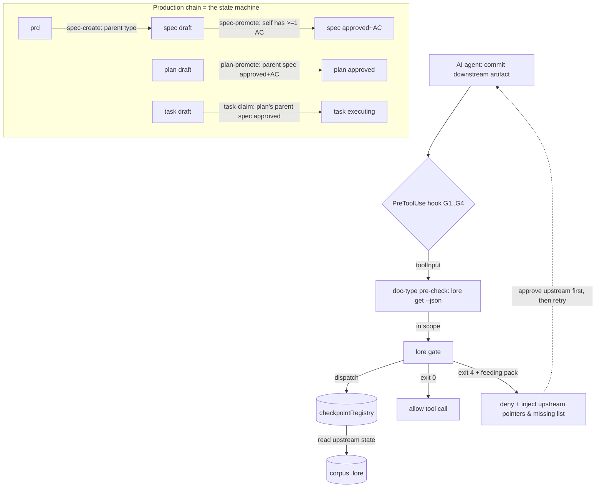

**spec_kind:** tech · **implements →** `adr-corpus-governed-active-ai-workflow-inversion-of-control-with`

## 1. Overview & Goal

Deliver **P2 — the workflow state machine (phases + deterministic entry/exit checks)** from the parent ADR. slice-1 proved the Inversion of Control runs on ONE lifecycle node (spec production) with two hardcoded checkpoints (`spec-create`, `spec-promote`). P2 **generalizes those two hardcoded checkpoints into a declarative checkpoint registry**, then uses that registry to model the whole IoC **production chain** — `prd → spec → plan → task` — as a typed state machine whose transitions are gated by **corpus-state predicates**.

The defining new capability is the **cross-tier precondition edge**: a downstream artifact cannot be **committed** (a plan approved, a task executed) until its upstream has satisfied its own exit condition. This upgrades SPEC-032's `upstream_unapproved` signal — today a **read-side advisory that "NEVER changes ready"** (`task-workflow.ts:423`) — into a **deterministic block**, enforced at the transition where the advisory already lives.

**Where the edge is enforced — commit-time, not create-time (D-1).** slice-1 set the precedent: `spec-create` gates only on the parent's **type** legality (`parentLegal` checks `parent.type`, never `parent.status` — `gate-predicates.ts:43`), while the approval/AC requirement is checked at the doc's **own exit gate** (`spec-promote`). P2 follows that precedent exactly: a downstream draft may be authored freely under a still-draft upstream (preserving the observed co-design workflow — see §2.1), but the upstream-approved edge blocks at the **commitment boundary**:
- **`plan-promote`** — a plan may not be approved until its parent spec is approved **and** carries ≥1 declared AC.
- **`task-claim`** — a task may not be claimed for execution until its plan's parent spec is approved (the literal upgrade of the SPEC-032 advisory at its native `lore ready` / `lore claim` boundary; config-gated, default on — see §2.1).

**Non-goal:** a workflow *engine* with stored runtime position. This is a **stateless state machine**: a checkpoint's verdict is a pure function of *current* corpus state, re-derived on every call, never persisted. Upholds slice-1 §5's explicit rejection of "option C — explicit state-machine command + cross-call state (bigger state space, less thin)".

## 2. Terminology & Workflow Grounding

### 2.1 The workflow this gates against (⚠️ measured, not assumed)

The observed workflow in this very corpus (P1 / slice-1 sessions) is **author-and-refine-everything-in-draft, then batch-approve at the end**. Concretely (P1 version logs): plan created `12:16:41` under a spec still in draft (spec approved only at `12:47:26`); task-t1 created `12:17:22` and **executed** (evidence `12:24:13`) while both plan and spec were still draft.

Two consequences drive D-1:
1. Gating **creation** on upstream-approved (the rejected C1 design) would have blocked this legitimate co-design burst. P2 does **not** gate creation on upstream status.
2. Gating **execution** on upstream-approved (the `task-claim` gate, default **on**) *does* change the "execute-in-draft" half of that observed flow into "approve-upstream-then-execute". This is the intended IoC inversion at the execution boundary — blocking task execution against an *unapproved* spec is exactly the free-run the ADR targets. Teams that want to keep executing in draft set `workflow.gates.task-claim.enabled = false`.

Batch approval still works: the only new constraint is **ordering within the batch** — approve the spec before the plan; approve the spec before claiming its tasks.

### 2.2 "phase" is overloaded

- **ADR "phases"** (this spec) = the **doc-type states** of the production chain (`spec` / `plan` / `task` states). The state machine's nodes.
- **SPEC-023 `extra.phases`** = intra-plan **grouping labels** for tasks. Unrelated to P2's gating; they stay pure labels. P2 does NOT add entry/exit checks to SPEC-023 phases.

Whenever this spec says "phase" it means the ADR sense unless it writes `extra.phases`.

## 3. Scope

**IN:**
1. **`checkpointRegistry`** — a pure, declarative table mapping each `GateCheckpoint` to `{ upstream precondition?, deterministic predicates, feeding-pack assembler }`. slice-1's `spec-create` / `spec-promote` are refactored into the first two registry entries with **zero behavior change** (regression-guarded by slice-1's existing tests).
2. **`plan-promote` gate** (NEW — the cross-tier edge at commit) — when a plan transitions draft → in-review/approved, its parent spec must be `approved`/`active` **and** carry ≥1 declared AC. Mirrors `spec-promote`'s doc-type-precheck-then-gate shape (`g2-spec-promote.sh`), but the predicate reaches one tier **up** (parent spec) instead of onto self.
3. **`task-claim` gate** (NEW — the SPEC-032 advisory, upgraded to a block) — a task may not be claimed (`lore claim` / MCP `lore_claim`) while its plan's parent spec is not approved. Reuses `evaluateReadiness`'s exact `parentSpecStatus` predicate (`core/task-workflow.ts:423`) — advisory on the read path, blocking on this write path — a single shared predicate, two consumers. Config-gated (`workflow.gates.task-claim.enabled`, default `true`).
4. **Hook shims** `g3-plan-promote.sh` + `g4-task-claim.sh` — mirror G2 exactly: doc-type pre-check via `lore get --json`, then gate, then map exit to allow/deny; same fail-open contract; same `LORE_GATE_BYPASS` short-circuit. Fire on Bash `lore approve|set --status` (plan) / `lore claim` (task) and the matching MCP tools.
5. **`.claude/settings.json`** wiring for G3/G4.
6. **`workflow.gates.<checkpoint>.enabled` config** — each checkpoint individually disable-able (default `true`). Realizes the ADR "gate density configurable" boundary; an escape valve narrower than the global `LORE_GATE_BYPASS`.

**OUT (later / next increments):**
- Gating **creation** of plan/task on upstream status (the rejected **C1** design — §6). Schema already enforces parent existence/type on create; P2 adds no create-time upstream gate. (A thin parent-type entry gate for plan/task, mirroring `spec-create`, is deferred — its marginal value is low since the interesting constraint is at commit.)
- Any stored workflow runtime state or a `lore workflow`/`lore spec-flow` command carrying cross-call position (slice-1 §5 option C — upheld rejection).
- **P4**: the feed-before-produce protocol + bidirectional skill/prompt ↔ artifact linkage. P2 provides the commit-gate mount points P4 will hang feeding on; it does not implement feed-before-produce itself.
- Gates for the chain *tail* (`verify`, `assess`).
- `UserPromptSubmit` early injection; automated over-refusal calibration dashboard.

## 4. Architecture



Creation of drafts is **not** on this gated path (D-1): only the commit transitions (`spec-promote`, `plan-promote`, `task-claim`) and the chain-entry `spec-create` are.

**Layering (unchanged from slice-1):** hook shims are pure IO plumbing (~10 lines shell, fail-open). ALL decision logic lives behind `lore gate <checkpoint>`, now dispatching through `checkpointRegistry` — the single source of truth shared by the Bash and MCP paths. The registry IS the moat the ADR names: the "graph-state predicate → block/inject" mapping, now data-shaped and extensible instead of hardcoded command bodies.

## 5. Components & Contracts

### 5.1 `checkpointRegistry` (NEW — the generalization)

```ts
type GateCheckpoint =
  | "spec-create" | "spec-promote"    // slice-1, refactored in
  | "plan-promote" | "task-claim";    // P2, new (commit-time)

interface CheckpointDef {
  readonly id: GateCheckpoint;
  // upstream precondition edge; absent for self-only checkpoints (spec-create/-promote)
  readonly upstream?: { readonly relation: "parent" | "grandparent-spec" };
  readonly check: (ctx: GateContext) => PredicateResult[];  // PURE — all deterministic predicates
  readonly feed: (ctx: GateContext, failures: PredicateResult[]) => FeedingPack;
  readonly configKey: `workflow.gates.${GateCheckpoint}`;   // per-checkpoint enable/disable
}
```

- `check` returns the full predicate list (pass + fail); `lore gate` blocks (exit 4) iff any `{ok:false}`.
- Verdict is a pure function of the resolved `GateContext` (the target doc + upstream doc snapshot). **No persisted position** — idempotent precheck (slice-1 §5).

### 5.2 New predicates (extend `gate-predicates.ts`, still pure)

- `upstreamApproved(upstream)` — upstream resolves, is the expected type, status ∈ {`approved`, `active`}. Reasons `UPSTREAM_MISSING` / `UPSTREAM_WRONG_TYPE` / `UPSTREAM_NOT_APPROVED`.
- `upstreamHasAcceptanceCriteria(upstreamSpec)` — reuses SPEC-038 `acceptance_criteria` existence (the same check `spec-promote` runs on self, applied to the parent spec). Reason `UPSTREAM_NO_AC`.

**SSOT with the readiness advisory:** `evaluateReadiness` already derives "the plan's parent spec is not approved" as `upstream_unapproved` (advisory, `task-workflow.ts:423`). The `task-claim` gate consumes the **same pure predicate** — advisory on the read path, blocking on the write path. One definition site, two consumers; P2 does not fork the logic.

### 5.3 `lore gate <checkpoint>` (extend existing command)

- New checkpoints `plan-promote`, `task-claim` dispatch through `checkpointRegistry`; `spec-create`/`spec-promote` keep their exact CLI surface and exit contract (`0` pass / `4` fail), now sourced from the registry.
- On fail, stdout = **feeding pack** (same shape as slice-1): upstream doc title/status/AC pointers + explicit "what's missing" list + a `[source: corpus <slug>, trust: team-authored]` header. Pointers + summary, never a full dump (ADR boundary ②).
- Reads `workflow.gates.<checkpoint>.enabled` (config, default `true`); disabled → immediate exit 0 (logged). `LORE_GATE_BYPASS=1` still short-circuits all checkpoints.

### 5.4 Hook shims G3 / G4 (NEW — thin, mirror G2)

Both follow `g2-spec-promote.sh`'s proven shape: extract the doc id from the command, **pre-check the doc's type via `lore get --json`** (so unrelated approve/claim calls on other doc types are allowed untouched — the mandatory pre-check that keeps a promote gate from false-blocking every `lore approve`), then invoke the gate.

- **G3** `g3-plan-promote.sh`: Bash `lore approve <plan>` / `lore set <plan> --status (in-review|approved)` (or MCP) where the doc resolves to a **plan** → `lore gate plan-promote --plan <id>`.
- **G4** `g4-task-claim.sh`: Bash `lore claim <task>` / MCP `lore_claim` where the doc resolves to a **task** → `lore gate task-claim --task <id>`.
- Both honor `LORE_GATE_BYPASS`; both fail OPEN on every anomaly (jq/binary/lookup/parse/undocumented-exit).

### 5.5 Reuse map (thin-glue evidence)

| Reused | Location |
|---|---|
| exit-code SSOT (`exitCode(4)`) | `cli/utils.ts` |
| pure-predicate pattern + `spec-create`/`spec-promote` bodies | `service/gate-predicates.ts`, `cli/commands/gate.ts` |
| "plan's parent spec not approved" predicate (advisory today) | `evaluateReadiness` `core/task-workflow.ts:423` |
| AC existence on a spec | SPEC-038 `acceptance_criteria` / `AcService` |
| doc-type pre-check + allow/deny protocol + fail-open contract | `hooks/g2-spec-promote.sh` |
| claim mechanics (the gated action) | SPEC-025 `TaskWorkflowService` / `lore claim` |
| feeding-pack text projection | `renderResolvedToMarkdown` `outline-service.ts` |
| probabilistic judge (advisory only) | SPEC-034 JudgmentService |
| gate-block audit | SPEC-035 AuditService |

**Truly new:** `checkpoint-registry.ts` + 2 predicates + 2 registry entries + 2 hook shims + settings wiring + per-checkpoint config.

## 6. Trade-off Decisions

| Option | Verdict |
|---|---|
| **C1** — gate **creation** of plan/task on upstream-approved | **Rejected (D-1).** Breaks slice-1's precedent (`parentLegal` checks type, not status) and the measured co-design workflow (§2.1: plan/task authored under draft upstream). Simpler ("all entry gates") but forces sequential approval at authoring time. |
| **C2** — gate the cross-tier edge at **commit** (`plan-promote` + `task-claim`) | **Chosen.** Consistent with slice-1 (create = parent type; commit = readiness); the truest upgrade of the SPEC-032 advisory (which lives at the `lore ready`/execute boundary); preserves draft co-design; enforces the DAG at the commitment boundary. |
| A — entry/exit checks on SPEC-023 `extra.phases` | Rejected: covers only intra-plan grouping; doesn't gate the cross-doc-type chain; overloads "phase". |
| B — new `workflow-def` corpus doc type + interpreter | Rejected (this increment): heaviest; new doc semantic + interpreter; edges toward the rejected stored-state machine. Revisit only if multiple user-authored divergent workflows are needed. |
| stored workflow runtime position (`lore spec-flow`) | Rejected — slice-1 §5 (bigger state space; hidden cross-call state). Upheld. |

## 7. Boundaries Realized (ADR → mechanism)

1. **Gate ceiling = min(oracle coverage, correctness).** Deterministic zone = upstream-approved + upstream-has-AC (over canonical corpus status) — exit-code oracles. Probabilistic zone (does the spec's AC set actually *cover* the plan?) stays SPEC-034 advisory to stderr; **never** blocks, never disguised as deterministic.
2. **Minimal context, just-in-time.** Feeding pack emitted ONLY on a block; upstream pointers + trimmed slice + missing-list, never a full dump (context-rot evidence).
3. **Active framework amplifies its own errors + corpus is attack surface.** A wrong commit gate blocks correct promotion *every* time → mitigations: pure predicates with high-coverage tests; **fail-loud** in the gate command but **fail-open** in the hook shims; `LORE_GATE_BYPASS` + per-checkpoint `enabled=false` (gate density configurable — the same knob that lets a team keep execute-in-draft, §2.1). Gate blocks audited (SPEC-035). Gate reads canonical status, never agent-asserted, so a doc can't be promoted by claiming approval it lacks.

## 8. Cross-Cutting

- **Security (STRIDE-lite):** unchanged surface from slice-1 — corpus read the agent already has; primary threat = Tampering (a doc that *looks* approved). Mitigation: gate reads canonical corpus status; only real `approved`/`active` passes; blocks audited.
- **Performance:** each promote/claim adds one bun spawn + read-only sqlite lookups (target doc + upstream doc, + AC list for plan-promote). Target p95 < 200 ms; `--json` fast path preserved. (Claim is already a mutating command; the added read is marginal.)
- **Observability:** structured log per gate decision (checkpoint, pass/block, hit predicate, fed?). Block counts per checkpoint feed later over-refusal-rate measurement.

## 9. Risk Registry

| Risk | Severity | Mitigation |
|---|---|---|
| Registry refactor silently changes slice-1 behavior | High | slice-1's existing gate-predicates + gate-feeding tests are the regression oracle (AC-P2-1); refactor behavior-preserving by construction. |
| `task-claim` gate changes the measured execute-in-draft workflow | Med | Intended IoC inversion (§2.1); documented; `workflow.gates.task-claim.enabled=false` restores prior behavior. NOT silent — called out in §1/§2.1. |
| `plan-promote` blocks a legitimate top-level plan (parented under prd, not spec) | Med | The `upstream` edge resolves the parent; a plan whose parent is a `prd` (or none) has no spec-tier precondition → gate passes (no edge to violate). Covered by AC-P2-6. |
| Bash-path command parsing (G3/G4) brittle | Med | Reuse G2's proven doc-id extraction + mandatory doc-type pre-check; prefer MCP structured path; fail-open on parse ambiguity (logged). |
| `task-claim` reads spec status two tiers up (task→plan→spec) — extra lookups / missing intermediate | Med | Reuse `evaluateReadiness`'s exact traversal (already does task→plan-parent-spec); a plan with no spec parent → no `upstream_unapproved` → gate passes. |
| Gate rigidity as models strengthen | Low | per-checkpoint `enabled=false` + `LORE_GATE_BYPASS`. |

## 10. Acceptance Criteria (all deterministic exit-code oracles; throwaway corpus, ⛔ never repo `.lore`)

- **AC-P2-1** registry refactor is behavior-preserving: existing `gate-predicates.test.ts` + `gate-feeding.test.ts` still pass; `spec-create`/`spec-promote` exit contract unchanged.
- **AC-P2-2** `lore gate plan-promote` with parent spec in `draft` → exit 4 + feeding names "upstream spec not approved".
- **AC-P2-3** `lore gate plan-promote` with parent spec `approved` but 0 declared AC → exit 4 + feeding names "upstream spec has no AC".
- **AC-P2-4** `lore gate plan-promote` with parent spec `approved` + ≥1 AC → exit 0.
- **AC-P2-5** `lore gate task-claim` whose plan's parent spec is unapproved → exit 4; once that spec is approved → exit 0.
- **AC-P2-6** plan parented under a `prd` (no spec tier) → `plan-promote` exit 0; a task under such a plan → `task-claim` exit 0 (no upstream edge to violate).
- **AC-P2-7** `LORE_GATE_BYPASS=1` → every checkpoint exit 0; `workflow.gates.task-claim.enabled=false` → `task-claim` exit 0 (both escape valves; the latter restores execute-in-draft).
- **AC-P2-8 (e2e, spans the chain)** draft spec + draft plan authored freely (no block on create) → approving the plan **blocked** while spec draft → approve spec → approving the plan **allowed** → claiming a task **blocked** while... (spec approved so) allowed; with spec still draft, claim is blocked. Proves the state machine gates every *commit* transition on real upstream corpus state while leaving *authoring* free.

## 11. Rollout Plan

1. `checkpoint-registry.ts` (pure) + refactor `spec-create`/`spec-promote` into it; new `upstreamApproved` / `upstreamHasAcceptanceCriteria` predicates + unit tests (AC-P2-1..6 as script-ACs, SPEC-039 attestable).
2. Wire `plan-promote` + `task-claim` into `lore gate`; per-checkpoint config; feeding-pack assembly for upstream pointers.
3. Hook shims G3/G4 + `.claude/settings.json` wiring; AC-P2-8 e2e on a throwaway corpus.
4. Rollback = remove the G3/G4 block from settings.json (gate command stays inert; zero corpus mutation).

## 12. Downstream Handoff

- **implement:** New files `service/checkpoint-registry.ts` (pure), `hooks/g3-plan-promote.sh`, `hooks/g4-task-claim.sh`; extend `service/gate-predicates.ts`, `cli/commands/gate.ts`, config schema (`workflow.gates`), `.claude/settings.json`. Contracts §5.1. Invariants: verdict pure fn of corpus state; feeding only on fail; the upstream-approved predicate is SSOT shared with the readiness advisory; hooks fail-open + mandatory doc-type pre-check; gate fails-loud; **no create-time upstream gate**.
- **test:** invariants — exit codes deterministic given corpus state; plan-under-prd passes; refactor regression-clean; bypass + per-checkpoint-disable short-circuit; authoring drafts under draft upstream is never blocked. Edge: parent soft-deleted, spec approved-then-edited-back-to-draft (status reset re-blocks promote), plan with no spec parent.
- **deploy:** requires `lore` binary reachable by hooks; env `LORE_GATE_BYPASS` + config `workflow.gates.*` documented; `task-claim` default-on workflow change noted in release notes.

## 13. Quality Gates (architecture mode)

- ✅ Every ADR boundary has a concrete mechanism (§7).
- ✅ Every tension point (state model, gate placement create-vs-commit, phase terminology, execute-in-draft change) has a decision + rationale grounded in measured workflow (§2, §6).
- ✅ High-severity risk (refactor regression) has mitigation (§9).
- ✅ Rollback defined (§11.4).
- ✅ Stateless invariant upheld (slice-1 §5 rejection honored).
- ✅ Consistency with slice-1 precedent (create = parent type; commit = readiness) explicit (§1, §6 D-1).


## Acceptance Criteria (structured)

- [·] [script] AC-P2-1: Checkpoint registry refactor is behavior-preserving: slice-1 gate-predicates + gate-feeding unit tests still pass; spec-create/spec-promote exit contract unchanged.
  script: test — bunx vitest run packages/lore/tests/unit/service/gate-predicates.test.ts packages/lore/tests/unit/service/gate-feeding.test.ts
- [·] [human] AC-P2-4: lore gate plan-promote: parent spec approved AND >=1 AC -> exit 0; parent spec draft, or approved with 0 AC -> exit 4 with a feeding pack naming the missing upstream condition.
  human: Cross-tier edge at the plan commit boundary; mirrors spec-promote but reaches one tier up.
- [·] [human] AC-P2-5: lore gate task-claim: task whose plan's parent spec is unapproved -> exit 4; once that spec is approved -> exit 0. Literal upgrade of SPEC-032 upstream_unapproved advisory to a block at the claim boundary.
  human: Reuses evaluateReadiness parentSpecStatus predicate (task-workflow.ts:423); default-on, disable-able.
- [·] [human] AC-P2-6: Plan parented under a prd (no spec tier) -> plan-promote exit 0; a task under such a plan -> task-claim exit 0 (no upstream edge to violate). Authoring drafts under a draft upstream is never blocked (no create-time gate).
  human: Consistency with slice-1: create = parent-type only; commit = readiness.
- [·] [human] AC-P2-7: LORE_GATE_BYPASS=1 -> every checkpoint exit 0; workflow.gates.task-claim.enabled=false -> task-claim exit 0 (restores execute-in-draft). Gate density configurable per ADR boundary 3.
  human: Escape hatch + per-checkpoint config.
- [·] [human] AC-P2-8: E2e (commit-gated, authoring free): draft spec + draft plan authored with no block -> approve plan blocked while spec draft -> approve spec -> approve plan allowed -> claim task blocked while spec draft, allowed once spec approved.
  human: Proves the stateless state machine gates every commit transition on real upstream state while leaving authoring free.

## Code anchors

- packages/lore/src/service/checkpoint-registry.ts
- packages/lore/src/service/gate-enforcer.ts
