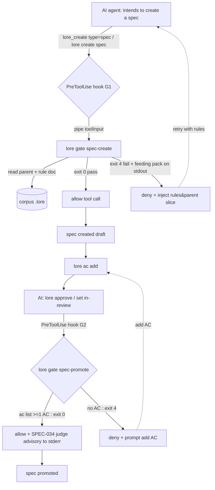

**spec_kind:** tech · **implements →** `adr-corpus-governed-active-ai-workflow-inversion-of-control-with`

## 1. Overview & Goal

Prove the Inversion of Control paradigm **runs end-to-end** on ONE real lifecycle node — spec production — before scaling horizontally. A thin vertical slice touching all four capabilities from the parent ADR:

1. **Active interception** — a Claude Code hook intercepts the "create a spec" action.
2. **Active feeding** — on a gate violation, inject the minimal write-spec rule slice + the target parent's summary (pointers, not full dump).
3. **AI produces** — the agent authors the spec guided by the injected rules.
4. **Deterministic gate** — on submit/promote, a corpus-predicate check blocks (no parent / bad spec_kind / no AC), driven by exit codes, never by AI judgment.

**Non-goal:** build the whole framework. This slice is the smallest closed loop that demonstrates the paradigm is real and measurable.

## 2. Scope

**IN:** two checkpoints (`spec-create`, `spec-promote`); one new `lore gate` command; two thin hook shims; one seed write-spec rule doc; `.claude/settings.json` hooks wiring.

**OUT (later P1–P4):** promoting prompt/skill to first-class doc types (full P1 — this slice seeds ONE rule doc as `knowledge/reference`); the workflow state machine (P2); gates for other doc types; `UserPromptSubmit` early injection; automated over-refusal calibration dashboard.

**Minimal upstream dependency:** the rule content to feed does not yet exist in the corpus (verified: no skill/prompt doc type, no write-spec doc). The slice seeds ONE `knowledge/reference` doc as the fed rule; P1 later migrates it to a first-class `skill`/`prompt` type.

## 3. Architecture

**Layering:** hook shims are pure IO plumbing (~10 lines shell). ALL decision logic (predicates + feeding-pack assembly) lives in the `lore gate` command — unit-testable, single source of truth, shared by the MCP and Bash paths. This is the moat the ADR names: the "graph-state predicate → inject/block" mapping.

## 4. Components & Contracts

### 4.1 `lore gate <checkpoint>` (NEW — the moat)

**`lore gate spec-create --input-json <toolInput> [--json]`**
- Deterministic predicates: parent resolves & type-legal? `spec_kind ∈ {feature,tech,design}`? content contains required skeleton headings?
- Exit: `0` = pass (allow) · `4` = fail (block) — reuses `exitCode()` SSOT (`cli/utils.ts:66`).
- On fail, stdout = **feeding pack**: minimal write-spec rule slice (from the seed rule doc via `renderResolvedToMarkdown`, `outline-service.ts:954`, trimmed) + target parent's title/summary/AC pointers + an explicit "what's missing" list. Header carries `[source: corpus <slug>, trust: team-authored]` (boundary ③).

**`lore gate spec-promote --spec <id> [--json]`**
- Deterministic predicate: `ac list <spec>` returns ≥1 AC? No → exit `4` block.
- Pass → exit `0`; MAY trigger the SPEC-034 judge, writing an **advisory/escalate** verdict to stderr — **never changes exit code** (boundary ① two-layer split).

**Escape hatch:** `LORE_GATE_BYPASS=1` → immediate exit 0 (mirrors existing `CLAUDE_AC_TRACE_BYPASS`), preventing rigidity as models strengthen.

### 4.2 Hook shims (NEW — thin)
- **G1** `PreToolUse` matcher `lore_create`: if `input.type==="spec"` → pipe toolInput to `lore gate spec-create` → map exit to permission decision (deny+reason / allow).
- **G2** `PreToolUse` matcher Bash `lore approve|lore set --status`: extract spec id → `lore gate spec-promote` → deny/allow.

### 4.3 Seed rule doc (NEW — data, P1 sliver)
One `knowledge` doc, `sub_type=reference`, status `approved`, holding the write-spec rules. Only **approved** rule docs are feedable (boundary ③ tamper mitigation).

### 4.4 Reuse map (thin-glue evidence)
| Reused | Location |
|---|---|
| exit-code SSOT | `cli/utils.ts:66` |
| create-time schema gate (parent/spec_kind) | `corpus-service.ts:_createImpl`, `schemas.ts:270` |
| text projection for slice | `renderResolvedToMarkdown` `outline-service.ts:954` |
| AC existence | `AcService` / `lore ac list` |
| probabilistic judge | SPEC-034 JudgmentService |
| audit trail | SPEC-035 AuditService |
**Truly new:** `lore gate` command + 2 shims + 1 seed doc + settings wiring.

## 5. Trade-off Decisions

| Option | Verdict |
|---|---|
| A — single create-time interception | Rejected: feeds too late (content already written), can't gate AC (added post-create). |
| B — early inject + Stop-hook gate | Rejected: intent detection is heuristic; hidden state (which spec was just made). |
| C — explicit `lore spec-flow` state machine | Runner-up: clean but adds a command + cross-call state (bigger state space, less thin). |
| **D' — lazy on-violation feeding (2 checkpoints)** | **Chosen (41/50).** No hidden cross-call state (idempotent precheck); feeding IS the minimal slice; clean two-layer split; max reuse. |

## 6. Boundaries Realized (ADR → mechanism)
1. **gate ceiling = min(oracle coverage, correctness).** Deterministic zone (parent/spec_kind/AC-existence) hard-blocks via exit 4; probabilistic zone (content quality, judge) is advisory to stderr, never blocks. Never disguised.
2. **Minimal context, just-in-time.** Feeding pack emitted ONLY on violation, carries a trimmed slice + pointers, never a full dump (context-rot evidence).
3. **Corpus is attack surface.** Only approved rule docs feedable; feeding pack carries source/trust tags; gate blocks audited; `LORE_GATE_BYPASS` for over-refusal relief.

## 7. Cross-Cutting

- **Security (STRIDE-lite on corpus→hook→AI):** primary threat = Tampering (poisoned rule doc → poisoned guidance). Mitigations: approved-only feedable docs; source/trust tags; gate-block audit (SPEC-035). Info-disclosure: agent already has corpus read — no new exposure.
- **Performance budget:** PreToolUse adds one bun-binary spawn + read-only sqlite query per create/approve; target p95 < 200 ms; `--json` fast path.
- **Observability:** structured log of each gate decision (pass/block, hit predicate, fed?); block counts feed later over-refusal-rate measurement (governance-of-governance hook).

## 8. Risk Registry
| Risk | Severity | Mitigation |
|---|---|---|
| Gate logic bug blocks correct specs deterministically | High | High-coverage tests on `lore gate` (pure predicates); `LORE_GATE_BYPASS`; fail-loud. |
| Bash-path command parsing (G2) brittle | Med | Prefer MCP structured path; G2 regex narrow + covered by AC; degrade to allow-with-warn on parse failure (fail-open ONLY for parse ambiguity, logged). |
| Seed rule doc tampered | Med | approved-only + trust tag + audit. |
| Agent bypasses via direct .md write (export-docs) | Low | Out-of-scope this slice; documented; main path is lore create. |

## 9. Acceptance Criteria (all deterministic exit-code oracles; throwaway corpus, ⛔ never repo `.lore`)
- **AC1** create spec with no parent → G1 exit 4 + stdout contains rule slice.
- **AC2** create compliant spec → G1 exit 0 allow.
- **AC3** approve spec with zero AC → G2 exit 4 block.
- **AC4** approve spec with ≥1 AC → G2 exit 0; judge advisory on stderr does NOT change exit.
- **AC5** `LORE_GATE_BYPASS=1` → gate exit 0.
- **AC6 (e2e loop)** seed rule doc + PRD parent → agent no-parent create blocked → retry with parent+kind succeeds → no-AC approve blocked → `ac add` → approve succeeds.

## 10. Rollout Plan
1. `lore gate` command + pure predicate module + unit tests (AC1–AC5 as script-AC, SPEC-039 attestable).
2. Seed rule doc + `renderResolvedToMarkdown` trimming for feeding pack.
3. Two hook shims + `.claude/settings.json` wiring; AC6 e2e on throwaway corpus.
4. Rollback = remove hooks block from settings.json (gate command stays inert; zero corpus mutation).

## 11. Downstream Handoff
- **implement:** `GateCheckpoint = "spec-create" | "spec-promote"`; `GateResult = { ok: true } | { ok: false; exitCode: 4; feedingPack: string }`; `FeedingPack` = `{ source: string; trust: "team-authored"; ruleSlice: string; parentSlice?: string; missing: string[] }`. New files: `cli/commands/gate.ts`, `service/gate-predicates.ts` (pure), `hooks/g1-spec-create.sh`, `hooks/g2-spec-promote.sh`.
- **test:** invariants — gate exit codes deterministic given corpus state; feeding pack only on fail; judge never alters exit; bypass short-circuits. Edge: parent soft-deleted, spec_kind absent (defaults feature — should PASS not block), content missing skeleton.
- **deploy:** requires `lore` binary on PATH for hooks; env `LORE_GATE_BYPASS` documented.

## 12. Quality Gates (architecture mode)
- ✅ Every boundary (NFR) has a concrete mechanism response.
- ✅ All tension points (feeding timing, gate mount point, two-layer split) have a decision + rationale (§5, §1).
- ✅ High-severity risk (deterministic false-block) has mitigation (§8).
- ✅ Rollback defined (§10.4).

## Acceptance Criteria (structured)

- [✔] [script] AC-IOC-1: gate-predicates pure functions pass
  script: test — bunx vitest run packages/lore/tests/unit/service/gate-predicates.test.ts
- [✔] [script] AC-IOC-2: gate-feeding minimal-slice pack passes
  script: test — bunx vitest run packages/lore/tests/unit/service/gate-feeding.test.ts

## Code anchors

- packages/lore/src/adapters/cli/commands/gate.ts
