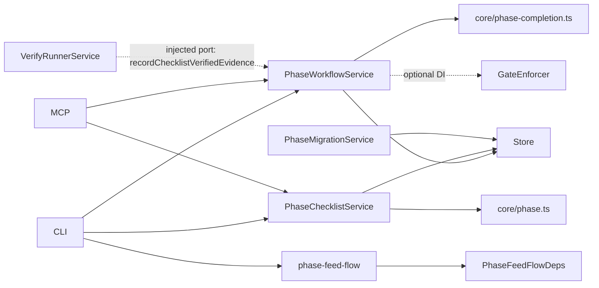

# Module Design: Phase Execution Model (PRD §18 landing spec, spec_kind: tech)

## Overview/Goal

Replace the task doc type as the execution unit with a `phase` doc type (parent: plan) that absorbs the SPEC-025/042 mechanics (claim lease, file anchors, append-only evidence) and adds the §18 P2 trio: `ac_scope` (contract projection), `checklist` (local oracle-bound gate items), `track` (informational work log). Completion is fully computed (P3 formula + four edge invariants), surfaced via `lore phase status` and `lore feed phase-start`. One-shot idempotent migration converts existing task docs. The task-claim checkpoint renames to phase-claim with a read-side config alias.

## Scope

**IN**: phase doc type + schemas (`phase.ts`/`phase-completion.ts`), PhaseWorkflowService + PhaseChecklistService + PhaseMigrationService, phase-claim checkpoint rename with config alias, `lore phase status|checklist|track` + `lore feed phase-start` + `lore migrate tasks-to-phases` (CLI+MCP parity), phases-per-plan assess metric, one-shot idempotent migration.
**OUT**: seat model / `lore seat` (own spec, PRD §15 S4); verification profiles (own spec, PRD §18 P6); hooks system + `labels` (PRD §19, no design round yet); checklist quantifiability lint (cut per P5 admission rule — no consumer); dashboard phase views beyond the CLI scorecard (§13.5 projection family, later).

## Module Boundary

- **Public API (new)**: `@lore/core` — `phaseExtraSchema` / `checklistItemSchema` / `trackItemSchema` / `PHASE_KINDS` / `assertScopeFreeze()` (`phase.ts`: schema + write-time invariants) and `computePhaseCompletion()` (`phase-completion.ts`: derivation — split per single-topic precedent `staleness.ts`); `PhaseWorkflowService` (claim/release/evidence/ready ONLY — SPEC-025 scope, one level up); `PhaseChecklistService` (checklist + track verbs — mirrors `AcService`'s add/list/remove-on-extra shape); `flows/phase-feed-flow.ts` (`buildPhaseStartPack` over an explicit `PhaseFeedFlowDeps`); `PhaseMigrationService.migrateTasks({dryRun})`; CLI `lore phase status|checklist|track`, `lore feed phase-start`, `lore migrate tasks-to-phases`; MCP `lore_phase_status`, `lore_feed` extension.
- **Internal**: completion-state derivation details, migration grouping/idempotency markers, feed section budget enforcement.
- **Dependencies (all injected)**: `StoreInterface`; `computeAcCoverage` (SPEC-038, unchanged); `GateEnforcer` (optional DI, unchanged shape); checklist script execution via a SECOND narrow TaskWorkflowService-style port `recordChecklistVerifiedEvidence` on the runner seam (see D8 — never a rebind of `recordVerifiedEvidence`, whose `ac_ref` shape stays byte-unchanged); `PhaseFeedFlowDeps` (see D5).

```ts
// flows/phase-feed-flow.ts — capped against StalenessFlowDeps precedent, NEVER full App
export interface PhaseFeedFlowDeps {
  getPhaseBundle: (phaseId: string) => Promise<Result<PhaseBundle, LoreError>>; // phase + plan + spec-slice + sibling summaries (CorpusService-implemented, one call)
  listLinkedKnowledgePointers: (docId: string, limit: number) => Promise<Result<KnowledgePointer[], LoreError>>; // T3: slug+line summary only, hygiene-filtered
  latestHandoffForPlan: (planId: string) => Promise<Result<HandoffPointer | null, LoreError>>;
}
```

## Structure

```
packages/core/src/phase.ts                    # NEW pure: schemas, PHASE_KINDS, assertScopeFreeze (write-time invariants w/ schema)
packages/core/src/phase-completion.ts         # NEW pure: computePhaseCompletion (derivation; single-topic split)
packages/core/src/schemas.ts                  # phase doc type registered; phaseExtraSchema superRefine wiring
packages/lore/src/service/phase-workflow-service.ts   # TaskWorkflowService generalized+renamed: claim/release/evidence/ready ONLY
packages/lore/src/service/phase-checklist-service.ts  # NEW: checklist+track verbs (AcService shape; CAS + version + audit)
packages/lore/src/service/phase-migration-service.ts  # NEW: one-shot idempotent task→phase sweep (D6/D6a)
packages/lore/src/service/checkpoint-registry.ts      # task-claim → phase-claim (registry key rename + config read-side alias)
packages/lore/src/flows/feed-flow.ts          # phase-start registered in CHECKPOINT_PRODUCED_TYPE SSOT map (no parallel dispatch path)
packages/lore/src/flows/phase-feed-flow.ts    # NEW: buildPhaseStartPack over PhaseFeedFlowDeps (T1/T2/T3, budgets, truncated[])
packages/lore/src/adapters/cli/commands/phase.ts      # NEW: status/checklist/track subcommands
packages/lore/src/adapters/mcp/tools.ts       # lore_phase_status; lore_claim/evidence target phases
```

Test placement (stated, not implied): pure core + services + flows → vitest with `InMemoryStore`; claim CAS + migration real-SQLite writes → `.bun.test.ts` under `bun test`; SPEC-042 anchor-overlap cases IMPORT the existing fixture file (same-file reuse, not a re-authored copy — otherwise "compatibility" is untested intent).

## Public Interface (TS sketch)

```ts
// @lore/core phase.ts — pure, zero IO
export const PHASE_KINDS = ["backend","frontend","fullstack","infra","docs"] as const;
export function assertScopeFreeze(prev: string[], next: string[], evidence: EvidenceEntry[]): Result<void, LoreError>; // removal of evidenced id → err

// @lore/core phase-completion.ts — pure, zero IO
export type PhaseCompletionState = "pending" | "active" | "done" | "vacuous";
export interface PhaseCompletion { state: PhaseCompletionState; blocking: string[]; dropped_named: string[]; manual_selfattested: string[]; }
export function computePhaseCompletion(i: { acScope: string[]; coverage: AcCoverageEntry[]; checklist: ChecklistItem[]; claim: TaskClaim | undefined; claimTtlMinutes: number; now: Date }): PhaseCompletion;
```

Checklist `bind` is a discriminated union `script | manual` (compiler-enforced OCP: a future `browser` variant is ONE new member, every switch site breaks loud). Script items execute through the SPEC-039 runner via the injected executor port (tests inject the existing fake-executor, no real subprocess) and record evidence with `checklist_ref` — an additive optional field; `ac_ref` semantics byte-unchanged (REGRESSION). Manual `checked: {by, at}` voided by statement edit. `dropped: {by, at, reason}` required-on-drop.

## Dependency Graph



No service imports another service (composition in app.ts, unchanged). Core files import nothing but zod + existing core types — no cycles.

## Design Decisions

| Decision | Choice | Rationale | Trade-off |
|---|---|---|---|
| D1 phase = new doc type; task type retired post-migration | new type `phase`, parent `plan` | clean semantics; `extra.phases` name-array retired | wide consumer rename (PRD P1 list) |
| D2 service strategy | TaskWorkflowService → PhaseWorkflowService (claim/release/evidence/ready ONLY) + NEW PhaseChecklistService (checklist/track); hard cutover + legacy task READ tolerance with a DEDICATED read-path unit fixture (not only the regression re-run) | single-writer ethos per concern; god-module risk named by review | one more service + DI site (AcService precedent, accepted) |
| D3 completion | 100% computed via `computePhaseCompletion`; NO stored status; `vacuous` distinct, never `done` | PRD P3 (a); readiness-is-computed ethos | every surface recomputes (pure fn, cheap) |
| D4 scope-freeze | `CorpusService.set` on a phase calls `assertScopeFreeze` (pure) when evidence exists; CorpusService READS `extra.verification_evidence`, never owns it | PRD P3 (b); mirrors `extra.phase` cross-validation precedent | one more set()-path check |
| D5 feed pack | `buildPhaseStartPack(deps: PhaseFeedFlowDeps)` — 3-method interface sketched above, capped against StalenessFlowDeps; per-section char budgets `workflow.phase_feed.*`; `truncated[]` recorded; `phase-start` enters `CHECKPOINT_PRODUCED_TYPE` SSOT map | CLI/MCP identical-by-construction; no parallel dispatch path | new config namespace |
| D6 migration data rules | phase gets `extra.migrated_from: taskId[]`; each merged evidence entry gains `origin: taskId`; claim precedence = newest fresh claim wins, displaced holders → track notes (loud in report); source task → archived + `extra.migrated_to`; `legacy_phase` honored as grouping fallback; empty declared phases → empty phase docs | PRD P7 edge rules carried into schema, not just AC | passthrough residue fields |
| D6a migration write path | raw `store.insert` bypass (MigrationService precedent, documented bounded bypass) + audit rows + version snapshots per created phase; NO GateEnforcer (no phase-create checkpoint exists) | one-shot, not steady-state; gates guard steady-state writes | un-gated path (bounded, documented) |
| D7 config-key rename | `workflow.gates."phase-claim"` canonical; `"task-claim"` read-side alias, ONE deprecation warning per process | PRD P1; existing corpora keep working | dual-read (one site) |
| D8 checklist script security | checklist commands run through the SPEC-039 executor with §M2 approval + env allowlist; evidence lands via NEW narrow port `recordChecklistVerifiedEvidence` (second injection point beside `recordVerifiedEvidence`, distinct `checklist_ref` shape) | same RCE surface; no second executor; no cross-service import | second port + wiring site |
| D9 phases-per-plan metric | `computeAssessmentFacts` gains `phase_count`; assess renders distribution; PRD re-open trigger | PRD self-diagnosis | assess prompt version bump |

Cut from v1 (P5 admission rule self-applied): `lintChecklistQuantifiability` — no PRD requirement, no AC, no consumer; the future advisory channel is SPEC-053's typed `advisory[]`, not a v1 stub.

## Acceptance Criteria (script-mode, SPEC-052-quantifiable)

- AC-P-1 [script/test] `computePhaseCompletion` suite: 0 failures across ≥16 cases — HAPPY (mixed attested+manual), BOUNDARY (anti-vacuous: empty scope + all-dropped → `vacuous`, distinct from `done`), STATE (overrun re-claim; stale-claim mid-phase), ERROR (malformed acScope entries, negative TTL → typed err, no throw), plus manual-vs-attested labeling.
- AC-P-2 [script/test] `assertScopeFreeze` matched pair (反向对照): removal of evidenced id → err AND additive edit → ok in the same fixture; 0 failures.
- AC-P-3 [script/test] phase-claim gate: SPEC-042 anchor-overlap fixture file IMPORTED and passing on phase docs; NEGATIVE case (same-actor overlap → NOT rejected) asserted; `"task-claim"` alias honored with exactly 1 deprecation warning.
- AC-P-4 [script/test] `buildPhaseStartPack`: T1 complete + T3 excludes invalidated docs on seeded fixture; over-budget sections in `truncated[]`; ERROR (plan with zero phases → typed err, not empty pack); CLI and MCP payloads deep-equal.
- AC-P-5 [script/test] migration fixture (≥8 tasks, 3 plans, legacy_phase residue, multi-claim group, >50 merged evidence, empty declared phase): aggregate pre/post reconciliation diff = 0 AND per-field fidelity on ≥2 representative phases (claim holder, every evidence `ac_ref`+`origin`, anchor list byte-equal); second run = 0 new writes.
- AC-P-6 [script/test] full regression: task-era suites pass; PLUS a dedicated legacy-read fixture proving the READ-tolerance branch renders task badges without any migration having run.
- AC-P-7 [script/build] `bun run typecheck` 0 errors across packages.

## Perspective Tensions Resolved

| Tension | Perspectives | Resolution | Why |
|---|---|---|---|
| One service vs split | Cohesion (split) vs Coupling (fewer seams) | Split: PWS + PhaseChecklistService | AcService precedent; god-module named risk outweighs one DI site |
| track storage | Cohesion (fold into evidence infra) vs draft | REJECTED fold — track stays its own array | evidence is append-only attested; track is mutable informational; folding poisons the P2 trust boundary |
| Migration gating | Coupling (undefined) | D6a: raw-insert bounded bypass + audit | one-shot path; mirrors MigrationService documented precedent |
| Feed deps breadth | Coupling (balloon risk) | explicit 3-method PhaseFeedFlowDeps | StalenessFlowDeps cap, enforced at review |

## Quality Gates (module)
- [x] No circular dependencies (core pure; flows narrow-deps interface stated; services composed in app.ts)
- [x] Single responsibility per module (claim-mechanics vs checklist vs migration vs feed — 4 modules, 4 concerns)
- [x] Public API sufficient for black-box testing (pure fns + Result surfaces + injectable fake executor)
- [x] Dependencies injectable (optional-DI shapes preserved; two named evidence ports)


## Acceptance Criteria (structured)

- [⚑] [script] AC-P-1: computePhaseCompletion vitest suite passes 0 failures across >=16 enumerated cases covering HAPPY/BOUNDARY(vacuous distinct from done)/STATE(overrun re-claim, stale claim)/ERROR(malformed acScope, negative TTL -> typed err)
  script: test — bunx vitest run packages/lore/tests/unit/core/phase-completion.test.ts
- [⚑] [script] AC-P-2: assertScopeFreeze matched-pair fixture: removal of evidenced AC id returns err AND additive edit returns ok in the same test file, 0 failures
  script: test — bunx vitest run packages/lore/tests/unit/core/phase-scope-freeze.test.ts
- [⚑] [script] AC-P-3: phase-claim gate passes the IMPORTED SPEC-042 anchor-overlap fixture on phase docs, includes same-actor NEGATIVE case (not rejected), and task-claim config alias emits exactly 1 deprecation warning, 0 failures
  script: test — bunx vitest run packages/lore/tests/unit/service/phase-claim-gate.test.ts
- [⚑] [script] AC-P-4: buildPhaseStartPack seeded fixture: T1 sections complete, T3 excludes invalidated docs, over-budget sections recorded in truncated[], zero-phase plan returns typed err, CLI and MCP payloads deep-equal, 0 failures
  script: test — bunx vitest run packages/lore/tests/unit/flows/phase-feed-flow.test.ts
- [⚑] [script] AC-P-5: migration fixture (>=8 tasks, 3 plans, legacy_phase residue, multi-claim group, >50 merged evidence, empty declared phase): aggregate reconciliation diff 0, per-field fidelity asserted on >=2 phases, second run performs 0 new writes
  script: test — cd packages/lore && bun test tests/unit/service/phase-migration.bun.test.ts
- [⚑] [script] AC-P-6: full both-runner regression green (vitest + bun test exit 0) plus dedicated legacy-read fixture rendering task badges with 0 migrations run
  script: test — bun run test
- [⚑] [script] AC-P-7: bun run typecheck exits 0 across all packages
  script: build — bun run typecheck

## Code anchors

- packages/core/src/phase.ts
- packages/core/src/phase-completion.ts
- packages/lore/src/service/phase-workflow-service.ts
- packages/lore/src/service/phase-checklist-service.ts
- packages/lore/src/service/phase-migration-service.ts
- packages/lore/src/flows/phase-feed-flow.ts
- packages/lore/src/store/migrations/migration-006.ts
