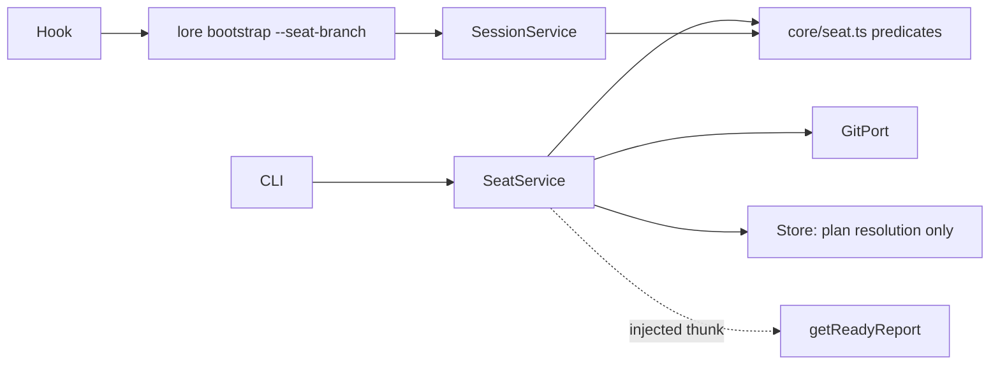

# Module Design: Two-tier worktree seat model — `lore seat` + seat-aware resume (PRD §15 S4, spec_kind: tech)

## Overview/Goal

Mechanize the plan-seat lifecycle: `lore seat <plan>` creates/enters a plan-bound worktree (branch `plan/<slug>`), `seat list` enumerates active seats (with the metric fields the G13 cost counter-metric aggregates), `seat resume <plan>` re-enters one; seat deletion with unmerged commits is REFUSED. `lore bootstrap` gains an optional seat signal (branch/worktree, supplied by the SPEC-047 SessionStart hook) making `resume_hint` seat-aware via a pure `deriveResumeHint`. Behavior specified per equivalence class (main checkout / seat worktree / task-worktree-under-seat / detached HEAD).

## Scope

**IN**: `SeatService` (thin GitPort orchestrator), `core/seat.ts` pure helpers (branch naming/parsing, location classification, `assertSeatEntryReady` entry predicate, `deriveResumeHint`), `SessionService.bootstrap` seat-signal parameter, CLI `lore seat` verb family (`list --json` carries `branch`/`created_at`/`merged` — the data surface the PRD cost counter-metric aggregates), SessionStart hook passing the seat signal, seat-briefing asset update (commit-cadence mandate), dirty-tree warning on `lore handoff` (boolean computed in the CLI adapter, passed as plain value — SessionService stays git-free). Task/subagent worktrees keep merging back to the SEAT branch (pre-existing dispatcher discipline, unchanged by this spec — stated for completeness); only seat→main integration is a human/orchestrator act on the main checkout.
**OUT**: phase model (SPEC-056 — contract note: this spec consumes `ReadyReport` through an injected thunk and asserts its SHAPE stays stable across the task→phase rename; re-verify at SPEC-056 landing); verification profiles (own spec); daemon/lock service (PRD §15 non-goal); cross-plan anchor gating (PRD-recorded honest limit); metric AGGREGATION in `lore assess` (data surface ships here, aggregation follows with D9/SPEC-056's assess changes).

## Module Boundary

- **Public API (new)**: `SeatService.enter/list/resume/remove` — all `Promise<Result<T, LoreError>>`, thin orchestration only; `core/seat.ts` — `seatBranchName(planSlug)`, `parseSeatBranch(branch)`, `classifySessionLocation(gitFacts)`, `assertSeatEntryReady(readyReport): Result<void, LoreError>` (pure entry predicate — GateEnforcer/deriveSessions precedent), `deriveResumeHint(handoffs, seatPlanId?)` (pure, symmetric to `deriveSessions`); `SessionService.bootstrap(by, now, seat?: {branch, worktree})` (additive optional — absent → byte-identical, REGRESSION anchored to the existing `session-service.test.ts` resume_hint assertions as the frozen baseline).
- **Internal**: git fact-gathering, worktree path convention (`../<repo>-seat-<plan-slug>`, code not config — no PRD mandate for configurability), refuse/force deletion logic.
- **Dependencies (all injected)**: `GitPort` (6 methods: `worktreeAdd, worktreeList, worktreeRemove, isMerged, rebaseFromMain, isDirty` — `currentBranch` PRUNED, no consumer; real impl `node:child_process`, tests inject scripted fake; McpRegistrar precedent); `StoreInterface` for plan-doc resolution ONLY; ALL readiness reads through the injected `getReadyReport` thunk, no exceptions.

## Structure

```
packages/core/src/seat.ts                        # NEW pure: naming/parsing, classification, assertSeatEntryReady, deriveResumeHint
packages/lore/src/service/seat-service.ts        # NEW: thin GitPort orchestration (no decisions — predicates decide)
packages/lore/src/service/session-service.ts     # bootstrap(by, now, seat?) → calls deriveResumeHint
packages/lore/src/adapters/real-git-port.ts      # NEW: node:child_process git impl (vitest-safe)
packages/lore/src/adapters/cli/commands/seat.ts  # NEW: seat enter/list/resume/remove; handoff dirty-boolean computed here
assets/hooks/session-start-resume.mjs            # Phase D passes seat signal (both copies + SSOT)
assets/governance/seat-briefing.md               # commit-cadence mandate line
packages/lore/tests/fixtures/seat-branch-sanitize.golden.json  # NEW: cross-language sanitizer parity fixture
```

Sanitizer duplication is REAL, not wished away: the hook's inline `.mjs` regex (session-start-resume.mjs:138-142) and `core/seat.ts`'s TS sanitizer are hand-maintained twins — a golden fixture (input→expected pairs) is consumed by BOTH the hook test suite and the core vitest suite, so divergence breaks a test, not production (the roster-map/governance-pipe incident class, closed by construction).

Test placement: core + SeatService (fake GitPort) + session-service → vitest; `RealGitPort` → vitest integration against a real `mkdtemp` git repo (reusing the hook suite's `initGitRepo` helper); hook behavior → existing spawned-subprocess suite (stub `lore` script logs `$PWD \t $*`, assert `--seat-branch` appears).

## Public Interface (TS sketch)

```ts
// core/seat.ts — pure
export function seatBranchName(planSlug: string): string;            // "plan/<sanitized-slug>"
export function parseSeatBranch(branch: string): string | null;
export interface GitFacts { branch: string | null; isLinkedWorktree: boolean; parentSeatBranch: string | null; }
export function classifySessionLocation(f: GitFacts): "main" | "seat" | "task_under_seat" | "detached";
export function assertSeatEntryReady(r: ReadyReport): Result<void, LoreError>;   // pure entry predicate
export function deriveResumeHint(handoffs: HandoffPointer[], seatPlanId?: string): ResumeHint | null; // seatPlanId absent → corpus-global (byte-identical)

// service/seat-service.ts
export interface GitPort { worktreeAdd(path: string, branch: string): P; worktreeList(): P<WorktreeInfo[]>; worktreeRemove(path: string, force: boolean): P; isMerged(branch: string, into: string): P<boolean>; rebaseFromMain(cwd: string): P; isDirty(cwd: string): P<boolean>; }
```

`deriveResumeHint` with a seat: newest handoff whose plan matches the seat plan (none → null, a fact — no silent fallback); unresolvable seat branch → corpus-global + `seat_unresolved` warning field (extends the SPEC-043/044 warning-field pattern).

## Dependency Graph



## Design Decisions

| Decision | Choice | Rationale | Trade-off |
|---|---|---|---|
| D1 git behind a port | `GitPort` 6 methods (consumer-driven; `currentBranch` pruned) | vitest-testable; McpRegistrar precedent | port surface to maintain |
| D2 bootstrap seat signal | additive optional param + `--seat-branch`/`--seat-worktree` CLI flags from the hook's SPEC-047 detection | zero paste; absent → byte-identical | hook↔CLI contract addition |
| D3 resume scoping | pure `deriveResumeHint(handoffs, seatPlanId?)` in core; unresolvable seat → corpus-global + `seat_unresolved` warning | G13; no silent fallback; deriveSessions symmetry | one warning field |
| D4 unmerged-deletion refusal | `remove` checks `isMerged`; unmerged → err naming branch + `--force` escape naming what is lost | PRD S4; data-loss guard | force path verbosity |
| D5 entry orchestration | SeatService.enter = thin sequence (clean check → rebaseFromMain → `assertSeatEntryReady(thunk())` → worktreeAdd); ALL decisions in pure predicates | SRP; GateEnforcer precedent | one more core export |
| D6 dirty-handoff warning | CLI adapter computes `isDirty` boolean, passes plain value into handoff flow | SessionService stays git-free (its documented invariant) | one boolean threaded |
| D7 mid-sequence failure semantics | worktreeAdd failure after rebase leaves a BENIGN partial state (main freshly rebased — independently desirable; no worktree created); `enter` is idempotent-retryable, err names the failed step; NO rollback machinery | rebase of main is not seat-scoped state; simplest honest semantics | none (documented benignity) |

## Acceptance Criteria (script-mode, SPEC-052-quantifiable)

- AC-S-1 [script/test] `core/seat.ts` suite: naming/parsing round-trip, 4-class location table, `assertSeatEntryReady` matched pair (ready → ok; blocked/anchor-conflict → err), `deriveResumeHint` seat-scoped + corpus-global + null-when-none cases; >=16 cases, 0 failures.
- AC-S-2 [script/test] `SeatService` over fake GitPort: entry sequence order asserted; dirty main → typed err; mid-sequence failure (rebase ok, worktreeAdd throws) → err naming step, second `enter` retry succeeds (idempotency); matched pair unmerged remove → err AND merged remove → ok; 0 failures.
- AC-S-3 [script/test] resume equivalence classes incl. REGRESSION: existing `session-service.test.ts` resume_hint assertions pass byte-unchanged (frozen baseline); seat → plan-scoped; task-worktree-under-seat → parent seat plan; detached → corpus-global + `seat_unresolved`; 0 failures.
- AC-S-4 [script/test] hook suite: seat-worktree session's stubbed `lore` invocation log contains `--seat-branch <branch>`; main-checkout invocation log byte-unchanged; 0 failures.
- AC-S-5 [script/test] sanitizer parity: `seat-branch-sanitize.golden.json` consumed by BOTH hook suite and core suite, all pairs pass in both; 0 failures.
- AC-S-6 [script/test] `RealGitPort` integration: mkdtemp real git repo round-trip (worktreeAdd → isDirty → isMerged → worktreeRemove), squash-merge and detached-entry `--porcelain` parsing cases; 0 failures.
- AC-S-7 [script/test] `seat list --json` emits `branch`/`created_at`/`merged` per seat on a fake-GitPort fixture (the G13 cost counter-metric data surface); 0 failures.
- AC-S-8 [script/build] `bun run typecheck` exits 0.

## Perspective Tensions Resolved

| Tension | Perspectives | Resolution | Why |
|---|---|---|---|
| Entry gating placement | Cohesion (pure predicate) vs draft (inline) | `assertSeatEntryReady` in core | GateEnforcer/deriveSessions precedent |
| Handoff dirty check | Coupling (no git in SessionService) vs draft (optional port) | boolean computed in CLI adapter | preserves documented git-free invariant |
| Sanitizer SSOT claim | Cohesion (claim false) | golden-fixture cross-language parity test | duplication is real; make divergence break tests |
| Metric oracle | Reuse (kill criterion had no oracle) | AC-S-7 data surface now; aggregation deferred with SPEC-056 assess changes | minimal admission-rule-compliant slice |

## Quality Gates (module)
- [x] No circular dependencies (predicates in core; ports/thunks injected)
- [x] Single responsibility (git lifecycle vs derivation vs signal — decisions all in pure fns)
- [x] Public API black-box testable (fake GitPort + real-repo integration anchor)
- [x] Dependencies injectable (one port, one thunk, plain-value boolean)


## Acceptance Criteria (structured)

- [⚑] [script] AC-S-1: core/seat.ts suite passes 0 failures across >=16 cases: naming/parsing round-trip, 4-class location table, assertSeatEntryReady matched pair (ready ok / blocked err), deriveResumeHint seat-scoped + corpus-global + null-when-none
  script: test — bunx vitest run packages/lore/tests/unit/core/seat.test.ts
- [⚑] [script] AC-S-2: SeatService fake-GitPort suite: entry sequence order asserted, dirty main typed err, mid-sequence failure (rebase ok then worktreeAdd throws) errs naming the step AND second enter retry succeeds, unmerged remove err / merged remove ok matched pair, 0 failures
  script: test — bunx vitest run packages/lore/tests/unit/service/seat-service.test.ts
- [⚑] [script] AC-S-3: resume equivalence classes pass: existing session-service.test.ts resume_hint assertions byte-unchanged (frozen baseline), seat -> plan-scoped hint, task-worktree-under-seat -> parent seat plan, detached -> corpus-global plus seat_unresolved warning, 0 failures
  script: test — bunx vitest run packages/lore/tests/unit/service/session-service.test.ts
- [⚑] [script] AC-S-4: hook spawned-subprocess suite: seat-worktree session invocation log contains --seat-branch with the branch value, main-checkout invocation log byte-unchanged, 0 failures
  script: test — bunx vitest run packages/lore/tests/unit/hooks/session-seat-injection.test.ts
- [⚑] [script] AC-S-5: sanitizer parity: seat-branch-sanitize.golden.json fixture consumed by BOTH hook suite and core suite with all pairs passing in both runners, 0 failures
  script: test — bunx vitest run packages/lore/tests/unit/core/seat.test.ts packages/lore/tests/unit/hooks/session-seat-injection.test.ts
- [⚑] [script] AC-S-6: RealGitPort integration against a real mkdtemp git repo: worktreeAdd -> isDirty -> isMerged -> worktreeRemove round-trip plus squash-merge and detached-entry porcelain parsing cases, 0 failures
  script: test — bunx vitest run packages/lore/tests/integration/real-git-port.test.ts
- [⚑] [script] AC-S-7: seat list --json emits branch, created_at and merged fields per seat on a fake-GitPort fixture (G13 cost counter-metric data surface), 0 failures
  script: test — bunx vitest run packages/lore/tests/unit/cli/seat-list.test.ts
- [⚑] [script] AC-S-8: bun run typecheck exits 0 across all packages
  script: build — bun run typecheck

## Code anchors

- packages/core/src/seat.ts
- packages/lore/src/service/seat-service.ts
- packages/lore/src/adapters/real-git-port.ts
- packages/lore/src/adapters/cli/commands/seat.ts
