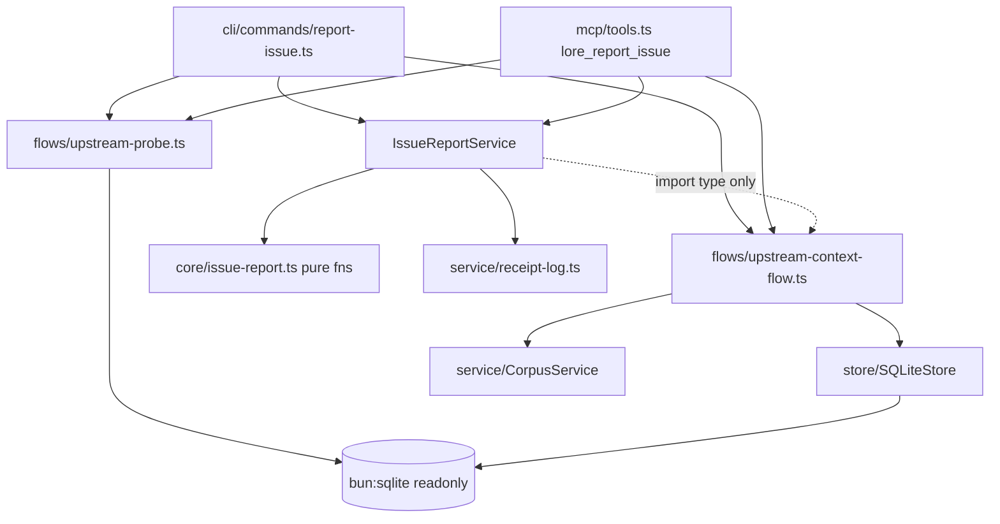

# SPEC-072 — Upstream issue reporting: `lore report-issue` (feature spec)

> Implements PRD §20 (Upstream Issue Feedback Loop), requirements R-4 (P0) + R-5 (P0). Root PRD v29.
> Design mode: module (4-perspective review applied: coupling / cohesion / reuse / testing).
> v1 scope: CLI command + MCP tool + local receipt. Out of v1 (PRD-staged): error-path hints F2(c), vendored stanza F2(d) — promotion seams named in §Extension Seams; HTTP transport, bootstrap surfacing = P2.

## Overview

`lore report-issue` lets an AI agent in a consuming project file a structured lore-defect report **directly into a configured upstream corpus**, landing as a SPEC-069 ad-hoc **draft** task in the upstream pending-review queue. `lore report-issue --list` shows the filed history joined live with upstream status (incl. rejection reasons). MCP surface: `lore_report_issue`. Every failure path is loud and side-effect-free (R-5); configuring `feedback.upstream.*` IS the consent act.

## Scope

**In (v1)**: CLI `lore report-issue` (+ `--list`, `--json`); MCP `lore_report_issue`; config `feedback.upstream.{corpus_path,root_prd}`; four R-5 safety rails (identity pin, version-skew reject, sync-upstream reject, rate cap) + failure-transparency (R-5e); advisory FTS dedup; consumer-side JSONL receipt log with live-status `--list` join.
**Out (PRD-staged)**: error-path hints F2(c) + vendored stanza F2(d) (data-gated — promotion seams in §Extension Seams); HTTP transport, remote status query, bootstrap surfacing, sync-enabled upstream support (P2).

## Module Boundary

- **Public API (consumer-facing)**: CLI `lore report-issue` (+ `--list`, `--json`); MCP tool `lore_report_issue` (`by` REQUIRED, SPEC-025).
- **Public API (code)**: `IssueReportService` (orchestration), `UpstreamPort` (transport seam), `ReceiptLog`, pure predicates in `@lore/core`, `probeUpstreamDb` + `buildUpstreamContext` (bun-only flows).
- **Internal**: check-sequence ordering, extra-payload assembly, receipt file format details.
- **Dependencies**: existing `SQLiteStore`, `CorpusService`, `loadConfig`, `resolveActor` (SPEC-071 tiers), `slugify`-era version constant discipline. **No service→service imports** — composition in CLI/MCP wiring only.

## 3. Structure

```
packages/core/src/config.ts                      # EXTEND: optional top-level `feedback` (strict)
packages/core/src/issue-report.ts                # NEW: pure predicates + payload assembly (vitest)
packages/lore/src/store/sqlite-store.ts          # EXTEND: export LATEST_SCHEMA_VERSION (SSOT beside migration chain)
packages/lore/src/flows/upstream-probe.ts        # NEW (bun-only): readonly PRAGMA user_version probe
packages/lore/src/flows/upstream-context-flow.ts # NEW (bun-only): narrow second composition root → UpstreamPort
packages/lore/src/service/issue-report-service.ts# NEW: IssueReportService (DI-only, vitest-testable)
packages/lore/src/service/receipt-log.ts         # NEW: append-only JSONL receipt log
packages/lore/src/adapters/cli/commands/report-issue.ts  # NEW citty command (strict flags inherited)
packages/lore/src/adapters/mcp/tools.ts          # EXTEND: lore_report_issue registration
```

Tests:
```
packages/lore/tests/unit/core/issue-report.test.ts                   # vitest: pure predicates
packages/lore/tests/unit/service/issue-report-service.test.ts        # vitest: orchestration w/ faked deps (+ static-import-scan pin)
packages/lore/tests/unit/service/receipt-log.test.ts                 # vitest: append/read/corrupt-line
packages/lore/tests/unit/store/schema-probe.bun.test.ts              # bun: probe purity (sha256 db+wal+shm pre/post)
packages/lore/tests/unit/service/issue-report-cross-corpus.bun.test.ts # bun: twin mkdtemp corpora e2e (R-4/R-5 suite)
```

## 4. Public Interface (TS)

```ts
// ── @lore/core config.ts ──
export const FeedbackConfigSchema = z.object({
  upstream: z.object({
    corpus_path: z.string().min(1),  // upstream repo ROOT (shape `lore init` produces)
    root_prd:    z.string().min(1),  // expected root-PRD slug or id (identity pin)
    // P2 seam (named, NOT implemented): transport: z.enum(["sqlite","http"]).default("sqlite")
  }).strict().optional(),
}).strict();

// ── @lore/core issue-report.ts (pure, vitest) ──
export interface IssueReportPayload {
  reporter_project: string; reporter_actor: string; lore_version: string;
  repro_command?: string; expected: string; actual: string; reported_at: string;
  possible_duplicates: string[];
}
export function matchRootPrd(root: { id: string; slug: string } | null, expected: string):
  | { ok: true } | { ok: false; found: string | null };
export function countOpenReports(tasks: ReadonlyArray<{ status: string; extra?: unknown }>, reporterProject: string): {
  open: number; ids: string[] };                     // status=draft ∧ extra.issue_report.reporter_project match
export function buildIssueReportExtra(p: IssueReportPayload): Record<string, unknown>; // → { adhoc: true, issue_report: {...} }
export const OPEN_REPORT_CAP = 10;

// ── flows/upstream-probe.ts (bun-only) ──
export function probeUpstreamDb(dbPath: string): Result<{ user_version: number }, LoreError>;
// `new Database(path, { readonly: true })` — structurally cannot migrate; probe purity oracle: sha256(db,-wal,-shm) pre/post

// ── flows/upstream-context-flow.ts (bun-only) ──
export interface UpstreamPort {                       // transport seam — P2 HttpUpstreamPort implements the same 4 ops
  resolveRootDoc(): Promise<Result<{ id: string; slug: string } | null, LoreError>>;
  listOpenAdhocDrafts(): Promise<Result<Array<{ id: string; status: string; extra?: unknown }>, LoreError>>;
  searchDuplicates(query: string, limit: number): Promise<Result<string[], LoreError>>;
  createDraft(input: { title: string; content: string; extra: Record<string, unknown> }):
    Promise<Result<{ id: string }, LoreError>>;       // upstream failure of ANY kind returned verbatim (R-5e)
  close(): void;
}
export function buildUpstreamContext(corpusRoot: string): Result<UpstreamPort, LoreError>;
// Narrow composition: SQLiteStore + CorpusService ONLY. No telemetry, no AI registry, no GateEnforcer —
// task-type create() never consults the 5 registered checkpoints (verified corpus-service.ts:749: gate branch
// is spec-create-scoped); wiring GateEnforcer here would be dead weight implying false assurance.
// Re-asserts user_version === LATEST_SCHEMA_VERSION before SQLiteStore construction (TOCTOU guard, one PRAGMA read).

// ── service/issue-report-service.ts (DI-only; `import type` ONLY from flows — pinned by static-import-scan test) ──
export interface IssueReportInput {
  title: string; description: string; expected: string; actual: string;
  repro_command?: string; by?: string;
}
export interface IssueReportResult {
  upstream_doc_id: string; possible_duplicates: string[];
  dedup_degraded: boolean;                            // FTS errored → true; surfaced, never blocks (advisory precedent SPEC-053)
}
export interface ReceiptStatusRow {
  upstream_doc_id: string; title: string; at: string;
  status: DocStatus | "unreachable"; rejection_reason?: string;
  warnings?: string[];                                // corrupt receipt lines skipped → named here (loud)
}
export interface IssueReportDeps {
  loadUpstreamConfig: (root: string) => Result<LoreConfig, LoreError>;
  probe: (dbPath: string) => Result<{ user_version: number }, LoreError>;
  expectedSchemaVersion: number;
  openUpstream: (root: string) => Result<UpstreamPort, LoreError>;
  receipts: ReceiptLog;
  loreVersion: string; reporterProject: string;
  now: () => string;
}
export class IssueReportService {
  constructor(deps: IssueReportDeps);
  report(input: IssueReportInput, cfg: { corpus_path: string; root_prd: string }): Promise<Result<IssueReportResult, LoreError>>;
  list(cfg: { corpus_path: string; root_prd: string }): Promise<Result<ReceiptStatusRow[], LoreError>>;
}

// ── service/receipt-log.ts ──
export class ReceiptLog {                             // <consumer>/.lore/issue-receipts.jsonl, JsonlTelemetry write pattern
  constructor(filePath: string);
  append(e: { upstream_doc_id: string; title: string; at: string }): Result<void, LoreError>;
  read(): Result<{ entries: ReceiptEntry[]; corrupt_lines: number[] }, LoreError>;  // skip + report, never crash
}
```

## 5. `report()` check sequence (fail-loud, cheapest-first, ZERO writes until step 8 succeeds)

| # | Check | Failure → (all exit 4 on CLI) |
|---|---|---|
| 1 | `feedback.upstream` unset | VALIDATION_ERROR naming BOTH keys + literal YAML example |
| 2 | `corpus_path/.lore/lore.db` missing | VALIDATION_ERROR naming the resolved bad path |
| 3 | upstream config `sync.enabled === true` | VALIDATION_ERROR: v1 SQLite-only constraint named |
| 4 | `probe.user_version !== expectedSchemaVersion` | VALIDATION_ERROR naming both versions (R-5b; readonly probe = no migration, structurally) |
| 5 | root-PRD identity ≠ `cfg.root_prd` (`matchRootPrd`) | VALIDATION_ERROR naming expected vs found (R-5a) |
| 6 | `countOpenReports ≥ OPEN_REPORT_CAP` | VALIDATION_ERROR listing the open report ids (R-5d) |
| 7 | advisory dedup `searchDuplicates` | error → `dedup_degraded: true`, proceed (advisory never blocks; degradation surfaced in output) |
| 8 | `createDraft` (upstream service layer) | ANY upstream failure propagated VERBATIM; no receipt line (R-5e) |
| 9 | `receipts.append` | only after step-8 success; append failure → loud error naming the receipt path (report already filed — message says so + prints doc id) |

`list()` runs steps 1-5 (same rails), then joins receipt entries with `lore get`-equivalent reads via the port; unreachable upstream → rows carry `status: "unreachable"` instead of throwing (history stays visible).

## 6. Dependency Graph



No cycles. `IssueReportService` reaches flows only via injected `IssueReportDeps` (value imports pinned out by a static-import-scan test — vitest graph never touches `bun:sqlite`).

## 7. Design Decisions

| Decision | Choice | Rationale | Trade-off |
|---|---|---|---|
| Transport seam | `UpstreamPort` (4 ops) now | P2 HTTP is PRD-committed, not speculative; port = zero orchestration rewrite | One extra interface today |
| Composition home | `flows/`, not `service/` | Repo rule: composition lives in app.ts/adapters; `flows/` is the established thin-composition home (setup-project-flow precedent) | — |
| GateEnforcer in upstream context | DROPPED v1 | task-type `create()` never consults the 5 registered checkpoints (corpus-service.ts:749 gate branch is spec-scoped) — wiring it implies false assurance | If a task-create checkpoint lands later, restore with cited precondition |
| R-5e semantics | "ANY upstream create failure propagates verbatim" | No gate currently fires on task create; honest contract is failure-transparency at the seam, oracle-tested via fake + real create-failure | PRD wording "gate denial" satisfied as the subset case |
| Rail predicates | pure fns in `@lore/core` | Repo precedent (computeDrift, computeAcCoverage): services orchestrate, core computes | — |
| Schema precheck | readonly probe BEFORE store construction + TOCTOU re-assert inside `buildUpstreamContext` | `SQLiteStore` ctor unconditionally migrates (sqlite-store.ts:82-83,114-190); no readonly mode exists | Double PRAGMA read (cheap) |
| Version SSOT | `LATEST_SCHEMA_VERSION` exported from sqlite-store.ts | Lives beside the migration chain it describes; today implicit ceiling = 6 | store/ exports a constant to flows/ |
| Dedup failure | `dedup_degraded: true`, proceed | Advisory-never-blocks (SPEC-053) vs fail-loud: resolved by surfacing the degradation in the result, not hiding it | A degraded report may miss duplicates |
| Receipt format | append-only JSONL, corrupt lines skipped + counted | JsonlTelemetry write pattern; read side must never crash `--list` | Corruption is reported, not repaired |
| Rate-cap query | list upstream adhoc drafts + pure filter | No store-level extra-field query exists; drafts bounded by review rhythm | Scan grows with total open drafts (v1 acceptable; revisit if consumer count grows) |

## 8. Perspective Tensions Resolved

| Tension | Perspectives | Resolution | Why |
|---|---|---|---|
| Full CorpusService in handle vs narrow port | Coupling+Reuse vs draft | Narrow `UpstreamPort` (4 ops) | Leak-proof + P2 transport seam in one move |
| Second composition root location | Cohesion vs draft | `flows/` | Draft violated its own stated composition rule |
| GateEnforcer "gates apply" | Coupling+Testing vs PRD wording | Drop; R-5e reframed to failure-transparency | Dead coupling + untestable oracle otherwise |
| Double version check | Coupling vs Reuse | Keep, documented as TOCTOU guard | Live shared upstream; one PRAGMA read is cheap insurance |
| `--list` in same service | Cohesion | Keep together | Identical preflight chain; split = duplicated DI wiring, zero SRP gain |
| probe home | Cohesion | `flows/` beside context (not `store/`) | store/ is StoreInterface-impls-only per its CLAUDE.md |

## Acceptance Criteria

All 13 ACs are script-mode (external oracles; added via `lore ac add`, covering R-4/R-5):

| AC | Assertion | Oracle |
|---|---|---|
| AC-072-1 | Round-trip: report lands in temp upstream as draft ad-hoc task, all 7 `extra.issue_report` fields populated, visible in upstream pending queue, ABSENT from `lore ready --adhoc` until approved | bun twin-corpus |
| AC-072-2 | Unconfigured → exit 4, message names `feedback.upstream.corpus_path` AND `feedback.upstream.root_prd` | bun (CLI spawn) |
| AC-072-3 | `root_prd` mismatch → exit 4 naming expected vs found; zero upstream writes | bun twin-corpus |
| AC-072-4 | Version skew (PRAGMA-downgraded fixture copy) → exit 4 naming both versions; sha256(db,-wal,-shm) byte-identical pre/post | bun twin-corpus |
| AC-072-5 | Upstream `sync.enabled: true` → exit 4 naming SQLite-only constraint | bun twin-corpus |
| AC-072-6 | 11th open report from same reporter_project → exit 4 listing the 10 open ids | bun twin-corpus |
| AC-072-7 | Upstream createDraft failure → error propagated verbatim, receipt file line-count unchanged | vitest (faked port) + bun (real create failure) |
| AC-072-8 | Zero-doc upstream → `possible_duplicates: []`, write succeeds | bun twin-corpus |
| AC-072-9 | 2 concurrent `report()` → 2 distinct upstream tasks + exactly 2 well-formed receipt JSONL lines | bun twin-corpus (in-process Promise.all; contract = JSON-per-line) |
| AC-072-10 | `--list` joins live status; rejected report row carries rejection reason; unreachable upstream → `status: "unreachable"`, no crash | bun twin-corpus |
| AC-072-11 | MCP `lore_report_issue` without `by` → validation error; with `by` → same round-trip as AC-072-1 | bun (MCP harness) |
| AC-072-12 | Probe purity: `probeUpstreamDb` on a WAL-mode db leaves sha256(db,-wal,-shm) unchanged | bun schema-probe test |
| AC-072-13 | Import-graph pin: `issue-report-service.ts` has no value import of flows/* or `bun:sqlite` (static scan) | vitest |

## 10. Extension Seams (named, NOT built — PRD staging)

- **F2(c) error-path hints**: injection point = SPEC-049 feeding-pack renderer + CLI internal-error formatter; promotion trigger = first review-approved true-positive report (PRD §20 kill-criterion clock starts at promotion).
- **F2(d) vendored stanza**: home = `assets/` SSOT tree (§17), ships via `lore setup` asset resync; same promotion trigger.
- **P2 HTTP transport**: `HttpUpstreamPort implements UpstreamPort`; config seam = additive `feedback.upstream.transport` enum (default `"sqlite"`).
- **P2 bootstrap surfacing**: reads cached receipt status (receipts.jsonl), NOT a live upstream open (hot-path cost).

## 11. Downstream Handoff

- **implement**: interfaces above are the contract; wiring lives in CLI command + MCP registration (bun-only); non-obvious notes: equal-version SQLiteStore open is a proven no-op (migration guards are `if (current < N)`); `resolveActor` supplies `reporter_actor` on CLI, MCP requires `by`; `reporter_project` = consumer repo root (basename + absolute path).
- **test**: invariants = §5 ordering (zero writes before step 8; receipt strictly after), §9 AC table; version-skew fixture = PRAGMA `user_version` downgrade on a freshly-migrated copy (synthetic, documented); twin mkdtemp corpora; NEVER the repo's own `.lore/`.
- **deploy**: no infra; config keys `feedback.upstream.{corpus_path,root_prd}`; no env vars; no migration (schema untouched — `extra` passthrough carries `issue_report`, §18 P5 admission rule: no typed-schema field until a pure function reads it — `countOpenReports` reads it via `extra` parse, which stays in `extra` per the promotion precedent until a gate/feed consumer lands).

## Quality Gates (module mode)

- [x] No circular dependencies (§6; flows→store/service one-way, service→core one-way, adapters compose)
- [x] Every module single responsibility (§8 resolutions applied)
- [x] Public API sufficient for black-box testing (UpstreamPort + IssueReportDeps + 13 ACs)
- [x] Dependencies injectable (IssueReportDeps; port faked in vitest)


## Acceptance Criteria (structured)

- [✔] [script] AC-072-1: Round-trip: a report filed from a consumer temp corpus lands in the twin upstream temp corpus as a draft ad-hoc task with all 7 extra.issue_report fields populated, appears in the upstream pending queue, and is absent from lore ready --adhoc output until approved (test exit 0 with 1 matched file).
  script: test — cd packages/lore && bun test tests/unit/service/issue-report-cross-corpus.bun.test.ts -t 'AC-072-1'
- [✔] [script] AC-072-2: Unconfigured feedback.upstream: lore report-issue exits 4 and the error message names both feedback.upstream.corpus_path and feedback.upstream.root_prd with a literal YAML example; zero local and zero remote writes.
  script: test — cd packages/lore && bun test tests/unit/service/issue-report-cross-corpus.bun.test.ts -t 'AC-072-2'
- [✔] [script] AC-072-3: Root-PRD identity mismatch: configured root_prd differing from the upstream corpus root exits 4 naming expected vs found values; upstream doc count unchanged.
  script: test — cd packages/lore && bun test tests/unit/service/issue-report-cross-corpus.bun.test.ts -t 'AC-072-3'
- [✔] [script] AC-072-5: Sync-enabled upstream: upstream config with sync.enabled true exits 4 naming the v1 SQLite-only constraint; no store construction attempted (no migration side effect observable).
  script: test — cd packages/lore && bun test tests/unit/service/issue-report-cross-corpus.bun.test.ts -t 'AC-072-5'
- [✔] [script] AC-072-6: Rate cap: the 11th open report from the same reporter_project exits 4 and the message lists the 10 existing open report ids; upstream task count stays 10.
  script: test — cd packages/lore && bun test tests/unit/service/issue-report-cross-corpus.bun.test.ts -t 'AC-072-6'
- [✔] [script] AC-072-7: Failure transparency: an upstream createDraft failure of any kind is propagated verbatim (same code and message) and the receipt file line count is unchanged (0 lines appended).
  script: test — bunx vitest run packages/lore/tests/unit/service/issue-report-service.test.ts -t 'AC-072-7'
- [✔] [script] AC-072-8: Dedup boundary: against a zero-doc upstream corpus (root PRD only), possible_duplicates is an empty array and the report write still succeeds with exit 0.
  script: test — cd packages/lore && bun test tests/unit/service/issue-report-cross-corpus.bun.test.ts -t 'AC-072-8'
- [✔] [script] AC-072-9: Concurrency: 2 concurrent in-process report() invocations yield exactly 2 distinct upstream draft tasks and exactly 2 well-formed JSONL receipt lines (JSON.parse succeeds per line).
  script: test — cd packages/lore && bun test tests/unit/service/issue-report-cross-corpus.bun.test.ts -t 'AC-072-9'
- [✔] [script] AC-072-10: Closure list: report-issue --list joins each receipt with live upstream status; a rejected report row carries the recorded rejection reason; with the upstream path removed, rows render status unreachable and the command exits 0 (history stays visible, no crash).
  script: test — cd packages/lore && bun test tests/unit/service/issue-report-cross-corpus.bun.test.ts -t 'AC-072-10'
- [✔] [script] AC-072-11: MCP surface: lore_report_issue without by returns a validation error; with by it produces the same upstream draft ad-hoc task shape as the CLI path (all 7 issue_report fields present).
  script: test — cd packages/lore && bun test tests/unit/service/issue-report-cross-corpus.bun.test.ts -t 'AC-072-11'
- [✔] [script] AC-072-13: Import-graph pin: a static scan asserts issue-report-service.ts contains no value import of flows/* modules or bun:sqlite (type-only imports allowed), keeping the service vitest-reachable.
  script: test — bunx vitest run packages/lore/tests/unit/service/issue-report-service.test.ts -t 'AC-072-13'
- [✔] [script] AC-072-4: Version skew: against a PRAGMA-user_version-downgraded upstream fixture copy, report-issue exits 4 naming both versions; the upstream db and -wal files are sha256-byte-identical before/after and the -shm file size is unchanged (WAL reader bookkeeping mutates -shm bytes on ANY connection incl. readonly — empirically verified 2026-07-24, T4).
  script: test — cd packages/lore && bun test tests/unit/service/issue-report-cross-corpus.bun.test.ts -t 'AC-072-4'
- [✔] [script] AC-072-12: Probe purity: probeUpstreamDb on a WAL-mode database returns user_version and leaves the db and -wal files sha256-byte-identical with -shm size invariant (readonly open, structurally no migration; -shm byte churn is inherent SQLite WAL reader bookkeeping, not a write).
  script: test — cd packages/lore && bun test tests/unit/store/schema-probe.bun.test.ts -t 'AC-072-12'

## Code anchors

- packages/core/src/issue-report.ts#matchRootPrd
- packages/core/src/config.ts#FeedbackConfigSchema
- packages/lore/src/flows/upstream-probe.ts#probeUpstreamDb
- packages/lore/src/flows/upstream-context-flow.ts#buildUpstreamContext
- packages/lore/src/service/issue-report-service.ts#IssueReportService
- packages/lore/src/service/receipt-log.ts#ReceiptLog
- packages/lore/src/adapters/cli/commands/report-issue.ts
- packages/lore/src/adapters/cli/report-issue-wiring.ts
- packages/lore/src/store/schema-version.ts#LATEST_SCHEMA_VERSION
