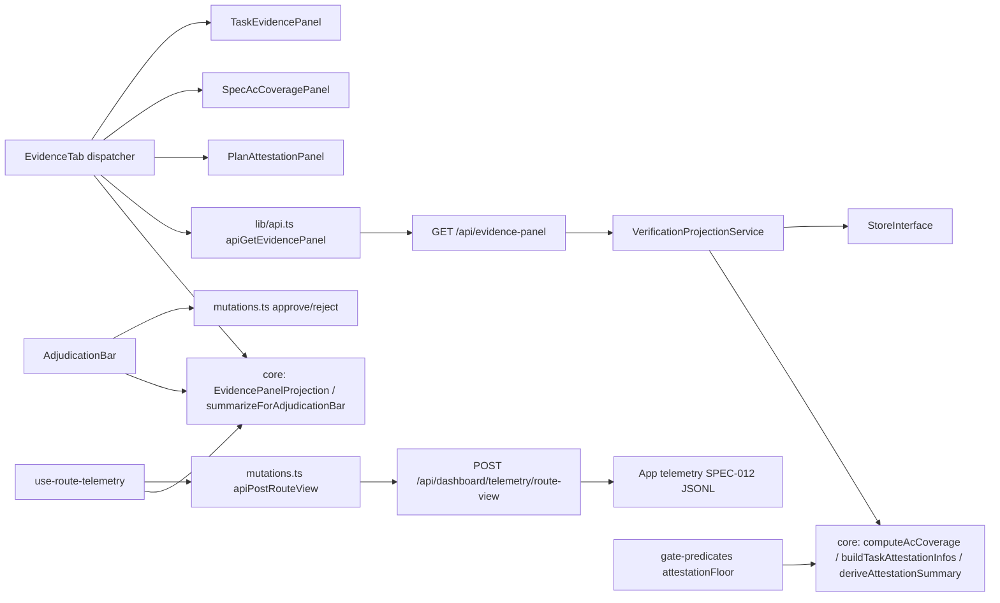

# SPEC-075 — Dashboard adjudication workbench + route telemetry (PRD §21 F1+F2)

> Kind: feature. Parent: PRD-001 §21 (v0.13, approved). Covers R-8 (P0), R-9 (P1), R-10 (P1).
> Design mode: module (lore-design); 4-perspective review applied (coupling/cohesion/reuse/testing — all findings incorporated, see Design Decisions D6-D10).
> Visual language: extension of the shipped dashboard system (shadcn + existing tokens, SPEC-033 rule — no multi-variant exploration; all new UI reuses existing components/tokens).

## Overview/Goal

Adjudication on the dashboard becomes evidence-grounded on one screen (PRD §21 F1): a doc's verification evidence, AC coverage, and attestation ratio render adjacent to the approve/reject controls; the triage queue becomes keyboard-operable; the judgment badge gains a drill-down honest to the qualitative `reasons[]` data shape. Route-level usage telemetry (PRD §21 F2) ships in the same batch, recording dashboard navigation to the existing SPEC-012 JSONL sink so later batches are decided on measurement, not assumption.

## Scope

**In**: one new read-only projection service + one read route; one telemetry ingestion route; DocDetail Evidence tab; adjudication context panel; keyboard triage hook; judgment drill-down; route-view telemetry hook; `TaskAttestationInfo` + attestation math hoisted to `@lore/core` (single writer for gate + projection). **Out** (PRD §21 non-goals): execution-verb writes, SSE/live push, home-page identity change, hosted/multi-tenant, numeric judgment scores, CLI feature parity.

## Module Boundary

### New/changed modules

| Module | Responsibility (single) | Public API | Depends on |
|---|---|---|---|
| `@lore/core` `evidence-panel.ts` (name follows the core content-named-file convention, main export = `EvidencePanelProjection`) | Pure projection TYPES + pure derivations shared by gate predicate, projection service, and dashboard (browser-safe; server↔client contract as one named type — SPEC-036 drift lesson structurally closed) | `EvidencePanelProjection` (discriminated union by `doc_type`), `AttestationSummary`, **`TaskAttestationInfo` (MOVED here from `gate-predicates.ts:504`)**, `deriveAttestationSummary(infos, minRatio)` (BOTH floor conditions: per-task zero-attested check AND plan-wide ratio), `buildTaskAttestationInfos(tasks)` (evidence/attested counting — the assembly SSOT so gate and projection can never fork), `summarizeForAdjudicationBar(panel)` (chip-level summary shared by AdjudicationBar and EvidenceTab — no dual derivation) | zod; reuses existing `AcCoverageFact`, `EvidenceEntry`, `AcceptanceCriterion` |
| `packages/lore/src/service/verification-projection-service.ts` | Assemble the evidence panel for one doc (read-only, stateless) | `VerificationProjectionService.evidencePanel(idOrSlug): Promise<Result<EvidencePanelProjection, LoreError>>` | `StoreInterface` (injected); core SSOT fns ONLY (`computeAcCoverage`, `buildTaskAttestationInfos`, `deriveAttestationSummary`) — zero local derivation math |
| `packages/lore/src/service/gate-predicates.ts` (changed) | `attestationFloor` becomes a thin consumer: `import type { TaskAttestationInfo } from "@lore/core"` + delegates to `deriveAttestationSummary`; byte-identical gate behavior (existing gate tests + a parity unit test pin it) | unchanged signature | `@lore/core` |
| HTTP: `GET /api/evidence-panel/:idOrSlug` | Read route, SPEC-033 read-family (cookie OR bearer) | envelope `{ok, value: EvidencePanelProjection}` | routes.ts flat table + VerificationProjectionService |
| HTTP: `POST /api/dashboard/telemetry/route-view` | Cookie-only + Origin-allowlist ingestion; server-stamped `ts`; enabled→append 1 `TelemetryEvent` (`source:"dashboard"`, `service:"dashboard"`, `method:"route_view"`, `meta:{route_id, doc_type?}`); disabled→204 zero-write; sink failure→server log + 204 (documented fail-quiet exception, PRD §21 F2) | body `{route_id: string (≤200), doc_type?: DocType}` (zod) → 204 | dashboard-routes.ts conventions (`assertAllowedOrigin`+`assertCookieActor`); telemetry writer reached through an **injectable seam** (handler takes the telemetry instance as a parameter, test injects a throwing double — the failure branch must be reachable in tests) |
| `packages/dashboard/src/components/EvidenceTab.tsx` | THIN discriminant dispatcher over the projection union — no rendering logic of its own | props `{doc: DocRecord}` | `apiGetEvidencePanel`, 3 panel subcomponents |
| `packages/dashboard/src/components/evidence/{TaskEvidencePanel,SpecAcCoveragePanel,PlanAttestationPanel}.tsx` | 1:1 with the core union members: evidence timeline (monospace `output_tail`, attested/self-reported trust label) / AC coverage matrix / attestation summary card; each owns its explicit empty state | props = its union member | core types only |
| `packages/dashboard/src/components/AdjudicationBar.tsx` | Same-screen adjudication context (R-8): chips from `summarizeForAdjudicationBar` + existing approve/reject + calibration-note affordance, rendered in DocDetail header region for docs in review | props `{doc, panel}` | existing `apiApproveDoc`/`apiRejectDoc` (SPEC-022/033 — no new write semantics) |
| `packages/dashboard/src/components/JudgmentDrilldown.tsx` | Expansion of `JudgmentBadge`: decision, confidence, qualitative `reasons[] {dimension, finding}`, checks, blocking_questions, judge prompt_version; no judgment record → no affordance (existing "unreviewed" badge unchanged); stale judgment renders with existing stale badge | props `{judgment: ReviewJudgment \| null}` | existing `apiGetJudgments` |
| `packages/dashboard/src/lib/use-triage-keyboard.ts` | Keyboard loop for queue surfaces (R-9): j/k selection, a approve, x reject-modal, e expand, o open; suppressed when `event.target.closest('input, textarea, [contenteditable], .cm-editor')` | `useTriageKeyboard(opts)` hook | none (DOM events) |
| `packages/dashboard/src/lib/use-route-telemetry.ts` | Fire one `apiPostRouteView` per router location change (R-10); fire-and-forget, never throws to UI | `useRouteTelemetry()` mounted in `__root` | router subscription + mutations.ts |

### Unchanged (consumed as-is)
`computeAcCoverage` (SSOT since SPEC-070), `ReviewJudgment`, `EvidenceEntry`, `AcceptanceCriterion`, approve/reject dashboard routes + calibration hook (SPEC-033 §2.1), `JudgmentBadge` semantics, `TelemetryEvent` (already carries `source:"dashboard"`).

## Structure (file tree delta)

```
packages/core/src/evidence-panel.ts                  # NEW: types (incl. moved TaskAttestationInfo) + deriveAttestationSummary
                                                     #      + buildTaskAttestationInfos + summarizeForAdjudicationBar
packages/core/src/evidence-panel.test.ts             # vitest (pure)
packages/lore/src/service/verification-projection-service.ts   # NEW
packages/lore/tests/unit/service/verification-projection-service.test.ts  # vitest via InMemoryStore
packages/lore/src/service/gate-predicates.ts         # attestationFloor thins to core delegate (parity-pinned)
packages/lore/src/adapters/http/routes.ts            # +GET /api/evidence-panel/:idOrSlug
packages/lore/src/adapters/http/dashboard-routes.ts  # +POST /api/dashboard/telemetry/route-view (injectable telemetry param)
packages/lore/tests/http/evidence-panel.bun.test.ts  # .bun.test.ts — HTTP tests run the real App+SQLiteStore path
packages/lore/tests/http/telemetry-route.bun.test.ts # .bun.test.ts — incl. throwing-writer double for the failure branch
packages/lore/src/app.ts                             # wire VerificationProjectionService into App
packages/dashboard/src/lib/api.ts                    # +apiGetEvidencePanel (typed by @lore/core)
packages/dashboard/src/api/mutations.ts              # +apiPostRouteView (fire-and-forget)
packages/dashboard/src/components/EvidenceTab.tsx    # thin dispatcher
packages/dashboard/src/components/evidence/{TaskEvidencePanel,SpecAcCoveragePanel,PlanAttestationPanel}.tsx
packages/dashboard/src/components/{AdjudicationBar,JudgmentDrilldown}.tsx
packages/dashboard/src/components/DocDetail.tsx      # mount Evidence tab + AdjudicationBar
packages/dashboard/src/lib/{use-triage-keyboard,use-route-telemetry}.ts
packages/dashboard/src/routes/__root.tsx             # mount useRouteTelemetry
packages/dashboard/tests/component/*                 # one test file per new component/hook (vitest+jsdom)
packages/dashboard/tests/e2e/adjudication.pw.ts      # Playwright: adjudicate-with-evidence-visible + calibration parity
```

## Public Interface (contract types, live in @lore/core)

```ts
export type EvidencePanelProjection =
  | { doc_type: "task"; evidence: EvidenceEntry[]; ac_refs: string[] }
  | { doc_type: "spec"; criteria: AcceptanceCriterion[]; coverage: AcCoverageFact[]; task_count: number }
  | { doc_type: "plan"; attestation: AttestationSummary; tasks: TaskAttestationInfo[] }
  | { doc_type: "other" };            // prd/adr/knowledge → tab hidden

export interface TaskAttestationInfo {  // MOVED from gate-predicates.ts (single home)
  slug: string; title: string; evidenceCount: number; attestedCount: number;
}

export interface AttestationSummary {
  total_evidence: number;
  attested: number;
  ratio: number | null;               // null when total_evidence === 0 (vacuous case, never fabricated 0)
  min_ratio: number;                  // from workflow.attestation.min_ratio
  meets_floor: boolean;               // BOTH attestationFloor conditions: no evidence-bearing task with 0 attested AND ratio ≥ min_ratio
  zero_attested_tasks: string[];      // slugs failing condition 1 (gate feeding-pack + UI share the same list)
}
```

Spec→tasks resolution: named fn `resolvePlanTasks(store, planId)` inside the service — spec → child `type=plan` docs → each plan's child `type=task` docs (2 store hops; deliberately NOT coupled to `getPlanBundle`'s assessment-shaped payload). **Documented assumption (D9)**: this pins the current task-centric hierarchy; the SPEC-056 phase migration (not yet executed — corpus has 0 `phase` docs) would make a `type=task` filter silently return empty. `resolvePlanTasks` is the single replacement point; it fail-louds (`VALIDATION_ERROR` naming this assumption) if a plan has ≥1 `phase` child and 0 `task` children.

## Dependency Graph



No cycles: core ← lore ← (HTTP) ← dashboard, all arrows inward.

## Design Decisions

| # | Decision | Choice | Rationale | Trade-off |
|---|---|---|---|---|
| D1 | Projection assembly home | NEW `VerificationProjectionService` | Repo pattern = one-responsibility stateless services; CorpusService already largest; HTTP-only assembly would block MCP/CLI reuse | One more service to wire |
| D2 | Contract types home | `@lore/core` browser-safe barrel (`evidence-panel.ts`) | Server return type ≡ client expected type by construction; precedent `deriveTypeMeta` | Core grows UI-adjacent types (pure data, acceptable) |
| D3 | Derivation SSOT | Service uses core fns only; import-graph-pinned by AC | task-feed-wiring (SPEC-070) already derives coverage — a third derivation would fork semantics | — |
| D4 | Telemetry transport | One POST per route navigation, fire-and-forget; telemetry instance injected into the handler (failure branch testable) | Simplest R-10-oracle mapping; 1-user scale needs no batching; failure never surfaces to UI (PRD-documented exception) | Chattier than batching (accepted) |
| D5 | Keyboard selection state | Component-local ephemeral state (documented exception to server/URL-state invariant) | URL-state per j/k pollutes history; precedent: editor draft ephemera | Selection lost on reload (Linear-consistent) |
| D6 | Attestation math home | `TaskAttestationInfo` + `buildTaskAttestationInfos` + `deriveAttestationSummary` ALL move to core; `attestationFloor` thins to a delegate | Single writer for type, assembly counting, AND ratio semantics — projection and gate can never disagree (coupling review) | Touches a gate predicate (parity-pinned) |
| D7 | Component decomposition | 3 panel subcomponents 1:1 with the union + thin dispatcher; chip summary via shared core fn | God-component risk; the union is exactly where future doc_types land (cohesion review) | 3 more small files |
| D8 | New HTTP tests runner | `.bun.test.ts` (real App+SQLiteStore path) | Repo convention; avoids InMemoryStore-vs-production divergence and bun:sqlite leakage into vitest (testing review) | — |
| D9 | Hierarchy assumption | `resolvePlanTasks` named fn; fail-loud on phase-children-without-tasks | SPEC-056 migration would silently empty a raw `type=task` filter (reuse review) | One assumption check per plan resolution |
| D10 | Naming | `evidence-panel.ts` not `workbench.ts` | Core files are content-named, not feature-batch-named (cohesion review) | — |

## Cross-Cutting

- **Security (STRIDE-lite)**: evidence-panel route = read-only projection, auth parity with SPEC-033 read family (401 unauthenticated); telemetry route = cookie-only + Origin allowlist (CSRF), zod-validated body (`route_id` ≤200 chars, `doc_type` enum), no reflected output; no new secrets, no shell-out.
- **Performance**: evidence panel ≤3 store queries (doc + children ×2); target <100ms on a 1k-doc corpus (existing HTTP test tolerance; no new SLA machinery).
- **Observability**: F2 IS the observability deliverable; new routes appear in existing HTTP telemetry via `emitDashboardTelemetry` conventions.
- **Privacy**: telemetry captures route_id + doc_type + timestamp only — no doc content, local JSONL, opt-in flag unchanged (PRD §21 boundary).

## Test Contract (for tester / verify)

- **Invariants**: dashboard has zero `@lore/lore` imports; projection service has zero local derivation math (imports pinned to core fns); keyboard suppression on editable focus; telemetry disabled → zero sink writes.
- **Error scenarios**: unknown doc id (DOC_NOT_FOUND), bearer on telemetry route (403), disallowed origin (403), sink write failure (204 + server log via throwing-writer double), judgment absent (no drill-down), zero evidence / no ACs / plan-with-zero-tasks (explicit empty states), phase-children-without-tasks (fail-loud VALIDATION_ERROR, D9).
- **Calibration parity fields (AC-075-4, quantified)**: dashboard adjudication with the panel visible produces a calibration record whose `doc_id`, `doc_version`, `judgment_id` pairing, `human_decision`, actor attribution, and optional note→`delta_reasons` all equal what the CLI path writes for the same doc state — asserted field-by-field via API read-back, not visually.
- **Edge cases**: spec with plans but zero tasks; plan with evidence but zero attested (floor condition 1 → `zero_attested_tasks` non-empty, `meets_floor` false); `ratio: null` vacuous case; stale judgment drill-down.

## Acceptance Criteria

Structured ACs via `lore ac add` (script-mode, commands pinned there). Prose summary:

1. **AC-075-1** TaskEvidencePanel renders a task's evidence timeline with attested/self-reported labels and monospace output_tail (component test).
2. **AC-075-2** SpecAcCoveragePanel renders the AC coverage matrix from `computeAcCoverage`; PlanAttestationPanel renders the attestation summary incl. `zero_attested_tasks` (component + service tests).
3. **AC-075-3** Boundary states: zero evidence, spec-without-ACs, plan-with-zero-tasks each render explicit empty states; phase-children-without-tasks returns fail-loud VALIDATION_ERROR (component + service tests).
4. **AC-075-4** (R-8) DocDetail for an in-review doc shows AdjudicationBar (chips via `summarizeForAdjudicationBar`) on the same screen as approve/reject; Playwright e2e adjudicates with the panel visible and asserts the calibration record field-by-field (doc_id, doc_version, judgment pairing, decision, actor, note→delta_reasons) equal to CLI-path semantics.
5. **AC-075-5** (R-9) Full keyboard loop j/k/a/x/e/o proven by a component test dispatching ONLY keyboard events, asserting each state transition.
6. **AC-075-6** (R-9) All five shortcuts suppressed while an editable element (input/textarea/contenteditable/.cm-editor) holds focus (keyboard-only component test).
7. **AC-075-7** JudgmentDrilldown renders decision/confidence/reasons[]/blocking_questions/prompt_version; no judgment record → no affordance, no error; stale judgment renders with stale badge (component tests).
8. **AC-075-8** (R-10) Telemetry enabled: one JSONL event per dashboard route navigation with `route_id` (+`doc_type` when applicable); disabled: zero writes; sink failure (throwing-writer double injected through the D4 seam): HTTP 204, zero user-visible errors, one server-side log line (`.bun.test.ts` HTTP tests + hook component test).
9. **AC-075-9** Auth matrix: evidence-panel route 401 unauthenticated, 200 for cookie AND bearer; telemetry route 403 for bearer and for disallowed Origin (`.bun.test.ts`).
10. **AC-075-10** Import-graph pins: verification-projection-service imports derivations ONLY from `@lore/core` (no local ratio/coverage math); dashboard has zero `@lore/lore` imports (grep oracles, exit-code checked).
11. **AC-075-11** `attestationFloor` delegates to core `deriveAttestationSummary` and reproduces BOTH conditions (per-task zero-attested AND plan-wide ratio ≥ min_ratio) with byte-identical gate behavior — existing gate tests green + a dedicated parity unit test over both condition classes.
12. **AC-075-12** Full oracle suite green: `bun run typecheck`, `bun run test:vitest`, `bun run test:bun`, dashboard vitest, Playwright e2e.

## Quality Gates (module mode) — status

- [x] No circular dependencies (core←lore←dashboard; gate + projection both point at core)
- [x] Every module single clear responsibility (boundary table; dispatcher/panel split per D7)
- [x] Public API sufficient for black-box testing (service via InMemoryStore; routes via `.bun.test.ts` real-App path; hooks/components via jsdom)
- [x] Dependencies injectable (store DI; telemetry instance injected into handler; hooks take callbacks)

## Downstream Handoff

- **implement**: interfaces above; no new deps; ordering: core `evidence-panel.ts` (types+fns+`attestationFloor` thinning) lands FIRST (its parity test is the safety net), then service+routes, then UI; layout spike for R-8 same-screen constraint is the plan's FIRST task — if infeasible, fallback (one-click evidence popover) requires owner sign-off as an R-8 change (PRD §21 F1b).
- **test**: contract above; six-dimension coverage per repo standard; new HTTP tests are `.bun.test.ts` (D8).
- **deploy**: none (local-dev surface; no env vars; no migration).


## Acceptance Criteria (structured)

- [⚑] [script] AC-075-1: TaskEvidencePanel renders a task's verification-evidence timeline with attested/self-reported trust labels and monospace output_tail
  script: test — cd packages/dashboard && bunx vitest run -t "AC-075-1"
- [⊘] [script] AC-075-2: SpecAcCoveragePanel renders the AC coverage matrix derived from computeAcCoverage; PlanAttestationPanel renders the attestation summary including zero_attested_tasks; VerificationProjectionService assembles all three unions via core SSOT fns
  script: test — bunx vitest run packages/lore/tests/unit/service/verification-projection-service.test.ts -t "AC-075-2" && cd packages/dashboard && bunx vitest run -t "AC-075-2"
- [⊘] [script] AC-075-3: Boundary states: zero evidence, spec-without-ACs, plan-with-zero-tasks render explicit empty states; a plan with phase children and zero task children returns fail-loud VALIDATION_ERROR (D9)
  script: test — bunx vitest run packages/lore/tests/unit/service/verification-projection-service.test.ts -t "AC-075-3" && cd packages/dashboard && bunx vitest run -t "AC-075-3"
- [⊘] [script] AC-075-4: Playwright e2e: DocDetail of an in-review doc shows AdjudicationBar on the same screen as approve/reject; adjudicating with the evidence panel visible produces a calibration record equal field-by-field (doc_id, doc_version, judgment pairing, decision, actor, note-to-delta_reasons) to CLI-path semantics, asserted via API read-back
  script: e2e — cd packages/dashboard && bunx playwright test tests/e2e/adjudication.pw.ts
- [⚑] [script] AC-075-5: Full keyboard triage loop j/k/a/x/e/o proven by a component test dispatching ONLY keyboard events and asserting each state transition
  script: test — cd packages/dashboard && bunx vitest run -t "AC-075-5"
- [⚑] [script] AC-075-6: All five triage shortcuts are suppressed while an editable element (input, textarea, contenteditable, .cm-editor) holds focus — keystrokes pass through, no adjudication fires
  script: test — cd packages/dashboard && bunx vitest run -t "AC-075-6"
- [⚑] [script] AC-075-7: JudgmentDrilldown renders decision, confidence, qualitative reasons[] (dimension+finding), blocking_questions, prompt_version; a doc with no judgment record shows no drill-down affordance and no error; a stale judgment renders with the existing stale badge
  script: test — cd packages/dashboard && bunx vitest run -t "AC-075-7"
- [⊘] [script] AC-075-8: Telemetry enabled: exactly one JSONL event per dashboard route navigation carrying route_id (+doc_type when applicable); disabled: zero sink writes; sink write failure via injected throwing writer: HTTP 204, zero user-visible errors, one server-side log line
  script: test — cd packages/lore && bun test tests/http/telemetry-route.bun.test.ts && cd ../dashboard && bunx vitest run -t "AC-075-8"
- [⊘] [script] AC-075-9: Auth matrix: GET /api/evidence-panel returns 401 unauthenticated and 200 for both cookie and bearer; POST /api/dashboard/telemetry/route-view returns 403 for bearer auth and for a disallowed Origin
  script: test — cd packages/lore && bun test tests/http -t "AC-075-9"
- [⚑] [script] AC-075-10: Import-graph pins hold: verification-projection-service defines no local derive/compute functions (derivations imported from @lore/core only) and packages/dashboard/src contains zero @lore/lore imports
  script: other — bash -c '! grep -nE "function (derive|compute)" packages/lore/src/service/verification-projection-service.ts && ! grep -rn "from \"@lore/lore\"" packages/dashboard/src/'
- [⚑] [script] AC-075-11: attestationFloor delegates to core deriveAttestationSummary reproducing BOTH conditions (per-task zero-attested AND plan-wide ratio >= min_ratio) with byte-identical gate behavior: existing gate tests green plus a dedicated parity unit test over both condition classes
  script: test — bunx vitest run packages/lore/tests -t "AC-075-11" && bunx vitest run packages/lore/tests/unit/service/gate-predicates.test.ts
- [⊘] [script] AC-075-12: Full oracle suite green: typecheck, vitest, bun test, dashboard vitest, Playwright e2e
  script: test — bun run typecheck && bun run test && cd packages/dashboard && bunx vitest run && bunx playwright test
