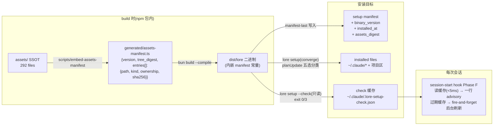

## Overview/Goal

Lore 通过 `lore setup`(全局 `~/.claude`)与 `lore setup --project`(消费仓库)把 292 个受管资产(41 skills、9 hooks、3 agents、2 governance、6 project 模板)安装进用户环境。现状是"一次性安装 + 幂等重跑",存在四个结构性缺口:**无过期检测**(installed 副本落后于 SSOT 无任何信号)、**无 update 语义**(diverged 用户改动被静默备份覆盖)、**无 agent 场景提醒**(postinstall 仅 TTY nudge)、**无版本记录**(manifest 不知道自己是哪个 lore 版本写的)。

本设计以三条经 ≥3 标杆交叉验证的原则为基座:**①内容 hash 判过期,时间戳只做节流**(pre-commit / Homebrew / VS Code);**②用户区/受管区物理隔离替代三方合并**(业界无一家做真正三方合并);**③CI/agent 场景不静默改,出 diff 走 review**(pre-commit.ci / Renovate)。

## Goals / Non-Goals

**Goals**
- G1:任何已安装环境一条只读命令(`lore setup --check`)判定新鲜度,exit code 可 CI 化
- G2:update = 重跑 `lore setup`,对 diverged(用户改过的受管文件)默认跳过 + 响亮报告,绝不静默覆盖
- G3:agent/非 TTY 会话在 session-start 收到过期 advisory(fail-open、<5ms 常态路径、一行文案)
- G4:manifest 记录 `binary_version` / `installed_at` / `assets_digest`,可观测"这台机器落后多少"
- G5:每个资产的 ownership(managed / merged / user_once)显式声明,不从 kind 推导

**Non-Goals**
- 自动更新(auto tier):**明确拒绝**——单一分发商内部工具,update 是低频人为决策;auto 的失败恢复模型(权限/网络/diverged 冲突)不可控(Cost R3 + Claude Code「不打断运行会话」先例)
- engines 式版本兼容门:assets 与二进制永远同 npm 包发布,兼容门是谎言性冗余
- 资产文件本体嵌入二进制:2.3MB 292 文件走 `/$bunfs` 的解析面(SPEC-068 教训)与构建成本不划算,只嵌 manifest 常量
- corpus 数据同步(Turso sync 已有自己的机制,不在本设计范围)

## Architecture Diagram



## Components

### C1 — Ownership 三区模型(schema 显式声明)

`assetFileSchema` / `setupEntrySchema` 各增加一个 additive 字段:

```ts
ownership: "managed" | "merged" | "user_once"
```

| 区 | 语义 | update 行为 | 成员 |
|---|---|---|---|
| `managed` | 工具拥有,只读分发单元 | outdated → 备份后覆盖;diverged → **默认跳过 + 报告**,`--force-diverged` 才覆盖 | skills、hooks、agents、governance、gate 脚本、pre-push |
| `merged` | 双方共管,确定性合并 | 走各自 merge 语义 + **孤儿清理**(见 C5) | settings.json、.gitignore |
| `user_once` | scaffold 一次即归用户 | **永不再碰** | config.yaml 模板、lore.tree.yaml 模板 |
| (marker 分段) | CLAUDE.md 特例:受管段落归工具,段外归用户 | 只重写 `# ─── lore governance ───` marker 之间的内容 | 根 CLAUDE.md stub(从整文件 backup-then-overwrite **迁移到 marker 分段**,复用 .gitignore marker-append 的已验证模式) |

Ownership 在 `AssetSource` 装载时声明(kind∩ownership 合法配对写进 setup-service 模块不变量 I6),**绝不运行时推导**——kind 是技术分类,ownership 是操作策略,二者正交(Domain 裁决)。

### C2 — 构建期资产 manifest(内嵌常量,不嵌文件本体)

`scripts/embed-assets-manifest.mjs`(prebuild):遍历 `assets/` → 计算 per-file sha256 + 排序后整树 digest → 生成 `packages/lore/src/generated/assets-manifest.ts`(git-tracked)→ `bun build --compile` 内嵌。同一脚本把 `package.json.version` 注入为 `LORE_BINARY_VERSION` 常量,替换现在硬编码的 `0.1.0`。

二进制即 SSOT 载体:**版本真相 = 二进制内嵌 digest,别无第二档案**(QA-5)。CI 加一条 freshness 检查:generated 文件与 `assets/` 现算结果不一致 → fail(防"改了 assets 忘了重新生成")。

### C3 — 五态判定 + `lore setup --check`(只读投影)

`planUpdate(embeddedManifest, installedManifest, fsProbe) → UpdatePlan`(`@lore/core` 纯函数,与 `planInstall` 平级而非包装——install 与 update 不变量不同,Domain 裁决):

| 状态 | 判定 | `--check` 报告 | `lore setup` 行为 |
|---|---|---|---|
| `sync` | disk sha = manifest sha = embedded sha | ✓ | skip(零写入) |
| `outdated` | disk sha = manifest sha ≠ embedded sha | 列出 | 备份后覆盖(受管区正常升级) |
| `diverged` | disk sha ≠ manifest sha(用户改过) | **响亮列出 + per-file 修复命令** | 默认跳过;`--force-diverged` 备份后覆盖 |
| `missing` | manifest 有,disk 无 | 列出 | 重新写入(restore) |
| `orphaned` | disk 有(lore 目录内),manifest 无 | 仅报告 | 永不触碰 |

快速路径:整树 digest 相等 → 短路返回 `sync`,不做 292 次 per-file 比对(Performance);digest 不等才展开五态分类(Cost 的"whole-tree bool 优先"与 Domain 的"内部必须五态"在此复合:**摘要判定短路,细节按需展开**)。

CLI 面:`lore setup --check [--json]`,零 mutation、零 gate。exit `0` = 全 sync;`3` = 存在 outdated/diverged/missing(沿用 `--check-tree`/`--check-drift` 的 exit-3 先例);orphaned 不影响 exit code。`--json` 输出 `{summary, binary_version, installed_binary_version, installed_at, files: {outdated[], diverged[], missing[], orphaned[]}}`。

**命名纪律:本域术语用 `diverged`/`freshness`,「drift」保留给 SPEC-045 code-drift,零冲突**(Domain 裁决)。

### C4 — Manifest 扩展(additive)

```ts
// setupManifestSchema 顶层新增(全部 optional,旧 manifest 解析不变)
binary_version?: string;   // 写入该 manifest 的 lore 版本
installed_at?: string;     // ISO8601,最近一次成功 install/converge
assets_digest?: string;    // 安装时的整树 digest
// entries[] 新增
ownership?: "managed" | "merged" | "user_once";
```

旧 manifest(字段缺失)→ ownership 从 kind 推导一次并在下次写入时补齐,推导路径打一条 stderr 提示(迁移期兜底,不是长期机制)。

### C5 — merged 区孤儿清理(Security)

`mergeSettings` 增加 pruning:lore 拥有的 hook 注册(按 `{{CLAUDE_DIR}}/hooks/` 路径前缀识别)中,command 指向的文件不在新 payload 内 → 该注册条目移除。修复"旧版注册的 hook 更名后,settings.json 遗留孤儿条目指向已删除文件"的累积腐化。同规则用于 uninstall 已有路径。备份卫生:`.lore-backups/` 在每次 install 时修剪(保留最近 N=5 次运行),防无限膨胀与敏感内容长期残留。

### C6 — session-start advisory(Phase F,cache-first)

```
hook 启动 → 读 ~/.claude/.lore-setup-check.json(一次 JSON read)
├─ 缓存新鲜(< 24h)且 status=sync → 无输出(<5ms,99% 路径)
├─ 缓存新鲜且 status≠sync → 注入一行:
│    ⚠ lore assets outdated (binary 0.2.1 / installed 0.1.9) — run `lore setup`
└─ 缓存缺失/过期 → fire-and-forget 后台 spawn `lore setup --check --json`
     (写缓存供下次会话,绝不 await,本会话不受影响)
```

- **绝不阻塞、绝不 gate**:任何异常静默跳过(fail-open,g1-hook 先例;Ops 裁决 Option A)
- 缓存写入 temp+rename 原子替换,损坏容忍(hash 不符 → 忽略重算)
- 时间戳只决定"何时检查",真相永远是 hash(oh-my-zsh 教训)
- 配置:`setup.check_reminder: bool`(默认 true)单开关 + env kill-switch `LORE_SETUP_NO_CHECK=1`——**三态 auto/reminder/disabled 被砍**(Cost 裁决)
- `lore setup` 成功收敛后主动删缓存,advisory 立即消失

### C7 — update 心智模型:没有新动词

`update ≡ 重跑 lore setup`(现有收敛语义的自然强化),不新增 `lore update` 命令——setup 已有 install/`--project`/`--uninstall`/`--dry-run` 四模式,新动词让 CLI 面翻倍(DX 裁决,Cost 附议)。完整流:

```bash
# agent / CI(PULL 模式,永不静默改)
lore setup --check --json     # 状态判定,exit 0/3
lore setup --yes              # 收敛;diverged 跳过并列出
lore setup --yes --force-diverged   # 显式接受"覆盖我的本地改动"

# 人类
npm update -g @lore/cli && lore setup   # postinstall TTY nudge 不变
```

## Data Flow(update 一次完整收敛)

```mermaid
sequenceDiagram
    participant U as 操作者(人/agent)
    participant CLI as lore setup
    participant PU as planUpdate(pure)
    participant FS as 目标目录
    participant M as manifest

    U->>CLI: lore setup --yes
    CLI->>M: 读 installed manifest
    CLI->>FS: fs probe(digest 短路 → 需要时 per-file sha)
    CLI->>PU: embedded manifest + installed manifest + probe
    PU-->>CLI: UpdatePlan {writes, skips, diverged, missing, orphaned}
    CLI->>FS: 备份 → 写 writes+missing(managed outdated)
    CLI->>FS: mergeSettings + 孤儿清理(merged)
    Note over CLI,FS: diverged 跳过;user_once 不碰;CLAUDE.md 只重写 marker 段
    CLI->>M: manifest 最后写入(binary_version/installed_at/assets_digest)
    CLI->>FS: 删 check 缓存
    CLI-->>U: receipt:written/skipped/diverged(含 per-file 修复命令)/pruned
```

## Trade-off Decisions

| 决策 | 选择 | 依据 | 代价 | 异议记录 |
|---|---|---|---|---|
| D1 过期真相源 | 编译期内嵌 assets manifest 常量(仅 manifest,不嵌文件本体) | hash 判定 <1ms、与二进制密码学绑定、避开 `/$bunfs` 292 文件面 | prebuild 脚本 + 一个 git-tracked generated 文件 + CI freshness 检查 | — |
| D2 diverged 处理 | 默认跳过 + 响亮报告,`--force-diverged` 显式覆盖(备份) | 「CI/agent 不静默改」三标杆原则;用户改 gate 脚本被静默恢复是策略突袭(Security) | update 后可能残留旧版文件,靠 `--check` exit 3 持续可见 | 标杆 VS Code/Claude Code 是无条件覆盖(cache 语义);因 lore 的 hooks 是安全策略载体,采更保守侧 |
| D3 update 动词 | 无新动词,重跑 `lore setup` = converge | CLI 面不翻倍;planUpdate 在内部区分 install/update 不变量 | "update"语义要靠文档而非命令名承载 | Domain 曾主张独立聚合操作——采纳其纯函数分离(planUpdate),拒绝其独立 CLI 动词 |
| D4 advisory 机制 | cache-first + 后台 fire-and-forget 刷新 + 一行文案 | session-start 严禁 spawn 子进程(Performance);99% 路径 <5ms、~40B token 成本(Cost) | 过期信号最多滞后 24h + 一个会话 | Ops 曾建议 append-only 审计日志——降为 receipt 内建信息,不单独建 jsonl(Cost 复杂度否决) |
| D5 配置面 | 单布尔 `setup.check_reminder` + env kill-switch | 3-5 人单分发商,三态配置 = 3× 分支 × 每个消费面(Cost) | 未来若真需 auto 要重开设计 | 初稿三态被否 |
| D6 五态 vs 布尔 | 内部五态分类,外部 digest 短路 + 摘要;`--json` 才展开 | update 策略每态恢复路径不同(Domain);高频路径零成本(Perf/Cost) | planUpdate 状态机测试 5 个场景 | — |
| D7 CLAUDE.md stub | 从 backup-then-overwrite 迁移到 marker 分段 | 用户自有内容零丢失风险;.gitignore marker 模式已验证(SPEC-060 D3) | 一次性迁移逻辑(检测旧版整文件 stub → 包 marker) | — |
| D8 ownership 声明 | schema 显式字段,装载时声明 | kind 与 ownership 正交,推导是隐藏契约(Domain) | additive schema bump + 旧 manifest 迁移兜底 | — |
| D9 并发 setup 锁 | **推迟**(P3 候补) | 现有 manifest-last + 幂等重跑已保证最终收敛;半状态窗口被 hook fail-open 吸收(Ops 自证) | 极小概率的会话内 hook 新旧混杂,下次 setup 自愈 | Ops 建议 PID lock;按 blast radius 评估推迟 |

## Risk Registry

| 风险 | 严重度 | 缓解 |
|---|---|---|
| 供应链:npm 包被投毒,assets 直接进 `~/.claude` 被自动执行 | High(先存量) | 本设计不扩大该面(无网络 fetch、digest 与二进制绑定);发布侧 2FA/provenance 属发布纪律,独立跟进,**不在本 spec 内假装解决** |
| agent 对 advisory 脱敏(长期忽略一行提示) | Medium | `--check` exit 3 可挂 CI/pre-push;receipt + manifest `installed_at` 让"落后多久"可查询;必要时后续把 check 挂 `lore status` |
| 旧版二进制读新版 manifest(降级) | Low | 全 additive optional 字段,Zod strip 语义天然容忍;重跑 setup 收敛回旧结构,无数据丢失 |
| planUpdate 与 planInstall 语义漂移 | Medium | 二者共享 probe/manifest 类型,独立 golden 测试各 5 态;`--dry-run` 输出即测试快照 |
| generated manifest 忘更新 | Medium | CI freshness 检查(重算比对)fail loud |
| 缓存竞态/损坏 | Low | temp+rename 原子写;内容 hash 校验,不符即忽略重算 |

## Migration Plan

**P1 — 判定与收敛核心**(一个 plan,可并行拆 task)
1. `scripts/embed-assets-manifest.mjs` + generated 常量 + `LORE_BINARY_VERSION` 注入 + CI freshness 检查
2. schema additive:`ownership` + manifest 顶层三字段;AssetSource 声明 ownership;kind∩ownership 不变量 I6
3. `planUpdate` 纯函数(五态)+ `lore setup --check [--json]`(exit 0/3)
4. `lore setup` 收敛语义强化:diverged 默认跳过 + `--force-diverged`;missing restore;receipt 扩展
5. CLAUDE.md marker 分段迁移;mergeSettings 孤儿清理;备份修剪(保留 5 次)

**P2 — agent 可达性**
6. session-start hook Phase F(cache-first advisory + 后台刷新 + kill-switch)
7. `lore setup` 成功后删缓存;config `setup.check_reminder`

**P3 — 候补(显式推迟,非 TODO)**
- 并发 setup PID lock(触发条件:真实撞上并发 setup 损坏一次)
- `lore status` 集成 assets freshness 摘要(触发条件:advisory 被证实不够)

回滚:全部 additive——新字段 optional、新命令独立、hook Phase F 独立开关;任一阶段回退 = 不发布该段代码,已写 manifest 对旧版透明。

## Downstream Handoff(implement 契约)

```ts
// @lore/core — 新增类型
type AssetOwnership = "managed" | "merged" | "user_once";
type FileFreshness = "sync" | "outdated" | "diverged" | "missing" | "orphaned";

interface EmbeddedAssetsManifest {          // generated/assets-manifest.ts
  binary_version: string;                   // from package.json at build
  tree_digest: string;                      // sha256 over sorted (path, sha256) pairs
  entries: ReadonlyArray<{ path: string; kind: SetupEntryKind; ownership: AssetOwnership; sha256: string }>;
}

interface UpdatePlan {
  summary: "sync" | "stale";                // digest 短路结果
  files: Record<FileFreshness, string[]>;   // digest 不等时展开
  writes: PlannedWrite[];                   // managed outdated + missing
  merges: PlannedMerge[];                   // settings.json / .gitignore(含 prune 集)
}
// planUpdate(embedded, installedManifest, probe): UpdatePlan — pure, @lore/core
// planInstall 不变(首装无 diverged 概念)
// AS-BUILT (2026-07-25, assess follow-up): CLAUDE.md marker-section rewrite
// landed directly in setup-project-flow.ts (T6) rather than through this
// classifier — `UpdatePlan` never carried a `markerRewrites` field in the
// shipped implementation. The field name above is now historical only; do
// not re-add it without a real populating call site.

// check 缓存文件 ~/.claude/.lore-setup-check.json
interface SetupCheckCache {
  checked_at: string;        // ISO8601
  binary_version: string;
  status: "sync" | "stale";
  stale_counts?: { outdated: number; diverged: number; missing: number };
}
```

非显然实现注意:①`--check` 是 bootstrap-stage 命令(不走 `loadLoreApp`,同 setup 豁免先例);②hook Phase F 的后台 spawn 用 `detached + unref`,严禁 await;③marker 迁移需识别三种存量:无 CLAUDE.md / 旧版整文件 stub / 用户自有文件,各自路径写进测试;④exit 3 复用 status-check 家族先例,与 `DOC_NOT_FOUND` 的 exit 3 域不同(setup 不触 corpus,无冲突)。

**test 契约**:不变量 = manifest-last、幂等(连续两次 converge 第二次零写入)、diverged 永不被无 flag 覆盖、user_once 永不被重写、digest 相等短路不读 per-file;错误场景 = 缓存损坏、manifest 缺字段、generated 过期、marker 缺失;边界 = 空安装目录、全 diverged、orphaned-only。

---

## Scope

**In scope**
- Additive schema: `AssetOwnership` on `assetFileSchema`/`setupEntrySchema`; manifest top-level `binary_version` / `installed_at` / `assets_digest`
- Build-time generated `packages/lore/src/generated/assets-manifest.ts` (per-file sha256 + tree digest + `LORE_BINARY_VERSION`) + CI freshness check
- Pure `planUpdate` five-state classifier (`sync|outdated|diverged|missing|orphaned`) in `@lore/core`, sibling of `planInstall`
- `lore setup --check [--json]` read-only projection (exit 0/3, bootstrap-stage command)
- Converge-semantics hardening of `lore setup` re-run: diverged skipped-by-default + `--force-diverged`; missing restored; receipt lists per-file repair commands
- Root CLAUDE.md stub migrated from backup-then-overwrite to marker-section rewrite
- `mergeSettings` orphan pruning (lore-owned hook registrations pointing at files absent from the new payload) + backup pruning (keep last 5 runs)
- Session-start hook Phase F: cache-first advisory (24h TTL, fire-and-forget background refresh, `setup.check_reminder` bool + `LORE_SETUP_NO_CHECK=1` kill-switch)

**Out of scope**
- Auto-update tier (rejected, D5); engines-style compatibility gates (rejected); embedding asset file bodies into the binary (rejected, D1)
- Concurrent-setup PID lock and `lore status` freshness splice (P3 deferred with explicit triggers)
- npm publish-side supply-chain hardening (release discipline, tracked separately)
- Corpus data sync (Turso) — unrelated mechanism

## Acceptance Criteria

Structured ACs are declared via `lore ac add` (see corpus). Prose summary: the embedded-manifest freshness check, five-state classification, check exit codes, diverged-skip/force semantics, user_once/marker preservation, orphan+backup pruning, manifest version fields, and hook Phase F advisory behavior are each pinned by a deterministic oracle below.


## Acceptance Criteria (structured)

- [⚑] [script] AC-076-1: planUpdate assigns each golden fixture exactly one of the five states (sync/outdated/diverged/missing/orphaned); a digest-equal input returns summary=sync with zero per-file sha comparisons (spy call count = 0)
  script: test — bunx vitest run packages/lore/tests/unit/core/plan-update.test.ts
- [⚑] [script] AC-076-2: On a fully-sync install 'lore setup --check' exits 0; after mutating one managed file it exits 3 and --json lists that path under files.diverged
  script: test — cd packages/lore && bun test tests/integration/setup-check.bun.test.ts
- [⚑] [script] AC-076-3: Re-running 'lore setup --yes' over a user-modified managed file leaves its bytes unchanged and prints the path plus a repair command; with --force-diverged the file's sha256 equals the embedded sha and a backup file exists
  script: test — cd packages/lore && bun test tests/integration/setup-converge-diverged.bun.test.ts
- [⚑] [script] AC-076-4: After converge, every user_once file is byte-identical to its pre-converge content; CLAUDE.md content outside the lore marker pair is byte-identical while the section between markers equals the new template
  script: test — cd packages/lore && bun test tests/integration/setup-user-once-marker.bun.test.ts
- [⚑] [script] AC-076-5: mergeSettings removes lore-owned hook registrations whose command path is absent from the new payload and leaves non-lore entries byte-identical; prune count is reported in the merge result
  script: test — bunx vitest run packages/lore/tests/unit/core/merge-settings-prune.test.ts
- [⚑] [script] AC-076-6: After converge the manifest's binary_version equals the binary's embedded LORE_BINARY_VERSION, assets_digest equals the embedded tree_digest, and installed_at parses as ISO8601
  script: test — cd packages/lore && bun test tests/integration/setup-manifest-fields.bun.test.ts
- [⚑] [script] AC-076-7: Hook Phase F emits 0 advisory bytes when cache status=sync; exactly 1 advisory line when status=stale; with LORE_SETUP_NO_CHECK=1 it emits 0 bytes and spawns 0 child processes
  script: test — bunx vitest run packages/lore/tests/unit/hooks/session-start-freshness.test.ts
- [⚑] [script] AC-076-8: After 7 converge runs each writing differing content, .lore-backups contains at most 5 run directories and the removed runs are the oldest by timestamp
  script: test — cd packages/lore && bun test tests/integration/setup-backup-prune.bun.test.ts
- [⚑] [script] AC-076-9: With assets/ unchanged since generation, the freshness check exits 0; after any assets/ file edit it exits non-zero until the manifest is regenerated
  script: build — bun scripts/embed-assets-manifest.mjs --check
- [⚑] [script] AC-076-10: Compiled-binary end-to-end cycle against a temp target dir: fresh 'lore setup --yes' then '--check' exits 0; mutating one managed file flips '--check' to exit 3 listing it under diverged; 'lore setup --yes --force-diverged' restores it and '--check' exits 0 again
  script: e2e — cd packages/lore && bun test tests/e2e/setup-freshness-cycle.bun.test.ts

## Code anchors

- packages/core/src/plan-update.ts#planUpdate
- packages/core/src/setup-manifest.ts
- packages/core/src/merge-settings.ts#mergeSettings
- packages/lore/src/adapters/cli/setup-check.ts
- packages/lore/src/service/setup-service.ts
- scripts/embed-assets-manifest.mjs
- assets/hooks/session-start-resume.mjs
- packages/lore/src/generated/assets-manifest.ts
