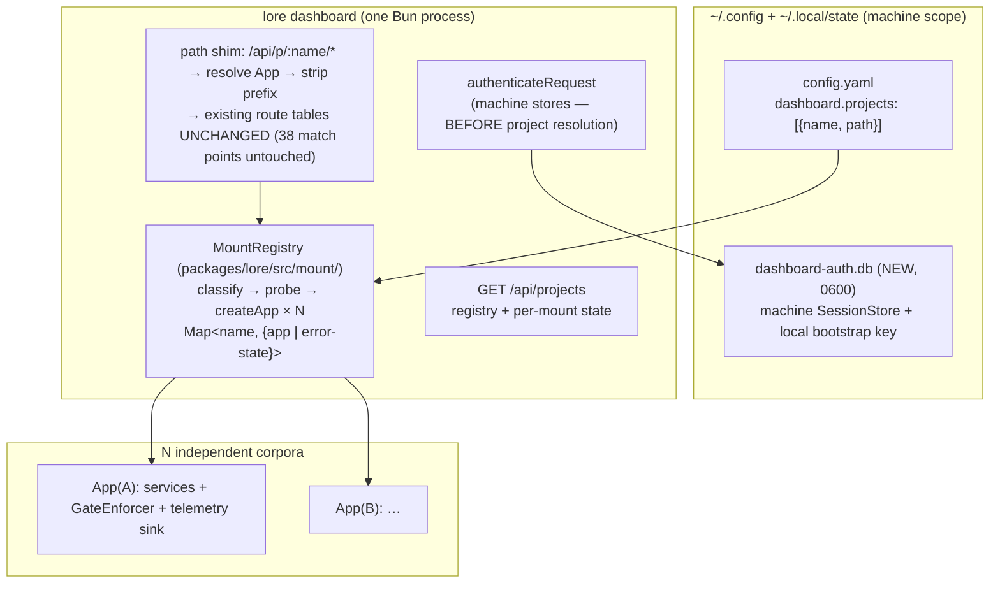

# SPEC-078 — Dashboard multi-project: mount registry, machine-scope auth, project-addressed routing (PRD §22)

## Overview

One `lore dashboard` instance mounts every corpus registered in machine config and serves them behind a project switcher. This spec pins the three PRD §22 Open questions (Q1 session home, Q2 N-App lifecycle, Q3 config schema) and the full landing architecture. Upstream: PRD §22 v0.14, R-11..R-17, G16. Design method: 6-role parallel architecture evaluation (performance / security / DX / ops / complexity / domain), synthesis below; every decision carries its dissent.

## Scope

**In scope (goals)**: R-11..R-17 mechanized exactly as the PRD states them; zero enforcement-code change (GateEnforcer stays per-corpus by construction); registry-less mode observably identical to today.

**Out of scope (non-goals)**: hot registry reload (restart-only by decision D6); cross-project aggregation routes (F4-gated; pending badges are client-side N-calls); production-build/single-process serving (§21 F4(i) unchanged — see constraint C-5); hosted/multi-tenant; corpus schema changes of any kind (this feature touches NO per-corpus `.lore/lore.db` schema).

## Architecture

Request flow: cookie auth against the machine store → project segment resolves the App (unregistered → 404, R-12) → prefix stripped → existing `handleApiRoute`/`handleDashboardRoute` receive that project's `app` exactly as today. Per-request failure in one App → that project's named 5xx (R-17); other mounts unaffected.

## Decisions (with tensions + dissent)

- **D1 (Q1) Machine-scope dashboard auth DB — unanimous (6/6 roles).** New SQLite file (XDG state dir via the `resolveGlobalConfigPath` precedent family; mode 0600) holding dashboard cookie sessions + the local bootstrap key. Domain framing adopted: "who is logged into this local dashboard" is an operator/machine-scoped fact — storing it per-corpus was a single-corpus-era accident; (b) N-way replication would leak session secrets into Turso replicas via SPEC-009 sync; (c) primary-corpus home couples all logins to one corpus's health (meta-violation of R-17) and to registry ordering. **Unconditional re-point** (Security+DX over Domain's two-path reading): `handleLocalBootstrap`/`ensureLocalApiKey`/`authenticateRequest` cookie path use the machine store in BOTH modes — R-15 pins observable behavior (routes, flows, 401 semantics), not storage internals; one auth code path forever. Corpus-DB `sessions` tables become vestigial (rows expire; schema untouched — no corpus migration). **Bearer API keys (SPEC-010 `lore serve`) stay per-corpus** — corpus-scoped consent by design; only dashboard cookie auth moves. Backup story: machine auth DB is NOT backed up; loss = logout, re-bootstrap (explicit, accepted).
- **D2 (Q2) `MountRegistry` = new platform module `packages/lore/src/mount/`** (DX+Domain converged; NOT `adapters/http/` — that dir is vitest-reachable and adapters must not import each other if MCP/CLI ever multi-mount). bun-only discipline (loader.ts pattern); never imported by `routes.ts`. Eager parallel mount at startup (`Promise.all`; Complexity: lazy adds a `mounting` transitional state + single-flight races for zero benefit at this scale). Hard gate: NO registry entry reaches `createApp` unprobed — readonly `PRAGMA user_version` probe first (`probeUpstreamDb` pattern; garbage/malicious file fails the header check structurally; never auto-migrates, R-11).
- **D3 (Q3) `GlobalLoreConfigSchema` gains optional `dashboard.projects`** (pure Zod, `packages/core`, SPEC-064 precedent; duplicate-name refine). The ONLY `packages/core` touch besides a pure `MountState` union type for client rendering. **Naming: `projects` kept, Domain dissent recorded**: Domain argued for `dashboard.corpora` (ubiquitous-language: "corpus" = one knowledge base; soft collision with §20 `reporter_project` free-text). Kept because the PRD v0.14 text pins `dashboard.projects`, the registry entry's `path` IS a project root (the corpus lives inside it), and "project" is the owner-chosen user-facing term; spec + config docs carry the explicit distinction note.
- **D4 Route integration = path-rewrite shim, not route-table edits.** Handlers already take `app` per call — strip `/api/p/:name`, resolve, delegate; 38 pathname match points untouched. The load-bearing edits are `authenticateRequest` wiring (~2 sites) + the server entry. Registry-less mode: shim inert, paths identical to today (R-15).
- **D5 Client seam = one factory triple**: `apiFetch(project, path)` wrapper + `queryKeys` factory (project-first key segment) + `useProjectParam()` router hook (`/p/:name/*` route wrapper; registry-less keeps current paths). R-16's "non-factory call sites = 0" enforced by ESLint rule banning raw `/api/` template literals outside the factory module (DX: grep counts are fragile). Switcher project list + mount states come from `GET /api/projects` (also the Ops health surface, D7). Pending badges: client N-calls through the factory per project (Complexity: an aggregated endpoint duplicates per-corpus logic + needs its own error boundary; SSOT). Last-viewed project: localStorage only.
- **D6 Restart-only registry** (no hot reload/watch/drain — unanimous; local single-user binary, restart ≈ 0 cost).
- **D7 `GET /api/projects` ships in the same change as multi-mount** (Ops: an unobservable isolation guarantee isn't one): registry entries + per-mount state (`mounted | missing | schema-skew | error`) + diagnosis + the serving instance identity (port + registry name — the two-instances-one-corpus debug surface). Cookie OR bearer, read-only.
- **D8 R-17 oracle = stub-injection in CI + one empirical spike test.** Ops demand honored: bun:sqlite behavior on a deleted-underneath DB file (throw vs hang) is empirically pinned by a dedicated bun test BEFORE relying on try/catch isolation — a hang would starve the single-threaded event loop and void R-17, forcing a watchdog decision. CI regression then uses a throwing-stub App in the registry Map (Complexity: real fault injection is flaky; the isolation mechanism under test is the dispatch boundary, not SQLite).
- **D9 Hardening rider: `PRAGMA busy_timeout` (~2000ms) added in `SQLiteStore` init** (Performance+Ops convergent finding): today's 0ms default turns dashboard-holds-corpus + CLI-writes-corpus contention into instant `SQLITE_BUSY` failures; multi-project makes this routine. Small, spec-pinned, regression-tested.

## Components

| Component | Home | Responsibility |
|---|---|---|
| `MountRegistry` | `packages/lore/src/mount/` (bun-only) | Load registry from machine config; probe → classify (R-11 three classes + duplicate-name reject); parallel `createApp`; hold `Map<name, MountEntry>`; per-mount runtime error state; ordered `close()` fan-out on shutdown |
| Machine auth stores | `packages/lore/src/adapters/http/` (reusing `SessionStore`/`ApiKeyStore` classes over a new machine DB handle) | Dashboard cookie sessions + local bootstrap key, both modes |
| Path shim + `/api/projects` | `packages/lore/src/adapters/http/index.ts` (+ small route file) | Project resolution, prefix strip, per-project 5xx boundary, health projection |
| Config schema | `packages/core/src/config.ts` | `dashboard.projects` section + `MountState` union |
| Client factory triple | `packages/dashboard/src/lib/` | `apiFetch`/`queryKeys`/`useProjectParam`; ESLint guard |
| Switcher UI | `packages/dashboard/src/components/` | Project dropdown + mount-state error entries + per-project pending badge + persistent project identity adjacent to write controls (R-13) |

## Risk registry

| Risk | Sev | Mitigation |
|---|---|---|
| bun:sqlite hangs (not throws) on deleted-underneath DB → event loop starvation voids R-17 | High | D8 empirical spike test FIRST; watchdog decision gated on its result |
| Client refactor blast radius (~31 literals, ~43 keys) regresses a route silently | High | Single factory seam + ESLint rule + R-16 stale-bleed e2e + R-15 route-shape pin |
| Two instances, one corpus: `SQLITE_BUSY` surfaced as generic 5xx, misread as broken corpus | Med | D9 busy_timeout + D7 instance identity in `/api/projects` + distinct error class for busy-vs-open-failure |
| Machine auth DB loss/corruption | Low | Logout-on-loss accepted (D1); re-bootstrap is one command |
| Rename of registry `name` breaks bookmarks (no redirect) | Low | Documented accepted constraint (Domain); names are operator-edited, rare |
| Multi-project instance must launch where the dashboard package resolves (dev-Vite two-process model unchanged) | Med | **C-5 named constraint**: v1 launch home = the lore monorepo checkout, same as today's de facto constraint; §21 F4(i) production-build candidate is the structural fix and its admission trigger is NOT changed by this spec |

## Rollout / migration

1. **T-order**: (1) D9 busy_timeout + D8 spike (independent, land first); (2) Q3 schema + MountRegistry + D7 route (server core); (3) D1 machine auth + bootstrap re-point; (4) D4 shim + R-12/R-13 server semantics; (5) D5 client factory refactor + switcher + R-16 ESLint rule; (6) two-corpus e2e fixture + full oracle suite (§22 launch oracles 1-5).
2. **No corpus migration. No flag day**: registry absent → all new code paths inert (R-15). Machine auth DB is created on first use; existing corpus-DB sessions simply expire.
3. **Rollback**: remove/empty `dashboard.projects` → single-project behavior; machine auth DB remains valid for single-project mode (D1 unconditional — rollback does not undo the auth re-point; reverting the binary version fully restores pre-SPEC state since corpus schemas were never touched).

## Acceptance Criteria

PRD §22 launch oracles 1-5 carried verbatim, plus: D8 spike test (empirical pin, bun-test); D9 busy_timeout regression (concurrent-writer bun-test asserting wait-not-fail); D7 `/api/projects` projection test (3 mount states + instance identity); ESLint rule negative fixture (raw `/api/` literal outside factory → lint error); machine-auth-DB permission assertion (0600). Two-corpus e2e fixture: registry generated at e2e setup pointing at 2 `mkdtemp` corpora; `assertServerIsOurs` guard extended to authenticate against both (QA review requirement).

## Acceptance Criteria (structured)

- [⊘] [script] AC-078-1: Mount classifier bun-test passes: a 2-corpus fixture classifies both mountable; a missing-path entry classifies missing; a version-skewed corpus classifies schema-skew AND its db file sha256 is identical before/after the mount attempt; a duplicate registry name is rejected at validation; an all-error registry yields a running MountRegistry with 0 mounted entries and no throw.
  script: test — bunx --bun vitest run packages/lore/tests/unit/mount/mount-registry.bun.test.ts
- [⊘] [script] AC-078-2: SQLiteStore init sets PRAGMA busy_timeout to 2000ms: bun test opens two connections to one corpus, holds a write transaction on the first, and asserts the second writer succeeds after waiting instead of failing immediately with SQLITE_BUSY.
  script: test — bunx --bun vitest run packages/lore/tests/unit/store/busy-timeout.bun.test.ts
- [⊘] [script] AC-078-3: Empirical liveness pin: with 2 corpora mounted, deleting corpus A's db file mid-session yields an error response for A's routes within 5000ms (never a hang) while a concurrent request to corpus B returns 200 during the same window.
  script: test — bunx --bun vitest run packages/lore/tests/unit/mount/deleted-corpus-liveness.bun.test.ts
- [⊘] [script] AC-078-4: Machine-scope auth store: dashboard-auth.db is created with file mode 0600; the cookie login flow authenticates against the machine store in BOTH registry-less and multi-project modes, asserted by one test exercising both paths through the same store instance.
  script: test — bunx --bun vitest run packages/lore/tests/unit/http/machine-auth.bun.test.ts
- [⊘] [script] AC-078-5: GET /api/projects returns one entry per registry item with state in {mounted, missing, schema-skew, error}, the per-entry diagnosis string, and the serving instance identity (port plus registry name); test asserts at least 3 distinct states and both identity fields.
  script: test — bunx --bun vitest run packages/lore/tests/unit/http/projects-route.bun.test.ts
- [⚑] [script] AC-078-9: Registry-less compatibility: with dashboard.projects absent, the existing single-project Playwright suite passes unchanged AND a new assertion pins the registry-less URL shape (a canonical route resolves with no /p/:name segment and returns 200), so a route-shape regression cannot pass vacuously.
  script: e2e — cd packages/dashboard && bunx playwright test
- [⊘] [script] AC-078-10: Runtime isolation stub test: injecting a throwing-stub App for one registry entry makes that project's routes return a named 5xx-class diagnostic and flips its /api/projects state to error, while the other mounted project's routes return 200 and a write still lands.
  script: test — bunx --bun vitest run packages/lore/tests/unit/mount/runtime-isolation.bun.test.ts
- [⊘] [script] AC-078-6: Two-corpus Playwright e2e under the dedicated multi-project config (registry over 2 mkdtemp corpora, machine-auth mkdtemp baseDir, guard authenticated against both): one login reads both projects; an approve plus doc edit addressed to project A lands in A while B's doc set is byte-unchanged; a request naming an unregistered project returns 404-class; an If-Match token minted under A replayed against B is rejected, never applied.
  script: e2e — cd packages/dashboard && bunx playwright test tests/e2e/multi-project-isolation.spec.ts --config=tests/e2e/playwright.multi-project.config.ts
- [⊘] [script] AC-078-7: Write-surface equivalence e2e under the multi-project config: a gate-armed spec write in project A is denied rendering A's feeding pack while the same write in project B succeeds; audit rows in both corpora carry surface=http_cookie; component tests assert the selected project's name renders adjacent to adjudication and save controls.
  script: e2e — cd packages/dashboard && bunx playwright test tests/e2e/multi-project-writes.spec.ts --config=tests/e2e/playwright.multi-project.config.ts
- [⊘] [script] AC-078-8: Client read-side isolation e2e under the multi-project config: after seeding distinguishable content in 2 corpora and switching project A to B in the UI, zero A-content renders under B's routes (list, tree, detail asserted); the ESLint negative fixture containing a raw /api/ literal outside the factory module fails lint with the dedicated rule id.
  script: e2e — cd packages/dashboard && bunx playwright test tests/e2e/multi-project-cache.spec.ts --config=tests/e2e/playwright.multi-project.config.ts && bun run lint:api-factory-fixture

## Code anchors

- packages/lore/src/mount/mount-registry.ts#createMountRegistry
- packages/lore/src/mount/types.ts
- packages/lore/src/adapters/http/machine-auth.ts#createMachineAuthStores
- packages/lore/src/adapters/http/projects-route.ts
- packages/dashboard/src/lib/project-api.ts
- packages/dashboard/src/components/ProjectSwitcher.tsx
