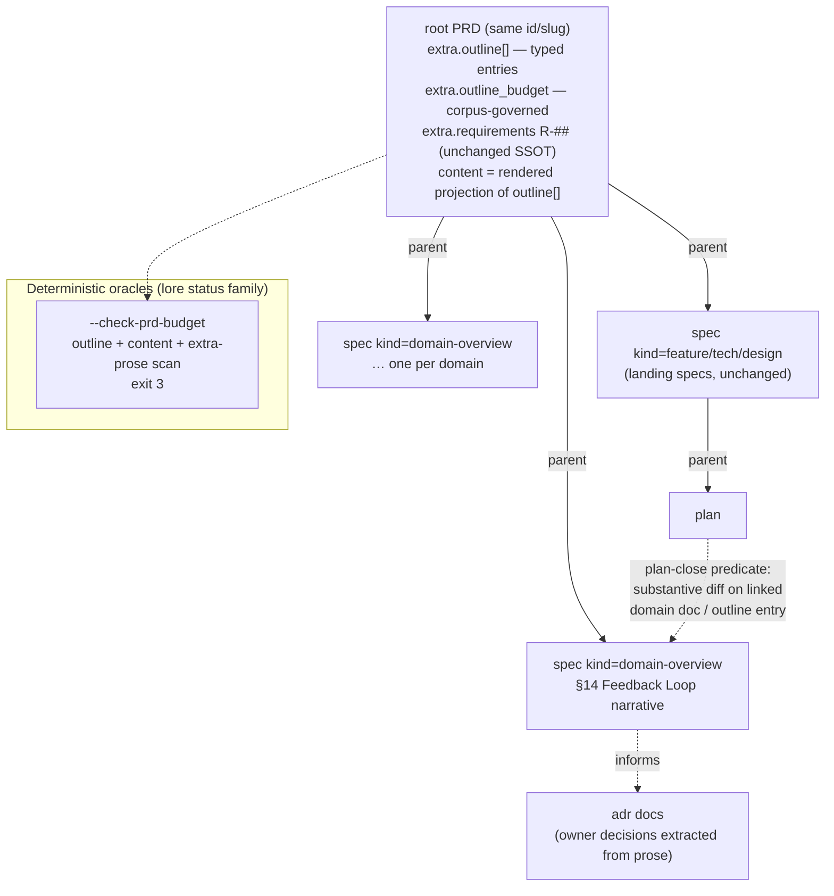

# SPEC-080 — PRD-as-Outline Contract

Design spec (architecture mode), synthesized from a 6-role parallel evaluation (token-economy / anti-gaming / authoring-DX / migration-ops / cost / domain-taxonomy). Owner-approved 2026-07-26.

## Overview/Goal

The root PRD has grown to 104KB / 22 sections / v49 by appending a prose-heavy domain section per product round. This spec converts the root PRD into a **structured outline** — typed per-domain summary entries (direction / decision pointers / constraints / links) with detail prose relocated into linked `domain-overview` specs — and mechanizes both **sync** (a plan cannot close while its domain narrative is stale, absent an audited exemption) and **anti-bloat** (a deterministic char-budget oracle joining the `lore status` check family).

Core stance: the PRD stays ONE living root doc (same id/slug, in-place migration); its body becomes a rendered projection of typed `extra.outline[]` entries, never a hand-edited 100KB blob again.

**Goals**
- G1: Root PRD raw body ≤ 24,000 chars, mechanically enforced (exit 3), zero LLM.
- G2: Every domain's full detail reachable ≤ 1 hop from its outline entry.
- G3: Feature landing implies a substantive (content-diff, not version-bump) domain-doc/outline update within the plan window, or an audited, surfaced exemption.
- G4: Kill the wholesale-`content` edit footgun for PRD maintenance (per-section CAS verbs).
- G5: Zero breakage for: dashboard Home = resolved PRD, `lore tree` root pick, bootstrap root pointer, R-## requirement inventory + `--check-requirements`.

## Scope

**In scope**
- `prd.extra.outline[]` typed schema + `lore outline set/list/rm/exempt` verb family (dedicated-writer guarded).
- `SPEC_KINDS` extension: `domain-overview` + SPEC-058 verification profile for it.
- `lore status --check-prd-budget` deterministic oracle (tiered budgets, extra-prose content-flight scan).
- `plan-close` checkpoint: `prdOutlineSynced` predicate + `extra.prd_sync_exempt` (dedicated verb, `lore status` surfacing).
- Idempotent, dry-run-gated migration of the existing 104KB PRD (in-place, per-section two-phase).

**Out of scope (recorded decisions, not omissions)**
- PRD nesting (`prd:["prd"]`) — rejected (T1).
- New first-class `domain` doc type — deferred with revisit trigger (T2).
- Duplication (shingle-overlap) lint — deferred behind evidence trigger (T5).
- Moving R-## requirements off the root PRD — rejected; inventory stays single-source (coverage oracle).
- Root-singularity (`prdsResult.value[0]`) hardening — separate backlog item, not bundled.

## Quality Attribute Scenarios

| ID | Stimulus | Response | Measure |
|----|----------|----------|---------|
| QA-1 | Agent session bootstraps / feeds on root PRD | Injection is link-only outline, never resolved MDX | `lore get <prd> --raw \| wc -c` ≤ 24,000; bootstrap payload carries pointers only |
| QA-2 | A plan closes after landing a feature | plan-close predicate finds a non-identical content diff on the linked domain doc / outline entry within the plan window, or a dedicated-verb exemption | 100% of closed plans satisfy predicate-or-exemption; exemptions listed by `lore status` |
| QA-3 | CI / pre-push runs corpus checks | `--check-prd-budget` runs deterministic, zero-LLM, composing existing exit precedence | exit 3 on breach; runtime < 1s; folds into `--check-tree`/`--check-drift` precedence |
| QA-4 | Migration executes over live corpus | Dry-run report proves set-equality invariants before any write | old §-refs ∪ char coverage == outline ∪ linked-doc content; every § detail ≤ 1 hop |
| QA-5 | Existing consumers read the PRD | No API/shape change: same doc id, `content` still present (rendered) | dashboard e2e + bootstrap + `--check-requirements` suites pass unchanged |

## Architecture



### C1 — Structured outline (`prd.extra.outline[]` + `lore outline` verb family)

Typed array following the proven `requirements[]` / `acceptance_criteria[]` / `phases[]` shape (typed array + dedicated verb + CAS + version + audit):

```ts
type OutlineEntry = {
  section: string;                 // stable key, e.g. "distribution"
  title: string;                   // rendered heading
  tier: "core" | "domain";         // budget tier (see C3)
  direction: string;               // bounded summary prose
  decision_pointers: string[];     // adr slugs
  constraints: string[];           // hard invariants only
  links: Array<{ slug: string; rel: "detail" | "landing-spec" | "adr" }>;
};
// prd.extra.outline: OutlineEntry[]
```

- **Dedicated verbs**: `lore outline set <prd> --section <key> …` (single-entry CAS patch — NOT array replace), `lore outline list`, `lore outline rm`. `CorpusService.set` rejects direct `extra.outline` patches (dedicated-writer pattern, same as validity/handoff), closing the wholesale-`extra`-wipe incident class (SPEC-076 phases-wipe precedent).
- **Body rendering**: PRD `content` becomes a deterministic projection rendered from `outline[]` (extra = SSOT, content generated — same convention as `renderHandoffContent` / `renderAssessmentContent`). Hand-editing the PRD body section-by-section ends.
- `entry.links[rel="detail"]` MUST resolve to an existing doc before an outline entry's prose can shrink below the migrated section (two-phase ordering, see Migration).

### C2 — `domain-overview` spec kind

- `SPEC_KINDS` extends `feature | tech | design` with `domain-overview` (SPEC-032 §3.1 pattern; PRD→spec parenting already legal — ~zero schema surgery).
- Holds a domain's full narrative: vision, staged commitments, owner-decision context. FULL review lifecycle (draft → in-review → approved; fast-track disallowed for this kind).
- **SPEC-058 verification profile**: `workflow.verification_profiles.domain-overview` sets an explicitly lighter oracle floor (no AC requirement — narrative, not implementation contract). "Spec ⇒ verified per its kind's declared profile" stays honest rather than silently diluted.
- Owner decisions embedded in PRD prose are extracted to `adr` docs, `informs`-linked from the domain doc.
- R-## requirements DO NOT move: root PRD stays the single inventory; coverage oracle stays single-source.

### C3 — Budget oracle: `lore status --check-prd-budget`

- Deterministic, zero-LLM, CI-runnable; composes into the existing `--check-tree`/`--check-drift` exit precedence (breach → exit 3).
- **Tiered budgets** (flat 2000 would gut the narrative core): `tier:"core"` entries ≤ 4,000 chars; `tier:"domain"` entries ≤ 2,000 chars; whole rendered body ≤ 24,000 chars.
- **Budget values are corpus-governed**, stored in `prd.extra.outline_budget` (version-bumped, review-gated), NOT `.lore/config.yaml` — config edits are unaudited; plain-YAML numeric thresholds demonstrably rot (`workflow.attestation.min_ratio` precedent).
- **Content-flight scan**: flags any free-text string value in `extra` outside typed schemas exceeding `outline_budget.extra_prose_chars` (default 1,000 chars; stored alongside the tiered budgets in `prd.extra.outline_budget`, corpus-governed like them), closing the "skinny body, fat extra" evasion vector.

### C4 — Plan-close sync predicate + surfaced exemption

- New predicate on the existing `plan-close` checkpoint (the one SPEC-054's UAT gate extends): the closing plan's ancestor spec must be linked (parent or `implements`) to a domain doc (or name an outline section); that target must carry **≥ 1 version whose content is non-identical to its predecessor within the plan window**. Window boundary rule: opens at the plan's earliest task-claim `at` timestamp (fallback: the plan's `created_at` when no claim was ever recorded), closes at the plan-close write's own timestamp; start-inclusive, end-exclusive (`[open, close)`). Version-bump-as-proxy is rejected — content-blind predicates are trivially gameable (independently flagged by two review lenses; a content-blind gate would regress below the codebase's own bar: attestation is exit-code-derived, judgeCompleteness rejects under-match).
- **Exemption**: `extra.prd_sync_exempt { reason, by, at }` mirrors `attestation_exempt` + required-reason, with two hardenings the precedent lacks: (a) dedicated writer verb (`lore outline exempt <plan> --reason …`); `CorpusService.set` rejects direct patches; (b) **surfacing** — `lore status` lists currently-exempt plans (the SPEC-069 field is proven structurally invisible today: zero status/doctor/dashboard surfacing; that miss is not repeated). Byproduct recommendation: retrofit the same surfacing onto `attestation_exempt`.
- Residual gameability (deliberate whitespace edit) is accepted: it converts silent drift into a visible, audited, diff-inspectable act — same posture as the rest of the deterministic-gate + audit-backstop architecture.
- Denial feeding pack names exact repair commands (`lore outline set …` / `lore set <domain-doc> …` / `lore outline exempt … --reason`).

### C5 — Deferred: duplication lint

NOT built now: no baseline exists until the outline lands (sequencing); advisory noise during migration trains agents to ignore it; D1 budget + spec-promote review likely catches gross duplication. **Trigger to build**: post-migration, duplicated prose slipping through review in ≥ 2 assessed plans → a shingle-overlap advisory section joins `--check-prd-budget`.

## Data Flow

- **Authoring (product round)**: `/lore-product` changes from "append prose via wholesale `lore set`" to: ① `lore create spec --kind domain-overview --parent <prd>` (new domain) or `lore set <domain-doc>` (existing) → ② `lore outline set <prd> --section <key> …` for the bounded summary + links → ③ landing-spec chain unchanged.
- **Read (agent)**: bootstrap/feed inject the raw outline (links only — **never resolved MDX**; resolving at injection would reconstitute ~100KB per session and nullify the redesign). Detail is agent-initiated pull: `lore get <domain-doc-slug>`.
- **Read (human)**: dashboard Home = resolved living PRD, unchanged (owner directive) — resolution stays on the dashboard read path where token cost is irrelevant.

## Trade-off Decisions

| # | Tension | Decision | Rationale |
|---|---------|----------|-----------|
| T1 | prd nesting vs single root | **Reject nesting** (unanimous) | `lore.tree.yaml` declares singular prd root; `value[0]` root-pick hard-coded in ≥4 sites (adhoc parenting, orphan advisory, bootstrap, tree-check); nesting = contract surgery for zero addressability gain over the already-legal PRD→spec edge |
| T2 | spec kind vs new `domain` type | **spec kind `domain-overview` + explicit SPEC-058 profile** | Reuses review/gate/link/staleness machinery at ~3-line enum cost; per-kind verification floor makes the lighter contract DECLARED, not silent. Domain-lens dissent recorded (narrative-without-ACs dilutes "spec ⇒ verifiable"); revisit trigger: domain docs accumulating pseudo-ACs or gate friction → first-class `domain` type |
| T3 | version-bump vs content-diff sync predicate | **Content-diff, linkage-scoped** | Version-bump is content-blind → trivially gameable |
| T4 | budgets in config.yaml vs corpus | **Corpus-governed** (`prd.extra.outline_budget`) | Config edits unaudited (`min_ratio` rot precedent); corpus values versioned + review-gated by construction |
| T5 | duplication lint now vs deferred | **Defer with trigger** | No pre-migration baseline; advisory fatigue; explicit re-arm condition recorded |
| T6 | wholesale `lore set` vs typed extra + verb | **Typed `extra.outline[]` + per-section CAS verb** | Wholesale `content = $1` keeps the clobber footgun even at 24KB; typed-array + dedicated-verb is the only PROVEN addressable-write-safety shape (requirements/AC/phases + SPEC-076 drop-guard) |
| T7 | resolve MDX at bootstrap vs link-only injection | **Link-only** | Resolving at injection reconstitutes ~100KB/session — redesign would be cosmetic |

## Risk Registry

| Risk | Severity | Mitigation |
|------|----------|------------|
| Exemption rot (exempt plans silently accumulate) | High | Dedicated writer + `lore status` exempt listing (fixes proven SPEC-069 invisibility gap); doctor counts open exemptions |
| Content-flight: prose hidden in `extra` / never-reviewed child docs | High | Budget check scans extra prose; `domain-overview` disallows fast-track; only typed schemas exempt from scan |
| Mid-migration content loss (section shrunk before child linked) | High | Two-phase per-section ordering (create+link FIRST, shrink second); dry-run set-equality invariant gates first write; idempotent markers |
| Spec semantic dilution (T2 dissent) | Medium | Declared per-kind verification profile; recorded revisit trigger |
| Gate friction × N domain docs | Medium | Lighter `domain-overview` profile; existing AI-judge advisory triage, no new gates |
| Budget-value rot | Medium | Corpus-governed values; changes are normal gated PRD writes |
| Root-singularity latent assumption (`value[0]`) | Low (not triggered — no second prd doc) | Hardening backlog item, NOT bundled into this migration |
| Advisory fatigue during migration window | Medium | Budget check advisory-mode until Phase 3 arming; duplication lint deferred |

## Migration Plan

**Doc-identity strategy: in-place.** All phases operate via `lore set`/verbs on the EXISTING PRD id — preserving id/slug keeps tree root-pick, bootstrap pointer, dashboard Home, and every inbound link working for free. Version history is append-only; every step is `lore restore`-recoverable.

- **Phase 0 — mechanism landing (no corpus change)**: schemas (`outlineEntrySchema`, `SPEC_KINDS`), `lore outline` verbs, `--check-prd-budget` (advisory mode), SPEC-058 `domain-overview` profile, plan-close predicate behind default-OFF knob. Rollback: none needed (corpus untouched).
- **Phase 1 — domain sections (§14–§22), one section per step**: ① create `domain-overview` spec carrying the section's full prose verbatim ② link + `lore outline set` the bounded entry ③ shrink the body section to the rendered entry. Idempotency marker: existing domain-doc slug. Dry-run first with machine-checkable invariant: `chars(old §) ⊆ chars(outline entry ∪ child doc)` + §-ref and R-id set equality. Rollback per section: `lore restore <prd> --version <pre-step>`; child doc remains (harmless additive).
- **Phase 2 — narrative core (§1–§13)**: condense to `tier:"core"` budgets; extract embedded owner decisions → `adr` docs (`informs`-linked). Same per-section dry-run + restore recovery.
- **Phase 3 — arming**: flip `--check-prd-budget` advisory → exit 3 (joins pre-push); enable plan-close predicate after 2 consecutive clean plan-closes under advisory observation. Rollback: gate knob off + check back to advisory — config flips, no corpus surgery.

## Acceptance Criteria

Structured ACs are declared via `lore ac add` (SSOT); prose mirror:

- AC-080-1 (script): post-migration `lore get <root-prd> --raw | wc -c` ≤ 24000; `--check-prd-budget` exits 3 on a seeded over-budget fixture, 0 on a compliant one, and completes in < 1000 ms on the compliant fixture (QA-3 latency pin).
- AC-080-2 (script): `lore outline set` patches exactly one entry (other entries byte-identical); a direct `lore set` patch touching `extra.outline` returns VALIDATION_ERROR naming `lore outline`.
- AC-080-3 (script): `lore create spec --kind domain-overview --parent <prd>` passes the spec-create gate; unknown kind value still exits 4.
- AC-080-4 (script): plan-close denies (exit 4, feeding pack names repair commands) when the linked domain doc has zero versions whose content differs from its predecessor inside the `[earliest-claim-at (fallback plan created_at), close-write)` window; passes when ≥ 1 such version exists; passes with exemption; direct `extra.prd_sync_exempt` patch returns VALIDATION_ERROR.
- AC-080-5 (script): `lore status` lists exempt plans (count + slugs) when ≥ 1 exemption exists; zero-exemption output is byte-stable vs pre-change.
- AC-080-6 (script): content-flight scan flags a seeded free-text `extra` string exceeding `outline_budget.extra_prose_chars` (default 1000); a payload at exactly the threshold and all typed schemas (requirements/AC/phases/outline) produce 0 flags.
- AC-080-7 (script): migration dry-run on a violation fixture reports the failed set-equality invariant and performs zero writes (doc version count unchanged).
- AC-080-8 (script): bootstrap/feed payload injects link-only outline — injected PRD-derived content < 32000 chars on the migrated corpus (payload-size regression pin for T7). The 8,000-char headroom over G1's 24,000 body cap is the declared envelope allowance (JSON wrapper, pointer lists, section keys around the raw body) — not slack for prose.

- AC-080-9 (script): post-migration, the pre-existing consumer regression suites pass unchanged — dashboard Playwright e2e, `lore bootstrap --json` schema self-check, and `lore status --check-requirements` all exit 0 (G5 pin).
- AC-080-10 (script): every outline entry declares ≥ 1 `rel="detail"` link, every such link resolves to an existing non-deleted doc, and target depth = outline + 1 hop (G2 pin, runs inside `--check-prd-budget`).

## Downstream Handoff (implement/test contracts)

- **Interfaces**: `OutlineEntry`, `prd.extra.outline_budget`, `plan.extra.prd_sync_exempt` — Zod-first in `@lore/core`, TS via `z.infer`; predicate joins `checkpoint-registry.ts` (checkpoint-agnostic shape).
- **Invariants to test**: dedicated-writer rejections; budget tier boundary math (=4000 / =2000 / =24000); predicate no-diff/whitespace-diff/exemption branches; content-flight typed-vs-free scan; dry-run abort with zero writes.
- **Error scenarios**: outline set on unknown section key (exit 4); exempt without reason (exit 2); budget check on legacy PRD without `outline[]` (degrade to whole-doc budget only, never crash).
- **Non-obvious**: bootstrap/feed MUST NOT resolve MDX (T7) — pin with payload-size regression test; `renderOutlineContent` follows the render-projection convention (extra = SSOT).


## Acceptance Criteria (structured)

- [⚑] [script] AC-080-2: lore outline set patches exactly 1 outline entry (all sibling entries byte-identical before/after); direct lore set patching extra.outline returns VALIDATION_ERROR (exit 4) naming lore outline
  script: test — bunx vitest run packages/lore/tests/unit/service/outline-writer-guard.test.ts
- [⊘] [script] AC-080-3: lore create spec --kind domain-overview --parent <prd> passes the spec-create gate (exit 0); an unrecognized kind value exits 4
  script: test — bunx --bun vitest run packages/lore/tests/integration/cli-domain-overview-kind.bun.test.ts
- [⚑] [script] AC-080-5: lore status lists exempt plans (count + slugs) when >= 1 prd_sync_exempt exists; zero-exemption text output is byte-stable vs pre-change baseline
  script: test — bunx vitest run packages/lore/tests/unit/cli/status-exempt-surfacing.test.ts
- [⚑] [script] AC-080-7: migration dry-run on a violation fixture reports the failed set-equality invariant and performs 0 writes (doc version count unchanged before/after)
  script: test — bunx --bun vitest run packages/lore/tests/unit/service/outline-migration-dryrun.bun.test.ts
- [⚑] [script] AC-080-8: bootstrap/feed inject link-only outline: injected PRD-derived content < 32000 chars on the migrated corpus (payload-size regression pin, no resolved MDX)
  script: test — bunx --bun vitest run packages/lore/tests/integration/bootstrap-outline-payload.bun.test.ts
- [⚑] [script] AC-080-1: Post-migration root PRD raw body <= 24000 chars; --check-prd-budget exits 3 on a seeded over-budget fixture, 0 on a compliant fixture, and completes in < 1000 ms on the compliant fixture
  script: test — bunx --bun vitest run packages/lore/tests/integration/prd-budget-check.bun.test.ts
- [⚑] [script] AC-080-4: plan-close denies with exit 4 and a feeding pack naming repair commands when the linked domain doc has 0 versions whose content differs from its predecessor inside the [earliest-claim-at (fallback plan created_at), close-write) window; passes when >= 1 such version exists; passes with a dedicated-verb exemption; direct extra.prd_sync_exempt patch returns VALIDATION_ERROR
  script: test — bunx vitest run packages/lore/tests/unit/service/plan-close-prd-sync.test.ts
- [⚑] [script] AC-080-6: content-flight scan flags a seeded free-text extra string exceeding outline_budget.extra_prose_chars (default 1000); a payload at exactly the threshold and all typed schemas (requirements/acceptance_criteria/phases/outline) produce 0 flags
  script: test — bunx vitest run packages/lore/tests/unit/service/prd-budget-content-flight.test.ts
- [⚑] [script] AC-080-9: Post-migration the pre-existing consumer regression suites pass unchanged: dashboard Playwright e2e exits 0, lore bootstrap --json schema self-check exits 0, lore status --check-requirements exits 0
  script: e2e — cd packages/dashboard && bunx playwright test && cd ../.. && lore bootstrap --json >/dev/null && lore status --check-requirements
- [⚑] [script] AC-080-10: Every outline entry declares >= 1 rel=detail link, every such link resolves to an existing non-deleted doc, and the target sits exactly 1 hop from the outline (verified inside --check-prd-budget)
  script: test — bunx --bun vitest run packages/lore/tests/integration/prd-budget-check.bun.test.ts -t detail-link

## Code anchors

- packages/core/src/outline.ts
- packages/lore/src/service/prd-outline-service.ts
- packages/lore/src/service/prd-budget-check.ts
- packages/lore/src/service/outline-migration-service.ts
- packages/lore/src/adapters/cli/commands/outline.ts
- packages/lore/src/flows/status-prd-sync-flow.ts
