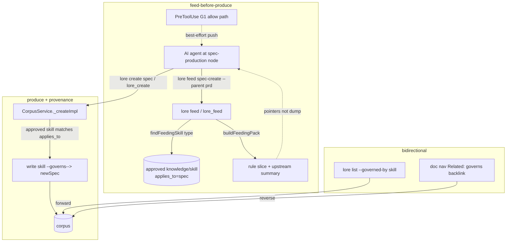

**spec_kind:** tech · **implements →** `adr-corpus-governed-active-ai-workflow-inversion-of-control-with` (P4 of P1–P4)

## 1. Overview & Goal

Deliver **P4 — upstream↔downstream linkage + the feed-before-produce protocol** from the parent ADR (capabilities **2** "active feeding" and **4** "bidirectional linkage"). Today the IoC loop feeds **reactively** — a skill slice reaches the agent ONLY when it violates a gate (slice-1's exit-4 deny reason). And linkage is **type-level only** — P1's `extra.skill.applies_to` matches a skill to a doc *type* (`"spec"`), with no per-instance record of which skill actually governed which artifact.

P4 closes both gaps as a **vertical slice through the spec-production node** (the ADR's recommended shape, continuing slice-1/P1/P2 on the same node):

1. **feed-before-produce (pull-first, push-best-effort)** — a deterministic `lore feed <checkpoint>` command + `lore_feed` MCP tool that returns the applicable approved skill slice + upstream summary **before** the agent produces, with no intent-heuristic. The gate's *allow* path additionally surfaces the same feed best-effort. This is the "Hollywood principle" realised deterministically: the framework hands the agent its guidance at the production node, on demand, not only on failure.
2. **bidirectional provenance** — a `governs` link (skill → the artifact it fed) written when a doc is produced under a matching approved skill, plus a reverse query so provenance is answerable both ways ("what governed this spec?" / "what did this skill produce?"). This makes feeding auditable and feeds the SPEC-035 calibration loop (which skill → which outcome).

**Non-goal:** UserPromptSubmit heuristic early-injection (slice-1 rejected it: intent detection is unreliable). P4's "before" is anchored to the **deterministic production action** (a `lore feed` call or the PreToolUse create attempt), never to a guessed intent. Also non-goal: prompt template interpolation / skill auto-execution (P1 OUT; P2/P3 cover hook-triggered execution).

## 2. Scope

**IN:**
1. **`lore feed <checkpoint> [--parent <id-or-slug>] [--json]`** + **`lore_feed` MCP tool** — deterministic pull. Resolves the checkpoint's produced-type → `CorpusService.findFeedingSkill(type)` (P1) → assembles a `FeedingPack` (rule slice + upstream/parent summary via `buildFeedingPack`/`renderFeedingPack`, slice-1) → prints it. No approved skill match → a clear "no governing skill declared" note (not an error). Pointers + summary, never a full dump (ADR boundary ②). Exit 0 always (feed is advisory context, not a gate).
2. **`governs` link type** — one new value on `linkTypeSchema` (`packages/core/src/schemas.ts` enum) + `types.ts` union. Semantics: `skill --governs--> artifact` (the skill fed/governed that artifact's production).
3. **Provenance write** — on successful `create` of a doc whose type has a matching approved `knowledge/skill` (`applies_to === <type>`), auto-write one `skill --governs--> newDoc` link. Idempotent (no duplicate on re-link). Owned by `CorpusService._createImpl` seam (mirrors how links are already written), NOT a new service.
4. **Reverse query** — `lore list --governed-by <skill>` (artifacts a skill produced) and the existing doc-nav "Related" already surfaces the inverse (an artifact's `governs` backlink shows the governing skill). `lore_*` MCP list gains the same filter.
5. **Gate allow-path best-effort push** — when a PreToolUse gate (G1 spec-create) would ALLOW, it additionally emits the applicable feed as non-blocking context IF the hook surface supports it; otherwise this degrades silently to the pull path (§5.4). Not an AC-blocking mechanism.

**OUT (later / other increments):**
- UserPromptSubmit heuristic early-injection (rejected — intent detection).
- Prompt-variable interpolation / skill auto-run.
- Provenance for the plan/task tiers' feed (this slice anchors spec-production; the mechanism generalises via `applies_to`/checkpoint, wired for other tiers later).
- A `consumes` link direction (artifact→skill it consumed) beyond what the `governs` backlink already answers.

## 3. Terminology

- **feed** = the just-in-time context bundle (applicable skill slice + upstream pointers) handed to the agent at a production node. Reuses slice-1's `FeedingPack`.
- **governs** = provenance link `skill → artifact`; its backlink answers "what governed this artifact".
- **pull** = agent/hook calls `lore feed` to GET the bundle. **push** = the gate proactively surfaces it. P4 guarantees pull; push is best-effort.

## 4. Architecture

**Layering:** `lore feed` is a thin adapter over the SAME `findFeedingSkill` + `gate-feeding` primitives the gate already uses (SSOT — feed content is identical whether pulled proactively or emitted on a violation). Provenance write lives at the `_createImpl` link seam. No new service, no new store method beyond a `governs`-filtered list (reuses the link table).

## 5. Components & Contracts

### 5.1 `lore feed <checkpoint>` + `lore_feed` (NEW — deterministic pull)
- Input: `checkpoint` (`spec-create` for this slice; the produced-type is derived from the checkpoint, e.g. `spec-create → "spec"`), optional `--parent` (to include the upstream/parent summary in the pack).
- Behavior: `findFeedingSkill(type)` → if found, `renderFeedingPack(buildFeedingPack({ ruleDoc, parentDoc?, missing: [] }))`; if none, a one-line "no approved governing skill for <type>" note. Exit 0 always.
- `--json` returns `{ checkpoint, type, skill: {slug,title}|null, feed: string }`.
- SSOT: reuses `CorpusService.findFeedingSkill` + `gate-feeding.ts` verbatim — the pack an agent PULLS equals the pack the gate would PUSH on violation.

### 5.2 `governs` link type (NEW — one enum value)
- Add `"governs"` to `linkTypeSchema` (`schemas.ts`) + `LinkType` union (`types.ts`). Direction: `from = skill`, `to = artifact`.
- No lifecycle/validation coupling beyond existing link rules; `governs` is a plain typed edge.

### 5.3 Provenance auto-write (`CorpusService._createImpl` seam)
- After a doc is created, if `findFeedingSkill(newDoc.type)` returns an approved skill, write `link(skill.id, newDoc.id, "governs")`. Idempotent: skip if an identical `governs` edge already exists.
- Fail-soft: a provenance-link failure NEVER fails the create (it is metadata, not the artifact). Logged, not thrown. (This is the ONE sanctioned soft path — provenance is advisory; the created doc is the SSOT.)

### 5.4 Gate allow-path push (best-effort, non-AC)
- In `runSpecCreateGate`'s allow branch, attempt to attach the feed as hook `additionalContext`. IF the Claude Code PreToolUse allow surface cannot carry context (to be verified at implementation), this is dropped silently — the pull path (§5.1) is the guaranteed delivery. ⛔ Never blocks, never changes the allow verdict.

### 5.5 Reuse map (thin-glue evidence)
| Reused | Location |
|---|---|
| skill discovery by `applies_to` | `CorpusService.findFeedingSkill` (P1) |
| feed pack assembly + render + char budget | `service/gate-feeding.ts` (`buildFeedingPack`/`renderFeedingPack`/`DEFAULT_FEEDING_MAX_CHARS`) |
| link table + `lore link` + nav backlinks | existing `CorpusService` link CRUD + `tree`/nav |
| exit-code SSOT | `cli/utils.ts` |
| create seam for the provenance write | `CorpusService._createImpl` |
| calibration consumer of provenance | SPEC-035 |

**Truly new:** `lore feed` command + `lore_feed` MCP tool + `governs` enum value + provenance auto-write at `_createImpl` + `--governed-by` list filter + best-effort push.

## 6. Trade-off Decisions

| Decision | Options | Verdict |
|---|---|---|
| feed mechanism | UserPromptSubmit heuristic (α-push) / deterministic `lore feed` pull (β) / PreToolUse allow-context push (γ) | **pull-first + best-effort push.** Deterministic (no intent guess, honoring slice-1's rejection); pull is the guaranteed surface, push is a bonus where the hook API allows. |
| provenance edge | new `governs` link / reuse `informs` / a new provenance table | **new `governs` link.** One enum value; reuses the entire link table + nav backlink + query; semantically precise for the reverse query. `informs` is overloaded; a new table is over-build. |
| where provenance is written | on `lore feed` consumption / on doc create / manual | **on doc create at `_createImpl`.** Deterministic + captures every governed artifact, not only those where the agent happened to call `lore feed`. Fail-soft (never fails the create). |
| P4 breadth | feed-only (α) / linkage-only (β) / **both at spec node (γ)** | **γ vertical slice.** Both ADR capabilities get a minimal closed loop on the already-wired node; provenance makes feed auditable + calibration-ready. |

## 7. Boundaries Realized (ADR → mechanism)

1. **Gate ceiling = min(oracle coverage, correctness).** feed is **advisory context**, never a gate — it cannot block, so it introduces no false-block surface. Provenance is metadata. The deterministic gates (P2) remain the only blockers. No probabilistic mechanism is disguised as deterministic.
2. **Minimal context, just-in-time.** `lore feed` returns a trimmed slice + pointers (reusing `DEFAULT_FEEDING_MAX_CHARS`), delivered at the production node on demand — the literal "pointers + summaries, never full dump."
3. **Active framework amplifies errors + corpus is attack surface.** A poisoned skill would now be pushed proactively (higher reach than reactive) → mitigation: `lore feed` surfaces ONLY `approved` skills (same tamper gate as slice-1's feeding), carries the `[source, trust]` header, and provenance links are audited (SPEC-035). feed cannot execute anything — it is text context only.

## 8. Cross-Cutting

- **Security (STRIDE-lite):** primary threat = Tampering (poisoned governing skill, now proactively delivered). Mitigation: approved-only discovery, source/trust header, no code execution in feed, provenance audited. No new read exposure (agent already reads the corpus).
- **Performance:** `lore feed` = one bun spawn + findFeedingSkill query (read-only). Provenance write = one extra link insert per governed create (skip when no skill matches). Negligible.
- **Observability:** log each feed pull (checkpoint, skill hit?) + each provenance write. Feeds the calibration/over-refusal view later.

## 9. Risk Registry

| Risk | Sev | Mitigation |
|---|---|---|
| Provenance auto-write fails the create | High | Fail-soft: link failure logged, never thrown; create is SSOT (§5.3). Regression test asserts create succeeds when linking fails. |
| `governs` enum add breaks existing link validation/serialization | Med | One additive enum value; full link/schema regression suite; existing link types untouched. |
| Proactive push amplifies a poisoned skill | Med | Approved-only + trust header + no execution + audit (§7.3). |
| Duplicate `governs` edges on repeated create/link | Low | Idempotent write (skip if identical edge exists). |
| PreToolUse allow cannot carry context → push silently absent | Low | Pull path is the guaranteed surface; push is explicitly best-effort/non-AC (§5.4). |

## 10. Acceptance Criteria (deterministic oracles; throwaway corpus, ⛔ never repo `.lore`)

- **AC-P4-1** `lore feed spec-create --parent <prd>` with an approved `knowledge/skill` (`applies_to=spec`) present → stdout contains that skill's rule slice + the parent summary + `[source…trust…]` header; exit 0. Output equals the slice-1 gate feeding pack for the same corpus (SSOT).
- **AC-P4-2** `lore feed spec-create` with NO approved governing skill → a clear "no governing skill for spec" note; exit 0 (not an error).
- **AC-P4-3** creating a `spec` while an approved `applies_to=spec` skill exists → a `skill --governs--> spec` link is written; re-running create/link does not duplicate it.
- **AC-P4-4** provenance write is fail-soft: with linking forced to fail, the `create` still succeeds (doc exists) and the failure is logged, not thrown.
- **AC-P4-5** `lore list --governed-by <skill>` returns the governed artifacts; the artifact's nav shows the `governs` backlink (bidirectional).
- **AC-P4-6** `governs` added to the link enum; all existing link-type tests + full suite stay green (regression).
- **AC-P4-7 (e2e)** seed approved skill (`applies_to=spec`) → `lore feed` returns its slice BEFORE producing → create the spec → `governs` link auto-written → `lore list --governed-by <skill>` lists the spec → reverse nav confirms. Proves the feed-before-produce + provenance loop end-to-end.

## 11. Rollout Plan

1. `governs` enum value (`schemas.ts` + `types.ts`) + link regression (AC-P4-6).
2. `lore feed` command + `lore_feed` MCP tool over `findFeedingSkill`/`gate-feeding` (AC-P4-1/2).
3. Provenance auto-write at `_createImpl` (fail-soft) + `--governed-by` list filter + nav backlink (AC-P4-3/4/5).
4. Best-effort gate allow-path push (§5.4) + e2e (AC-P4-7); full oracle sweep.
5. Rollback = feature-additive; `governs` links + `lore feed` are inert if unused (zero impact on existing flows).

## 12. Downstream Handoff

- **implement:** `governs` in `packages/core/src/{schemas,types}.ts`; new `packages/lore/src/adapters/cli/commands/feed.ts` + `lore_feed` in the MCP tools; provenance write in `CorpusService._createImpl` (fail-soft); `--governed-by` filter in list; reuse `findFeedingSkill` + `gate-feeding.ts`. Invariants: feed content SSOT with the gate's pack; provenance never fails a create; feed never blocks; approved-only skills.
- **test:** feed pull output == gate pack for same corpus; provenance idempotent + fail-soft; enum regression; `--governed-by` forward + nav reverse; no approved skill → graceful note.
- **deploy:** `lore feed` documented; `governs` link type documented; MCP tool count +1.

## 13. Quality Gates (architecture mode)

- ✅ Every ADR boundary has a concrete mechanism (§7).
- ✅ Every tension (feed mechanism, provenance edge choice, write site, breadth) decided + rationale (§6).
- ✅ High-sev risk (provenance fails create) mitigated fail-soft + tested (§9, AC-P4-4).
- ✅ Rollback = additive/inert (§11.5).
- ✅ No intent-heuristic (slice-1 rejection honored); feed anchored to deterministic production action (§1 non-goal).
- ✅ SSOT: pulled feed == pushed/violation feed (§5.1).

## Acceptance Criteria (structured)

- [·] [human] AC-P4-1: lore feed spec-create --parent <prd> with an approved knowledge/skill (applies_to=spec) returns that skill's rule slice + parent summary + [source,trust] header, exit 0; output equals the slice-1 gate feeding pack for the same corpus (SSOT).
- [·] [human] AC-P4-2: lore feed spec-create with no approved governing skill returns a clear 'no governing skill for spec' note, exit 0 (not an error).
- [·] [human] AC-P4-3: Creating a spec while an approved applies_to=spec skill exists writes a skill--governs-->spec link; re-run does not duplicate (idempotent).
- [·] [human] AC-P4-4: Provenance write is fail-soft: with linking forced to fail, create still succeeds (doc exists) and failure is logged not thrown.
- [·] [human] AC-P4-5: lore list --governed-by <skill> returns governed artifacts; artifact nav shows the governs backlink (bidirectional).
- [·] [human] AC-P4-7: e2e: seed approved skill (applies_to=spec) -> lore feed returns its slice before producing -> create spec -> governs link auto-written -> lore list --governed-by lists the spec -> reverse nav confirms.
- [·] [human] AC-P4-6: governs added to linkTypeSchema enum + LinkType union; all existing link-type tests + full vitest/bun suites stay green (regression).
  human: additive enum value; existing link types untouched

## Code anchors

- packages/lore/src/flows/feed-flow.ts
