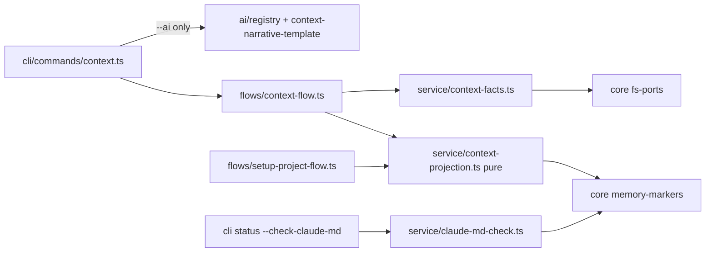

# Module Design: context verb family — CLAUDE.md as a first-class managed artifact

## Overview/Goal

Promote resident-context management from a prompt package (the `lore-init-context` skill) into the tested, gated, distributed lore binary, implementing the owner's three invariants as mechanisms:

1. **Admission control** — what may enter CLAUDE.md is checked, not trusted: deterministic lint (lines/bytes — existing; reference-existence — new) plus advisory narrative-smell detection.
2. **Tracks code reality** — the mechanical majority of CLAUDE.md becomes a regenerated projection of the repo (drift structurally impossible); hand-written references are existence-checked.
3. **Resident injection ≠ memory** — CLAUDE.md = interface (projection + standing discipline); events/status/history stay in the corpus; smell detection patrols the boundary.

Direction fixed by `adr-context-capability-is-a-first-class-lore-verb-family-init` (promote to accepted when this spec lands). Supersets `spec-project-claude-md-content-contract-governance-injected` — its lint layer, `context.memory_files.*` config, and `lore governance claude-md` verb are consumed as-is.

## Scope

In: `@lore/core` memory-markers + fs-ports leaves; pure projection/splice/parse module; context-facts collection; claude-md-check extensions (reference-existence deterministic + narrative-smell advisory); `flows/context-flow.ts` init/refresh orchestration; CLI `lore context init|refresh`; AI narrative template (adapter-orchestrated, init-only); setup-project-flow splice-SSOT refactor; PostToolUse guard hook asset + auto-registration; lore-init-context skill retirement via `RETIRED_FROM_INSTALL_PATHS`; assets manifest regen.

Out: corpus-slug reference validation (needs store — deferred); config-declared marker registry (dead-config risk, D8); dashboard rendering of context findings; AGENTS.md as default filename (config value only, already supported by `context.memory_files.filenames`); marker-integrity as a standalone `lore status` check (subsumed: fingerprint verification happens inside refresh/splice).

## Two-Zone File Anatomy

- **Z1 (lore-managed)**: marker-wrapped sections regenerated by `lore context refresh` as pure projections of reality — module index (existence-checked links), command table (package.json scripts), governance pointer, spec-discovery pointer. Each section carries a fingerprint comment `<!-- lore:managed section=<id> hash=<8-hex> -->`; a hash mismatch means a human/AI edited inside the managed zone → `diverged_skip`, never silent overwrite (SPEC-076 five-state semantics reused).
- **Z2 (hand-written discipline)**: rules, prohibitions, thresholds. Machine NEVER rewrites Z2 bytes. Admission control applies here: budgets lint + `reference_missing` (deterministic, exit 3) + narrative smells (advisory, exit-neutral).

## Module Boundary

- **Public API**:
  - `@lore/core`: `CLAUDE_MD_MARKER_START/END`, `ManagedSectionMeta`, `FsReadPort`, `FsWritePort` (types/constants only — browser-safe barrel preserved)
  - `service/context-projection.ts` (pure): `parseManagedSections`, `renderManagedSections`, `spliceManagedSections`
  - `service/context-facts.ts`: `collectContextFacts(fs: FsReadPort, root, budgetsCfg)`
  - `service/claude-md-check.ts` (extended): `checkReferenceExistence(content, fileExists)`, `detectNarrativeSmells(content)`
  - `flows/context-flow.ts`: `runContextInit(deps, root, {narrative?, force?})`, `runContextRefresh(deps, root)`
  - CLI: `lore context init [--ai|--no-ai] [--force]`, `lore context refresh`
- **Internal**: fact-collection walk details, section renderers, splice span math, smell heuristics.
- **Dependencies**: `@lore/core` (config + markers + ports), `@lore/core/node` (loadConfig, CLI-side only), `service/fs-walk`, `ai/registry` (CLI adapter only). **No store/DB dependency anywhere in the context path.**

## Structure

```
packages/core/src/memory-markers.ts            NEW   marker constants + ManagedSectionMeta (browser-safe leaf)
packages/core/src/fs-ports.ts                  NEW   FsReadPort / FsWritePort interfaces + InMemoryFsPort test double
packages/lore/src/service/context-facts.ts     NEW   collectContextFacts — IO behind FsReadPort
packages/lore/src/service/context-projection.ts NEW  pure: parse / render / splice (five-state, fingerprint hashes)
packages/lore/src/service/claude-md-check.ts   EXT   + checkReferenceExistence (deterministic) + detectNarrativeSmells (advisory)
packages/lore/src/flows/context-flow.ts        NEW   runContextInit / runContextRefresh (writes via FsWritePort)
packages/lore/src/flows/setup-project-flow.ts  REF   computeClaudeMdCandidate → consumes spliceManagedSections (splice SSOT)
packages/lore/src/ai/context-narrative-template.ts NEW prompt template (narrative compression only)
packages/lore/src/adapters/cli/commands/context.ts NEW verb wiring; --ai orchestration lives HERE, not in flow
packages/lore/src/adapters/real-asset-source.ts EXT  assets/skills/lore-init-context → RETIRED_FROM_INSTALL_PATHS
assets/hooks/claude-md-guard.sh                NEW   PostToolUse(Edit|Write on memory files) → lore status --check-claude-md
```

## Public Interface (TypeScript)

```ts
// @lore/core — memory-markers.ts / fs-ports.ts
export interface ManagedSectionMeta { id: string; hash: string }
export interface FsReadPort {
  exists(p: string): Promise<boolean>
  readFile(p: string): Promise<string | null>
  listDir(p: string): Promise<string[]>
}
export interface FsWritePort extends FsReadPort { writeFile(p: string, content: string): Promise<void> }

// service/context-projection.ts — ALL PURE
export function parseManagedSections(content: string): { sections: ParsedManagedSection[]; z2Spans: Span[] }
export function renderManagedSections(facts: ContextFacts): ManagedSection[]
export function spliceManagedSections(existing: string, next: ManagedSection[]): SpliceResult
// SpliceResult.perSection[]: { id, state: "created"|"updated"|"unchanged"|"diverged_skip"|"appended" }

// service/context-facts.ts
export function collectContextFacts(fs: FsReadPort, root: string, cfg: MemoryFileBudgets): Promise<Result<ContextFacts, LoreError>>

// service/claude-md-check.ts (extension; existing lintMemoryFiles untouched)
export function checkReferenceExistence(content: string, fileExists: (p: string) => boolean): MemoryFileFinding[] // kind "reference_missing"
export function detectNarrativeSmells(content: string): AdvisoryFinding[] // NEVER affects exit codes

// flows/context-flow.ts
export function runContextInit(deps: { fs: FsWritePort }, root: string, opts: { narrative?: string; force?: boolean }): Promise<Result<ContextInitReport, LoreError>>
export function runContextRefresh(deps: { fs: FsWritePort }, root: string): Promise<Result<ContextRefreshReport, LoreError>>
```

## Dependency Graph



One direction only: core ← service ← flows ← adapters. No cycles.

## Design Decisions

| # | Decision | Choice | Rejected | Rationale |
|---|---|---|---|---|
| D1 | Capability home | flows/ orchestration + pure service/ modules + CLI verb | keep as skill; ContextService in service/ | skill = untestable prompt package; service/ is store-centric — file orchestration precedent is setup-project-flow (cohesion review) |
| D2 | AI seam | CLI adapter orchestrates `--ai`; flow takes `narrative?: string`; refresh NEVER AI | flow calls ai/registry | service/flow never calls another service (coupling review); refresh idempotency requires zero AI |
| D3 | Provider absent at init | skeleton + loud stderr warning, exit 0, report.narrative="skeleton" | error exit; silent skeleton | deterministic value must not be hostage to AI availability; silence violates fail-loud |
| D4 | Splice SSOT | setup-project-flow refactored to consume spliceManagedSections | two independent splice paths | two implementations of marker splice WILL diverge (reuse review) |
| D5 | Divergence detection | per-section fingerprint hash comment; mismatch → diverged_skip | timestamps; whole-file diff | deterministic, testable, git-diff-quiet (hash changes only when content changes) |
| D6 | Reference check scope | file paths only (backtick-quoted repo-relative), injected fileExists predicate, pure | corpus-slug validation (needs store) | keeps claude-md-check store-free; slug checking is a corpus concern, deferred |
| D7 | Advisory vs deterministic | narrative smells NEVER exit-affecting; reference_missing exit 3 | smells as gate | gate-deterministic / judge-advisory is a project invariant |
| D8 | Marker registry | code-versioned section set | config-declared sections | a config section without a code renderer is dead config; filenames config already covers AGENTS.md |
| D9 | Fs abstraction | minimal FsReadPort/FsWritePort in core + InMemoryFsPort double | reuse wide internal fs helpers; ad-hoc mkdtemp everywhere | narrow injectable contract (coupling), pure-vitest testing for ~80% of logic (testing review) |
| D10 | Skill retirement | RETIRED_FROM_INSTALL_PATHS + manifest regen; no thin shell | render-only shell skill (SPEC-070 style) | owner decision; verbs cover the whole surface; shell would be a second doc surface to drift |
| D11 | Edit-time hook | distributed PostToolUse asset; zero numbers; delegates to status check; fail-open sans lore | hook-local thresholds | numbers live in config only (content-contract D1); delegation = single measurement point |

## Perspective Tensions Resolved

| Tension | Perspectives | Resolution | Why |
|---|---|---|---|
| service/ vs flows/ for orchestration | cohesion vs "checks already live in service/" | pure fns in service/, fs-writing orchestration in flows/ | matches both precedents (claude-md-check pure; setup-project-flow writes) |
| AI inside vs outside the flow | coupling+cohesion vs API convenience | adapter-orchestrated narrative string | keeps flow deterministic + black-box testable; CLI slightly fatter — accepted |
| five new files vs consolidation | reuse (surface area) vs SRP | kept, justified by splice SSOT consumed by setup-project-flow | vertical reuse is real, not speculative |
| config-driven sections | reuse (extensibility) vs SSOT | rejected config registry | renderer must ship with code anyway |

## Risks

- setup-project-flow splice refactor regression → mitigated by existing setup e2e + parity pins staying green (AC-4).
- Reference-extraction false positives → conservative grammar v1: backtick-quoted tokens that look like repo-relative paths (contain `/`, no spaces, no URL scheme); misses are acceptable, false alarms are not.
- Fingerprint comments add visual noise to CLAUDE.md → one HTML comment line per managed section; invisible in rendered markdown.
- New `.strict()` config keys none (reuses context.memory_files.*); no config version floor change.

## Acceptance Criteria (coverage contract — authored via `lore ac add`, script mode)

1. Projection/splice unit suite (vitest): five-state transitions incl. `diverged_skip` on hash mismatch; refresh idempotency `splice(splice(x)) === splice(x)`; Z2 byte-preservation on every path.
2. Admission-check unit suite (vitest): `reference_missing` fixtures (existing/missing paths, URL/scheme exclusions); smell fixtures assert advisory findings never alter exit-relevant output.
3. Compiled-binary e2e (bun test, temp repo): `lore context init` without provider → skeleton + stderr warning + exit 0; second `lore context refresh` run byte-identical (idempotent); hand-edit inside a managed section → refresh reports `diverged_skip` and leaves bytes untouched.
4. Splice-SSOT pin (vitest): setup-project-flow imports spliceManagedSections (no second splice implementation — grep-pin) + existing setup e2e green.
5. Hook-trip e2e (bun test, temp repo): PostToolUse guard emits blocking feedback on over-ceiling memory file; exits 0 when lore/.lore absent (fail-open); contains zero numeric literals for budgets (grep-pin).
6. Retirement end-to-end (bun test): fixture with previously-installed lore-init-context skill → `lore setup` removes it; assets manifest `--check` green.
7. Full gates: `bun run typecheck` + both test runners pass.

## Quality Gates (module mode)

- [x] No circular dependencies — single direction core ← service ← flows ← adapters
- [x] Every module has single clear responsibility — facts / projection / checks / flow / CLI each one concern
- [x] Public API sufficient for black-box testing — pure fns + ports + narrative-as-string
- [x] Dependencies injectable — FsReadPort/FsWritePort, fileExists predicate, narrative string, budgets from config

## Downstream Handoff (implement/test)

- Interfaces above are the implementation contract; file tree is the recommended layout.
- Non-obvious notes: fingerprint hash = first 8 hex of sha256 over the section body EXCLUDING the fingerprint line itself; `parseManagedSections` must tolerate CRLF and missing end-marker (fail-loud VALIDATION_ERROR, never partial splice); reference grammar shares the path normalizer with task file_anchors (SPEC-042) — reuse, don't re-implement.
- Invariants for test: refresh never touches Z2 bytes; advisory never changes exit; hook has no numbers; provider-absent init is loud.


## Acceptance Criteria (structured)

- [⚑] [script] AC-CTX-1: Projection/splice unit suite passes: five-state transitions including diverged_skip on fingerprint hash mismatch, splice idempotency (second apply of identical sections is byte-identical), and Z2 byte-preservation on every code path
  script: test — bunx vitest run packages/lore/tests/unit/service/context-projection.test.ts
- [⚑] [script] AC-CTX-2: Admission-check unit suite passes: reference_missing findings fire for backtick-quoted repo-relative paths that do not exist and stay silent for existing paths and URL-scheme tokens; detectNarrativeSmells findings are emitted as advisory and never alter the deterministic finding set or exit-relevant output
  script: test — bunx vitest run packages/lore/tests/unit/service/claude-md-admission.test.ts
- [⊘] [script] AC-CTX-3: Compiled-binary e2e passes in a temp repo: lore context init without a usable AI provider exits 0, writes a skeleton, and prints a warning on stderr; an immediately following lore context refresh is byte-identical (idempotent); a hand-edit inside a managed section makes the next refresh report diverged_skip and leave the file bytes untouched
  script: e2e — bunx --bun vitest run packages/lore/tests/e2e/context-verbs-compiled.bun.test.ts
- [⊘] [script] AC-CTX-4: Splice SSOT holds: setup-project-flow imports spliceManagedSections from context-projection (grep-pin asserts no second marker-splice implementation remains) and the existing setup e2e suite stays green
  script: test — bunx vitest run packages/lore/tests/unit/flows/setup-splice-ssot.test.ts
- [⊘] [script] AC-CTX-5: RETIRED HOOK, current mechanism: the claude-md-guard PostToolUse hook was retired in ee114c62; its check now runs at turn end in stop-turn-review.mjs, which blocks a turn that edited a CLAUDE.md past its ceiling, carrying the 'lore status --check-claude-md' report; a CLAUDE.md edited within budget is silent, and an over-budget file the turn did not touch is not re-reported
  script: e2e — bunx --bun vitest run packages/lore/tests/integration/hooks/stop-turn-review-drift-budget.test.ts -t 'CLAUDE.md budget'
- [⊘] [script] AC-CTX-6: Skill retirement completes end-to-end: on a fixture with a previously-installed lore-init-context skill, lore setup removes the installed copy, and the embedded assets manifest check exits 0
  script: e2e — bunx --bun vitest run --testTimeout=30000 --hookTimeout=30000 packages/lore/tests/integration/retirement-registry.bun.test.ts -t 'install-skill-lore-init-context|an emptied skill directory' && bun scripts/embed-assets-manifest.mjs --check
- [⚑] [script] AC-CTX-7: Full gates pass: bun run typecheck exits 0 and both test runners (vitest suite and bun test suite) exit 0
  script: test — bun run typecheck && bun run test
- [⚑] [script] AC-CTX-8: Refresh pre-write admission: contextRefresh runs the claude-md ceiling admission check (same max_lines/max_bytes source as lore status --check-claude-md) on the SPLICED candidate BEFORE writing; a would-be breach performs NO write and returns a loud non-ok Result naming the findings; a within-budget splice writes as before (byte-identical to pre-change behavior)
  script: test — bunx vitest run packages/lore/tests/unit/flows/context-flow.test.ts
- [⚑] [script] AC-CTX-9: Module-index walk hygiene: collectContextFacts skips (a) every dot-directory by default and (b) every directory matched by .gitignore semantics (root and nested .gitignore files, including negation patterns), sourced via FsReadPort reads only — no child_process; the static EXCLUDED_DIR_BASENAMES denylist is retained as fallback for repos without .gitignore. Regression pins the incident: a tree containing gitignored dist-npm/ and dot-dir .serena/cache never yields those paths in moduleIndex
  script: test — bunx vitest run packages/lore/tests/unit/service/context-facts.test.ts

## Code anchors

- packages/core/src/memory-markers.ts
- packages/core/src/fs-ports.ts
- packages/lore/src/service/context-projection.ts#spliceManagedSections
- packages/lore/src/service/context-facts.ts#collectContextFacts
- packages/lore/src/flows/context-flow.ts
- packages/lore/src/adapters/cli/commands/context.ts
- packages/lore/src/ai/context-narrative-template.ts
- packages/lore/src/service/claude-md-admission.ts#checkReferenceExistence
- assets/hooks/stop-turn-review.mjs
