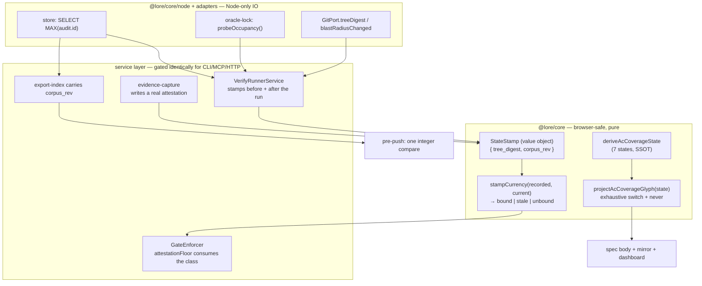
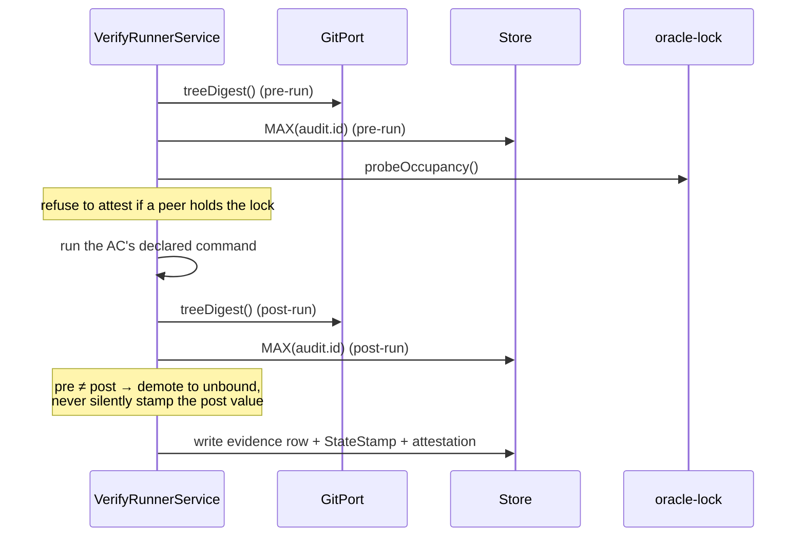

# Architecture: Corpus Truthfulness — a verdict must carry the state it describes, and a post-arming stamp-less record is never green

## Overview

`lore`'s north star is development executed ~100% by AI, ~90% of decisions made by AI, advancing unattended after the opening phase, with **many concurrent sessions on one checkout**. Once AI output outpaces human review, sampling stops scaling — 1% of ten times the output is still unreadable. The only check that scales is the corpus checking itself, which promotes the corpus from *a record of what happened* to *the single source of truth and the coordination mechanism between sessions*.

That promotion has a consequence the current design does not honour: **a verdict is an assertion about a state, but verdicts are stored with no reference to the state they describe.** Their validity therefore lives only in one agent's short-term memory, and when that agent ends, the verdict keeps reading as valid. Under concurrency this is not an edge case — measured in one session: a full-suite green anchored at `08091dfd` while `main` moved to `7ab1d742`; an attested `AC-OX-6` pass that a `lore done` invalidated 61 seconds later; a subagent misattributing 9 reddened tests as "pre-existing" because reproducing at the merge-base shares the same live DB.

This design makes state-binding a first-class, mechanically-checked property, and closes the six adjacent ways the corpus currently asserts falsehoods.

## Goals / Non-Goals

**Goals**

- G1. Every verdict-like record carries the identity of the state it was measured against.
- G2. A verdict whose state has moved is **distinguishable** from one whose state is current — in storage, in gates, and in every rendered projection.
- G3. A stamp-less record is classified against an **immutable arming cutoff** — `arming_rev`, the value of `MAX(audit.id)` captured once in the arming commit. A row written AFTER arming with no stamp can never satisfy a floor; a pre-arming row classifies `legacy_unbound` and is **ACCEPTED** by the floor exactly as today, so arming retro-fails nothing. Both are counted, never silently dropped. ⛔ The cutoff is an integer on an append-only, hash-chain-verified table, so it cannot be backdated or renumbered — that non-forgeability, not the extra class name, is what distinguishes this from a mintable grandfather clause. Governing decision: `adr-a-record-with-no-state-stamp-is-acceptable-but-never-green`.
- G4. Self-checking cost stays O(1) with respect to corpus size.
- G5. No new check can wedge an unattended loop.

**Non-Goals**

- N1. Not preventing all false verdicts — only preventing the corpus from *asserting* them as sound.
- N2. Not retro-invalidating the back-catalogue. Pre-existing rows migrate to a named legacy class, not to `fail`.
- N3. Not proving every gate's remediation hint correct (cut — see Trade-off D6).
- N4. Not converting `hooks/pre-push` into a full verification pass. Push-path cost is budgeted, not unbounded.

## Scope

**In scope — files this design touches**

| Layer | Path | Change |
|---|---|---|
| core (browser-safe) | `packages/core/src/task-workflow.ts` | `StateStamp` value object (optional on `attestation`) **and** the `ARMING_REV` constant |
| core (browser-safe) | `packages/core/src/acceptance.ts` | `projectAcCoverageGlyph` beside `deriveAcCoverageState` |
| service (pure) | `packages/lore/src/service/gate-predicates.ts` | `stampCurrency` predicate (four-valued) |
| service (pure) | `packages/lore/src/service/gate-predicates.ts` | blast-radius **resolver**: derives an AC's declared path set from its script-mode command target + the governing task's `file_anchors`; no declaration → `unmeasured` |
| service | `packages/lore/src/service/checkpoint-registry.ts` | `attestationFloor` consumes all four classes — refuses `unbound`/`stale`, accepts `legacy_unbound`, counts every one |
| service | `packages/lore/src/service/outline-service.ts` | `acCoveragePrefix` delegates, stops re-deriving |
| adapter (Node IO) | `packages/lore/src/adapters/real-git-port.ts` | `blastRadiusChanged` |
| adapter | `packages/lore/src/adapters/cli/evidence-capture.ts` | write a real `attestation` from data already measured |
| script | `scripts/oracle-lock.ts` | export `probeOccupancy()` (read-only) |
| script (new) | `scripts/check-ac-state-renderers.ts` | site-scan ratchet |
| hook (twins) | `hooks/pre-push` + `assets/project/pre-push` | one integer compare; manifest regen required |
| corpus | `SPEC-038` AC-ACODE-9 | amended in the same commit as the renderer (D7) |

**Out of scope**

- Proving every gate remediation hint passes its own gate (D6 — cut; replaced by "hints are derived, not hand-authored").
- Retro-classifying pre-existing evidence rows as `fail` (N2 — they classify `legacy_unbound` and remain floor-acceptable).
- Global allocation of AC ids (D8 — qualified reference instead).
- Any change to `assessmentFreshness` itself; it is the reference shape, deliberately untouched.

## Acceptance Criteria

Prose summary; the machine-checkable set is declared structurally via `lore ac add` and is what `lore verify` executes. Every criterion below is script-mode with a declared falsifier, because an oracle never observed red has no demonstrated discriminating power.

- **AC-CT-1** — All 7 `deriveAcCoverageState` outputs project to 7 pairwise-distinct glyphs; adding an 8th state fails the TypeScript build via a `never` exhaustiveness check.
- **AC-CT-2** — Zero evidence rows carry `capture_source: "runner"` without an `attestation` block, asserted against a throwaway corpus by driving `evidence-capture` itself, not by inspecting the schema.
- **AC-CT-3** — THREE halves, all required: a stamp-less row **above** `arming_rev` is refused by `attestationFloor`; one **at or below** it is **ACCEPTED** by that same floor; both appear distinctly labelled in the `capture_source` distribution. ⛔ The accept half is the mandatory control — without it the criterion cannot distinguish this design from a blanket refusal, which would wedge every open plan on the arming commit.
- **AC-CT-4** — THE DISCRIMINATING PAIR: a peer commit **inside** the oracle's declared blast radius classifies `stale`, while one **outside** it stays `bound`. The radius is the AC's own declared paths — its script-mode command target plus the governing task's `file_anchors` — and an AC declaring none classifies `unmeasured`, never `bound`. ⛔ Both halves required: the "inside" half alone passes vacuously under an ancestry test, which is exactly the defect D4 rejects.
- **AC-CT-5** — When the pre-run and post-run stamps differ, the row is demoted; the post-run value is never silently recorded as the measured state. ⛔ INJECTION SEAM PINNED: the state change MUST be a **real commit** in a throwaway repo landing between the two reads — a fake `GitPort` returning two differing digests proves only that the comparison executes, never that the runner reads the stamp where a concurrent write can actually land, and therefore does NOT satisfy this criterion.
- **AC-CT-6** — (a) STRUCTURAL and primary: the step performs ZERO writes to `docs/requirements/**` or `.lore/export-index.json` (byte-equality before/after) and does work **constant in corpus size** — one indexed read plus one index-field read, never a doc enumeration. (b) COST as a distribution over a named fixture: **p95 < 200ms over ≥20 consecutive runs** against this repository's live corpus. ⛔ A bare single-sample `< 50ms` wall clock was the original form and is rejected: on a git hook it passes idle and fails loaded, which is the flapping-gate mode this criterion's own rationale says drives a loop to `--no-verify`.
- **AC-CT-7** — No read of `.fail` / `.pass` off an `AcCoverageFact` exists outside `packages/core/src/acceptance.ts`, except entries in a written-reason allowlist; the scan exits 1 on violation and 2 when the scan itself breaks.

## Quality Attribute Scenarios (ATAM-lite)

| ID | Stimulus | Response | Measure |
|---|---|---|---|
| QA-1 | Session A records an attested pass at HEAD X; session B lands a commit touching the oracle's blast radius; `lore done` runs | The pass is classified stale and cannot satisfy the attestation floor | `lore done` exits non-zero **naming** the stale row; a control where B's commit touches nothing in the blast radius still closes |
| QA-2 | Corpus grows, several sessions concurrent, pre-push fires | Verdict reached without rendering any doc, doing work **constant in corpus size** | Structural (primary): byte-equality of `docs/requirements` + `.lore/export-index.json` before/after, and one indexed read plus one index-field read — never a doc enumeration. Cost: **p95 < 200ms over ≥20 consecutive runs** against this repository's live corpus |
| QA-3 | An AC accumulates `fail`, then a strictly-newer attested pass | Spec body and mirror distinguish it from a live failure | All 7 `deriveAcCoverageState` outputs render to 7 distinguishable glyphs; adding an 8th state fails the build |
| QA-4 | `lore evidence --capture` records a passing oracle run | The row is either genuinely attested or not labelled `runner` | Zero rows with `capture_source: "runner"` and no `attestation` block |
| QA-5 | The new check cannot obtain a verdict (peer occupancy, contended index) | It marks and continues; the loop does not stall | Check emits SKIPPED + an audit row; exit code unchanged; a following `lore status` surfaces the skip |
| QA-6 | A stamp-less evidence row is read by a floor | Classified by the arming cutoff — post-arming → refused; pre-arming (`legacy_unbound`) → **accepted**, so nothing retro-fails | Both halves asserted separately, and both appear distinctly in `capture_source` distributions. ⛔ The accept half is the mandatory control: without it the criterion cannot tell this design from blanket refusal |

## Architecture

## Components

### C1. `StateStamp` — value object (`@lore/core`, browser-safe)

- **Responsibility**: name the state a verdict was measured against. Two coordinates, because code state and corpus state move independently: `tree_digest` (code) and `corpus_rev` (corpus).
- **Interface**: `{ tree_digest: string; corpus_rev: number; captured_at: string }`, present-iff-computed.
- **Why `corpus_rev` is free**: `audit.id` is already `INTEGER PRIMARY KEY AUTOINCREMENT` (measured at 6176). `SELECT MAX(id)` is a rightmost B-tree descent — microseconds, no process spawn, and the existing audit hash chain already commits content.
- **Why not mtime**: git rewrites mtimes; unusable as identity.
- **Dependencies**: none. No git, no store — it is data.

### C2. `stampCurrency` — pure predicate (`gate-predicates.ts`)

- **Responsibility**: three-valued comparison, shaped exactly like the proven `assessmentFreshness`: caller pre-resolves both sides, function does no IO.
- **Interface**: `stampCurrency(recorded: StateStamp | undefined, recordedAuditId: number, armingRev: number, current: StateStamp, blastRadiusChanged: boolean | "unmeasured") → { class: "bound" | "stale" | "unbound" | "legacy_unbound", reason?, field? }`
- **Invariant**: FOUR classes, not a boolean and not three. `unbound` (post-arming, no stamp) accepts at no floor. `legacy_unbound` (`recordedAuditId <= armingRev`) is accepted by every floor that accepts today, which is what makes arming non-retro-invalidating. Neither is silently dropped from counts.
- **`arming_rev` ownership**: a single exported constant, captured once as `MAX(audit.id)` in the arming commit and stored in `packages/core/src/task-workflow.ts` beside the `StateStamp` type. It is data, not a computation — nothing re-derives it, and a migration that loses it must fail loud rather than default to `0`.

### C3. `GitPort.blastRadiusChanged` (`real-git-port.ts`, Node-only)

- **Responsibility**: answer "did the code under test move", which is **not** ancestry. Measured: a peer's merge keeps your HEAD an ancestor while invalidating your verdict; `merge-base --is-ancestor` only catches rebase/reset.
- **Interface**: `blastRadiusChanged(recordedDigest, paths) → boolean | "unmeasured"`, i.e. `git diff --quiet <recorded> HEAD -- <paths>`.
- **Cost**: measured ~10.9ms per spawn. Affordable **per attestation**, ruinous per row (200 rows = 2.2s of pure fork) → memoize per distinct digest, 1-3 spawns per `lore done`.
- **Three-valued discipline**: `unmeasured` ≠ `changed`, matching the existing `BranchMeasurement` convention.

### C4. `projectAcCoverageGlyph` (`acceptance.ts`, beside the derivation)

- **Responsibility**: the ONLY glyph projection. `switch` over all 7 states with a `never` exhaustiveness check, so an 8th state breaks the build instead of silently rendering as `·`.
- **Replaces**: `outline-service.ts::acCoveragePrefix`, which re-derives from raw `fact.fail > 0` and collapses `fail` with `fail_superseded`. `deriveAcCoverageState`'s own JSDoc claims to be "the SINGLE precedence implementation this codebase uses" — that claim is currently false.
- **Guarded by**: C8.

### C5. `evidence-capture` attestation completion

- **Responsibility**: stop labelling a row `capture_source: "runner"` without an `attestation` block. The adapter **already measures** `spawnResult.status`, `elapsedMs` and `timed_out` and simply never writes them.
- **Upstream effect**: `deriveAcCoverageState`'s `attested_pass` / `fail_superseded` branches are starved today precisely because captures never attest — so this partly fixes C4's inputs too.

### C6. Occupancy source: `oracle-lock.ts` → `probeOccupancy()`

- **Responsibility**: report **machine** occupancy (live pid holding the checkout-level lock), as opposed to `active_sessions`, which reports **intent** occupancy (claim leases with a TTL). Measured disagreement: `active_sessions` read EMPTY while the checkout was 15 minutes into `bun run test` and had rewritten the shared `dist/lore` 19 seconds earlier.
- **Why load-bearing**: without it, a verdict produced during a peer's suite run gets a cryptographically precise binding to a **corrupted observation** — worse than no binding, because it launders a bad verdict into an attested one.

### C7. `export-index` carries `corpus_rev`; pre-push compares integers

- **Responsibility**: make mirror convergence a push-path property costing one integer compare, not a 1524-file / 186MB-DB re-render (measured: bare read alone is 360ms warm; full render is orders above).
- **Contention**: reading `MAX(audit.id)` and an index field writes nothing, so it cannot dirty the tree it checks nor race the single shared `.lore/export-index.json` — the objection that killed the naive formulation.
- **Repair path**: on mismatch, re-render only docs named by `audit(doc_id)` rows above the recorded rev.

### C8. Renderer site-scan ratchet (`scripts/check-ac-state-renderers.ts`)

- **Responsibility**: refuse any read of `.fail` / `.pass` off an `AcCoverageFact` outside `acceptance.ts`. Allowlist-by-file with written reasons, on the established `check-plan-membership-sites.ts` / `check-anchor-coverage.ts` template (exit 1 = violation, exit 2 = scan broke).
- **Why a scan, not a test**: a test asserting "the badge is right" pins today's four call sites; a site scan refuses the fifth.

## Data Flow — one attested verify run

⛔ The pre/post pair is not decoration: the recorded HEAD is captured by the *writer* after the runner finished, so without it a peer merge landing mid-run yields a stamp naming a state the oracle never actually ran against.

## Trade-off Decisions

| ID | Decision | Choice | Rationale | Trade-off | Dissenting view |
|---|---|---|---|---|---|
| D1 | Missing state stamp: pass or refuse? | **Neither — a third class `unbound`, acceptable but never green** | Refusal retro-invalidates the back-catalogue in one commit and wedges every plan at once (ops). Vacuous pass makes *producing absent data* the cheapest path to green (security). A distinct class satisfies both; `not_measured` is the existing precedent | Guarantee weakens to "cannot assert soundness *where it measured*" | Security wanted hard refusal with a migration-cutoff grandfather |
| D2 | Stale detection: block or degrade? | **Degrade at evidence-write; block at plan-close** | A blocking check firing on peer contention converts a concurrency event into a permanently stuck loop that cannot self-clear — clearing needs touching a peer's uncommitted files or rebuilding shared `dist/` under a running peer (G5) | A stale verdict lives in the corpus for a window | Security: any window is exploitable |
| D3 | Is the degrade mark load-bearing on day one? | **Yes — mandatory, not phase 2** | A trust class nothing consumes is defect C5 rebuilt deliberately. Sinks already exist: `attestationFloor` and the `capture_source` distributions in `assess-render.ts` / `status.ts` | Couples this slice to those consumers | none |
| D4 | Staleness test: ancestry or blast radius? | **Blast radius (`git diff --quiet <recorded> HEAD -- <paths>`)** | ⛔ Ancestry reads GREEN through the exact failure measured here: a peer's merge *keeps* your HEAD an ancestor while invalidating your verdict. Ancestry catches only rebase/reset | Over-reports on cosmetic peer commits inside the radius | Perf preferred memoized ancestry as cheaper; accepted because over-reporting into a *degrade* path is cheap |
| D5 | Mirror convergence on the push path? | **Yes, but as one integer compare (C7)** | The naive form (run export, diff) writes the tree it checks and races the shared index → flaps under two sessions, and a flapping gate trains the loop to `--no-verify`. The integer form writes nothing | Detects rev mismatch, not hand-doctored file content; that needs a periodic full sweep | Cost angle wanted it off the push path entirely, behind `lore status --check-*` |
| D6 | Prove every gate hint passes its own gate? | **Cut. Replace with: hints must be DERIVED from the predicate's own inputs, never hand-authored** | A cross-product over 7 checkpoints × 4 floors cannot be discharged once and re-breaks on every message edit | Hints can still be stale or unhelpful | none — all angles agreed to cut |
| D7 | Amend AC-ACODE-9 when fixing the renderer? | **Yes, same commit, mechanically forced** | `outline-service.ts`'s JSDoc claims it "mirrors AC-ACODE-9 exactly". Fix the renderer alone and `SPEC-038:130` becomes the falsehood — and the newly-wired mirror check would enshrine it. Matches the standing rule that fixing a gap and updating the note recording it are one acceptance unit | Drags an older AC into the slice | Cost angle: the JSDoc sentence is not a dependency, just delete it |
| D8 | AC id identity | **Qualified reference `(spec_ordinal, ac_id)` on `ac_ref`; NOT global allocation** | AC ids are legitimately spec-local section numbering and authors renumber freely in draft. But `ac_ref` crosses a document boundary, so it must carry the qualifier. SPEC-084 ordinals are already corpus-allocated and stable | Prose references stay ambiguous unless a check resolves them | Domain angle proposed also refusing ambiguous bare `AC-*` at write time |

## Risk Registry

| Risk | Severity | Mitigation | Owner |
|---|---|---|---|
| Blocking floor deadlocks an unattended loop with no operator | **High** | D2 (degrade at write, block only at plan-close); D1's `unbound` class never blocks by itself | this spec |
| Verdict bound to a corrupted observation (peer mid-`bun run test`, shared `dist/lore` rewritten under us) — launders a bad verdict into attested | **High** | C6: refuse to attest while a peer holds the checkout lock; extend the lock to cover `bun run build` | this spec |
| Ancestry chosen as the staleness test → silently green through the measured failure | **High** | D4 | this spec |
| Renderer fixed without amending AC-ACODE-9 → corpus asserts a falsehood the mirror check then enshrines | Medium | D7 + C8 ratchet | this spec |
| `hooks/pre-push` edited without regenerating the assets manifest (byte-identical twin `assets/project/pre-push`) | Medium | Existing `pre-push-parity.test.ts` + manifest regen in the same commit; third-party copies need the `[ -f … ] && command -v bun` presence guard, never `\|\| exit 0` | implementer |
| `attestation` grows into a grab-bag as the stamp is denormalized onto every row | Low | Accepted (see D1 dissent); a normalized basis table would reintroduce a nullable join, which is the failure mode itself | domain |
| Site-scan false-positives on legitimate aggregation reads of `fact.pass` | Low | Allowlist-by-file with written reasons; each waiver widens the blind spot and must say so | implementer |

## Migration Plan

**Phase 1 — honest labels (no schema change, no new concepts)**
1. C5: `evidence-capture` writes a real `attestation` from data it already measures. Rollback: revert one adapter file.
2. C4 + D7: `projectAcCoverageGlyph` with `never` exhaustiveness; amend AC-ACODE-9 in the same commit. Rollback: revert; no stored data changed.
3. C8: renderer site-scan ratchet wired into `bun run test`. Rollback: delete the script + its allowlist.

**Phase 2 — the stamp (additive, optional field)**
4. C1 + C2: `StateStamp` type, the `ARMING_REV` constant (captured in this very commit as `MAX(audit.id)`), and the four-valued `stampCurrency`. The stamp field is **optional**, and every pre-existing row sits below the cutoff, so it classifies `legacy_unbound` and is accepted — nothing retro-fails (N2). Rollback: field unread, constant unreferenced.
5. C3 + C6: `GitPort.blastRadiusChanged`, `probeOccupancy()`; `VerifyRunnerService` stamps pre/post.
6. D3: route the `unbound` / `stale` classes into `attestationFloor` and the `capture_source` distributions. ⛔ Phase 2 is not done without this step — that is the difference between a mechanism and a metadata field.

**Phase 3 — push-path convergence**
7. C7: `corpus_rev` in the export index; pre-push integer compare, **advisory-first** (warn + audit row for N observed clean runs, recording the calibration base commit) before arming. Rollback: remove the hook step in both twins + regen manifest.

**Phase 4 — addressability**
8. D8: qualified `ac_ref`; corpus-wide check that a bare `AC-*` resolves within its enclosing spec.

## Cross-Cutting Concerns

- **Security (integrity, not network)**: the adversary is an agent under pressure to make a gate pass. Escape hatches must be *more expensive than compliance*: typed `kind` enum rather than free prose (the existing `attestationExemptKindSchema` pattern), bound to a specific state stamp so an override dies when the state moves, **visible in the projection** so the next session sees the debt, and budgeted per plan. ⛔ Note the measured correction: `LORE_GATE_BYPASS=1` is scoped to the `lore gate` command alone and does **not** affect `GateEnforcer.enforce` in the service layer (CLI/MCP/HTTP all route through the latter), and it writes a `gate_skipped` audit row — an earlier draft of this analysis overstated it as a silent global kill switch.
- **Performance**: budget is QA-2 — structural size-independence plus p95 < 200ms over >=20 runs on this repo's live corpus (the earlier single-sample < 50ms form was rejected as self-flapping). Achieved by stamping once and comparing scalars — gates never recompute. Watch C4's `isSupersededByNewerAttestedPass`, which is O(|refs|) per AC per spec inside the export render path.
- **Observability**: `unbound` / `stale` / SKIPPED must each appear in `lore status` and in the `capture_source` distribution; a `--no-verify` push should itself leave a corpus row so the escape is visible in `lore audit`.
- **Data privacy**: n/a — local-first, no PII in scope.

## Downstream Handoff

**To `implement`**: C1/C2 signatures above are normative TypeScript. `@lore/core` must stay browser-safe — the stamp *type* and the *comparison* live there; all git IO lives in `real-git-port.ts` / `@lore/core/node` and is passed **pre-resolved**, exactly as `getAssessmentFreshness` does today. `hooks/pre-push` and `assets/project/pre-push` are byte-identical twins; edit both and regenerate the manifest.

**To `test`**: invariants — (i) 7 states → 7 distinguishable glyphs, 8th breaks the build; (ii) zero rows with `capture_source: "runner"` and no attestation; (iii) `unbound` satisfies no floor; (iv) a peer commit **inside** the blast radius reds QA-1 while one **outside** it does not (this pair is the discriminating test — one half alone passes vacuously); (v) pre/post stamp mismatch demotes rather than stamps the post value. Every script-mode AC carries `--falsifier-path/--find/--replace/--exit-code`.

**To `deploy`**: no infra. Phase 3 touches a git hook; consumers activate via `git config core.hooksPath hooks`.

## Quality Gate Checklist (architecture mode)

- [x] **Every NFR has an architectural response with a measurable target** — QA-1…QA-6, each with a Measure column; the push-path budget is a distribution over a named fixture (p95 < 200ms, >=20 runs) plus a structural size-independence assertion.
- [x] **All tension points have a decision + rationale** — D1…D8, each carrying the dissenting view rather than hiding it.
- [x] **High-severity risks have mitigations** — three High rows, each mapped to a specific decision or component.
- [x] **Migration phases defined with rollback** — four phases, rollback named per step; Phase 2 additive-optional so the back-catalogue never retro-fails.

## Acceptance Criteria (structured)

- [·] [script] AC-CT-1: RENDERING IS INJECTIVE. All seven states deriveAcCoverageState can return (fail, fail_superseded, attested_pass, not_measured, pass_unfalsified, pass, none) project to seven PAIRWISE-DISTINCT glyphs, and the projection is the ONLY one in the codebase. Asserted by enumerating all seven and comparing the resulting glyph set size to 7 (never by spot-checking two). An eighth state MUST fail the TypeScript build via a never exhaustiveness check, asserted by a compile-failure fixture rather than by prose. Measured defect this closes 2026-08-17: outline-service.ts acCoveragePrefix reads fact.fail > 0 raw, collapsing fail with fail_superseded, so SPEC-136 renders AC-OX-1 and AC-OX-6 as FAILED while both hold attested passes, permanently, because fact.fail is a cumulative counter that never decrements. MANDATORY FALSIFIER once the symbol exists (cannot be declared structurally today: --falsifier-find requires the target string to already be on disk): mutate two switch arms of projectAcCoverageGlyph to return the same glyph and assert the command exits EXACTLY 1.
  script: test — bunx vitest run packages/core/tests/unit/ac-coverage-glyph.test.ts 2>&1 && echo "AC-CT-1 PASS: seven coverage states project to seven pairwise-distinct glyphs through a single exhaustive projection, and an unhandled state is a compile error"
- [·] [script] AC-CT-2: NO FALSE TRUST LABEL. Zero evidence rows may carry capture_source runner without an attestation block. Asserted on a THROWAWAY corpus by DRIVING evidence-capture itself end to end (production wiring, not a schema inspection and not a grep): record a passing oracle run through the real capture path, then read the stored row back and assert attestation is present with an exit_code. Measured defect 2026-08-17: an implementer sincerely reported its pass as attested because the row said runner; it had no attestation block and no second source to catch that with. The adapter ALREADY measures spawnResult.status, elapsedMs and timed_out and simply never writes them, so this is a write-through fix, not new measurement. MANDATORY FALSIFIER once implemented: delete the attestation write while leaving the runner label in place, and assert the command exits EXACTLY 1.
  script: test — bunx vitest run packages/lore/tests/unit/adapters/evidence-capture-attestation.test.ts 2>&1 && echo "AC-CT-2 PASS: a runner-labelled row written through the real evidence-capture path carries an attestation block with a measured exit code"
- [·] [script] AC-CT-3: A STAMP-LESS RECORD IS CLASSIFIED BY AN IMMUTABLE CUTOFF, AND THE CONTROL HALF IS MANDATORY. stampCurrency returns bound, stale, unbound or legacy_unbound. Classification uses arming_rev — the value of MAX(id) FROM audit captured once in the arming commit and stored as a constant. Asserted on a throwaway corpus, THREE halves, separately: (1) a stamp-less row whose audit.id is ABOVE arming_rev is REFUSED by attestationFloor; (2) a stamp-less row whose audit.id is at or BELOW arming_rev is ACCEPTED by that same floor; (3) both appear, distinctly labelled, in the capture_source distribution rather than being silently dropped. ⛔ Half (2) is the CONTROL and is not optional: without it this criterion cannot distinguish this design from a blanket refusal, and a blanket refusal wedges every open plan on the arming commit with no operator awake to clear it. REVISION RECORD 2026-08-17, in-flight, before any evidence existed: an earlier form asserted only that unbound satisfies NO floor. The spec-promote review judge ESCALATED the governing ADR with a blocking question that was correct — if every legacy row reads unbound and unbound satisfies no floor, then arming retro-refuses every plan consuming a legacy attestation, which is the exact outcome used to reject hard refusal. This is a CORRECTION, not a weakening: it adds an assertion (half 2) and pins the cutoff to an append-only, hash-chain-verified integer that an agent cannot backdate or renumber, where a timestamp cutoff would have been mintable by choosing when to write. MANDATORY FALSIFIERS once implemented, two of them: (a) make stampCurrency return bound for an undefined recorded stamp, command must exit EXACTLY 1; (b) set arming_rev to 0 so every legacy row reclassifies as unbound, and the same command must exit EXACTLY 1 on half (2).
  script: test — bunx vitest run packages/lore/tests/unit/service/stamp-currency-floor.test.ts 2>&1 && echo "AC-CT-3 PASS: a stamp-less row above the arming cutoff is refused by attestationFloor, one at or below it is accepted, and both are distinctly labelled in the capture_source distribution"
- [·] [script] AC-CT-4: THE DISCRIMINATING PAIR: staleness is measured by BLAST RADIUS, not ancestry. WHERE THE RADIUS IS DECLARED (pinned so neither half requires implementer invention): the radius is the AC own declared paths — its script-mode command target plus the governing task file_anchors — and an AC that declares NO radius classifies unmeasured, never bound, matching the three-valued discipline of the git port. Asserted on a throwaway git repo, BOTH halves required: (a) a peer commit touching a path INSIDE that declared radius classifies the earlier verdict stale; (b) a peer commit touching ONLY paths outside it leaves that verdict bound. Half (a) alone passes vacuously under an ancestry test and is therefore not evidence. Rationale, measured 2026-08-17: a peer merged 1871 lines mid-run and KEPT the recorded HEAD as an ancestor while invalidating the verdict, so merge-base --is-ancestor reads GREEN through the exact failure this criterion exists to catch; ancestry detects only rebase and reset. Implementation MUST be git diff --quiet recorded HEAD -- paths. MANDATORY FALSIFIER once implemented: replace the blast-radius diff with merge-base --is-ancestor and assert the command exits EXACTLY 1 — note what that proves, half (b) still passes under ancestry while half (a) breaks, so a test asserting only (a) would have been satisfied by the rejected implementation.
  script: test — bunx vitest run packages/lore/tests/unit/adapters/blast-radius-staleness.test.ts 2>&1 && echo "AC-CT-4 PASS: a peer commit inside the declared blast radius makes the verdict stale, one outside it stays bound, and an AC declaring no radius classifies unmeasured"
- [·] [script] AC-CT-5: A STAMP NAMES THE STATE THE ORACLE ACTUALLY RAN AGAINST, AND THE SEAM IS ASSERTED WHERE THE RUNNER READS IT. The runner captures the state stamp BEFORE the command and re-reads it AFTER; when the two differ the row is demoted, and the post-run value is NEVER silently recorded as the measured state. INJECTION SEAM PINNED (the review judge correctly noted three candidate seams prove different things): the state change MUST be injected as a REAL COMMIT in a throwaway git repo landing between the two reads — ⛔ a fake GitPort returning two different digests proves only that the comparison executes, never that VerifyRunnerService reads the stamp at the seam where a concurrent write can actually land. A fake-port test alone does NOT satisfy this criterion. Rationale: the recorded HEAD is written by the WRITER after the runner finished, so without the pre/post pair a peer merge landing mid-run yields a stamp naming a state the oracle never ran against — worse than no stamp, because it launders an unsound observation into an attested one. MANDATORY FALSIFIER once implemented: record only the post-run stamp, dropping the comparison, and assert the command exits EXACTLY 1.
  script: test — bunx vitest run packages/lore/tests/unit/service/stamp-pre-post-demotion.test.ts 2>&1 && echo "AC-CT-5 PASS: a real commit landing between the pre-run and post-run stamp reads demotes the row instead of recording the post-run value"
- [·] [script] AC-CT-6: THE PUSH PATH STAYS SIDE-EFFECT FREE, AND ITS COST ASSERTION MUST NOT ITSELF FLAP. (a) STRUCTURAL, deterministic, PRIMARY and load-bearing: the mirror-convergence step reaches its verdict by comparing the export index recorded corpus_rev against SELECT MAX(id) FROM audit and RENDERS NOTHING — asserted by hashing docs/requirements and .lore/export-index.json before and after the step and requiring byte equality, AND by asserting the work performed is CONSTANT with respect to corpus size (one indexed read plus one index-field read; it never enumerates docs), which is what makes the cost claim structural rather than environmental. (b) COST, as a distribution over a NAMED fixture: p95 of added latency over at least 20 consecutive runs against THIS repository live corpus stays under 200ms. ⛔ Two corrections recorded rather than excused, both in-flight before any evidence existed. First: the original form pinned a bare single-sample wall clock under 50ms, which was self-contradicting — a tight single-sample threshold on a git hook passes on an idle machine and fails on a loaded one, the exact flapping-gate mode this criterion own rationale says trains an unattended loop toward --no-verify. Second: the review judge then noted the corrected p95 still named no measurement environment, so the fixture is now pinned above and half (a) carries the size-independence assertion that makes the number reproducible instead of machine-dependent. MANDATORY FALSIFIER once implemented: replace the integer comparison with a real export invocation and assert the command exits EXACTLY 1 on half (a) byte-equality assertion.
  script: test — bunx vitest run packages/lore/tests/unit/hooks/pre-push-mirror-rev.test.ts 2>&1 && echo "AC-CT-6 PASS: the convergence step decides from a corpus-size-independent integer comparison, leaves docs/requirements and the export index byte-identical, and its p95 added latency over 20 runs on this repo live corpus stays under 200ms"
- [·] [script] AC-CT-7: NO SECOND DERIVATION MAY BE ADDED. A site scan refuses any read of .fail or .pass off an AcCoverageFact outside packages/core/src/acceptance.ts, allowlist-by-file with a written reason per entry, exiting 1 on violation and EXACTLY 2 when the scan itself cannot complete (the established shape of check-plan-membership-sites.ts and check-anchor-coverage.ts). A test asserting the badge is currently right pins only todays call sites; a site scan refuses the next one, which is the actual failure mode: deriveAcCoverageState JSDoc already claims to be the SINGLE precedence implementation in this codebase and that claim is false today. The scan is wired into bun run test so it is invoked, not merely present, because an existing sound oracle is not a gate until something runs it. MANDATORY FALSIFIER once implemented: add a fact.fail read in a non-allowlisted file and assert the scan exits EXACTLY 1 naming that file.
  script: test — bun scripts/check-ac-state-renderers.ts 2>&1 && echo "AC-CT-7 PASS: no AcCoverageFact precedence read exists outside acceptance.ts except written-reason allowlist entries, and the scan is wired into bun run test"
