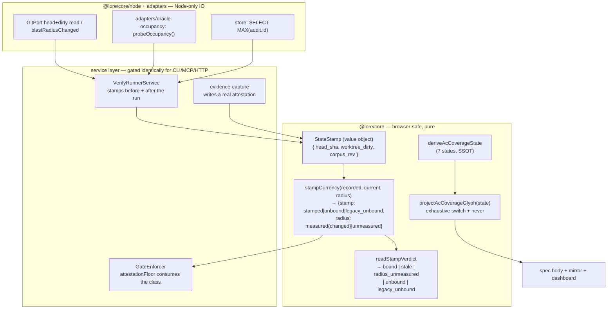
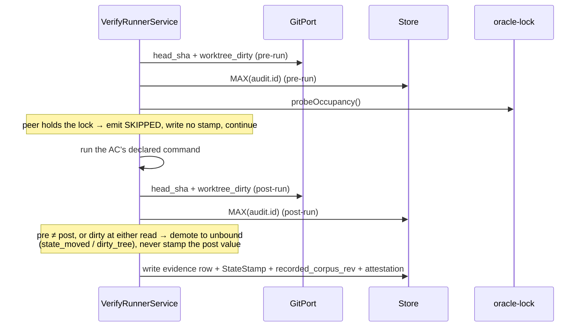

# Architecture: Corpus Truthfulness — a verdict must carry the state it describes, and a post-arming stamp-less record is never green

## Overview

`lore`'s north star is development executed ~100% by AI, ~90% of decisions made by AI, advancing unattended after the opening phase, with **many concurrent sessions on one checkout**. Once AI output outpaces human review, sampling stops scaling — 1% of ten times the output is still unreadable. The only check that scales is the corpus checking itself, which promotes the corpus from *a record of what happened* to *the single source of truth and the coordination mechanism between sessions*.

That promotion has a consequence the current design does not honour: **a verdict is an assertion about a state, but verdicts are stored with no reference to the state they describe.** Their validity therefore lives only in one agent's short-term memory, and when that agent ends, the verdict keeps reading as valid. Under concurrency this is not an edge case — measured in one session: a full-suite green anchored at `08091dfd` while `main` moved to `7ab1d742`; an attested `AC-OX-6` pass that a `lore done` invalidated 61 seconds later; a subagent misattributing 9 reddened tests as "pre-existing" because reproducing at the merge-base shares the same live DB.

This design makes state-binding a first-class, mechanically-checked property, and closes the six adjacent ways the corpus currently asserts falsehoods.

## Goals / Non-Goals

**Goals**

- G1. Every verdict-like record carries the identity of the state it was measured against.
- G2. A verdict whose state has moved is **distinguishable** from one whose state is current — in storage, in gates, and in every rendered projection.
- G3. A stamp-less record is classified against a **per-corpus, append-only arming cutoff** — the id of the single `state-binding-armed` audit row, written once per corpus by the arming step (and by `lore init` for a fresh corpus). A row written AFTER arming with no stamp can never satisfy a floor; a pre-arming row classifies `legacy_unbound` and is **ACCEPTED** by the floor exactly as today, so arming retro-fails nothing; a corpus with no armed row is unarmed and nothing in it is refused. Both classes are counted in the stamp-verdict distribution, never silently dropped. ⛔ The cutoff is an audit id on an append-only, hash-chain-verified table, so it cannot be backdated or renumbered — that non-forgeability, not the extra class name, is what distinguishes this from a mintable grandfather clause. It is a per-corpus row and not a shipped literal because a literal never arms in a consumer corpus and, measured 2026-10-17, the shipped `ARMING_REV` (14992) sat below the live `MAX(audit.id)` (45789) with 2084 attested rows after it (R13). A row recorded on a dirty working tree is never `stamped`: it counts under its own `dirty_tree` reason and does not satisfy the floor (R13). Governing decision: `adr-a-record-with-no-state-stamp-is-acceptable-but-never-green`.
- ~~G4. Self-checking cost stays O(1) with respect to corpus size.~~ WITHDRAWN (R13): its only asserting criterion was AC-CT-6, retired on 2026-10-17, and a goal with no measuring oracle is the defect class this spec exists to remove. The surviving stamp reads are a fixed handful of calls per `lore verify` run, with `blastRadiusChanged` memoized per distinct HEAD (C3); no criterion measures that, and none is claimed.
- G5. No new check can wedge an unattended loop.

**Non-Goals**

- N1. Not preventing all false verdicts — only preventing the corpus from *asserting* them as sound.
- N2. Not retro-invalidating the back-catalogue. Pre-existing rows migrate to a named legacy class, not to `fail`.
- N3. Not proving every gate's remediation hint correct (cut — see Trade-off D6).
- N4. Not converting `hooks/pre-push` into a full verification pass. Push-path cost is budgeted, not unbounded.
- N5. Not converging the docs mirror on the push path (R13). The full mirror parity check `scripts/export-spec-mirror.ts --check` already runs in `bun run test`; no `corpus_rev` is added to the export index and `hooks/pre-push` is not touched by this spec.

## Scope

**In scope — files this design touches**

| Layer | Path | Change |
|---|---|---|
| core (browser-safe) | `packages/core/src/task-workflow.ts` | `StateStamp` value object (optional on `attestation`) and the per-row server-written `recorded_corpus_rev` field. The shipped `ARMING_REV` constant is REMOVED, replaced by the per-corpus armed audit row (C1, R13). The existing `classifyCaptureSource` stays the capture_source axis classifier |
| service | the arming step (host file named by task CT-3's anchors; `lore init` calls it for a fresh corpus) | writes the single `state-binding-armed` audit row, idempotently, and reports the count of rows whose audit id is unresolvable before arming (R13). Must not run before the runner writes stamps |
| core (browser-safe) | `packages/core/src/acceptance.ts` | `projectAcCoverageGlyph` beside `deriveAcCoverageState` |
| service (pure) | `packages/lore/src/service/gate-predicates.ts` | `stampCurrency` predicate (TWO-AXIS: three-valued `stamp` × `RadiusMeasurement`), plus `readStampVerdict` projecting the five terminal readings (R9) |
| service (pure) | `packages/lore/src/service/gate-predicates.ts` | blast-radius **resolver**: extracts pathspecs from an AC's script-mode command target + the governing task's `file_anchors`. A member is resolved when it is a syntactically valid repo-relative pathspec, ⛔ NOT when the file currently exists — `git diff --quiet` is sound over created and deleted paths alike (measured; R8). No pathspec at all → `unmeasured`; ≥1 pathspec → measurable |
| service | `packages/lore/src/service/checkpoint-registry.ts` | `attestationFloor` reads the STAMP axis first, the radius axis only when stamped — refuses `unbound` (including `dirty_tree`) and `stamped`+changed, accepts `legacy_unbound` and `stamped`+unchanged and `stamped`+unmeasured, and counts every terminal reading with `radius_unmeasured` as its own bucket (AC-CT-9, R9). The per-task attested-pass floor that `lore done` consults (file named by CT-3's anchors) refuses `unbound` too, once the corpus is armed (AC-CT-3 half 5, user decision 2026-10-17) |
| service | `packages/lore/src/service/outline-service.ts` | `acCoveragePrefix` delegates, stops re-deriving |
| adapter (Node IO) | `packages/lore/src/adapters/real-git-port.ts` | `blastRadiusChanged` |
| adapter | `packages/lore/src/adapters/cli/evidence-capture.ts` | write a real `attestation` from data already measured |
| script | `scripts/oracle-lock.ts` | stays the lock WRITER; exports the lock path/name constant that AC-CT-8(d)'s shared-constant test imports on the reader's behalf |
| adapter (new) | `packages/lore/src/adapters/oracle-occupancy.ts` | read-only `probeOccupancy()`, a READER of the same lock protocol; the shipped binary imports nothing from `scripts/` and consumer repos have no `scripts/` (R13) |
| script (new) | `scripts/check-ac-state-renderers.ts` | site-scan ratchet |
| service | `packages/lore/src/service/verify-runner-service.ts` | pre/post stamp reads around the command (C5's seam; AC-CT-5) and the occupancy probe + SKIPPED-and-continue step (AC-CT-8); a tree dirty at either read demotes the row to `unbound`/`dirty_tree` — ⛔ added R11, extended R13 |
| adapter | `packages/lore/src/adapters/cli/assess-render.ts` | hosts the accumulation of the NEW stamp-verdict distribution over the five `readStampVerdict` readings, with the `unbound` reason breakdown, beside the existing capture_source one, whose bucketing is `classifyCaptureSource` in `task-workflow.ts` (three buckets: runner / self-report / runner-unattested) (AC-CT-9(d), AC-CT-10) — ⛔ added R11, corrected R12 and R13 |
| adapter | `packages/lore/src/adapters/cli/commands/status.ts` | calls the same two classifiers (the capture_source duplicate was already collapsed into `classifyCaptureSource` by commit c1d03e73, so nothing is left to delete); renders the stamp-verdict distribution and the `state-binding … SKIPPED` line (AC-CT-8(c), AC-CT-9(d)) — ⛔ added R11, corrected R13 |
| script (new) | `scripts/check-capture-source-buckets.ts` | bucketing-predicate site scan (AC-CT-10) — ⛔ added R11 |
| service | `packages/lore/src/service/task-workflow-service.ts` | ⛔ MODIFIED by C5 after all — this row read "NOT modified" until 2026-08-23, and the AC-CT-2 diff falsified it. It now carries the `capture_attestation` input key and the single `promoteCapturedAttestation` promotion point both `_addEvidenceImpl`s call. Its PRE-EXISTING `capture_source` read is still the tail-guard exemption AC-CT-10 allowlists by SHAPE (zero accumulation targets), and the new logic deliberately adds no `capture_source` comparison, so that allowlist entry still needs no widening |
| corpus | `SPEC-038` AC-ACODE-9 | amended in the same commit as the renderer (D7) |

**Out of scope**

- Proving every gate remediation hint passes its own gate (D6 — cut; replaced by "hints are derived, not hand-authored").
- Retro-classifying pre-existing evidence rows as `fail` (N2 — they classify `legacy_unbound` and remain floor-acceptable).
- Global allocation of AC ids (D8 — qualified reference instead).
- Any change to `assessmentFreshness` itself; it is the reference shape, deliberately untouched.
- Mirror convergence on the push path: AC-CT-6 and component C7 are retired (R13), so the export index, `hooks/pre-push` and `assets/project/pre-push` are not touched.

## Acceptance Criteria

Prose summary; the machine-checkable set is declared structurally via `lore ac add` and is what `lore verify` executes. Every criterion below is script-mode with a declared falsifier, because an oracle never observed red has no demonstrated discriminating power.

- **AC-CT-1** — All 7 `deriveAcCoverageState` outputs project to 7 pairwise-distinct glyphs; adding an 8th state fails the TypeScript build via a `never` exhaustiveness check. The projection's GLOBAL UNIQUENESS is measured, not asserted: RULE 2 of C8's scan (`--rule glyph-projection`) refuses any function outside `acceptance.ts` satisfying BOTH a type-reference condition AND a glyph-yielding condition, the latter enumerated as exactly four forms (bare string literal, string-literal union return type, template literal with a glyph in its static parts, indexed read from an object/array literal holding one); the flag must itself be proven non-inert in both directions. ⛔ The conjunction is the mechanism — either condition alone over-matches into a 13-plus-entry allowlist (R2) — and the four forms are the CLOSED definition of a violation, so any other shape is out of the rule's scope by construction (R7; the unimplementable "report unenumerated forms" duty was removed in R8). ⛔ The scan IMPORTS the glyph alphabet from `acceptance.ts` rather than re-listing it, so the rule cannot drift from the projection it guards (R9).
- **AC-CT-2** — Zero evidence rows carry `capture_source: "runner"` without an `attestation` block, asserted against a throwaway corpus by driving `evidence-capture` itself, not by inspecting the schema.
- **AC-CT-3** — FIVE halves, all required: a stamp-less row **above** the corpus's armed audit row is refused by `attestationFloor`; one **at or below** it (or in an unarmed corpus) is **ACCEPTED** by that same floor; both appear distinctly labelled in the **stamp-verdict** distribution, never folded into `capture_source` (R13 corrected the axis); a post-arming row stamped on a DIRTY tree is `unbound` with reason `dirty_tree`, refused and counted under that reason, against a committed-tree control that is `stamped` and accepted; and `lore done`'s per-task floor refuses an `unbound`-only task like `attestationFloor` does. ⛔ The accept half is the mandatory control — without it the criterion cannot distinguish this design from a blanket refusal, which would wedge every open plan on arming. A row's audit id is its server-written `recorded_corpus_rev`, else its evidence audit row; a row with neither is `unbound`/`audit_id_unresolved` and counted (measured 2026-10-17: 98 rows in 36 docs, so the arming step reports the count before arming). Evidence must be recorded on a committed tree; no tree digest is computed.
- **AC-CT-4** — FOUR halves, all required: a peer commit **inside** the radius classifies `stale`; one **outside** it stays `bound`; a radius pathspec ABSENT at the recorded HEAD but CREATED by a peer classifies `stale` (live control: one that never exists stays `bound`); and an AC whose command yields NO pathspec, e.g. `bun run typecheck`, classifies `unmeasured` (live control: a sibling yielding one stays `bound`). ⛔ Resolvability is a PATHSPEC property, not an EXISTENCE property — measured 2026-08-20, `git diff --quiet` exits 1 for a created path and 1 for a deleted one; an existence rule reached 29% of the 831 script-mode ACs versus 6% for the pathspec rule (R8), and re-measured 2026-10-17 the pathspec rule leaves 54 of 1170 (4.6%) (R13). ⛔ RE-CHECK TRIGGER: if the no-pathspec share exceeds 15%, this direction AND AC-CT-9's accept decision are both re-opened (R10). ⛔ OWNER (R13): the CT-9 plan gate re-measures it on merged main and records it on the plan; afterwards any revision record touching AC-CT-4 or AC-CT-9 states the current share, with `radius_unmeasured` as the standing proxy. ⛔ The "inside" half alone passes vacuously under ancestry (the defect D4 rejects), and the last two halves without their controls pass vacuously under a resolver returning one answer always.
- **AC-CT-5** — When the pre-run and post-run stamps differ, the row is demoted (`unbound`, reason `state_moved`); the post-run value is never silently recorded as the measured state. A tree dirty at either read is also demoted (`unbound`, reason `dirty_tree`), against a clean-tree control that stamps (R13, user decision 2026-10-17). ⛔ INJECTION SEAM PINNED: each change MUST be real — a **real commit**, or a real uncommitted file, in a throwaway repo landing at the seam — a fake `GitPort` returning two differing values proves only that the comparison executes, never that the runner reads the stamp where a concurrent write can actually land, and therefore does NOT satisfy this criterion.
- **AC-CT-6** — RETIRED 2026-10-17 by correction (R13), kept as a TOMBSTONE with its reason recorded here and in R13: an approved spec with evidence has no removal path (`lore ac rm` and `lore reopen` are both refused), so the criterion was corrected to assert only the surviving fact, that the full mirror check is wired into `bun run test` as `check:spec-mirror`. Its compare, `index.corpus_rev == MAX(audit.id)`, is unreliable: measured on main cb55711d, about 26% of audit writes (claim, evidence, gate_passed, judge, release, worktree-cleanup) advance `MAX(audit.id)` without changing a mirrored byte, and the advisory's own audit row advances it too, so the compare would report drift after ordinary work and invalidate itself. The full mirror parity check `scripts/export-spec-mirror.ts --check` already runs in `bun run test`. Component C7, D5's push-path step, QA-2 and Migration Phase 3 are retired with it; G4 is withdrawn.
- **AC-CT-7** — TWO rules in one scan, `--rule <name>` selecting exactly one and no flag running both. RULE 1 `fact-field-read` (owned here): no read of `.fail` / `.pass` off an `AcCoverageFact` outside `packages/core/src/acceptance.ts`, except written-reason allowlist entries. RULE 2 `glyph-projection` (owned and asserted by AC-CT-1): no second state-to-glyph projection. The scan exits 1 on violation and EXACTLY 2 when the scan itself cannot complete (R5).
- **AC-CT-8** — G5 gets an executing oracle, hosted in `lore verify`'s stamp step (R13): when the state-binding check cannot obtain a verdict it emits SKIPPED, writes exactly one audit row, and leaves `lore verify`'s exit code EXACTLY EQUAL to the same fixture run with the check absent (asserted by running both, never by hard-coding 0). ⛔ Three further halves are mandatory: a LIVE CONTROL where releasing occupancy makes the SAME check produce a real verdict — without it an always-skip implementation passes while G5 holds in name only; a USER-SURFACE assertion that spawns the real `lore status` and requires its stdout to contain the literal token `SKIPPED` on a line that ALSO contains the literal check identifier `state-binding` (R6, tightened in R7); and a shared-constant test pinning the occupancy READER in `adapters/` and the lock WRITER in `scripts/oracle-lock.ts` to one lock path and name (R13).
- **AC-CT-9** — The radius axis is ORTHOGONAL to the stamp axis and its `unmeasured` state has a declared gate consequence. `attestationFloor` reads the stamp axis FIRST and the radius axis only when stamped, so `stamped`+`unmeasured` is ACCEPTED while `unbound`+`unmeasured` is still REFUSED — that pair is the precedence control. `readStampVerdict` must be TOTAL over the product, projecting five mutually-exclusive readings, and a SECOND, PARALLEL stamp-verdict distribution buckets those five with `radius_unmeasured` carrying its own count summing to the row total — reported ALONGSIDE the `capture_source` distribution (runner / self-report / runner-unattested) and ⛔ never merged into it, the two being orthogonal axes over the same rows (R12). ⛔ DIRTY-TREE PLACEMENT (R13): a post-arming row stamped on a dirty tree is `unbound` on the STAMP axis with reason `dirty_tree`, so the floor refuses it before the radius is read and the five readings stay exhaustive; a pre-arming dirty row is `legacy_unbound`. Every `unbound` row carries exactly one reason (`dirty_tree`, `state_moved`, `audit_id_unresolved`, `no_stamp`) and the reason counts sum to the `unbound` count. ⛔ Both distributions route through ONE exported classifier each, `classifyCaptureSource` and `readStampVerdict`, called by `assess-render.ts` and `commands/status.ts`; the earlier private duplicate no longer exists (commit c1d03e73). The RE-introduction ratchet is AC-CT-10. The accept direction is fixed by measurement — the 4.6% of script-mode ACs yielding no pathspec (re-measured 2026-10-17; 6% when R9 decided) are dominated by whole-repository oracles whose honest radius IS the repository, so refusing them reproduces the mass-wedge N2/G5 reject and R1 rejected once (R9).
- **AC-CT-10** — The single bucketing predicate is RATCHETED, not merely established once: a site scan refuses any evidence-row bucketing decision, over either axis, made outside its classifier's own file (`classifyCaptureSource`, `readStampVerdict`), allowlist-by-file with written reasons, exit 1 on violation and EXACTLY 2 when the scan cannot complete, wired into `bun run test`. ⛔ The discriminator is structural, never a path (R13): a raw `capture_source` read or a literal comparison against a `CAPTURE_SOURCES`/`StampVerdict` value in a function with two or more accumulation targets is the violation; a `switch` over a classifier's RETURN value is the sanctioned consumer; a raw read returned directly with zero accumulation targets is the tail-guard exemption, exempt by shape wherever it moves. Measured 2026-10-17, the only literal left outside the classifier is the tail-guard `isRunnerCaptured` (`task-workflow-service.ts:1122`), so the allowlist is empty or one entry; the implementing task re-measures it, because the 2026-08-21 count of four sites described code that has since changed.

## Quality Attribute Scenarios (ATAM-lite)

| ID | Stimulus | Response | Measure |
|---|---|---|---|
| QA-1 | Session A records an attested pass at HEAD X; session B lands a commit touching the oracle's blast radius; `lore done` runs | The pass is classified stale and cannot satisfy the attestation floor | `lore done` exits non-zero **naming** the stale row; a control where B's commit touches nothing in the blast radius still closes; a third case whose command yields NO pathspec classifies `unmeasured` rather than `bound`, against a live `bound` control; and a fourth where the radius pathspec did not exist at the recorded HEAD but a peer creates it classifies `stale`, so red-first oracles are covered rather than excluded (R8) |
| QA-2 | ~~Corpus grows, several sessions concurrent, pre-push fires~~ | RETIRED (R13) with AC-CT-6: the push-path mirror compare is not built, because `MAX(audit.id)` is advanced by ~26% of writes that never touch the mirror | The full mirror parity check runs in `bun run test` (`scripts/export-spec-mirror.ts --check`); no QA measure is claimed here |
| QA-3 | An AC accumulates `fail`, then a strictly-newer attested pass | Spec body and mirror distinguish it from a live failure | All 7 `deriveAcCoverageState` outputs render to 7 distinguishable glyphs; adding an 8th state fails the build; and C8's RULE 2 finds no second state-to-glyph projection anywhere outside `acceptance.ts`, so the distinction cannot be re-collapsed by a new call site |
| QA-4 | `lore evidence --capture` records a passing oracle run | The row is either genuinely attested or not labelled `runner` | Zero rows with `capture_source: "runner"` and no `attestation` block |
| QA-5 | `lore verify`'s state-binding check cannot obtain a verdict — peer occupancy, which R11 establishes is the ONLY such condition (the pre-push integer compare that once argued index contention is retired, R13) | It marks and continues; the loop does not stall | Check emits SKIPPED + exactly one audit row; `lore verify`'s exit code EQUAL to a check-absent control run; a following `lore status` surfaces the skip; and a live control where occupancy is released produces a real verdict, so an always-skip implementation cannot satisfy this. Asserted by AC-CT-8 (R6, R13) |
| QA-6 | A stamp-less evidence row is read by a floor | Classified by the corpus's armed audit row — post-arming → refused; pre-arming (`legacy_unbound`) or unarmed corpus → **accepted**, so nothing retro-fails; a row stamped on a dirty tree → refused under its own `dirty_tree` reason | Both halves asserted separately, and both appear distinctly in the stamp-verdict distribution (not `capture_source`, R13). ⛔ The accept half is the mandatory control: without it the criterion cannot tell this design from blanket refusal |

## Architecture



## Components

### C1. `StateStamp` — value object (`@lore/core`, browser-safe)

- **Responsibility**: name the state a verdict was measured against. Two coordinates, because code state and corpus state move independently: `head_sha` (code, the attestation's existing `head_sha`, recorded together with `worktree_dirty`) and `corpus_rev` (corpus). ⛔ No tree digest (R13, user decision 2026-10-17): a tree dirty at either read is never `stamped`, so uncommitted changes are never certified and a second code coordinate on one attestation would be the "second derivation" this spec forbids.
- **Interface**: `{ head_sha: string; worktree_dirty: boolean; corpus_rev: number; captured_at: string }`, present-iff-computed. Separately, every evidence write after arming stores `recorded_corpus_rev: number` on the ROW, server-side and never caller-suppliable (the same terms as `attestation`): the write-time `MAX(audit.id)`, which is what classifies a stamp-less row against the arming cutoff. It is a different datum from `corpus_rev` above (the pre-run read the stamp names).
- **Why `corpus_rev` is free**: `audit.id` is already `INTEGER PRIMARY KEY AUTOINCREMENT` (measured at 6176). `SELECT MAX(id)` is a rightmost B-tree descent — microseconds, no process spawn, and the existing audit hash chain already commits content.
- **Why not mtime**: git rewrites mtimes; unusable as identity.
- **Dependencies**: none. No git, no store — it is data.

### C2. `stampCurrency` — pure predicate (`gate-predicates.ts`)

- **Responsibility**: three-valued comparison, shaped exactly like the proven `assessmentFreshness`: caller pre-resolves both sides, function does no IO.
- **Interface** (TWO AXES, orthogonal — R9):
```ts
type StampClass = "stamped" | "unbound" | "legacy_unbound";     // presence, split by the arming cutoff
type RadiusMeasurement =                                         // shape of real-git-port.ts::BranchMeasurement
  | { readonly status: "measured"; readonly changed: boolean }
  | { readonly status: "unmeasured" };

stampCurrency(
  recorded: StateStamp | undefined, recordedAuditId: number | undefined,
  armingRev: number | undefined, current: StateStamp, radius: RadiusMeasurement,
) → { stamp: StampClass; radius: RadiusMeasurement; reason?: string; field?: string }

readStampVerdict(c): "bound" | "stale" | "radius_unmeasured" | "unbound" | "legacy_unbound"
```
- **Why two axes rather than one enum**: `unbound`/`legacy_unbound` are the STAMP axis (this spec's ADR-034 subject); `bound`/`stale` are the RADIUS axis (ADR-035's). A single enum is their partially-expanded product and is missing exactly one cell — stamp present, radius unmeasurable. ⛔ Filling that cell with any existing name is a false verdict: `bound` claims "compared, unchanged", `stale` claims "changed", `unbound` contradicts ADR-034's own "carrying no stamp" definition. Keeping the enum and bolting on a side field moves the falsehood from the type into consumer discipline, which G1 forbids (R9).
- **`bound`/`stale` are DERIVED, not stored** — `readStampVerdict` is the single projection, total over the product with a `never` exhaustiveness check, mirroring C4's discipline. The five readings are mutually exclusive and are the `capture_source` distribution's buckets.
- **Invariant**: TWO ORTHOGONAL AXES, never a boolean and never one collapsed enum (R9). On the stamp axis, `unbound` (post-arming, no valid stamp, or a stamp recorded on a dirty tree) accepts at no floor, while `legacy_unbound` (`recordedAuditId <= armingRev`, or `armingRev` undefined because the corpus is unarmed) is accepted by every floor that accepts today — which is what makes arming non-retro-invalidating. `recordedAuditId` undefined (no `recorded_corpus_rev`, no evidence audit row) is `unbound` with reason `audit_id_unresolved`, never defaulted. Every `unbound` carries one reason (`dirty_tree`, `state_moved`, `audit_id_unresolved`, `no_stamp`), counted; a dirty row never reaches the radius axis, so `readStampVerdict` stays five-valued (R13). On the radius axis, `unmeasured` is accepted when the stamp is present, and the stamp axis is always evaluated FIRST, so `unbound` + `unmeasured` still refuses. Nothing on either axis is silently dropped from counts.
- **Arming ownership (R13)**: the cutoff is the id of the single `state-binding-armed` audit row, written once per corpus by the arming step (and by `lore init` for a fresh corpus), in the same transaction that first lets a floor consume it. It is data on an append-only, hash-chain-verified table (`lore audit --verify`), so it keeps the non-forgeability G3 requires and arms consumer corpora too, with no shipped literal and no "re-capture duty". ⛔ ORDER: arming must not land before the runner writes stamps (CT-2 blocks CT-3), else every post-arming row is stamp-less and refused. A migration that loses the row must fail loud (`lore audit --verify`), never default to `0`.

### C3. `GitPort.blastRadiusChanged` (`real-git-port.ts`, Node-only)

- **Responsibility**: answer "did the code under test move", which is **not** ancestry. Measured: a peer's merge keeps your HEAD an ancestor while invalidating your verdict; `merge-base --is-ancestor` only catches rebase/reset.
- **Interface**: `blastRadiusChanged(recordedHead, paths) → RadiusMeasurement`, i.e. `git diff --quiet <recorded> HEAD -- <paths>`, reusing the diff of the shipped `SpawnGitPort.changedSince` through one shared port rather than a second copy. The diff is the decision; an ancestry pre-check that reads `not-ancestor` as unknown must not stand in for it (AC-CT-4 falsifier a). ⛔ The earlier declared type `boolean | "unmeasured"` is RETIRED (R9): a loose union of a primitive and a sentinel string is precisely the shape `real-git-port.ts` forbids in its own source — "a discriminated union, NEVER a nullable/empty string". C3's output type and C2's `radius` input are ONE type, not two shapes kept in agreement by hand.
- **Cost**: measured ~10.9ms per spawn. Affordable **per attestation**, ruinous per row (200 rows = 2.2s of pure fork) → memoize per distinct recorded HEAD, 1-3 spawns per `lore done`.
- **Three-valued discipline**: `unmeasured` ≠ `changed`, matching the existing `BranchMeasurement` convention. It is also the NO-PATHSPEC sink, and ONLY that: `unmeasured` is returned when the AC yields no syntactically valid repo-relative pathspec at all. ⛔ It is NOT returned because a pathspec names a file that does not currently exist — measured 2026-08-20 on a throwaway repo, `git diff --quiet <rev> HEAD -- <p>` exits 1 when `p` was created after `<rev>`, 1 when it was deleted after `<rev>`, and 0 when it never existed, so the comparison is sound over non-existent paths and an existence test would have excluded exactly the red-first ACs that most need staleness protection. The earlier existence-based rule (R3) is removed as founded on a false premise (R8). The floor's treatment of `unmeasured` is pinned by AC-CT-9.

### C4. `projectAcCoverageGlyph` (`acceptance.ts`, beside the derivation)

- **Responsibility**: the ONLY glyph projection. `switch` over all 7 states with a `never` exhaustiveness check, so an 8th state breaks the build instead of silently rendering as `·`. It also declares the glyph ALPHABET that C8's RULE 2 reads, so "only one projection" is a measured property rather than a claim.
- **Rejected alternative, named so it is not re-proposed**: a branded `AcCoverageGlyph` type whose sole producer is this function. ⛔ Zero discriminating power over `acCoveragePrefix`, which never names the type and returns a bare string-literal union — it would pass while the one measured defect stood (R2).
- **Replaces**: `outline-service.ts::acCoveragePrefix`, which re-derives from raw `fact.fail > 0` and collapses `fail` with `fail_superseded`. `deriveAcCoverageState`'s own JSDoc claims to be "the SINGLE precedence implementation this codebase uses" — that claim is currently false.
- **Guarded by**: C8 RULE 2 (`glyph-projection`) for uniqueness, and C8 RULE 1 (`fact-field-read`) for the raw-field reads that produced the original defect.

### C5. `evidence-capture` attestation completion

- **Responsibility**: stop labelling a row `capture_source: "runner"` without an `attestation` block. The adapter **already measures** `spawnResult.status`, `elapsedMs` and `timed_out` and simply never writes them.
- **Upstream effect**: `deriveAcCoverageState`'s `attested_pass` / `fail_superseded` branches are starved today precisely because captures never attest — so this partly fixes C4's inputs too.

### C6. Occupancy source: `adapters/oracle-occupancy.ts` → `probeOccupancy()`

- **Responsibility**: report **machine** occupancy (live pid holding the checkout-level lock), as opposed to `active_sessions`, which reports **intent** occupancy (claim leases with a TTL). Measured disagreement: `active_sessions` read EMPTY while the checkout was 15 minutes into `bun run test` and had rewritten the shared `dist/lore` 19 seconds earlier.
- **Host and layering (R13)**: `VerifyRunnerService` calls it from `lore verify`'s stamp step. It is a read-only READER of the lock protocol that `scripts/oracle-lock.ts` WRITES, kept in `packages/lore/src/adapters/` because the shipped binary imports nothing from `scripts/` and consumer repos have no `scripts/`; a shared-constant test pins both to one lock path and name (AC-CT-8(d)).
- **Why load-bearing**: without it, a verdict produced during a peer's suite run gets a cryptographically precise binding to a **corrupted observation** — worse than no binding, because it launders a bad verdict into an attested one. When it reports occupancy the step emits SKIPPED and continues (G5), writing no stamp, so the row is `unbound` until re-recorded.

### C7. RETIRED (R13) — `export-index` carries `corpus_rev`; pre-push compares integers

- Retired on 2026-10-17 together with AC-CT-6, by the user's decision. The compare `index.corpus_rev == MAX(audit.id)` is unreliable: measured on main cb55711d, about 26% of audit writes (claim, evidence, gate_passed, judge, release, worktree-cleanup) advance `MAX(audit.id)` without touching a mirrored byte, and the advisory's own audit row advances it too, so the check invalidates itself. The full mirror parity check `scripts/export-spec-mirror.ts --check` already runs in `bun run test`, so nothing is built here: no `corpus_rev` in the export index, no pre-push step, no change to `hooks/pre-push` or `assets/project/pre-push`.

### C8. Renderer site-scan ratchet (`scripts/check-ac-state-renderers.ts`)

- **Responsibility**: TWO rules, with `--rule <name>` selecting exactly one and no flag running both. RULE 1 `fact-field-read`: refuse any read of `.fail` / `.pass` off an `AcCoverageFact` outside `acceptance.ts`. RULE 2 `glyph-projection`: refuse any second state-to-glyph projection — any function outside `acceptance.ts` that BOTH names `AcCoverageFact` or `AcCoverageState` in its signature or a local type annotation AND yields a glyph from C4's declared alphabet by one of FOUR enumerated forms. ⛔ The scan IMPORTS that alphabet from `acceptance.ts` and never keeps its own copy: a scan holding a duplicate list silently guards a stale alphabet the moment the projection changes a glyph, which is this spec's own guarded-vs-guardian drift reproduced inside the guard (R9). The four forms: a bare string literal, a string-literal union return type, a template literal whose static parts contain a glyph, or an indexed read from an object or array literal holding one. ⛔ Those four are the CLOSED definition of a violation for this rule; a fifth shape (dynamic construction, re-export) is out of scope by construction. An obligation to REPORT unenumerated forms was declared in R7 and removed in R8: recognising an unenumerated form is the same act as enumerating it, so the duty was unimplementable rather than merely unimplemented. Allowlist-by-file with written reasons, on the established `check-plan-membership-sites.ts` / `check-anchor-coverage.ts` template (exit 1 = violation, exit EXACTLY 2 = scan broke).
- **Why the RULE 2 conjunction, and why neither condition alone**: measured on this repository 2026-08-19, the glyph-literal condition alone matches 15 non-test source files that render those characters for unrelated reasons, and the type-reference condition alone matches 17 that legitimately consume the state names. Either alone needs a 13-plus-entry allowlist, which dilutes the rule to nothing; the conjunction matches the one real instance, `outline-service.ts::acCoveragePrefix` (R2).
- **The selector must be proven non-inert**: AC-CT-1 asserts `--rule glyph-projection` exits EXACTLY 1 on a rule-2-only violation and EXACTLY 0 on a rule-1-only violation. A silently-inert flag is this project's fifth measured false-oracle vector, so a flag that selects nothing must not be able to read as green.
- **Why a scan, not a test**: a test asserting "the badge is right" pins today's four call sites; a site scan refuses the fifth.

## Data Flow — one attested verify run



⛔ The pre/post pair is not decoration: the recorded HEAD is captured by the *writer* after the runner finished, so without it a peer merge landing mid-run yields a stamp naming a state the oracle never actually ran against.

## Trade-off Decisions

| ID | Decision | Choice | Rationale | Trade-off | Dissenting view |
|---|---|---|---|---|---|
| D1 | Missing state stamp: pass or refuse? | **Neither — a third class `unbound`, acceptable but never green** | Refusal retro-invalidates the back-catalogue in one commit and wedges every plan at once (ops). Vacuous pass makes *producing absent data* the cheapest path to green (security). A distinct class satisfies both; `not_measured` is the existing precedent | Guarantee weakens to "cannot assert soundness *where it measured*" | Security wanted hard refusal with a migration-cutoff grandfather |
| D2 | Stale detection: block or degrade? | **Degrade at evidence-write; block at plan-close** | A blocking check firing on peer contention converts a concurrency event into a permanently stuck loop that cannot self-clear — clearing needs touching a peer's uncommitted files or rebuilding shared `dist/` under a running peer (G5) | A stale verdict lives in the corpus for a window | Security: any window is exploitable |
| D3 | Is the degrade mark load-bearing on day one? | **Yes — mandatory, not phase 2** | A trust class nothing consumes is defect C5 rebuilt deliberately. Sinks already exist: `attestationFloor` and the `capture_source` distributions in `assess-render.ts` / `status.ts` | Couples this slice to those consumers | none |
| D4 | Staleness test: ancestry or blast radius? | **Blast radius (`git diff --quiet <recorded> HEAD -- <paths>`)** | ⛔ Ancestry reads GREEN through the exact failure measured here: a peer's merge *keeps* your HEAD an ancestor while invalidating your verdict. Ancestry catches only rebase/reset | Over-reports on cosmetic peer commits inside the radius | Perf preferred memoized ancestry as cheaper; accepted because over-reporting into a *degrade* path is cheap |
| D5 | Mirror convergence on the push path? | **RETIRED (R13): not built** | The integer-compare form (C7) was the only acceptable one, and it is unreliable: ~26% of audit writes advance `MAX(audit.id)` without touching the mirror (measured 2026-10-17), and the advisory's own row advances it too. The full mirror check already runs in `bun run test` | No push-path mirror verdict; drift surfaces at test time instead | Cost angle had wanted it off the push path entirely, which is where it ended up |
| D6 | Prove every gate hint passes its own gate? | **Cut. Replace with: hints must be DERIVED from the predicate's own inputs, never hand-authored** | A cross-product over 7 checkpoints × 4 floors cannot be discharged once and re-breaks on every message edit | Hints can still be stale or unhelpful | none — all angles agreed to cut |
| D7 | Amend AC-ACODE-9 when fixing the renderer? | **Yes, same commit, mechanically forced** | `outline-service.ts`'s JSDoc claims it "mirrors AC-ACODE-9 exactly". Fix the renderer alone and `SPEC-038:130` becomes the falsehood — and the newly-wired mirror check would enshrine it. Matches the standing rule that fixing a gap and updating the note recording it are one acceptance unit | Drags an older AC into the slice | Cost angle: the JSDoc sentence is not a dependency, just delete it |
| D8 | AC id identity | **Qualified reference `(spec_ordinal, ac_id)` on `ac_ref`; NOT global allocation** | AC ids are legitimately spec-local section numbering and authors renumber freely in draft. But `ac_ref` crosses a document boundary, so it must carry the qualifier. SPEC-084 ordinals are already corpus-allocated and stable | Prose references stay ambiguous unless a check resolves them | Domain angle proposed also refusing ambiguous bare `AC-*` at write time |

## Revision Records

In-flight AC revisions, recorded rather than excused. Each entry states the prior form, the exact defect that form produced, and why the change is a correction rather than a weakening. ⛔ The pattern itself is the risk: "AC red → edit AC → green" and "concealed failure" are indistinguishable in an audit no matter how sound each individual edit was, so visibility is the only remedy. Measured precedent — a round in which 3 of 11 criteria were revised mid-flight, all three justifiably, and `lore assess` still pushed `evidence_integrity` from 86 to 68 on the pattern alone. It was right to.

### R1 — AC-CT-3, 2026-08-17: "`unbound` satisfies no floor" → classified by an immutable `arming_rev` cutoff

- **Prior form**: asserted only that a stamp-less row satisfies NO attestation floor.
- **Exact defect**: the spec-promote review judge ESCALATED the governing ADR with a blocking question that was correct — if every legacy row reads `unbound` and `unbound` satisfies no floor, then arming retro-refuses every plan consuming a legacy attestation, which is the exact outcome D1 used to reject hard refusal. G3 contradicted N2.
- **Why a correction**: it ADDS an assertion — half (2), the accept control — and pins the cutoff to an append-only, hash-chain-verified integer that no agent can backdate or renumber. A timestamp cutoff would have been mintable by choosing when to write.

### R2 — AC-CT-1, 2026-08-19: a global-uniqueness claim asserted by nothing → RULE 2 of the site scan

- **Prior form**: "the projection is the ONLY one in the codebase" — a whole-repository property with no oracle naming it, appearing to lean on AC-CT-7.
- **Exact defect**: AC-CT-7's scan is scoped to `.fail` / `.pass` field reads off an `AcCoverageFact`. A second `switch` mapping seven states to glyphs WITHOUT touching those fields would have passed BOTH criteria while re-introducing the exact divergence this slice exists to remove. Non-blocking advisory, spec-promote review judge, approve @ 0.74; recorded in `knowledge-a-declared-property-with-no-measuring-oracle-and-the`.
- **Why a correction**: it adds an oracle to a clause that had none. No assertion was removed or loosened.
- **Mechanism, with the rejected alternative named so it is not re-proposed**: RULE 2 is a CONJUNCTION of a type-reference condition and a glyph-literal condition. Measured on this repository 2026-08-19 — the glyph-literal condition alone matches 15 non-test source files (`setup-render.ts`, `SessionsPanel.tsx`, `IssuesList.tsx`, and 12 more) that render those characters for unrelated reasons; the type-reference condition alone matches 17 source files that legitimately consume the seven state names. Either alone would need a 13-plus-entry allowlist, diluting the rule to nothing. ⛔ A branded `AcCoverageGlyph` type whose only producer is `projectAcCoverageGlyph` was considered and REJECTED: zero discriminating power over `acCoveragePrefix`, which never names the type and returns a bare string-literal union — it would have passed while the sole measured defect stood.

### R3 — AC-CT-4, 2026-08-19: an unresolvable radius had no classification → `unmeasured`, with live controls

- **Prior form**: pinned the radius resolution RULE (script-mode command target plus the governing task's `file_anchors`) and classified a MISSING declaration as `unmeasured`, but left resolution FAILURES unclassified.
- **Exact defect**: a command target resolving to a package script name, a glob or a directory, and a `file_anchors` entry naming a deleted path, were all implementer discretion — and the two available answers carry OPPOSITE safety consequences, since `bound` silently certifies a verdict whose radius was never compared. Same advisory source as R2.
- **Why a correction**: it adds two assertion halves — (c) and (d) — plus a live `bound` control for each, and removes implementer discretion over a safety direction. Nothing was relaxed. The controls are not decoration: without them both halves pass vacuously under a resolver that returns `unmeasured` for everything.

### R4 — AC-CT-6, 2026-08-19: `p95 < 200ms` replaced by a counted size-independence assertion plus a loose ceiling

- **Prior forms, in order**: (i) a bare single-sample `< 50ms` wall clock; (ii) `p95 < 200ms` over ≥20 consecutive runs against this repository's live corpus.
- **Exact defects**: (i) a tight single-sample threshold on a git hook passes on an idle machine and fails on a loaded one — the flapping-gate mode this criterion's own rationale says trains an unattended loop toward `--no-verify`. (ii) survived that objection only one level deep: it pinned the corpus fixture but named no machine and no load, so the number stayed environment-dependent. Separately and more seriously, the size-independence clause named a property with NO measuring oracle at all — byte-equality before/after covers side-effect FREEDOM, not work PERFORMED — so "constant in corpus size" was implementer discretion between counted store calls, a query log, or a two-fixture timing comparison. Same advisory source as R2.
- **Why a correction**: the asymptotic property that the p95 number was only ever a proxy for is now measured DIRECTLY and deterministically, by comparing store-call counts across two corpora differing ≥100x in doc count — zero timing, so peer load cannot move it. The 2s ceiling retains discriminating power over the one failure mode counting cannot see: a cost constant in corpus size but huge, such as a fixed sleep or a synchronous network call. Net: two oracles that cannot flap replace one that could, and a clause that had no oracle now has one.

### R5 — AC-CT-7, 2026-08-19: a single-rule scan → two named rules with a `--rule` selector

- **Prior form**: described one scan rule (`.fail` / `.pass` field reads).
- **Exact defect**: AC-CT-1's uniqueness clause needs a SECOND rule in the same scan (R2). An implementer reading AC-CT-7 alone would have built rule 1 only, leaving AC-CT-1's `--rule glyph-projection` invocation pointed at a flag that does not exist — a red that reads as an environment problem rather than as missing scope.
- **Why a correction**: it adds scope. ⛔ It also adds an obligation on AC-CT-1: `--rule glyph-projection` must exit EXACTLY 1 on a rule-2-only violation and EXACTLY 0 on a rule-1-only violation, because a silently-inert CLI flag is this project's fifth measured false-oracle vector — without both directions the flag could select nothing and the criterion would read green on a scan that never ran.

### R6 — AC-CT-8, 2026-08-19: G5 was a goal with no asserting criterion → a new AC with a live control

- **Prior form**: G5 ("No new check can wedge an unattended loop") was declared as a goal and measured only by QA-5. No acceptance criterion asserted it.
- **Exact defect**: C6's degradation path — emit SKIPPED, write an audit row, leave the exit code unchanged, surface the skip in `lore status` — carried a stated Measure column and NO executing oracle. `lore assess` cannot score a goal that no AC covers, so the property most load-bearing for unattended operation was the one property nothing would have run. Non-blocking completeness finding, review judge, approve @ 0.78.
- **Why a correction**: it adds a criterion; nothing was removed or relaxed. Two design points are deliberate. (i) Half (a) compares the exit code against the SAME fixture run with the check ABSENT rather than hard-coding 0 — other pre-push checks may legitimately fail, and a hard-coded 0 would redden this criterion for reasons unrelated to G5. (ii) Half (b) is a LIVE CONTROL and is the load-bearing half: an implementation that always returns SKIPPED satisfies (a) perfectly while honouring G5 in name only. ⛔ That is the same vacuous-pass shape as AC-CT-3 half (2) and AC-CT-4 halves (c)/(d) — the third occurrence in this one spec — which says the explicit control is not optional rigour but a structural requirement of every three-valued classification this spec introduces.

### R7 — AC-CT-1 / CT-6 / CT-8, 2026-08-19: three under-specified pass conditions pinned

Three non-blocking `ac_quantifiability` advisories from the review that followed R2–R6 (approve @ 0.84). All three are the SAME defect this spec's earlier revisions exist to close — a named oracle whose pass condition was still implementer discretion — so they are recorded here rather than deferred.

- **AC-CT-1, RULE 2 condition (ii)**. Prior form: "returns or produces a string literal from the glyph alphabet". Exact defect: "produces" was undefined against concrete cases (template interpolation, table lookup, indirect construction, re-export), leaving the rule's true-positive boundary under-specified relative to condition (i), which was crisply defined as a signature or local type annotation. Two implementations could both claim compliance while scanning materially different surfaces. Correction: four ENUMERATED forms, declared as the COMPLETE true-positive surface, with any fifth shape defined as a scan GAP the scan must report rather than silently pass. This adds precision; it removes no coverage.
- **AC-CT-6, half (b)**. Prior form: "one run under 2s wall clock" presented alongside (a1)/(a2) as if all three were equally reproducible. Exact defect: it pins a threshold and a corpus but no machine and no run count, so a single sample can flap on a loaded host — the same environment-dependence R4 rejected in the p95 form, surviving one level deeper. Correction: (b) is now LABELLED a smoke bound that must never be cited as a performance number. ⛔ The threshold itself is deliberately unchanged: the honest fix is to stop overselling what (b) measures, not to add run counts that would re-import the flapping R4 removed. (a2) remains the reproducible half.
- **AC-CT-8, half (c)**. Prior form: spawn the real `lore status` and "match its stdout". Exact defect: the oracle named the right layer — a real process, real stdout — but declared no string, token or pattern, so its pass condition was implementer invention and a bare non-empty-output assertion would have satisfied it. Correction: stdout must contain the literal token `SKIPPED` on a line that ALSO names the skipped check, and a bare non-empty assertion is explicitly refused.

⛔ Standing observation from this round, recorded because the pattern is the finding: R2, R4, R6 and now R7 are all one defect class — **a criterion that names a property or an oracle without naming the condition that decides it**. Four occurrences in one spec, each caught by the review judge and none by the author, says the class is not an attention failure. It is what an AC looks like when written by a producer who already knows what they meant.

### R8 — AC-CT-4 / CT-9 / CT-1 / CT-8, 2026-08-20: the review judge ESCALATED, and it was right

This is the only revision in this record triggered by a BLOCKING judgment rather than an advisory, and the finding was a genuine design defect introduced by R3 — not a presentation problem.

- **What R3 broke**: its resolution-failure rule ("ANY member that fails to resolve to a concrete EXISTING file → the WHOLE radius `unmeasured`") introduced a FIFTH classification while the Scope table still declared `attestationFloor` consumes "all four classes". The fifth class therefore had no declared gate behaviour and no asserting criterion. The judge's three blocking questions were: what does the floor do with `unmeasured`; is `bound` even reachable for this corpus's existing ACs; and which criterion executes the gate outcome rather than merely the classification.
- **Why either answer looked like it collided with a goal**: refuse `unmeasured` → the ACs it captures get refused en masse, reproducing the wedge R1 rejected (N2, G5); accept it → the staleness mechanism is bypassed for exactly those ACs, so G2 does not hold for the common case. The escalation was correct: the question cannot be answered without knowing HOW MANY ACs land in the class.
- **So it was measured, and the measurement changed the design.** Over all 831 script-mode ACs in this corpus (152 specs, 2026-08-20): 55 (6%) yield no path-shaped token at all; 587 (70%) yield tokens that all currently exist; 189 (22%) yield at least one token that does not exist — and that 22% *structurally contains every red-first AC*, including all of this spec's own, because a red-first AC's test file is by definition not yet on disk. R3's rule would therefore have classified 29% `unmeasured`, concentrated on precisely the criteria most in need of staleness protection.
- **And the premise itself was false.** Measured on a throwaway git repo the same day: `git diff --quiet <rev> HEAD -- <p>` exits **1** when `p` was created after `<rev>`, **1** when `p` was deleted after `<rev>`, **0** when `p` never existed, and 0 for a glob matching nothing. Existence is irrelevant to the comparison's soundness — a created or deleted path is exactly the change the radius exists to detect. ⛔ R3 conflated "the file is not there" with "the radius cannot be measured". These are different properties and only the second is a real sink.
- **Corrections**: (1) AC-CT-4's resolvability test is now PATHSPEC VALIDITY, not existence, dropping `unmeasured` from 29% to 6%; its deleted-anchor half is REMOVED as founded on the false premise, and a new half asserts the created-after-recorded-HEAD case that R3 would have excluded. (2) AC-CT-9 is NEW and answers the floor question: `unmeasured` is ACCEPTED like `legacy_unbound`, with a live control that `unbound`/`stale` are still refused, and with its own labelled bucket in the distribution. (3) AC-CT-1's R7 clause obliging the scan to "report unenumerated forms" is REMOVED as unimplementable — recognising an unenumerated form is the same act as enumerating it — leaving the four forms as a closed definition. (4) AC-CT-8 half (c) now pins the literal check identifier `state-binding` alongside the `SKIPPED` token, replacing "names the skipped check".
- **Why this is a correction and not a weakening**: (1) and (2) each ADD an assertion half plus a control; (3) removes a clause that no implementation could satisfy, which raises the criterion's honesty without lowering its coverage; (4) replaces implementer invention with a literal. ⛔ The one thing NOT done: R3's direction — never silently narrow a radius to the members that resolved — is retained verbatim, because that half of R3 was sound.
- ⛔ **The lesson that generalises past this spec**: R3 tightened an oracle without measuring the population the tightened oracle would apply to, and the tightening would have destroyed the oracle's reach for the one class it mattered most for. The standing rule this repository already carries — measure a field or command BEFORE pinning an AC to it, because tightening can destroy — was violated by the author who was at that moment writing revision records about under-measured criteria. The judge caught it; no self-check did.

### R9 — AC-CT-9 / C2 / C3, 2026-08-21: the four-valued enum was two axes collapsed, and AC-CT-9 asserted a value the type could not hold

Found by the plan skill's upstream-document gate one day after this spec was re-approved at 0.79 with no blocking questions. ⛔ Neither the review judge nor any deterministic check caught it: the judge's consistency dimension reported "the Scope table and the AC set agree on every named symbol and file", which was true and beside the point — the contradiction was between a COMPONENT'S TYPE SIGNATURE and a CRITERION'S PROSE.

- **Prior form**: C2 declared `stampCurrency(…) → { class: "bound" | "stale" | "unbound" | "legacy_unbound" }`, and R8's AC-CT-9 asserted that `attestationFloor` accepts an `unmeasured` radius and that `unmeasured` gets its own bucket. No value in that return type could represent it. The Scope table and Migration step 6 had been updated to say "five classes"; the interface, the mermaid node, C2's Invariant ("FOUR classes, not a boolean and not three") and ADR-034's prose had not.
- **Exact defect, and why no existing name could fill the gap**: the four values are a partially-expanded product of TWO axes — `unbound`/`legacy_unbound` are stamp presence (ADR-034's subject), `bound`/`stale` are the radius comparison (ADR-035's). Stamp-absent rows have no recorded HEAD to diff, so those rows collapse legitimately; exactly one cell is missing, **stamp present + radius unmeasurable**. Filling it with `bound` claims "compared, unchanged"; with `stale` claims "changed"; with `unbound` contradicts ADR-034's own "carrying no stamp" definition and inverts the gate outcome. Keeping the enum and adding a side field relocates the falsehood into consumer discipline, which G1 exists to forbid — and ADR-034 itself notes the logic "propagates into every consumer", so a consumer reading only `class` would read a false verdict.
- **Correction**: the stamp axis becomes three-valued (`stamped | unbound | legacy_unbound`) and carries only what ADR-034 decided; the radius axis becomes `RadiusMeasurement`, a discriminated union structurally identical to `real-git-port.ts::BranchMeasurement` — whose source states the rule this obeys, that "not measured" and "known to be absent" are different facts with opposite safe defaults. `bound`/`stale` are retained as DERIVED readings via `readStampVerdict`, since they are the right names for two cells and appear in ADR-035, QA-1 and AC-CT-4. C3's `boolean | "unmeasured"` is retired for the same reason — it is the loose primitive-plus-sentinel union that file forbids — and C3's output is now the same type as C2's input rather than two shapes kept in agreement by hand.
- **Why a correction and not a weakening**: no assertion was removed. AC-CT-9 gains half (b), the precedence control that distinguishes an ORDERED two-axis floor from one that accepts anything unmeasured; half (c), totality of the projection with a compile-failure fixture; and half (d), the single-predicate requirement. Floor precedence — stamp axis first, radius only when stamped — turns the judge's "what if both are unfavourable" from a judgement call into a defined case.
- **A second defect found while designing the fix, folded into half (d)**: the `capture_source` bucketing predicate is DUPLICATED. `assess-render.ts::computeCaptureSourceDistribution` (plan-scoped, returns counts) and `commands/status.ts`'s private helper (corpus-wide, returns member lists) each open-code `entry.capture_source === "runner"` and neither imports the other. Extending one alone satisfies AC-CT-9 on `assess` while `status` still reports two buckets. ⛔ This is the same second-derivation failure AC-CT-7's site scan exists to refuse, on a different field — and AC-CT-7's RULE 1, scoped to `AcCoverageFact.fail/.pass`, structurally cannot see it.
- **ADR-034 disposition**: AMENDMENT, not successor. Its four substantive decisions — the arming cutoff, the non-forgeable `audit.id` basis, no retro-fail, day-one consumption — are all stamp-axis and untouched. The sentence "returns one of `bound | stale | …`" was arguing *multi-valued over boolean*, an argument this change strengthens rather than reverses.
- ⛔ **The generalisable lesson, and it is the fifth of its kind in this one spec**: R2, R4, R6, R7 and now R9 are all one defect class — a criterion naming a property or an oracle without the contract that decides it. R9 is the sharpest instance, because the criterion itself was precise and measurable; what was missing is that its author never opened the component section that had to carry it. The reviewing mechanisms here are organised around documents and symbols, not around **the contract a criterion implies for the component it names**. Nothing in this repository checks that today.

### R10 — AC-CT-4 / CT-6 / CT-9 / CT-10, 2026-08-21: a ratchet, a re-check trigger, and one advisory deliberately not taken

Three `ac_quantifiability` advisories from the review that followed R9 (approve @ 0.77, no blocking questions). Two were adopted, one was refused on a documented ground, and adopting the first forced a criterion split.

- **AC-CT-9 half (d) had no ratchet → split out as AC-CT-10.** Prior form: (d) required deleting `status.ts`'s duplicate bucketing predicate and routing both call sites through one exported function. Exact defect: that verifies deletion at implementation time, while the failure mode is RE-INTRODUCTION — which is verbatim AC-CT-7's own rationale ("a test asserting the badge is currently right pins only today's call sites; a site scan refuses the next one"), so this spec was making an argument in one criterion that it violated in another. Correction: a site scan, declared as its own criterion. ⛔ The split was FORCED, not stylistic: AC-CT-10's oracle is `bun scripts/check-capture-source-buckets.ts` while AC-CT-9's is a vitest run, and a single criterion naming two oracles cannot report which one failed. The 2000-character statement ceiling made the same point independently — five halves plus a ratchet plus the measurement did not fit, and the thing that did not fit was exactly the thing with a different oracle.
- **AC-CT-10's allowlist is justified by measurement, not by convenience.** Measured 2026-08-21: `capture_source === "runner"` appears in exactly 4 non-test source files — `assess-render.ts` and `commands/status.ts` (the two duplicates being collapsed), `task-workflow-service.ts:795` (a tail-guard exemption with genuinely different semantics, which stays), and `commands/evidence.ts` (JSDoc prose only). So the allowlist is ONE entry. ⛔ Contrast AC-CT-1's RULE 2, where a literal-only scan would have needed thirteen entries and was therefore rejected as self-diluting: the same reasoning that killed the literal scan there licenses it here, and the difference is a measured count rather than a judgement.
- **AC-CT-4's justifying measurement had no expiry → re-check trigger added.** Prior form: the 776/831 and 55/831 figures justified the pathspec-validity direction, and AC-CT-9's accept decision leans on the same 55, but nothing said when a shifted distribution would re-open either. Correction: if the no-pathspec share exceeds 15% of script-mode ACs, both decisions re-open. A measurement taken once and never monitored is a premise, not a fact — and this spec's own R8 exists because an unmeasured premise was allowed to stand.
- **AC-CT-6 half (b): the advisory's suggested remedy was REFUSED, and the refusal is the record.** The review correctly observed that (b)'s single-sample 2s ceiling can flap on a loaded host and that AC-CT-8's non-wedging guarantee is scoped to the state-binding check, not to (b). It proposed a retry allowance or a pinned CI host class. ⛔ Neither was adopted: a retry is precisely the timeout/retry reflex this project forbids, because it hides the signal it silences, and a host class this repository cannot enforce is a fiction that would make (b) read reproducible while remaining exactly as environment-dependent. What was added instead is the honest disclosure — (b) is a smoke bound, AC-CT-8 does not cover it, and if it flaps in practice the correct action is DELETING (b), not retrying it. Recording a refused remedy alongside its reason is the only way a later session can tell "considered and rejected" from "never noticed".
- ⛔ **Sixth instance of the §1 class, and the first one this spec argued against itself.** R2, R4, R6, R7, R9 and now the (d)-ratchet gap are all one defect: a criterion naming a property or an oracle without the contract that decides it. This instance is distinctive because the missing contract was already written down — in AC-CT-7, three criteria away, as the explicit reason a site scan beats a test. The spec contained its own refutation and shipped anyway.

### R11 — AC-CT-3 / CT-8 / CT-10 / Scope table / QA-5, 2026-08-21: the consistency closure R9 opened, closed systematically instead of one finding at a time

R9 changed a type that four other places referenced. Those places were then fixed ONE PER REVIEW ROUND — R10 caught some, this round's ESCALATION caught two more — which is the wrong shape of work. This entry is the result of enumerating the closure instead: every AC's cross-references to types, symbols and files were extracted and checked against the post-R9 contract in one pass.

**What the escalation found (both real):**

- **AC-CT-3 still declared the four-valued return.** Its opening sentence said `stampCurrency` returns `bound, stale, unbound or legacy_unbound` — the type R9 replaced. ⛔ Worse, its mandatory falsifier (a) said "make `stampCurrency` return `bound` for an undefined recorded stamp", which is **UNREPRESENTABLE** in the R9 type: `bound` is a `readStampVerdict` reading, never a stamp-axis value. That falsifier could never have been run. It is restated as "return `stamped` for an UNDEFINED recorded stamp", which is the same defect in the new type. ⛔ A falsifier that cannot be executed is worse than a missing one, because it reads as coverage.
- **The Scope table was missing every file the new criteria touch.** AC-CT-10's new site scan, and AC-CT-9(d)'s edits to `assess-render.ts` and `commands/status.ts`, appeared in no row.

**What the closure pass found that the escalation did not:**

- **`verify-runner-service.ts` was never in the Scope table at all**, though AC-CT-5 has asserted its pre/post stamp seam since the spec was written. Not an R9 regression — a gap that predates it and that seven review rounds did not surface.
- **`export-docs-service.ts`, C7's producer side, was likewise absent** while AC-CT-6 asserts the `corpus_rev` it writes.
- **AC-CT-8 declared TWO skip triggers and exercised ONE.** Its text said the check skips when "a peer holds the checkout-level lock … or the export index is contended". ⛔ The second trigger contradicts C7's reason for existing: the integer-compare form "writes nothing, so it cannot dirty the tree it checks nor race the single shared `.lore/export-index.json` — the objection that killed the naive formulation". A criterion asserting a skip on index contention asserts an UNREACHABLE state. The wording was inherited verbatim from QA-5, which predates C7's integer form; QA-5 is corrected in the same commit. Declaring two triggers while all halves exercise one is precisely how a criterion comes to look broader than its oracle.
- **AC-CT-10's structural discriminator was demanded but never stated** (review advisory). "Distinguish bucketing from the tail-guard exemption structurally, not by path" is an obligation with no discriminator — the same shape as the clause R8 had to delete from AC-CT-1. Now pinned: a `capture_source` read is a BUCKETING decision when its enclosing function writes two or more distinct accumulation targets across that read's branches, and the TAIL-GUARD exemption when the value is returned directly with zero. Measured against the four real sites, this classifies all four correctly and survives moving the exemption to another file, which a path allowlist would not.

⛔ **The lesson, and it is about method rather than about any one criterion.** Six review rounds each found a genuine inconsistency, and each was fixed in isolation, which guaranteed the next round would find the next one. The AC set here has dense cross-references — AC-CT-3 and AC-CT-9 share a type, AC-CT-10 references AC-CT-9, AC-CT-1 references AC-CT-7's rule, AC-CT-4 and AC-CT-9 share a measurement — and changing any referenced thing obliges a sweep of its referents. Nothing in this repository computes that closure: `lore ac list` prints criteria independently, and the AI judge reads them as prose. The sweep done here was manual, and it found three defects the judge had not reported, including one predating R9 by the spec's entire life.

### R12 — AC-CT-9(d) / CT-10, 2026-08-23: the five buckets were put inside a distribution that measures a different axis

Found during the plan skill's clarification sprint, while checking what `assess-render.ts` and `status.ts` actually report today — not by a review round.

- **Prior form**: AC-CT-9(d) said "the `capture_source` distribution buckets those five [readStampVerdict readings], the five summing to the row total".
- **Exact defect**: the existing `capture_source` distribution buckets a DIFFERENT axis — who recorded the evidence (`runner` vs self-report) — and it already sums to the row total on its own. The stamp-verdict readings are a second, orthogonal axis over the SAME rows. Folding them into one bucket set yields buckets that are not mutually exclusive and a total of twice the row count, which directly contradicts (d)'s own "summing to the row total" clause. ⛔ ADR-034's phrasing ("counted separately in the `capture_source` distribution") is what this inherited; that phrasing predates the distinction and reads as "reported in the same place", not "in the same bucket set".
- **Why a correction**: it makes (d) internally consistent — the prior form asserted a sum that its own bucketing could not produce. Two parallel distributions, each summing to the row total, each behind its own exported predicate. AC-CT-10's ratchet is widened from "any `capture_source` bucketing decision" to "any evidence-row bucketing decision over EITHER axis", so adding the second distribution cannot re-introduce the duplication the ratchet exists to prevent.
- ⛔ **Seventh instance of the §1 class, and the second found by reading the code rather than the spec.** Like R9, this one was invisible to eight review rounds because the contradiction is between a criterion's prose and a RUNTIME STRUCTURE it names, not between two pieces of prose. The judge reads the spec; it does not read `computeCaptureSourceDistribution`'s return type. Both instances were caught only when someone opened the implementation to plan against it — which is an argument for doing that BEFORE the eighth review round, not after.

### R13 — AC-CT-3/4/5/6/8/9/10, C1/C2/C7/G3/G4, 2026-10-17: the corrections the re-measurement on main cb55711d forced, and AC-CT-6 retired

Source: `knowledge-ac-ct-3-10-re-measured-on-main-cb55711d-verdicts-nine` (§2 measurements, §3 corrections C1-C9), applied by task `task-skill-spec-ct-1-spec-corrections-c1-c9-with-the-user-s`. Three decisions are the user's (2026-10-17), the rest follow from measurement. Each is a CORRECTION: it changes a criterion to match a measured fact or adds an assertion, and none lowers the bar a criterion sets.

- **C1 — per-corpus arming (G3, AC-CT-3).** Prior: the cutoff was `ARMING_REV`, a literal captured in the arming commit. Measured defect: 14992 against a live `MAX(audit.id)` of 45789, with 2084 attested rows recorded after it, which arming would have refused all at once (the mass-wedge N2/G5 forbid); and a shipped literal never arms in a consumer corpus. Now: the id of one `state-binding-armed` audit row per corpus; no armed row means unarmed and nothing is refused. Falsifiers: read the id as 0 (half 2 fails); ignore the row (half 1 fails).
- **C2 — a row's audit id (AC-CT-3).** Prior: `recordedAuditId` had no defined source; `evidenceEntrySchema` stores none. Measured: joining the audit table by (doc_id, `details.version`) alone misses 36 docs / 98 rows. Now: every post-arming write stores a server-written `recorded_corpus_rev`; a stamp-less row falls back to the join; neither yields `unbound`/`audit_id_unresolved`, counted. The 98 rows are therefore refused unless the arming step is run with that count reviewed first, which the arming step reports — a stated cost, not a hidden one.
- **C3 — AC-CT-3 half (3), QA-6, G3.** Prior: both classes appeared "in the `capture_source` distribution". R12 had split the axes but these three sentences were not updated; they now name the stamp-verdict distribution.
- **C4 — dirty working tree (AC-CT-3(4), AC-CT-5, AC-CT-9), USER DECISION.** Measured: 377 of 609 (62%) `head_sha` rows were recorded on a dirty tree, and `head_sha` does not name the state such a run measured. Decision: evidence recorded on a dirty tree is counted under its own `dirty_tree` reason and does NOT satisfy the attestation floor; evidence must be recorded on a committed tree; no tree digest. R1's option (a), which would have accepted such rows, is NOT taken. Placement: the STAMP axis (`unbound`, one reason among four), so the floor refuses it before reading the radius and AC-CT-9's five readings stay exhaustive and mutually exclusive, with the reason counts partitioning the `unbound` bucket; a pre-arming dirty row is `legacy_unbound`, as N2 requires. StateStamp's code coordinate reuses the attestation's `head_sha` + `worktree_dirty`.
- **`lore done` refuses `unbound` (AC-CT-3(5)), USER DECISION.** The per-task attested-pass floor `lore done` applies refuses an `unbound`-only task once the corpus is armed, which happens only after the runner writes stamps (CT-2 blocks CT-3, measured: arming first would leave every later row stamp-less).
- **C5 — AC-CT-9(d), AC-CT-10.** Measured: the capture_source axis already has one exported classifier, `classifyCaptureSource` (commit c1d03e73, three buckets runner / self-report / runner-unattested), called by both `assess-render.ts` and `status.ts`. Wording that said "runner/self-report" and "private duplicate DELETED" described code that has since changed. Now: (d) asserts the surviving state; AC-CT-10's discriminator says a `switch` over a classifier's return is the consumer and a raw read in a two-accumulator function is the violation; the site count is re-measured by the implementing task. The Scope-table rows for `assess-render.ts` and `status.ts` follow.
- **C6 — echoes.** AC-CT-4's echo still described the R8-removed "unresolvable radius member" rule; AC-CT-10's echo named only `capture_source` while the statement covers both axes. Both now match their statements.
- **C7 — AC-CT-6 RETIRED, USER DECISION.** Reason: an audit-id compare is unreliable, because about 26% of writes raise `MAX(audit.id)` without touching the mirror (claim, evidence, gate_passed, judge, release and worktree-cleanup rows; the task mirror renders neither claim nor evidence) and the advisory's own audit row moves it too; the full mirror check already runs in `bun run test` (measured 15.5 s). Retired by correction, not silently: AC-CT-6 is corrected into a tombstone asserting only the `check:spec-mirror` wiring (an approved spec with evidence cannot drop a criterion: `lore ac rm` and `lore reopen` are refused, and `approved` can only move to active, archived or deprecated), its Scope-table rows (`export-docs-service.ts` corpus_rev, `hooks/pre-push` and `assets/project/pre-push`) are deleted, C7, QA-2, D5 and Migration Phase 3 are marked retired, G4 (whose only asserting criterion it was) is withdrawn, and the test-governance not-built ledger drops its row. Not a weakening: nothing asserted by a remaining criterion was loosened, and the property AC-CT-6 named (convergence of the mirror) keeps a stronger, existing oracle.
- **C8 — AC-CT-8 host and layering.** The host was undeclared (C6's data flow put it in `VerifyRunnerService`, AC-CT-8(a) talked about "other pre-push checks", and R11 had shown the pre-push step can never be contended). Now: `lore verify`'s stamp step, with the exit-code control comparing `lore verify` with and without the check. `probeOccupancy` cannot live in `scripts/oracle-lock.ts` (the binary imports nothing from `scripts/`, measured count 0, and consumer repos have no `scripts/`), so it is a read-only reader in `packages/lore/src/adapters/`, with a shared-constant test (half d). The audit row each SKIPPED writes raised the C7 noise problem, which retiring C7 removes.
- **C9 — runtime.** Every CT command used `bunx vitest run` (Node); since tg-23 the suite runs under `bunx --bun vitest run`, and the new tests open `bun:sqlite`, which Node cannot load. An attested run on a runtime the suite does not use certifies something else. AC-CT-3, 4, 5, 8 and 9 now use `bunx --bun vitest run`; AC-CT-9's command also names `stamp-types.test.ts`, the file that holds its half (c) oracle today.
- **Re-check trigger owner (AC-CT-4).** Measured 54 of 1170 script-mode ACs (4.6%) yield no pathspec, below the 15% trigger. Owner: the CT-9 plan gate, then any revision record touching AC-CT-4 or AC-CT-9.
- **Statement length.** Criterion statements are capped at 2000 characters, and AC-CT-3, 4, 8, 9 and 10 sat at the cap, so their revision-history sentences moved here; no normative assertion or falsifier was dropped.

### Falsifier debt on this spec, declared rather than hidden

EVERY criterion on this spec carries its falsifier as PROSE ("MANDATORY FALSIFIER once implemented"), not as structured `--falsifier-*` fields. This is not author laziness: `--falsifier-find` requires the literal find-text to be on disk at declaration time, while red-first requires the AC to precede the implementation. For any AC authored before its code the two requirements are mutually exclusive. ⛔ Nothing currently forces these deferrals to be redeemed, which makes each one the TODO shape this project's discipline forbids, and there is no query that counts them corpus-wide. The mechanism that would close it does not exist and needs its own spec — `knowledge-a-declared-property-with-no-measuring-oracle-and-the` carries the two candidate designs and why `--falsifier-deferred <reason>` is the better one.

## Risk Registry

| Risk | Severity | Mitigation | Owner |
|---|---|---|---|
| Blocking floor deadlocks an unattended loop with no operator | **High** | D2 (degrade at write, block only at plan-close); D1's `unbound` class never blocks by itself; arming is per-corpus and lands only after the runner writes stamps | this spec |
| Verdict bound to a corrupted observation (peer mid-`bun run test`, shared `dist/lore` rewritten under us) — launders a bad verdict into attested | **High** | C6: when a peer holds the checkout lock the verify step emits SKIPPED, writes no stamp and continues (AC-CT-8); extend the lock to cover `bun run build` | this spec |
| Ancestry chosen as the staleness test → silently green through the measured failure | **High** | D4 | this spec |
| The no-pathspec share of script-mode ACs exceeds 15%, so the accept decision for `stamped`+`unmeasured` no longer holds (AC-CT-4 trigger) | Medium | The CT-9 plan gate re-measures it on merged main and records it on the plan (baseline 4.6% on 2026-10-17); afterwards any revision touching AC-CT-4 or AC-CT-9 states the current share; `radius_unmeasured` is the standing proxy | task CT-9, then this spec |
| Renderer fixed without amending AC-ACODE-9 → corpus asserts a falsehood the mirror check then enshrines | Medium | D7 + C8 ratchet | this spec |
| `attestation` grows into a grab-bag as the stamp is denormalized onto every row | Low | Accepted (see D1 dissent); a normalized basis table would reintroduce a nullable join, which is the failure mode itself | domain |
| Site-scan false-positives — RULE 1 on legitimate aggregation reads of `fact.pass`, RULE 2 on a helper that both names the fact type and returns an unrelated glyph string | Low | Allowlist-by-file with written reasons; each waiver widens the blind spot and must say so. RULE 2's two-condition conjunction is itself the primary false-positive control: measured, either condition alone would have needed a 13-plus-entry allowlist (R2) | implementer |

## Migration Plan

**Phase 1 — honest labels (no schema change, no new concepts)**
1. C5: `evidence-capture` writes a real `attestation` from data it already measures. Rollback: revert one adapter file.
2. C4 + D7: `projectAcCoverageGlyph` with `never` exhaustiveness; amend AC-ACODE-9 in the same commit. Rollback: revert; no stored data changed.
3. C8: renderer site-scan ratchet wired into `bun run test`. Rollback: delete the script + its allowlist.

**Phase 2 — the stamp (additive, optional field)**
4. C1 + C2: `StateStamp` type, the per-row `recorded_corpus_rev`, the two-axis `stampCurrency`, and `readStampVerdict`. The stamp field is **optional**. ⛔ The ARMING step is NOT part of this commit: it writes the `state-binding-armed` audit row only after step 5's runner writes stamps (CT-2 blocks CT-3), and reports the count of rows whose audit id is unresolvable first. Until a corpus is armed every stamp-less row classifies `legacy_unbound` and is accepted, so nothing retro-fails (N2). Rollback: field unread, no armed row written.
5. C3 + C6: `GitPort.blastRadiusChanged` and the occupancy reader `adapters/oracle-occupancy.ts`; `VerifyRunnerService` stamps pre/post and demotes a dirty or moved tree (`dirty_tree`, `state_moved`). ⛔ Includes the SKIPPED-and-continue contract AC-CT-8 asserts — emit SKIPPED, write one audit row, leave `lore verify`'s exit code identical to a check-absent control, surface the skip in `lore status`, and still produce a real verdict once occupancy releases. A `probeOccupancy` that always skips satisfies the first of those and defeats G5, so the live control is part of this step, not a later hardening.
6. D3: route BOTH axes into `attestationFloor` and `lore done`'s per-task floor (stamp axis first, radius only when stamped; `unbound` refused once armed) and bucket all five `readStampVerdict` readings in a NEW stamp-verdict distribution reported beside the existing `capture_source` one, never folded into it, `radius_unmeasured` carrying its own count and `unbound` its reason breakdown (AC-CT-9, R12, R13). The capture_source bucketing is already ONE exported function, `classifyCaptureSource` (commit c1d03e73), so no duplicate remains to collapse; AC-CT-10's scan keeps it that way. ⛔ Phase 2 is not done without this step — that is the difference between a mechanism and a metadata field.

**Phase 3 — push-path convergence: RETIRED (R13)**

7. Not built. C7 and AC-CT-6 were retired on 2026-10-17: the audit-id compare is unreliable (about 26% of writes advance `MAX(audit.id)` without touching the mirror), and `scripts/export-spec-mirror.ts --check` already runs in `bun run test`. Nothing to roll back.
**Phase 4 — addressability**
8. D8: qualified `ac_ref`; corpus-wide check that a bare `AC-*` resolves within its enclosing spec.

## Cross-Cutting Concerns

- **Security (integrity, not network)**: the adversary is an agent under pressure to make a gate pass. Escape hatches must be *more expensive than compliance*: typed `kind` enum rather than free prose (the existing `attestationExemptKindSchema` pattern), bound to a specific state stamp so an override dies when the state moves, **visible in the projection** so the next session sees the debt, and budgeted per plan. ⛔ Note the measured correction: `LORE_GATE_BYPASS=1` is scoped to the `lore gate` command alone and does **not** affect `GateEnforcer.enforce` in the service layer (CLI/MCP/HTTP all route through the latter), and it writes a `gate_skipped` audit row — an earlier draft of this analysis overstated it as a silent global kill switch.
- **Performance**: the push-path budget (QA-2, AC-CT-6) is retired with C7 (R13). The remaining cost control is structural: stamp once per run (a fixed handful of git reads and one `MAX(audit.id)` read before and after the command) and compare scalars, so gates never recompute; `blastRadiusChanged` is memoized per distinct recorded HEAD (C3). No criterion measures it. Watch C4's `isSupersededByNewerAttestedPass`, which is O(|refs|) per AC per spec inside the export render path.
- **Observability**: `unbound` (with its reason breakdown) / `stale` / SKIPPED must each appear in `lore status`, the first two in the stamp-verdict distribution beside the `capture_source` one; a `--no-verify` push should itself leave a corpus row so the escape is visible in `lore audit`.
- **Data privacy**: n/a — local-first, no PII in scope.

## Downstream Handoff

**To `implement`**: C1/C2 signatures above are normative TypeScript. `@lore/core` must stay browser-safe — the stamp *type* and the *comparison* live there; all git IO lives in `real-git-port.ts` / `@lore/core/node` and is passed **pre-resolved**, exactly as `getAssessmentFreshness` does today. The occupancy reader lives in `packages/lore/src/adapters/` because the binary imports nothing from `scripts/`. No hook is touched (the push-path step is retired, R13).

**To `test`**: invariants — (i) 7 states → 7 distinguishable glyphs, 8th breaks the build; (ii) zero rows with `capture_source: "runner"` and no attestation; (iii) `unbound` satisfies no floor; (iv) a peer commit **inside** the blast radius reds QA-1 while one **outside** it does not (this pair is the discriminating test — one half alone passes vacuously); (v) pre/post stamp mismatch, or a dirty tree at either read, demotes rather than stamps the post value; (vi) a stamp recorded on a dirty tree never satisfies a floor and is counted under `dirty_tree`. Every script-mode AC carries `--falsifier-path/--find/--replace/--exit-code`.

**To `deploy`**: no infra and no hook change (Phase 3 is retired, R13).

## Quality Gate Checklist (architecture mode)

- [x] **Every NFR has an architectural response with a measurable target** — QA-1, QA-3…QA-6, each with a Measure column; QA-2 and G4 (the push-path budget) were retired with AC-CT-6 rather than left as goals with no oracle (R13).
- [x] **All tension points have a decision + rationale** — D1…D8, each carrying the dissenting view rather than hiding it.
- [x] **High-severity risks have mitigations** — three High rows, each mapped to a specific decision or component.
- [x] **Migration phases defined with rollback** — four phases, rollback named per step; Phase 2 additive-optional so the back-catalogue never retro-fails.


## Acceptance Criteria (structured)

- [⚑] [script] AC-CT-1: RENDERING IS INJECTIVE AND ITS UNIQUENESS IS MEASURED, NOT ASSERTED. All seven states `deriveAcCoverageState` returns project to seven PAIRWISE-DISTINCT glyphs, asserted by enumerating all seven and comparing the glyph set size to 7. An eighth state MUST fail the build via a `never` check, asserted by a compile-failure fixture, not prose. UNIQUENESS ORACLE, previously asserted by nothing: RULE 2 of `scripts/check-ac-state-renderers.ts`, run as `--rule glyph-projection`, refuses any function outside `acceptance.ts` and its written-reason allowlist satisfying BOTH (i) it names `AcCoverageFact` or `AcCoverageState` in its signature or a local type annotation, AND (ii) it yields a glyph from `projectAcCoverageGlyph`'s alphabet by ANY of four ENUMERATED forms — a bare string literal, a string-literal union return type, a template literal with a glyph in its static parts, or an indexed read from an object/array literal holding one — exiting EXACTLY 1 naming it. Those four are the CLOSED definition of a violation; a shape outside them is out of scope by construction (the duty to report unenumerated forms was REMOVED in R8 as unimplementable — recognising one is enumerating it). ⛔ THE ALPHABET MUST BE IMPORTED from `acceptance.ts`, never re-listed there — a scan with its own copy silently guards a stale alphabet the moment the projection changes a glyph (R9). BOTH conditions mandatory: measured 2026-08-19, (ii) alone hits 15 unrelated sources, (i) alone 17, so either needs a 13-entry allowlist that dilutes the rule; the conjunction catches the one real instance, `acCoveragePrefix` (R2). THE FLAG MUST BE NON-INERT: exit EXACTLY 1 on a rule-2-only violation, 0 on a rule-1-only one. REVISION 2026-08-19: uniqueness had no oracle, leaning on AC-CT-7 whose scan covers only `.fail`/`.pass` reads (R2). MANDATORY FALSIFIERS: (a) make two switch arms return the same glyph, exit EXACTLY 1; (b) add a non-allowlisted function taking an `AcCoverageFact` and returning a glyph, exit 1.
  script: test — bunx vitest run packages/core/tests/unit/ac-coverage-glyph.test.ts 2>&1 && bun scripts/check-ac-state-renderers.ts --rule glyph-projection 2>&1 && echo "AC-CT-1 PASS: seven coverage states project to seven pairwise-distinct glyphs through a single exhaustive projection, an unhandled state is a compile error, and rule 2 of the renderer site scan finds no second projection outside acceptance.ts"
- [⚑] [script] AC-CT-2: NO FALSE TRUST LABEL. Zero evidence rows may carry capture_source runner without an attestation block. Asserted on a THROWAWAY corpus by DRIVING evidence-capture itself end to end (production wiring, not a schema inspection and not a grep): record a passing oracle run through the real capture path, then read the stored row back and assert attestation is present with an exit_code. Measured defect 2026-08-17: an implementer sincerely reported its pass as attested because the row said runner; it had no attestation block and no second source to catch that with. The adapter ALREADY measures spawnResult.status, elapsedMs and timed_out and simply never writes them, so this is a write-through fix, not new measurement. MANDATORY FALSIFIER once implemented: delete the attestation write while leaving the runner label in place, and assert the command exits EXACTLY 1.
  script: test — bunx vitest run packages/lore/tests/unit/adapters/evidence-capture-attestation.test.ts 2>&1 && echo "AC-CT-2 PASS: a runner-labelled row written through the real evidence-capture path carries an attestation block with a measured exit code"
- [⚑] [script] AC-CT-3: A STAMP-LESS RECORD IS CLASSIFIED BY A PER-CORPUS APPEND-ONLY CUTOFF; THE CONTROL HALF IS MANDATORY. STAMP AXIS ONLY of AC-CT-9's `{stamp, radius}` return (`stamped|unbound|legacy_unbound`). CUTOFF (R13, replaces the `ARMING_REV` literal): the id of the single `state-binding-armed` audit row, written once per corpus by the arming step and by `lore init`; a corpus with no armed row is unarmed and every stamp-less row in it is `legacy_unbound`. A row's audit id is its server-written `recorded_corpus_rev` (never caller-supplied), else the id of its (doc_id, `details.version`) evidence audit row; neither: `unbound`, reason `audit_id_unresolved`, counted. On a throwaway corpus, FIVE halves: (1) a stamp-less row ABOVE the armed id is REFUSED by attestationFloor; (2) CONTROL: one at or BELOW it, or in an unarmed corpus, is ACCEPTED; (3) both appear distinctly in the STAMP-VERDICT distribution (AC-CT-9(d)), never folded into capture_source; (4) DIRTY TREE (user decision 2026-10-17): a post-arming row stamped on a dirty tree is `unbound`, reason `dirty_tree`, REFUSED and counted under that reason, control: the same row on a committed tree is `stamped` and ACCEPTED; no tree digest exists, so uncommitted changes are never certified; a pre-arming dirty row stays `legacy_unbound`; (5) `lore done`'s per-task attested-pass floor also refuses an `unbound`-only task, accepts `legacy_unbound`, and refuses nothing in an unarmed corpus. ⛔ Half (2) is the CONTROL: without it this cannot be told from blanket refusal, which wedges every open plan on arming. FALSIFIERS: (a) stampCurrency returns `stamped` for an UNDEFINED stamp, exit EXACTLY 1; (b) read the armed id as 0, exit 1 on (2); (c) ignore the armed row, exit 1 on (1); (d) `lore done` ignores `unbound`, exit 1 on (5); (e) treat a dirty stamp as `stamped`, exit 1 on (4).
  script: test — bunx --bun vitest run packages/lore/tests/unit/service/stamp-currency-floor.test.ts 2>&1 && echo "AC-CT-3 PASS: a stamp-less row above the corpus arming row is refused by attestationFloor and by lore done, one at or below it (or in an unarmed corpus) is accepted, a stamp recorded on a dirty tree is refused under its own dirty_tree reason against a committed-tree control, and unbound and legacy_unbound are distinctly counted in the stamp-verdict distribution"
- [⚑] [script] AC-CT-4: STALENESS IS MEASURED BY BLAST RADIUS, NOT ANCESTRY, AND RESOLVABILITY IS A PATHSPEC, NOT AN EXISTENCE, PROPERTY. RADIUS: pathspecs extractable from the AC's command target plus the governing task's `file_anchors`; a member resolves when it is a syntactically valid repo-relative pathspec, ⛔ NOT when the file exists. Measured 2026-08-20: `git diff --quiet <rev> HEAD -- <p>` exits 1 for a path CREATED after `<rev>`, 1 for one DELETED after it, 0 if it never existed. An AC yielding NO pathspec classifies `unmeasured`, never `bound` (floor treatment: AC-CT-9). Re-measured 2026-10-17: 54 of 1170 script-mode ACs (4.6%) yield none. ⛔ RE-CHECK TRIGGER: if that share exceeds 15%, this direction and AC-CT-9's accept decision are BOTH re-opened. OWNER (R13): the CT-9 plan gate (`task-skill-test-ct-9-plan-gate-on-merged-main`) re-measures it on merged main and records it on the plan; afterwards any revision record touching AC-CT-4 or AC-CT-9 states the current share; `radius_unmeasured` in AC-CT-9(d)'s distribution is the standing proxy. On a throwaway repo, FOUR halves: (a) a peer commit INSIDE the radius classifies the earlier verdict `stale`; (b) one touching ONLY paths outside it leaves it `bound`; (c) a pathspec absent at the recorded HEAD but CREATED by a peer classifies `stale`, control: one never existing stays `bound`; (d) an AC whose command yields no pathspec (`bun run typecheck`) classifies `unmeasured`, control: a sibling yielding one stays `bound`. Implementation MUST be `git diff --quiet <recorded HEAD> HEAD -- <paths>` (D4); (a) alone passes vacuously under ancestry. FALSIFIERS: (a) swap the diff for `merge-base --is-ancestor`, exit EXACTLY 1; (b) require existence for resolvability, exit 1 on (c).
  script: test — bunx --bun vitest run packages/lore/tests/unit/adapters/blast-radius-staleness.test.ts 2>&1 && echo "AC-CT-4 PASS: a peer commit inside the declared blast radius makes the verdict stale, one outside it stays bound, a pathspec created or deleted after the recorded HEAD still measures stale against a never-existing bound control, and an AC declaring no pathspec classifies unmeasured against a live bound control"
- [⚑] [script] AC-CT-5: A STAMP NAMES THE STATE THE ORACLE ACTUALLY RAN AGAINST, AND THE SEAM IS ASSERTED WHERE THE RUNNER READS IT. The runner captures the state stamp BEFORE the command and re-reads it AFTER; when the two differ the row is demoted, and the post-run value is NEVER silently recorded as the measured state. INJECTION SEAM PINNED (the review judge correctly noted three candidate seams prove different things): the state change MUST be injected as a REAL COMMIT in a throwaway git repo landing between the two reads — ⛔ a fake GitPort returning two different digests proves only that the comparison executes, never that VerifyRunnerService reads the stamp at the seam where a concurrent write can actually land. A fake-port test alone does NOT satisfy this criterion. A tree DIRTY AT EITHER READ is also demoted (user decision 2026-10-17): the row is `unbound`, reason `dirty_tree`, never `stamped`, injected by a REAL uncommitted file, with a clean-tree control that stamps; a pre/post difference is demoted with reason `state_moved`. The code coordinate is the attestation's `head_sha` + `worktree_dirty`, no tree digest. Rationale: the recorded HEAD is written by the WRITER after the runner finished, so without the pre/post pair a peer merge landing mid-run yields a stamp naming a state the oracle never ran against — worse than no stamp, because it launders an unsound observation into an attested one. MANDATORY FALSIFIER once implemented: record only the post-run stamp, dropping the comparison, and assert the command exits EXACTLY 1.
  script: test — bunx --bun vitest run packages/lore/tests/unit/service/stamp-pre-post-demotion.test.ts 2>&1 && echo "AC-CT-5 PASS: a real commit landing between the pre-run and post-run stamp reads demotes the row instead of recording the post-run value, a real uncommitted file at either read demotes it as dirty_tree against a clean-tree stamped control"
- [⚑] [script] AC-CT-6: RETIRED 2026-10-17 (R13, user decision): THE PUSH-PATH corpus_rev COMPARE IS NOT BUILT, AND THE MIRROR-CONVERGENCE PROPERTY IT NAMED IS HELD BY THE FULL PARITY CHECK AT TEST TIME. REASON: comparing the export index's corpus_rev with SELECT MAX(id) FROM audit is unreliable. Measured on main cb55711d, about 26% of audit writes (claim, evidence, gate_passed, judge, release, worktree-cleanup) advance MAX(audit.id) without changing a mirrored byte (the task mirror renders neither claim nor evidence), and the advisory's own audit row advances it too, so the check would report drift after ordinary work and invalidate itself. The full check scripts/export-spec-mirror.ts --check already runs in bun run test (15.5 s measured). This criterion stays as a TOMBSTONE only because an approved spec with evidence cannot drop a criterion (lore ac rm and lore reopen are both refused); it asserts the one fact that remains checkable: the full check is wired into bun run test as check:spec-mirror and runs export-spec-mirror.ts --check. No corpus_rev is written to the export index and hooks/pre-push and assets/project/pre-push are untouched. The former halves (a1) side-effect freedom, (a2) counted size-independence and (b) the 2s ceiling are withdrawn with the step they measured; G4, QA-2 and D5's push-path step go with it. FALSIFIER: remove check:spec-mirror from the test script, exit EXACTLY 1.
  script: other — grep -c "bun run check:spec-mirror" package.json && grep -c "\"check:spec-mirror\": \"bun scripts/export-spec-mirror.ts --check\"" package.json && echo "AC-CT-6 RETIRED PASS: no push-path corpus_rev compare exists; the full mirror parity check is wired into bun run test as check:spec-mirror and runs export-spec-mirror.ts --check"
- [⚑] [script] AC-CT-7: NO SECOND DERIVATION MAY BE ADDED — TWO RULES IN ONE SCAN. `scripts/check-ac-state-renderers.ts` carries TWO rules, with `--rule <name>` selecting exactly one and no flag running both. RULE 1, `fact-field-read`, owned and asserted by this criterion: refuse any read of `.fail` or `.pass` off an `AcCoverageFact` outside `packages/core/src/acceptance.ts`, allowlist-by-file with a written reason per entry. RULE 2, `glyph-projection`, owned and asserted by AC-CT-1: refuse any second state-to-glyph projection, by the two-condition conjunction that criterion pins. The scan exits 1 on violation and EXACTLY 2 when the scan itself cannot complete, the established shape of `check-plan-membership-sites.ts` and `check-anchor-coverage.ts`. A test asserting the badge is currently right pins only today's call sites; a site scan refuses the next one, which is the actual failure mode: `deriveAcCoverageState`'s JSDoc already claims to be the SINGLE precedence implementation in this codebase and that claim is false today. The scan is wired into `bun run test` so it is invoked, not merely present, because an existing sound oracle is not a gate until something runs it. REVISION RECORD 2026-08-19, in-flight, before any evidence existed: the two-rule structure and the `--rule` selector are new. The prior form described a single-rule scan while AC-CT-1's uniqueness clause appeared to lean on it, though it covered only field reads — naming both rules here closes the gap where an implementer reading this criterion alone would have built rule 1 only. This is a CORRECTION that adds scope, not a weakening. MANDATORY FALSIFIER once implemented: add a `fact.fail` read in a non-allowlisted file and assert the scan exits EXACTLY 1 naming that file.
  script: test — bun scripts/check-ac-state-renderers.ts 2>&1 && echo "AC-CT-7 PASS: both scan rules run clean — no AcCoverageFact precedence read outside acceptance.ts and no second state-to-glyph projection, except written-reason allowlist entries, and the scan is wired into bun run test"
- [⚑] [script] AC-CT-8: NO NEW CHECK CAN WEDGE AN UNATTENDED LOOP (G5), AND THE SKIP PATH NEEDS A LIVE CONTROL. HOST (R13): the state-binding check is `lore verify`'s stamp step in `VerifyRunnerService`. When it cannot obtain a verdict — a peer holds the checkout-level lock per C6 `probeOccupancy`, the ONLY such condition — it marks and continues. `probeOccupancy` is a read-only READER of the lock protocol in `packages/lore/src/adapters/oracle-occupancy.ts` (the binary imports nothing from `scripts/`); `scripts/oracle-lock.ts` stays the WRITER. A skipped step writes no stamp, so its row is `unbound` until re-recorded. FOUR halves, on a throwaway corpus: (a) with occupancy present, the check emits SKIPPED, writes exactly one audit row, and `lore verify`'s exit code EQUALS the same fixture's with the check ABSENT, asserted by running both; (b) LIVE CONTROL: with occupancy released the SAME check yields a real verdict (the row is `stamped` with a `head_sha`), NOT SKIPPED, else an always-skip implementation passes (a); (c) the real `lore status` stdout contains the literal `SKIPPED` on a line that ALSO contains the literal `state-binding`; (d) reader and writer use ONE lock path and name, asserted by a shared-constant test failing if either changes alone. FALSIFIERS: (a) exit 1 instead of SKIPPED when undecidable, exit EXACTLY 1; (b) always SKIPPED, exit 1 on (b); (c) drop the audit-row write, exit 1; (d) rename the lock on the reader side only, exit 1 on (d).
  script: test — bunx --bun vitest run packages/lore/tests/unit/service/occupancy-skip-continuity.test.ts 2>&1 && echo "AC-CT-8 PASS: an undecidable state-binding check in lore verify emits SKIPPED with one audit row and leaves the exit code identical to the check-absent control, the same check produces a real verdict once occupancy is released, the skip is visible in real lore status stdout, and the reader and writer share one lock path"
- [⚑] [script] AC-CT-9: THE RADIUS AXIS IS ORTHOGONAL TO THE STAMP AXIS AND ITS UNMEASURED STATE HAS A DECLARED GATE CONSEQUENCE. `stampCurrency` returns `{stamp:"stamped"|"unbound"|"legacy_unbound", radius:RadiusMeasurement}`, `RadiusMeasurement` = `{status:"measured",changed:boolean}|{status:"unmeasured"}`. `attestationFloor` reads STAMP first, radius ONLY when stamped: `unbound` REFUSED, `legacy_unbound` ACCEPTED regardless of radius; `stamped`: changed→REFUSED, unchanged→ACCEPTED, unmeasured→ACCEPTED. DIRTY-TREE ROWS (R13) fall on the STAMP axis only: a post-arming dirty row is `unbound`, reason `dirty_tree`, refused before radius is read; a pre-arming one is `legacy_unbound`; never a sixth reading. Each `unbound` row has one reason (`dirty_tree`, `state_moved`, `audit_id_unresolved`, `no_stamp`) and the reason counts sum to the `unbound` count. FOUR halves, on a throwaway corpus: (a) `stamped`+`unmeasured` satisfies the floor; (b) PRECEDENCE CONTROL: `unbound`+`unmeasured` is still REFUSED; (c) `readStampVerdict` is TOTAL over the product, five mutually-exclusive readings (`bound`, `stale`, `radius_unmeasured`, `unbound`, `legacy_unbound`), by a `never` check plus a compile-failure fixture; (d) a PARALLEL stamp-verdict distribution buckets those five, reported ALONGSIDE the `capture_source` one (runner/self-report/runner-unattested via `classifyCaptureSource`), ⛔ never merged: folding gives buckets summing to twice the row count. `radius_unmeasured` keeps its OWN count; the five sum to the row total. Each distribution routes through one exported classifier (`classifyCaptureSource`, `readStampVerdict`) called by `assess-render.ts` and `status.ts`; no private duplicate remains. The ratchet is AC-CT-10. FALSIFIERS: (a) REFUSE `stamped`+`unmeasured`, exit EXACTLY 1; (b) read radius before stamp, exit 1 on (b); (c) drop a `readStampVerdict` arm, exit 1; (d) merge the distributions, exit 1 on (d).
  script: test — bunx --bun vitest run packages/lore/tests/unit/service/unmeasured-floor-consequence.test.ts packages/lore/tests/unit/service/stamp-types.test.ts 2>&1 && echo "AC-CT-9 PASS: the stamp axis precedes the radius axis in attestationFloor (stamped+unmeasured accepted, unbound+unmeasured still refused), a dirty-tree row is unbound with its own reason and never a sixth reading, readStampVerdict is total over five mutually-exclusive readings, and the stamp-verdict distribution gives radius_unmeasured its own count summing to the evidence-row total beside the capture_source one"
- [⚑] [script] AC-CT-10: THE SINGLE BUCKETING PREDICATE IS RATCHETED, NOT ESTABLISHED ONCE. Both distributions route through one exported classifier per axis, `classifyCaptureSource` (`packages/core/src/task-workflow.ts`) and `readStampVerdict`. A site scan refuses any evidence-row bucketing decision over EITHER axis made outside that classifier's file, allowlist-by-file with written reasons, exit EXACTLY 1 on violation and EXACTLY 2 when the scan breaks (the `check-plan-membership-sites.ts` shape), wired into `bun run test`; a test pins today's sites, a scan refuses the next. ⛔ STRUCTURAL DISCRIMINATOR (R13): a BUCKETING DECISION is a raw `capture_source` read, or a literal comparison against a `CAPTURE_SOURCES` or `StampVerdict` value, in a function writing TWO OR MORE distinct accumulation targets (counters or arrays), outside the classifier's file. A `switch` over a classifier's RETURN value with two or more accumulators is the SANCTIONED CONSUMER, not a violation. A raw read returned directly with zero accumulation targets is the TAIL-GUARD exemption, exempt BY SHAPE wherever it moves; path is never the discriminator. Measured 2026-10-17: the only `capture_source === "runner"` literal left in non-test source outside the classifier is the tail-guard `isRunnerCaptured` (`task-workflow-service.ts:1122`), so the allowlist is empty or one entry; the implementing task re-measures and records the figure. FALSIFIERS: (a) re-add a raw-field bucketing decision in a non-allowlisted file, exit EXACTLY 1 naming it; (b) move the tail-guard to a new file, scan still exits 0; (c) add a switch over a classifier return with two accumulators in a new file, scan exits 0.
  script: other — bun scripts/check-capture-source-buckets.ts 2>&1 && echo "AC-CT-10 PASS: no capture_source or stamp-verdict bucketing decision exists outside its single exported classifier except written-reason allowlist entries, a switch over a classifier return value is accepted as the consumer, the tail-guard exemption is distinguished structurally rather than by path, and the scan is wired into bun run test"
