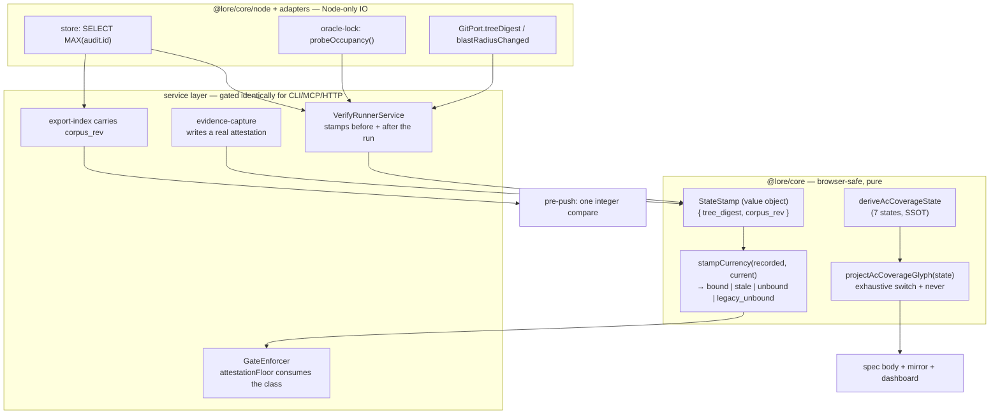
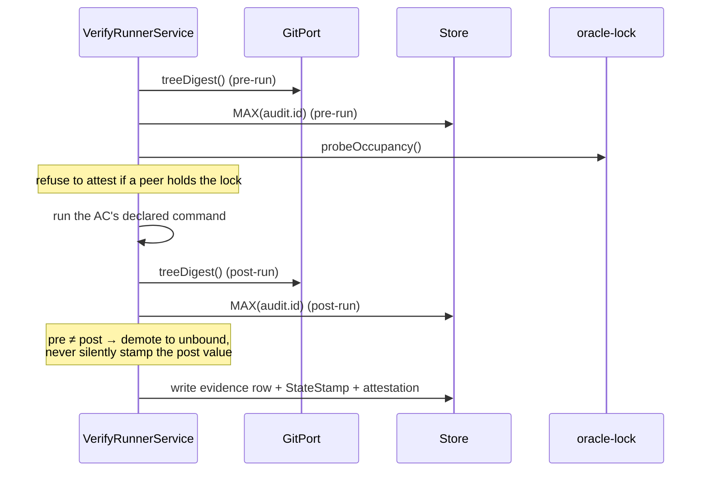

# Architecture: Corpus Truthfulness — a verdict must carry the state it describes, and a post-arming stamp-less record is never green

## Overview

`lore`'s north star is development executed ~100% by AI, ~90% of decisions made by AI, advancing unattended after the opening phase, with **many concurrent sessions on one checkout**. Once AI output outpaces human review, sampling stops scaling — 1% of ten times the output is still unreadable. The only check that scales is the corpus checking itself, which promotes the corpus from *a record of what happened* to *the single source of truth and the coordination mechanism between sessions*.

That promotion has a consequence the current design does not honour: **a verdict is an assertion about a state, but verdicts are stored with no reference to the state they describe.** Their validity therefore lives only in one agent's short-term memory, and when that agent ends, the verdict keeps reading as valid. Under concurrency this is not an edge case — measured in one session: a full-suite green anchored at `08091dfd` while `main` moved to `7ab1d742`; an attested `AC-OX-6` pass that a `lore done` invalidated 61 seconds later; a subagent misattributing 9 reddened tests as "pre-existing" because reproducing at the merge-base shares the same live DB.

This design makes state-binding a first-class, mechanically-checked property, and closes the six adjacent ways the corpus currently asserts falsehoods.

## Goals / Non-Goals

**Goals**

- G1. Every verdict-like record carries the identity of the state it was measured against.
- G2. A verdict whose state has moved is **distinguishable** from one whose state is current — in storage, in gates, and in every rendered projection.
- G3. A stamp-less record is classified against an **immutable arming cutoff** — `arming_rev`, the value of `MAX(audit.id)` captured once in the arming commit. A row written AFTER arming with no stamp can never satisfy a floor; a pre-arming row classifies `legacy_unbound` and is **ACCEPTED** by the floor exactly as today, so arming retro-fails nothing. Both are counted, never silently dropped. ⛔ The cutoff is an integer on an append-only, hash-chain-verified table, so it cannot be backdated or renumbered — that non-forgeability, not the extra class name, is what distinguishes this from a mintable grandfather clause. Governing decision: `adr-a-record-with-no-state-stamp-is-acceptable-but-never-green`.
- G4. Self-checking cost stays O(1) with respect to corpus size.
- G5. No new check can wedge an unattended loop.

**Non-Goals**

- N1. Not preventing all false verdicts — only preventing the corpus from *asserting* them as sound.
- N2. Not retro-invalidating the back-catalogue. Pre-existing rows migrate to a named legacy class, not to `fail`.
- N3. Not proving every gate's remediation hint correct (cut — see Trade-off D6).
- N4. Not converting `hooks/pre-push` into a full verification pass. Push-path cost is budgeted, not unbounded.

## Scope

**In scope — files this design touches**

| Layer | Path | Change |
|---|---|---|
| core (browser-safe) | `packages/core/src/task-workflow.ts` | `StateStamp` value object (optional on `attestation`) **and** the `ARMING_REV` constant |
| core (browser-safe) | `packages/core/src/acceptance.ts` | `projectAcCoverageGlyph` beside `deriveAcCoverageState` |
| service (pure) | `packages/lore/src/service/gate-predicates.ts` | `stampCurrency` predicate (four-valued) |
| service (pure) | `packages/lore/src/service/gate-predicates.ts` | blast-radius **resolver**: derives an AC's declared path set from its script-mode command target + the governing task's `file_anchors`; no declaration → `unmeasured`, and ANY member that fails to resolve to a concrete existing file → the WHOLE radius `unmeasured` (never `bound`, never narrowed to the members that did resolve — R3) |
| service | `packages/lore/src/service/checkpoint-registry.ts` | `attestationFloor` consumes all four classes — refuses `unbound`/`stale`, accepts `legacy_unbound`, counts every one |
| service | `packages/lore/src/service/outline-service.ts` | `acCoveragePrefix` delegates, stops re-deriving |
| adapter (Node IO) | `packages/lore/src/adapters/real-git-port.ts` | `blastRadiusChanged` |
| adapter | `packages/lore/src/adapters/cli/evidence-capture.ts` | write a real `attestation` from data already measured |
| script | `scripts/oracle-lock.ts` | export `probeOccupancy()` (read-only) |
| script (new) | `scripts/check-ac-state-renderers.ts` | site-scan ratchet |
| hook (twins) | `hooks/pre-push` + `assets/project/pre-push` | one integer compare; manifest regen required |
| corpus | `SPEC-038` AC-ACODE-9 | amended in the same commit as the renderer (D7) |

**Out of scope**

- Proving every gate remediation hint passes its own gate (D6 — cut; replaced by "hints are derived, not hand-authored").
- Retro-classifying pre-existing evidence rows as `fail` (N2 — they classify `legacy_unbound` and remain floor-acceptable).
- Global allocation of AC ids (D8 — qualified reference instead).
- Any change to `assessmentFreshness` itself; it is the reference shape, deliberately untouched.

## Acceptance Criteria

Prose summary; the machine-checkable set is declared structurally via `lore ac add` and is what `lore verify` executes. Every criterion below is script-mode with a declared falsifier, because an oracle never observed red has no demonstrated discriminating power.

- **AC-CT-1** — All 7 `deriveAcCoverageState` outputs project to 7 pairwise-distinct glyphs; adding an 8th state fails the TypeScript build via a `never` exhaustiveness check. The projection's GLOBAL UNIQUENESS is measured, not asserted: RULE 2 of C8's scan (`--rule glyph-projection`) refuses any function outside `acceptance.ts` satisfying BOTH a type-reference condition AND a glyph-yielding condition, the latter enumerated as exactly four forms (bare string literal, string-literal union return type, template literal with a glyph in its static parts, indexed read from an object/array literal holding one); the flag must itself be proven non-inert in both directions. ⛔ The conjunction is the mechanism — either condition alone over-matches into a 13-plus-entry allowlist (R2) — and the four forms are the rule's COMPLETE true-positive surface, so any other shape is a declared scan GAP rather than a silent pass (R7).
- **AC-CT-2** — Zero evidence rows carry `capture_source: "runner"` without an `attestation` block, asserted against a throwaway corpus by driving `evidence-capture` itself, not by inspecting the schema.
- **AC-CT-3** — THREE halves, all required: a stamp-less row **above** `arming_rev` is refused by `attestationFloor`; one **at or below** it is **ACCEPTED** by that same floor; both appear distinctly labelled in the `capture_source` distribution. ⛔ The accept half is the mandatory control — without it the criterion cannot distinguish this design from a blanket refusal, which would wedge every open plan on the arming commit.
- **AC-CT-4** — FOUR halves, all required: a peer commit **inside** the oracle's declared blast radius classifies `stale`; one **outside** it stays `bound`; a task `file_anchors` entry naming a DELETED path classifies `unmeasured`; a command target that is not a file path (package script name, glob, directory) classifies `unmeasured` — the last two each asserted against a live `bound` control in the same fixture. The radius is the AC's own declared paths — its script-mode command target plus the governing task's `file_anchors` — and an AC declaring none classifies `unmeasured`, never `bound`. ⛔ The "inside" half alone passes vacuously under an ancestry test (the defect D4 rejects), and the two `unmeasured` halves without their controls pass vacuously under a resolver that returns `unmeasured` for everything (R3).
- **AC-CT-5** — When the pre-run and post-run stamps differ, the row is demoted; the post-run value is never silently recorded as the measured state. ⛔ INJECTION SEAM PINNED: the state change MUST be a **real commit** in a throwaway repo landing between the two reads — a fake `GitPort` returning two differing digests proves only that the comparison executes, never that the runner reads the stamp where a concurrent write can actually land, and therefore does NOT satisfy this criterion.
- **AC-CT-6** — (a1) SIDE-EFFECT FREEDOM: ZERO writes to `docs/requirements/**` or `.lore/export-index.json`, by byte-equality before/after. (a2) SIZE-INDEPENDENCE, primary, measured by COUNTING not timing: the step is run against TWO throwaway corpora whose doc counts differ ≥100x through a counting store double, and the store-call count must be EQUAL across the two AND equal the declared constant 2. ⛔ Asserting only that the count is 2 does not measure size-independence — it never compares across sizes. (b) CONSTANT-FACTOR CEILING: one run against this repository's live corpus under **2s wall clock**, an order-of-magnitude bound whose only job is the degradation (a2) cannot see (a cost constant in size but huge). ⛔ (b) is a SMOKE BOUND, not a reproducible measure, and must never be cited as a performance number — it pins a threshold and a corpus but no machine and no run count (R7). ⛔ Both earlier timing forms are rejected and recorded: a bare single-sample `< 50ms`, then `p95 < 200ms over ≥20 runs` — the first flaps by machine load, the second pinned the corpus but still named no machine (R4).
- **AC-CT-7** — TWO rules in one scan, `--rule <name>` selecting exactly one and no flag running both. RULE 1 `fact-field-read` (owned here): no read of `.fail` / `.pass` off an `AcCoverageFact` outside `packages/core/src/acceptance.ts`, except written-reason allowlist entries. RULE 2 `glyph-projection` (owned and asserted by AC-CT-1): no second state-to-glyph projection. The scan exits 1 on violation and EXACTLY 2 when the scan itself cannot complete (R5).
- **AC-CT-8** — G5 gets an executing oracle: when the state-binding check cannot obtain a verdict it emits SKIPPED, writes exactly one audit row, and leaves the exit code EXACTLY EQUAL to the same fixture run with the check absent (asserted by running both, never by hard-coding 0). ⛔ Two further halves are mandatory: a LIVE CONTROL where releasing occupancy makes the SAME check produce a real verdict — without it an always-skip implementation passes while G5 holds in name only — and a USER-SURFACE assertion that spawns the real `lore status` and requires its stdout to contain the literal token `SKIPPED` on a line that ALSO names the skipped check — never a bare non-empty-output assertion — since an attested pass on the implementation layer is not evidence of production wiring (R6, tightened in R7).

## Quality Attribute Scenarios (ATAM-lite)

| ID | Stimulus | Response | Measure |
|---|---|---|---|
| QA-1 | Session A records an attested pass at HEAD X; session B lands a commit touching the oracle's blast radius; `lore done` runs | The pass is classified stale and cannot satisfy the attestation floor | `lore done` exits non-zero **naming** the stale row; a control where B's commit touches nothing in the blast radius still closes; and a third case whose radius cannot be resolved at all classifies `unmeasured` rather than `bound`, against a live `bound` control |
| QA-2 | Corpus grows, several sessions concurrent, pre-push fires | Verdict reached without rendering any doc, doing work **constant in corpus size** | Structural (primary): byte-equality of `docs/requirements` + `.lore/export-index.json` before/after, and a COUNTED store-call total that is equal across two corpora differing ≥100x in doc count and equals the declared constant 2 — never a doc enumeration, and never a timing proxy. Ceiling: one run under **2s wall clock** on this repository's live corpus, catching only a cost that is constant in size but huge |
| QA-3 | An AC accumulates `fail`, then a strictly-newer attested pass | Spec body and mirror distinguish it from a live failure | All 7 `deriveAcCoverageState` outputs render to 7 distinguishable glyphs; adding an 8th state fails the build; and C8's RULE 2 finds no second state-to-glyph projection anywhere outside `acceptance.ts`, so the distinction cannot be re-collapsed by a new call site |
| QA-4 | `lore evidence --capture` records a passing oracle run | The row is either genuinely attested or not labelled `runner` | Zero rows with `capture_source: "runner"` and no `attestation` block |
| QA-5 | The new check cannot obtain a verdict (peer occupancy, contended index) | It marks and continues; the loop does not stall | Check emits SKIPPED + exactly one audit row; exit code EQUAL to a check-absent control run; a following `lore status` surfaces the skip; and a live control where occupancy is released produces a real verdict, so an always-skip implementation cannot satisfy this. Asserted by AC-CT-8 (R6) |
| QA-6 | A stamp-less evidence row is read by a floor | Classified by the arming cutoff — post-arming → refused; pre-arming (`legacy_unbound`) → **accepted**, so nothing retro-fails | Both halves asserted separately, and both appear distinctly in `capture_source` distributions. ⛔ The accept half is the mandatory control: without it the criterion cannot tell this design from blanket refusal |

## Architecture

## Components

### C1. `StateStamp` — value object (`@lore/core`, browser-safe)

- **Responsibility**: name the state a verdict was measured against. Two coordinates, because code state and corpus state move independently: `tree_digest` (code) and `corpus_rev` (corpus).
- **Interface**: `{ tree_digest: string; corpus_rev: number; captured_at: string }`, present-iff-computed.
- **Why `corpus_rev` is free**: `audit.id` is already `INTEGER PRIMARY KEY AUTOINCREMENT` (measured at 6176). `SELECT MAX(id)` is a rightmost B-tree descent — microseconds, no process spawn, and the existing audit hash chain already commits content.
- **Why not mtime**: git rewrites mtimes; unusable as identity.
- **Dependencies**: none. No git, no store — it is data.

### C2. `stampCurrency` — pure predicate (`gate-predicates.ts`)

- **Responsibility**: three-valued comparison, shaped exactly like the proven `assessmentFreshness`: caller pre-resolves both sides, function does no IO.
- **Interface**: `stampCurrency(recorded: StateStamp | undefined, recordedAuditId: number, armingRev: number, current: StateStamp, blastRadiusChanged: boolean | "unmeasured") → { class: "bound" | "stale" | "unbound" | "legacy_unbound", reason?, field? }`
- **Invariant**: FOUR classes, not a boolean and not three. `unbound` (post-arming, no stamp) accepts at no floor. `legacy_unbound` (`recordedAuditId <= armingRev`) is accepted by every floor that accepts today, which is what makes arming non-retro-invalidating. Neither is silently dropped from counts.
- **`arming_rev` ownership**: a single exported constant, captured once as `MAX(audit.id)` in the arming commit and stored in `packages/core/src/task-workflow.ts` beside the `StateStamp` type. It is data, not a computation — nothing re-derives it, and a migration that loses it must fail loud rather than default to `0`.

### C3. `GitPort.blastRadiusChanged` (`real-git-port.ts`, Node-only)

- **Responsibility**: answer "did the code under test move", which is **not** ancestry. Measured: a peer's merge keeps your HEAD an ancestor while invalidating your verdict; `merge-base --is-ancestor` only catches rebase/reset.
- **Interface**: `blastRadiusChanged(recordedDigest, paths) → boolean | "unmeasured"`, i.e. `git diff --quiet <recorded> HEAD -- <paths>`.
- **Cost**: measured ~10.9ms per spawn. Affordable **per attestation**, ruinous per row (200 rows = 2.2s of pure fork) → memoize per distinct digest, 1-3 spawns per `lore done`.
- **Three-valued discipline**: `unmeasured` ≠ `changed`, matching the existing `BranchMeasurement` convention. It is also the RESOLUTION-FAILURE sink: if any member of the resolved path set is not a concrete existing file — a command target that is a package script name, a glob or a directory; a `file_anchors` entry naming a deleted path — the WHOLE radius is `unmeasured`, never `bound` and never narrowed to the members that resolved. The direction is fixed by consequence asymmetry, not preference: `bound` would certify a verdict whose radius was never compared, which is precisely the laundering this spec closes (R3).

### C4. `projectAcCoverageGlyph` (`acceptance.ts`, beside the derivation)

- **Responsibility**: the ONLY glyph projection. `switch` over all 7 states with a `never` exhaustiveness check, so an 8th state breaks the build instead of silently rendering as `·`. It also declares the glyph ALPHABET that C8's RULE 2 reads, so "only one projection" is a measured property rather than a claim.
- **Rejected alternative, named so it is not re-proposed**: a branded `AcCoverageGlyph` type whose sole producer is this function. ⛔ Zero discriminating power over `acCoveragePrefix`, which never names the type and returns a bare string-literal union — it would pass while the one measured defect stood (R2).
- **Replaces**: `outline-service.ts::acCoveragePrefix`, which re-derives from raw `fact.fail > 0` and collapses `fail` with `fail_superseded`. `deriveAcCoverageState`'s own JSDoc claims to be "the SINGLE precedence implementation this codebase uses" — that claim is currently false.
- **Guarded by**: C8 RULE 2 (`glyph-projection`) for uniqueness, and C8 RULE 1 (`fact-field-read`) for the raw-field reads that produced the original defect.

### C5. `evidence-capture` attestation completion

- **Responsibility**: stop labelling a row `capture_source: "runner"` without an `attestation` block. The adapter **already measures** `spawnResult.status`, `elapsedMs` and `timed_out` and simply never writes them.
- **Upstream effect**: `deriveAcCoverageState`'s `attested_pass` / `fail_superseded` branches are starved today precisely because captures never attest — so this partly fixes C4's inputs too.

### C6. Occupancy source: `oracle-lock.ts` → `probeOccupancy()`

- **Responsibility**: report **machine** occupancy (live pid holding the checkout-level lock), as opposed to `active_sessions`, which reports **intent** occupancy (claim leases with a TTL). Measured disagreement: `active_sessions` read EMPTY while the checkout was 15 minutes into `bun run test` and had rewritten the shared `dist/lore` 19 seconds earlier.
- **Why load-bearing**: without it, a verdict produced during a peer's suite run gets a cryptographically precise binding to a **corrupted observation** — worse than no binding, because it launders a bad verdict into an attested one.

### C7. `export-index` carries `corpus_rev`; pre-push compares integers

- **Responsibility**: make mirror convergence a push-path property costing one integer compare, not a 1524-file / 186MB-DB re-render (measured: bare read alone is 360ms warm; full render is orders above).
- **Cost is asserted by COUNTING, not timing**: exactly 2 store calls — one indexed `MAX(audit.id)` read plus one index-field read — and the count must be EQUAL across two corpora differing ≥100x in doc count. This is what makes size-independence a measured property instead of a timing proxy that moves with machine load (R4).
- **Contention**: reading `MAX(audit.id)` and an index field writes nothing, so it cannot dirty the tree it checks nor race the single shared `.lore/export-index.json` — the objection that killed the naive formulation.
- **Repair path**: on mismatch, re-render only docs named by `audit(doc_id)` rows above the recorded rev.

### C8. Renderer site-scan ratchet (`scripts/check-ac-state-renderers.ts`)

- **Responsibility**: TWO rules, with `--rule <name>` selecting exactly one and no flag running both. RULE 1 `fact-field-read`: refuse any read of `.fail` / `.pass` off an `AcCoverageFact` outside `acceptance.ts`. RULE 2 `glyph-projection`: refuse any second state-to-glyph projection — any function outside `acceptance.ts` that BOTH names `AcCoverageFact` or `AcCoverageState` in its signature or a local type annotation AND yields a glyph from C4's declared alphabet by one of FOUR enumerated forms: a bare string literal, a string-literal union return type, a template literal whose static parts contain a glyph, or an indexed read from an object or array literal holding one. ⛔ Those four are the COMPLETE true-positive surface; a fifth shape (dynamic construction, re-export) is a scan GAP the scan must REPORT, never silently pass (R7). Allowlist-by-file with written reasons, on the established `check-plan-membership-sites.ts` / `check-anchor-coverage.ts` template (exit 1 = violation, exit EXACTLY 2 = scan broke).
- **Why the RULE 2 conjunction, and why neither condition alone**: measured on this repository 2026-08-19, the glyph-literal condition alone matches 15 non-test source files that render those characters for unrelated reasons, and the type-reference condition alone matches 17 that legitimately consume the state names. Either alone needs a 13-plus-entry allowlist, which dilutes the rule to nothing; the conjunction matches the one real instance, `outline-service.ts::acCoveragePrefix` (R2).
- **The selector must be proven non-inert**: AC-CT-1 asserts `--rule glyph-projection` exits EXACTLY 1 on a rule-2-only violation and EXACTLY 0 on a rule-1-only violation. A silently-inert flag is this project's fifth measured false-oracle vector, so a flag that selects nothing must not be able to read as green.
- **Why a scan, not a test**: a test asserting "the badge is right" pins today's four call sites; a site scan refuses the fifth.

## Data Flow — one attested verify run

⛔ The pre/post pair is not decoration: the recorded HEAD is captured by the *writer* after the runner finished, so without it a peer merge landing mid-run yields a stamp naming a state the oracle never actually ran against.

## Trade-off Decisions

| ID | Decision | Choice | Rationale | Trade-off | Dissenting view |
|---|---|---|---|---|---|
| D1 | Missing state stamp: pass or refuse? | **Neither — a third class `unbound`, acceptable but never green** | Refusal retro-invalidates the back-catalogue in one commit and wedges every plan at once (ops). Vacuous pass makes *producing absent data* the cheapest path to green (security). A distinct class satisfies both; `not_measured` is the existing precedent | Guarantee weakens to "cannot assert soundness *where it measured*" | Security wanted hard refusal with a migration-cutoff grandfather |
| D2 | Stale detection: block or degrade? | **Degrade at evidence-write; block at plan-close** | A blocking check firing on peer contention converts a concurrency event into a permanently stuck loop that cannot self-clear — clearing needs touching a peer's uncommitted files or rebuilding shared `dist/` under a running peer (G5) | A stale verdict lives in the corpus for a window | Security: any window is exploitable |
| D3 | Is the degrade mark load-bearing on day one? | **Yes — mandatory, not phase 2** | A trust class nothing consumes is defect C5 rebuilt deliberately. Sinks already exist: `attestationFloor` and the `capture_source` distributions in `assess-render.ts` / `status.ts` | Couples this slice to those consumers | none |
| D4 | Staleness test: ancestry or blast radius? | **Blast radius (`git diff --quiet <recorded> HEAD -- <paths>`)** | ⛔ Ancestry reads GREEN through the exact failure measured here: a peer's merge *keeps* your HEAD an ancestor while invalidating your verdict. Ancestry catches only rebase/reset | Over-reports on cosmetic peer commits inside the radius | Perf preferred memoized ancestry as cheaper; accepted because over-reporting into a *degrade* path is cheap |
| D5 | Mirror convergence on the push path? | **Yes, but as one integer compare (C7)** | The naive form (run export, diff) writes the tree it checks and races the shared index → flaps under two sessions, and a flapping gate trains the loop to `--no-verify`. The integer form writes nothing | Detects rev mismatch, not hand-doctored file content; that needs a periodic full sweep | Cost angle wanted it off the push path entirely, behind `lore status --check-*` |
| D6 | Prove every gate hint passes its own gate? | **Cut. Replace with: hints must be DERIVED from the predicate's own inputs, never hand-authored** | A cross-product over 7 checkpoints × 4 floors cannot be discharged once and re-breaks on every message edit | Hints can still be stale or unhelpful | none — all angles agreed to cut |
| D7 | Amend AC-ACODE-9 when fixing the renderer? | **Yes, same commit, mechanically forced** | `outline-service.ts`'s JSDoc claims it "mirrors AC-ACODE-9 exactly". Fix the renderer alone and `SPEC-038:130` becomes the falsehood — and the newly-wired mirror check would enshrine it. Matches the standing rule that fixing a gap and updating the note recording it are one acceptance unit | Drags an older AC into the slice | Cost angle: the JSDoc sentence is not a dependency, just delete it |
| D8 | AC id identity | **Qualified reference `(spec_ordinal, ac_id)` on `ac_ref`; NOT global allocation** | AC ids are legitimately spec-local section numbering and authors renumber freely in draft. But `ac_ref` crosses a document boundary, so it must carry the qualifier. SPEC-084 ordinals are already corpus-allocated and stable | Prose references stay ambiguous unless a check resolves them | Domain angle proposed also refusing ambiguous bare `AC-*` at write time |

## Revision Records

In-flight AC revisions, recorded rather than excused. Each entry states the prior form, the exact defect that form produced, and why the change is a correction rather than a weakening. ⛔ The pattern itself is the risk: "AC red → edit AC → green" and "concealed failure" are indistinguishable in an audit no matter how sound each individual edit was, so visibility is the only remedy. Measured precedent — a round in which 3 of 11 criteria were revised mid-flight, all three justifiably, and `lore assess` still pushed `evidence_integrity` from 86 to 68 on the pattern alone. It was right to.

### R1 — AC-CT-3, 2026-08-17: "`unbound` satisfies no floor" → classified by an immutable `arming_rev` cutoff

- **Prior form**: asserted only that a stamp-less row satisfies NO attestation floor.
- **Exact defect**: the spec-promote review judge ESCALATED the governing ADR with a blocking question that was correct — if every legacy row reads `unbound` and `unbound` satisfies no floor, then arming retro-refuses every plan consuming a legacy attestation, which is the exact outcome D1 used to reject hard refusal. G3 contradicted N2.
- **Why a correction**: it ADDS an assertion — half (2), the accept control — and pins the cutoff to an append-only, hash-chain-verified integer that no agent can backdate or renumber. A timestamp cutoff would have been mintable by choosing when to write.

### R2 — AC-CT-1, 2026-08-19: a global-uniqueness claim asserted by nothing → RULE 2 of the site scan

- **Prior form**: "the projection is the ONLY one in the codebase" — a whole-repository property with no oracle naming it, appearing to lean on AC-CT-7.
- **Exact defect**: AC-CT-7's scan is scoped to `.fail` / `.pass` field reads off an `AcCoverageFact`. A second `switch` mapping seven states to glyphs WITHOUT touching those fields would have passed BOTH criteria while re-introducing the exact divergence this slice exists to remove. Non-blocking advisory, spec-promote review judge, approve @ 0.74; recorded in `knowledge-a-declared-property-with-no-measuring-oracle-and-the`.
- **Why a correction**: it adds an oracle to a clause that had none. No assertion was removed or loosened.
- **Mechanism, with the rejected alternative named so it is not re-proposed**: RULE 2 is a CONJUNCTION of a type-reference condition and a glyph-literal condition. Measured on this repository 2026-08-19 — the glyph-literal condition alone matches 15 non-test source files (`setup-render.ts`, `SessionsPanel.tsx`, `IssuesList.tsx`, and 12 more) that render those characters for unrelated reasons; the type-reference condition alone matches 17 source files that legitimately consume the seven state names. Either alone would need a 13-plus-entry allowlist, diluting the rule to nothing. ⛔ A branded `AcCoverageGlyph` type whose only producer is `projectAcCoverageGlyph` was considered and REJECTED: zero discriminating power over `acCoveragePrefix`, which never names the type and returns a bare string-literal union — it would have passed while the sole measured defect stood.

### R3 — AC-CT-4, 2026-08-19: an unresolvable radius had no classification → `unmeasured`, with live controls

- **Prior form**: pinned the radius resolution RULE (script-mode command target plus the governing task's `file_anchors`) and classified a MISSING declaration as `unmeasured`, but left resolution FAILURES unclassified.
- **Exact defect**: a command target resolving to a package script name, a glob or a directory, and a `file_anchors` entry naming a deleted path, were all implementer discretion — and the two available answers carry OPPOSITE safety consequences, since `bound` silently certifies a verdict whose radius was never compared. Same advisory source as R2.
- **Why a correction**: it adds two assertion halves — (c) and (d) — plus a live `bound` control for each, and removes implementer discretion over a safety direction. Nothing was relaxed. The controls are not decoration: without them both halves pass vacuously under a resolver that returns `unmeasured` for everything.

### R4 — AC-CT-6, 2026-08-19: `p95 < 200ms` replaced by a counted size-independence assertion plus a loose ceiling

- **Prior forms, in order**: (i) a bare single-sample `< 50ms` wall clock; (ii) `p95 < 200ms` over ≥20 consecutive runs against this repository's live corpus.
- **Exact defects**: (i) a tight single-sample threshold on a git hook passes on an idle machine and fails on a loaded one — the flapping-gate mode this criterion's own rationale says trains an unattended loop toward `--no-verify`. (ii) survived that objection only one level deep: it pinned the corpus fixture but named no machine and no load, so the number stayed environment-dependent. Separately and more seriously, the size-independence clause named a property with NO measuring oracle at all — byte-equality before/after covers side-effect FREEDOM, not work PERFORMED — so "constant in corpus size" was implementer discretion between counted store calls, a query log, or a two-fixture timing comparison. Same advisory source as R2.
- **Why a correction**: the asymptotic property that the p95 number was only ever a proxy for is now measured DIRECTLY and deterministically, by comparing store-call counts across two corpora differing ≥100x in doc count — zero timing, so peer load cannot move it. The 2s ceiling retains discriminating power over the one failure mode counting cannot see: a cost constant in corpus size but huge, such as a fixed sleep or a synchronous network call. Net: two oracles that cannot flap replace one that could, and a clause that had no oracle now has one.

### R5 — AC-CT-7, 2026-08-19: a single-rule scan → two named rules with a `--rule` selector

- **Prior form**: described one scan rule (`.fail` / `.pass` field reads).
- **Exact defect**: AC-CT-1's uniqueness clause needs a SECOND rule in the same scan (R2). An implementer reading AC-CT-7 alone would have built rule 1 only, leaving AC-CT-1's `--rule glyph-projection` invocation pointed at a flag that does not exist — a red that reads as an environment problem rather than as missing scope.
- **Why a correction**: it adds scope. ⛔ It also adds an obligation on AC-CT-1: `--rule glyph-projection` must exit EXACTLY 1 on a rule-2-only violation and EXACTLY 0 on a rule-1-only violation, because a silently-inert CLI flag is this project's fifth measured false-oracle vector — without both directions the flag could select nothing and the criterion would read green on a scan that never ran.

### R6 — AC-CT-8, 2026-08-19: G5 was a goal with no asserting criterion → a new AC with a live control

- **Prior form**: G5 ("No new check can wedge an unattended loop") was declared as a goal and measured only by QA-5. No acceptance criterion asserted it.
- **Exact defect**: C6's degradation path — emit SKIPPED, write an audit row, leave the exit code unchanged, surface the skip in `lore status` — carried a stated Measure column and NO executing oracle. `lore assess` cannot score a goal that no AC covers, so the property most load-bearing for unattended operation was the one property nothing would have run. Non-blocking completeness finding, review judge, approve @ 0.78.
- **Why a correction**: it adds a criterion; nothing was removed or relaxed. Two design points are deliberate. (i) Half (a) compares the exit code against the SAME fixture run with the check ABSENT rather than hard-coding 0 — other pre-push checks may legitimately fail, and a hard-coded 0 would redden this criterion for reasons unrelated to G5. (ii) Half (b) is a LIVE CONTROL and is the load-bearing half: an implementation that always returns SKIPPED satisfies (a) perfectly while honouring G5 in name only. ⛔ That is the same vacuous-pass shape as AC-CT-3 half (2) and AC-CT-4 halves (c)/(d) — the third occurrence in this one spec — which says the explicit control is not optional rigour but a structural requirement of every three-valued classification this spec introduces.

### R7 — AC-CT-1 / CT-6 / CT-8, 2026-08-19: three under-specified pass conditions pinned

Three non-blocking `ac_quantifiability` advisories from the review that followed R2–R6 (approve @ 0.84). All three are the SAME defect this spec's earlier revisions exist to close — a named oracle whose pass condition was still implementer discretion — so they are recorded here rather than deferred.

- **AC-CT-1, RULE 2 condition (ii)**. Prior form: "returns or produces a string literal from the glyph alphabet". Exact defect: "produces" was undefined against concrete cases (template interpolation, table lookup, indirect construction, re-export), leaving the rule's true-positive boundary under-specified relative to condition (i), which was crisply defined as a signature or local type annotation. Two implementations could both claim compliance while scanning materially different surfaces. Correction: four ENUMERATED forms, declared as the COMPLETE true-positive surface, with any fifth shape defined as a scan GAP the scan must report rather than silently pass. This adds precision; it removes no coverage.
- **AC-CT-6, half (b)**. Prior form: "one run under 2s wall clock" presented alongside (a1)/(a2) as if all three were equally reproducible. Exact defect: it pins a threshold and a corpus but no machine and no run count, so a single sample can flap on a loaded host — the same environment-dependence R4 rejected in the p95 form, surviving one level deeper. Correction: (b) is now LABELLED a smoke bound that must never be cited as a performance number. ⛔ The threshold itself is deliberately unchanged: the honest fix is to stop overselling what (b) measures, not to add run counts that would re-import the flapping R4 removed. (a2) remains the reproducible half.
- **AC-CT-8, half (c)**. Prior form: spawn the real `lore status` and "match its stdout". Exact defect: the oracle named the right layer — a real process, real stdout — but declared no string, token or pattern, so its pass condition was implementer invention and a bare non-empty-output assertion would have satisfied it. Correction: stdout must contain the literal token `SKIPPED` on a line that ALSO names the skipped check, and a bare non-empty assertion is explicitly refused.

⛔ Standing observation from this round, recorded because the pattern is the finding: R2, R4, R6 and now R7 are all one defect class — **a criterion that names a property or an oracle without naming the condition that decides it**. Four occurrences in one spec, each caught by the review judge and none by the author, says the class is not an attention failure. It is what an AC looks like when written by a producer who already knows what they meant.

### Falsifier debt on this spec, declared rather than hidden

EVERY criterion on this spec carries its falsifier as PROSE ("MANDATORY FALSIFIER once implemented"), not as structured `--falsifier-*` fields. This is not author laziness: `--falsifier-find` requires the literal find-text to be on disk at declaration time, while red-first requires the AC to precede the implementation. For any AC authored before its code the two requirements are mutually exclusive. ⛔ Nothing currently forces these deferrals to be redeemed, which makes each one the TODO shape this project's discipline forbids, and there is no query that counts them corpus-wide. The mechanism that would close it does not exist and needs its own spec — `knowledge-a-declared-property-with-no-measuring-oracle-and-the` carries the two candidate designs and why `--falsifier-deferred <reason>` is the better one.

## Risk Registry

| Risk | Severity | Mitigation | Owner |
|---|---|---|---|
| Blocking floor deadlocks an unattended loop with no operator | **High** | D2 (degrade at write, block only at plan-close); D1's `unbound` class never blocks by itself | this spec |
| Verdict bound to a corrupted observation (peer mid-`bun run test`, shared `dist/lore` rewritten under us) — launders a bad verdict into attested | **High** | C6: refuse to attest while a peer holds the checkout lock; extend the lock to cover `bun run build` | this spec |
| Ancestry chosen as the staleness test → silently green through the measured failure | **High** | D4 | this spec |
| Renderer fixed without amending AC-ACODE-9 → corpus asserts a falsehood the mirror check then enshrines | Medium | D7 + C8 ratchet | this spec |
| `hooks/pre-push` edited without regenerating the assets manifest (byte-identical twin `assets/project/pre-push`) | Medium | Existing `pre-push-parity.test.ts` + manifest regen in the same commit; third-party copies need the `[ -f … ] && command -v bun` presence guard, never `\|\| exit 0` | implementer |
| `attestation` grows into a grab-bag as the stamp is denormalized onto every row | Low | Accepted (see D1 dissent); a normalized basis table would reintroduce a nullable join, which is the failure mode itself | domain |
| Site-scan false-positives — RULE 1 on legitimate aggregation reads of `fact.pass`, RULE 2 on a helper that both names the fact type and returns an unrelated glyph string | Low | Allowlist-by-file with written reasons; each waiver widens the blind spot and must say so. RULE 2's two-condition conjunction is itself the primary false-positive control: measured, either condition alone would have needed a 13-plus-entry allowlist (R2) | implementer |

## Migration Plan

**Phase 1 — honest labels (no schema change, no new concepts)**
1. C5: `evidence-capture` writes a real `attestation` from data it already measures. Rollback: revert one adapter file.
2. C4 + D7: `projectAcCoverageGlyph` with `never` exhaustiveness; amend AC-ACODE-9 in the same commit. Rollback: revert; no stored data changed.
3. C8: renderer site-scan ratchet wired into `bun run test`. Rollback: delete the script + its allowlist.

**Phase 2 — the stamp (additive, optional field)**
4. C1 + C2: `StateStamp` type, the `ARMING_REV` constant (captured in this very commit as `MAX(audit.id)`), and the four-valued `stampCurrency`. The stamp field is **optional**, and every pre-existing row sits below the cutoff, so it classifies `legacy_unbound` and is accepted — nothing retro-fails (N2). Rollback: field unread, constant unreferenced.
5. C3 + C6: `GitPort.blastRadiusChanged`, `probeOccupancy()`; `VerifyRunnerService` stamps pre/post. ⛔ Includes the SKIPPED-and-continue contract AC-CT-8 asserts — emit SKIPPED, write one audit row, leave the exit code identical to a check-absent control, surface the skip in `lore status`, and still produce a real verdict once occupancy releases. A `probeOccupancy` that always skips satisfies the first four and defeats G5, so the live control is part of this step, not a later hardening.
6. D3: route the `unbound` / `stale` classes into `attestationFloor` and the `capture_source` distributions. ⛔ Phase 2 is not done without this step — that is the difference between a mechanism and a metadata field.

**Phase 3 — push-path convergence**
7. C7: `corpus_rev` in the export index; pre-push integer compare, **advisory-first** (warn + audit row for N observed clean runs, recording the calibration base commit) before arming. Rollback: remove the hook step in both twins + regen manifest.

**Phase 4 — addressability**
8. D8: qualified `ac_ref`; corpus-wide check that a bare `AC-*` resolves within its enclosing spec.

## Cross-Cutting Concerns

- **Security (integrity, not network)**: the adversary is an agent under pressure to make a gate pass. Escape hatches must be *more expensive than compliance*: typed `kind` enum rather than free prose (the existing `attestationExemptKindSchema` pattern), bound to a specific state stamp so an override dies when the state moves, **visible in the projection** so the next session sees the debt, and budgeted per plan. ⛔ Note the measured correction: `LORE_GATE_BYPASS=1` is scoped to the `lore gate` command alone and does **not** affect `GateEnforcer.enforce` in the service layer (CLI/MCP/HTTP all route through the latter), and it writes a `gate_skipped` audit row — an earlier draft of this analysis overstated it as a silent global kill switch.
- **Performance**: budget is QA-2 — size-independence asserted by COUNTED store calls, equal across two corpora differing >=100x in doc count and equal to the declared constant 2, plus a loose 2s wall-clock ceiling for the constant-but-huge case. ⛔ Both timing-first forms were rejected and recorded in R4: a single-sample < 50ms flaps by machine load, and p95 < 200ms over >=20 runs pinned the corpus but never the machine. Achieved by stamping once and comparing scalars — gates never recompute. Watch C4's `isSupersededByNewerAttestedPass`, which is O(|refs|) per AC per spec inside the export render path.
- **Observability**: `unbound` / `stale` / SKIPPED must each appear in `lore status` and in the `capture_source` distribution; a `--no-verify` push should itself leave a corpus row so the escape is visible in `lore audit`.
- **Data privacy**: n/a — local-first, no PII in scope.

## Downstream Handoff

**To `implement`**: C1/C2 signatures above are normative TypeScript. `@lore/core` must stay browser-safe — the stamp *type* and the *comparison* live there; all git IO lives in `real-git-port.ts` / `@lore/core/node` and is passed **pre-resolved**, exactly as `getAssessmentFreshness` does today. `hooks/pre-push` and `assets/project/pre-push` are byte-identical twins; edit both and regenerate the manifest.

**To `test`**: invariants — (i) 7 states → 7 distinguishable glyphs, 8th breaks the build; (ii) zero rows with `capture_source: "runner"` and no attestation; (iii) `unbound` satisfies no floor; (iv) a peer commit **inside** the blast radius reds QA-1 while one **outside** it does not (this pair is the discriminating test — one half alone passes vacuously); (v) pre/post stamp mismatch demotes rather than stamps the post value. Every script-mode AC carries `--falsifier-path/--find/--replace/--exit-code`.

**To `deploy`**: no infra. Phase 3 touches a git hook; consumers activate via `git config core.hooksPath hooks`.

## Quality Gate Checklist (architecture mode)

- [x] **Every NFR has an architectural response with a measurable target** — QA-1…QA-6, each with a Measure column; the push-path budget is a DETERMINISTIC counted assertion (equal store-call totals across two corpora differing >=100x in doc count, equal to the constant 2) plus a loose 2s ceiling, replacing the environment-dependent p95 form (R4).
- [x] **All tension points have a decision + rationale** — D1…D8, each carrying the dissenting view rather than hiding it.
- [x] **High-severity risks have mitigations** — three High rows, each mapped to a specific decision or component.
- [x] **Migration phases defined with rollback** — four phases, rollback named per step; Phase 2 additive-optional so the back-catalogue never retro-fails.

## Acceptance Criteria (structured)

- [·] [script] AC-CT-1: RENDERING IS INJECTIVE AND ITS GLOBAL UNIQUENESS IS MEASURED, NOT ASSERTED. All seven states `deriveAcCoverageState` returns project to seven PAIRWISE-DISTINCT glyphs, asserted by enumerating all seven and comparing the glyph set size to 7, not spot-checking two. An eighth state MUST fail the TypeScript build via a `never` exhaustiveness check, asserted by a compile-failure fixture, not prose. UNIQUENESS ORACLE, previously asserted by nothing: RULE 2 of `scripts/check-ac-state-renderers.ts`, invoked as `--rule glyph-projection`, refuses any function outside `packages/core/src/acceptance.ts` and its written-reason allowlist satisfying BOTH (i) it names `AcCoverageFact` or `AcCoverageState` in its signature or a local type annotation, AND (ii) it yields a glyph from the alphabet `projectAcCoverageGlyph` declares, by ANY of four ENUMERATED forms — a bare string literal, a string-literal union return type, a template literal whose static parts contain a glyph, or an indexed read from an object or array literal holding one — exiting EXACTLY 1 naming that function. Those four are the COMPLETE true-positive surface: a form outside them (dynamic construction, re-export) is a scan GAP to report, not to pass. BOTH conditions mandatory: measured 2026-08-19, (ii) alone hits 15 unrelated sources and (i) alone hits 17, so either alone needs a 13-plus-entry allowlist that dilutes the rule; the conjunction catches the one real instance, `acCoveragePrefix` (R2). THE FLAG MUST BE NON-INERT: `--rule glyph-projection` exits EXACTLY 1 on a rule-2-only violation and EXACTLY 0 on a rule-1-only one. REVISION 2026-08-19: uniqueness had no oracle and appeared to lean on AC-CT-7, whose scan covers only `.fail`/`.pass` reads; a CORRECTION adding an oracle where none existed (R2). MANDATORY FALSIFIERS once the symbols exist: (a) make two switch arms return the same glyph, exit EXACTLY 1; (b) add a non-allowlisted function taking an `AcCoverageFact` and returning a glyph, exit EXACTLY 1.
  script: test — bunx vitest run packages/core/tests/unit/ac-coverage-glyph.test.ts 2>&1 && bun scripts/check-ac-state-renderers.ts --rule glyph-projection 2>&1 && echo "AC-CT-1 PASS: seven coverage states project to seven pairwise-distinct glyphs through a single exhaustive projection, an unhandled state is a compile error, and rule 2 of the renderer site scan finds no second projection outside acceptance.ts"
- [·] [script] AC-CT-2: NO FALSE TRUST LABEL. Zero evidence rows may carry capture_source runner without an attestation block. Asserted on a THROWAWAY corpus by DRIVING evidence-capture itself end to end (production wiring, not a schema inspection and not a grep): record a passing oracle run through the real capture path, then read the stored row back and assert attestation is present with an exit_code. Measured defect 2026-08-17: an implementer sincerely reported its pass as attested because the row said runner; it had no attestation block and no second source to catch that with. The adapter ALREADY measures spawnResult.status, elapsedMs and timed_out and simply never writes them, so this is a write-through fix, not new measurement. MANDATORY FALSIFIER once implemented: delete the attestation write while leaving the runner label in place, and assert the command exits EXACTLY 1.
  script: test — bunx vitest run packages/lore/tests/unit/adapters/evidence-capture-attestation.test.ts 2>&1 && echo "AC-CT-2 PASS: a runner-labelled row written through the real evidence-capture path carries an attestation block with a measured exit code"
- [·] [script] AC-CT-3: A STAMP-LESS RECORD IS CLASSIFIED BY AN IMMUTABLE CUTOFF, AND THE CONTROL HALF IS MANDATORY. stampCurrency returns bound, stale, unbound or legacy_unbound. Classification uses arming_rev — the value of MAX(id) FROM audit captured once in the arming commit and stored as a constant. Asserted on a throwaway corpus, THREE halves, separately: (1) a stamp-less row whose audit.id is ABOVE arming_rev is REFUSED by attestationFloor; (2) a stamp-less row whose audit.id is at or BELOW arming_rev is ACCEPTED by that same floor; (3) both appear, distinctly labelled, in the capture_source distribution rather than being silently dropped. ⛔ Half (2) is the CONTROL and is not optional: without it this criterion cannot distinguish this design from a blanket refusal, and a blanket refusal wedges every open plan on the arming commit with no operator awake to clear it. REVISION RECORD 2026-08-17, in-flight, before any evidence existed: an earlier form asserted only that unbound satisfies NO floor. The spec-promote review judge ESCALATED the governing ADR with a blocking question that was correct — if every legacy row reads unbound and unbound satisfies no floor, then arming retro-refuses every plan consuming a legacy attestation, which is the exact outcome used to reject hard refusal. This is a CORRECTION, not a weakening: it adds an assertion (half 2) and pins the cutoff to an append-only, hash-chain-verified integer that an agent cannot backdate or renumber, where a timestamp cutoff would have been mintable by choosing when to write. MANDATORY FALSIFIERS once implemented, two of them: (a) make stampCurrency return bound for an undefined recorded stamp, command must exit EXACTLY 1; (b) set arming_rev to 0 so every legacy row reclassifies as unbound, and the same command must exit EXACTLY 1 on half (2).
  script: test — bunx vitest run packages/lore/tests/unit/service/stamp-currency-floor.test.ts 2>&1 && echo "AC-CT-3 PASS: a stamp-less row above the arming cutoff is refused by attestationFloor, one at or below it is accepted, and both are distinctly labelled in the capture_source distribution"
- [·] [script] AC-CT-4: THE DISCRIMINATING PAIR: staleness is measured by BLAST RADIUS, not ancestry, AND AN UNRESOLVABLE RADIUS IS CLASSIFIED, NEVER GUESSED. RADIUS DEFINITION, pinned so no half needs implementer invention: the AC's script-mode command target plus the governing task's `file_anchors`; an AC declaring NO radius classifies `unmeasured`, never `bound`, matching the git port's three-valued rule (C3). RESOLUTION-FAILURE RULE, previously unclassified: if ANY member of the resolved path set does not resolve to a concrete existing file, the WHOLE radius classifies `unmeasured`, never `bound` and never silently narrowed to those that did resolve (direction fixed by consequence asymmetry; see Revision Records). On a throwaway git repo, FOUR halves, all required: (a) a peer commit touching a path INSIDE the declared radius classifies the earlier verdict `stale`; (b) a peer commit touching ONLY paths outside it leaves that verdict `bound`; (c) an AC whose task `file_anchors` name a DELETED path classifies `unmeasured`, with a live control in the same fixture, a sibling AC whose anchors all exist still classifying `bound`, so it cannot pass by the resolver failing all; (d) an AC whose command target is not a file path, a package script name, glob, or directory, classifies `unmeasured`, same control. (a) alone passes vacuously under ancestry; (c)/(d) without controls pass vacuously under a resolver returning `unmeasured` always. Implementation MUST be `git diff --quiet <recorded HEAD> HEAD -- <paths>` (D4). REVISION 2026-08-19, in-flight, pre-evidence: the resolution-failure rule and halves (c)/(d) are new, a CORRECTION adding two halves plus two controls; full record in Revision Records. MANDATORY FALSIFIERS once implemented: (a) swap the diff for `merge-base --is-ancestor`, exit EXACTLY 1, noting (b) still passes under ancestry while (a) breaks, so asserting only (a) would have accepted the rejected design; (b) map an unresolvable member to `bound`, exit EXACTLY 1 on (c) and (d).
  script: test — bunx vitest run packages/lore/tests/unit/adapters/blast-radius-staleness.test.ts 2>&1 && echo "AC-CT-4 PASS: a peer commit inside the declared blast radius makes the verdict stale, one outside it stays bound, an AC declaring no radius classifies unmeasured, and an unresolvable radius member (deleted anchor or non-path command target) classifies the whole radius unmeasured against a live bound control"
- [·] [script] AC-CT-5: A STAMP NAMES THE STATE THE ORACLE ACTUALLY RAN AGAINST, AND THE SEAM IS ASSERTED WHERE THE RUNNER READS IT. The runner captures the state stamp BEFORE the command and re-reads it AFTER; when the two differ the row is demoted, and the post-run value is NEVER silently recorded as the measured state. INJECTION SEAM PINNED (the review judge correctly noted three candidate seams prove different things): the state change MUST be injected as a REAL COMMIT in a throwaway git repo landing between the two reads — ⛔ a fake GitPort returning two different digests proves only that the comparison executes, never that VerifyRunnerService reads the stamp at the seam where a concurrent write can actually land. A fake-port test alone does NOT satisfy this criterion. Rationale: the recorded HEAD is written by the WRITER after the runner finished, so without the pre/post pair a peer merge landing mid-run yields a stamp naming a state the oracle never ran against — worse than no stamp, because it launders an unsound observation into an attested one. MANDATORY FALSIFIER once implemented: record only the post-run stamp, dropping the comparison, and assert the command exits EXACTLY 1.
  script: test — bunx vitest run packages/lore/tests/unit/service/stamp-pre-post-demotion.test.ts 2>&1 && echo "AC-CT-5 PASS: a real commit landing between the pre-run and post-run stamp reads demotes the row instead of recording the post-run value"
- [·] [script] AC-CT-6: THE PUSH PATH STAYS SIDE-EFFECT FREE, ITS ASYMPTOTIC COST IS MEASURED DETERMINISTICALLY, AND NEITHER ASSERTION CAN FLAP. (a1) SIDE-EFFECT FREEDOM: the mirror-convergence step decides by comparing the export index's recorded `corpus_rev` against `SELECT MAX(id) FROM audit` and RENDERS NOTHING, asserted by hashing `docs/requirements` and `.lore/export-index.json` before and after and requiring byte equality. (a2) SIZE-INDEPENDENCE, PRIMARY, measured by COUNTING not timing, the half that previously named a property with no measuring oracle: run the step against TWO throwaway corpora whose doc counts differ by at least 100x, for example 3 and 300, through a COUNTING store double, and assert the store-call count is EQUAL across the two AND equals the declared constant 2, one indexed `MAX(audit.id)` read plus one index-field read, never a doc enumeration. Asserting only that the count is 2 does NOT measure size-independence: it never compares across sizes and stays green under one that enumerates only above a threshold. BOTH corpora required. (b) CONSTANT-FACTOR CEILING, an order-of-magnitude bound not a tight percentile: one run against this repository's live corpus completes under 2s wall clock. Its ONLY job is the degradation (a2) cannot see, a cost constant in size but huge such as a fixed sleep. (b) IS A SMOKE BOUND, NOT A REPRODUCIBLE MEASURE, and must never be cited as a performance number: it pins a threshold and a corpus but no machine and no run count, so a single sample can flap on a loaded host. It is sound only because it sits about 10x above any plausible honest value and because (a2) carries the reproducible half. THREE corrections recorded in R4: single-sample `< 50ms`, then `p95 < 200ms`, now replaced. MANDATORY FALSIFIERS once implemented: (a1) replace the integer compare with a real export invocation, exit EXACTLY 1; (a2) make the step enumerate docs so the two counts diverge, exit EXACTLY 1; (b) insert a 3s sleep, exit EXACTLY 1.
  script: test — bunx vitest run packages/lore/tests/unit/hooks/pre-push-mirror-rev.test.ts 2>&1 && echo "AC-CT-6 PASS: the convergence step leaves docs/requirements and the export index byte-identical, issues an equal and constant 2 store calls against corpora differing 100x in doc count, and completes one run on this repo live corpus under 2s"
- [·] [script] AC-CT-7: NO SECOND DERIVATION MAY BE ADDED — TWO RULES IN ONE SCAN. `scripts/check-ac-state-renderers.ts` carries TWO rules, with `--rule <name>` selecting exactly one and no flag running both. RULE 1, `fact-field-read`, owned and asserted by this criterion: refuse any read of `.fail` or `.pass` off an `AcCoverageFact` outside `packages/core/src/acceptance.ts`, allowlist-by-file with a written reason per entry. RULE 2, `glyph-projection`, owned and asserted by AC-CT-1: refuse any second state-to-glyph projection, by the two-condition conjunction that criterion pins. The scan exits 1 on violation and EXACTLY 2 when the scan itself cannot complete, the established shape of `check-plan-membership-sites.ts` and `check-anchor-coverage.ts`. A test asserting the badge is currently right pins only today's call sites; a site scan refuses the next one, which is the actual failure mode: `deriveAcCoverageState`'s JSDoc already claims to be the SINGLE precedence implementation in this codebase and that claim is false today. The scan is wired into `bun run test` so it is invoked, not merely present, because an existing sound oracle is not a gate until something runs it. REVISION RECORD 2026-08-19, in-flight, before any evidence existed: the two-rule structure and the `--rule` selector are new. The prior form described a single-rule scan while AC-CT-1's uniqueness clause appeared to lean on it, though it covered only field reads — naming both rules here closes the gap where an implementer reading this criterion alone would have built rule 1 only. This is a CORRECTION that adds scope, not a weakening. MANDATORY FALSIFIER once implemented: add a `fact.fail` read in a non-allowlisted file and assert the scan exits EXACTLY 1 naming that file.
  script: test — bun scripts/check-ac-state-renderers.ts 2>&1 && echo "AC-CT-7 PASS: both scan rules run clean — no AcCoverageFact precedence read outside acceptance.ts and no second state-to-glyph projection, except written-reason allowlist entries, and the scan is wired into bun run test"
- [·] [script] AC-CT-8: NO NEW CHECK CAN WEDGE AN UNATTENDED LOOP (G5), AND THE SKIP PATH MUST HAVE A LIVE CONTROL. When the state-binding check cannot obtain a verdict — a peer holds the checkout-level lock per C6 `probeOccupancy`, or the export index is contended — it marks and continues. THREE halves, all required, on a throwaway corpus: (a) with occupancy present, the check emits SKIPPED and writes exactly one audit row, and the command's exit code is EXACTLY EQUAL to the same fixture's exit code with the check absent, asserted by running BOTH rather than hard-coding 0, since other pre-push checks may legitimately fail; (b) LIVE CONTROL: with occupancy released the SAME check produces a real verdict (`bound` or `stale`), NOT SKIPPED — without this half an implementation that always skips passes (a) while G5 holds in name only, and the goal ends up with no oracle at all; (c) the skip is visible on the USER SURFACE, asserted by spawning the real `lore status` and requiring its stdout to contain the literal token `SKIPPED` on a line that ALSO names the skipped check, never by reading an internal field and never by a bare non-empty-output assertion, because an attested pass on the implementation layer is not evidence of production wiring. REVISION 2026-08-19: this criterion is NEW. G5 was declared as a goal and measured only by QA-5, with no AC asserting it, so C6's degradation path carried a stated measure and no executing oracle — the same defect class R2 and R4 close, a declared property whose oracle nobody named (non-blocking completeness finding, review judge, approve @ 0.78; full record in Revision Records). MANDATORY FALSIFIERS once implemented: (a) make the check exit 1 instead of emitting SKIPPED when it cannot decide, exit EXACTLY 1; (b) make the check always return SKIPPED, exit EXACTLY 1 on half (b); (c) drop the audit-row write, exit EXACTLY 1.
  script: test — bunx vitest run packages/lore/tests/unit/service/occupancy-skip-continuity.test.ts 2>&1 && echo "AC-CT-8 PASS: an undecidable state-binding check emits SKIPPED with one audit row and leaves the exit code identical to the check-absent control, the same check produces a real verdict once occupancy is released, and the skip is visible in real lore status stdout"
