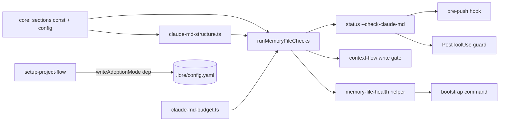

Amends SPEC-095 (`spec-project-claude-md-content-contract-governance-injected`, which listed "section-structure lint" as Out) and extends SPEC-146 (`spec-claude-md-governance-content-dimension-checks-wire-the`). Reversal recorded in a new ADR.

## Overview/Goal

1. The root memory file's five required H2 sections become a **deterministic** check (non-zero exit; blocks pre-push, PostToolUse guard, `lore context` write gate). Module files get an **advisory** check only.
2. An existing project adopting lore is never red on day one, and never silently unenforced: an explicit **adoption mode** that is visible on every check run and every session start until promoted.

## Scope

**In**: pure H2 structure check (root deterministic, module advisory); unified `context.memory_files.adoption: enforce|warn` covering ALL deterministic memory-file findings; absent → `warn` with `mode_source: "default"`; setup writes the key only when absent (clean (= zero would-be deterministic findings of ALL kinds, capacity included) → enforce, else warn + migration checklist); new-file skeleton + managed block reshaped into sections 4-5; HUMAN WARN line, status JSON `adoption` block, bootstrap `memory_file_health`; `lore context` write gate honours adoption; pre-push failure text generalised (both byte-identical copies); contract asset prose ("must contain, in order" + Adoption Mode section) + manifest; lore-init-context SKILL fills the existing `## Module Index`; this repo's root CLAUDE.md is restructured under the contract's "keep the rule, drop the story" (user decision 2026-10-07, revising the earlier "evict verbatim" plan once the three subsections proved to be rule+pointer shaped): `### Dogfooding…` becomes its own `## Dogfooding: Skill/Tool Eval Log` H2 (advisory extra), `### Implementation Status` is renamed `### Cross-cutting Rules`, `### AI Default Behavior by Caller Surface (SPEC-024)` stays under Architecture; `.lore/config.yaml` sets `adoption: enforce`.

**In (added during implementation, 2026-10-07)**: `lore status --check-memory-pointers` must not go silent under warn — it prints the `WARN adoption=warn` line and the downgraded `slug_pointer_missing` findings (AC-STR-9; measured regression after the Phase-1 change). Memory-file discovery stops at any non-root directory containing `.git` (dir or gitfile), so a nested/vendored repo or submodule is never linted as a module of the host (AC-STR-10; issue #24).

**Out**: localized heading aliases; per-path overrides; H3+ structure; content-semantics judgement; auto-promotion warn→enforce (a check never writes config — CQS).

Decision record: `adr-claude-md-root-h2-structure-is-deterministic-with-one`.

## Module Boundary

- **Public API**
  - `@lore/core`: `ROOT_REQUIRED_SECTIONS`, `MODULE_REQUIRED_SECTIONS` (pure constants, browser-safe); `contextConfigSchema.memory_files.adoption`; `resolveMemoryFileBudgets` resolves the absent key to `warn` (single defaults home).
  - `service/claude-md-structure.ts` (new, pure): `parseH2Headings`, `checkRootStructure(file, required)`, `checkModuleStructure(file, required)` — mode-free.
  - `service/claude-md-admission.ts`: `runMemoryFileChecks` stays the SOLE composition entry; it calls the structure checks and applies the mode (moves would-be-deterministic findings to advisory `downgraded` in warn mode); result gains `adoption: { mode, mode_source, downgraded_count, promotable }`; in `warn` EVERY deterministic finding kind (capacity, slug, emphasis, structure) is downgraded.
- **Internal**: fenced-code skipping, heading normalisation (trim only; exact, case-sensitive).
- **Dependencies**: `@lore/core` only. No store, no fs, no clock (existing purity invariant).

## Structure

```
packages/core/src/memory-file-sections.ts          # ROOT_/MODULE_REQUIRED_SECTIONS
packages/core/src/config.ts                        # memory_files.adoption (.strict) + resolve default
packages/core/src/session.ts                       # bootstrapReportSchema: optional memory_file_health
packages/lore/src/service/claude-md-structure.ts   # NEW pure checks
packages/lore/src/service/claude-md-findings.ts    # new kinds
packages/lore/src/service/claude-md-admission.ts   # wire + mode application
packages/lore/src/adapters/cli/claude-md-render.ts # explicit WARN branch in HUMAN output
packages/lore/src/adapters/cli/commands/status.ts  # JSON structure block
packages/lore/src/adapters/cli/commands/bootstrap.ts # memory_file_health (adapter-side, beside sessionService.bootstrap)
packages/lore/src/adapters/cli/memory-file-health.ts # shared helper: probe roots via budgets.filenames + runMemoryFileChecks
packages/lore/src/flows/setup-project-flow.ts      # skeleton for new files + writeAdoptionMode dep
packages/lore/src/flows/context-flow.ts            # write gate sees structure findings (enforce only)
assets/project/CLAUDE.md.template                  # managed block = ## Module Index + ## Finding Live Project State
assets/project/CLAUDE.md.skeleton                  # NEW: ## What This Is / ## Commands / ## Architecture (new files only)
assets/project/pre-push + hooks/pre-push           # failure message no longer says only "trim"
assets/governance/claude-md-contract.md            # "must contain, in order"; Adoption Mode section
assets/skills/lore-init-context/SKILL.md           # fill existing ## Module Index, never add one
CLAUDE.md (this repo)                              # evict 3 Architecture subsections; .lore/config.yaml → enforce
```

## Public Interface

```ts
// @lore/core
export const ROOT_REQUIRED_SECTIONS = ["What This Is","Commands","Architecture","Module Index","Finding Live Project State"] as const;
export const MODULE_REQUIRED_SECTIONS = ["Purpose"] as const;
export type AdoptionMode = "enforce" | "warn";

// service/claude-md-structure.ts
export interface H2Heading { text: string; line: number }
export function parseH2Headings(content: string): H2Heading[];          // ^## only (not ###), skips ``` / ~~~ fences
export function checkRootStructure(file: MemoryFileInput, required: readonly string[]): { deterministic: MemoryFileFinding[]; advisory: AdvisoryFinding[] };
export function checkModuleStructure(file: MemoryFileInput, required: readonly string[]): AdvisoryFinding[];

// findings
type MemoryFileFindingKind = ... | "section_missing" | "section_order" | "section_duplicate";
type AdvisoryFindingKind   = ... | "section_extra" | "section_empty" | "module_section_missing" | "downgraded";
// "downgraded" carries `downgraded_kind: MemoryFileFindingKind` → rendering stays injective

// runMemoryFileChecks result
adoption: { mode: AdoptionMode; mode_source: "config" | "default"; downgraded_count: number; promotable: boolean }

// bootstrap (optional, present only when mode=warn OR the root file has >=1 would-be deterministic finding of ANY kind)
memory_file_health?: { mode; mode_source; missing: string[]; out_of_order: boolean; downgraded_kinds: string[]; downgraded_count: number; promotable: boolean }
```

### Definitions

- `section_empty`: a required section whose body (lines up to the next H2) contains only blank lines and/or HTML comments; any other line, including an H3, counts as content.
- would-be deterministic finding: any `MemoryFileFindingKind` (capacity, slug, emphasis, structure) before adoption is applied.

## Dependency Graph



## Design Decisions

| # | Decision | Choice | Rationale | Trade-off |
|---|---|---|---|---|
| D1 | Module split | New pure `claude-md-structure.ts`; wired only via `runMemoryFileChecks` | admission.ts already 848 lines / 5 checks; heading order is a distinct responsibility; single composition entry preserved | one more file |
| D2 | Where mode applies | In composition, not in the check | check stays mode-free and unit-testable; one place decides exit relevance | every consumer reads `adoption.mode` from the result |
| D3 | Absent key | Resolves to `warn`, `mode_source: "default"` | already-installed consumers upgrading the binary are not red on first push | default is the weak setting → mitigated by visibility (D7) and ACs that assert mode explicitly |
| D4 | Setup | New file: skeleton (3 sections) + managed block (last 2 sections). Existing file: managed block only. Writes mode only if absent, judged on the POST-SPLICE content (after the managed block is appended — never the pre-splice file): clean (= zero would-be deterministic findings of ALL kinds, capacity included) → enforce, else warn + migration checklist | managed block = sections 4-5 means old installs keep `## Module Index` on re-run and order holds when appended at the end | an existing file that already has its own `## Finding Live Project State` gets `section_duplicate` (shown as downgraded in warn) |
| D5 | Heading match | `^## ` only, trim, exact, case-sensitive; fenced code skipped | most discriminating rule; `### Commands` and `## commands` do not count | localized headings cannot pass (stay in warn) |
| D6 | Section list | Constant in core, not configurable; checks take `required` param | shared contract semantics; param keeps future aliases non-breaking | — |
| D7 | Visibility | HUMAN output prints, every run in warn mode, a line starting with the fixed token `WARN adoption=warn`; bootstrap emits `memory_file_health`; `promotable` = mode is warn AND the would-be DETERMINISTIC finding count (`downgraded_count`) is 0; advisory kinds (`section_extra`, `section_empty`, …) never affect it | "must not go silent" | one extra line per session until promoted |
| D8 | Bootstrap layering | Computed in the CLI adapter via a shared helper, attached beside `sessionService.bootstrap`; core schema gains optional field | SessionService has no fs; helper shared with status prevents a second composition | — |
| D9 | Root discovery | Root entries from `budgets.filenames` (AGENTS.md aware), dedupe by realpath | no hard-coded filename | — |
| D10 | Corpus-free | `--check-claude-md` still never loads the corpus | SPEC-095 D9 | — |

## Perspective Tensions Resolved

| Tension | Perspectives | Resolution | Why |
|---|---|---|---|
| Template split vs re-run regression | Cohesion, Testing | Managed block becomes sections 4-5 instead of removing Module Index | avoids deleting a heading from old installs |
| `downgraded_kind` field vs kind explosion | Cohesion | one advisory kind `downgraded` + `downgraded_kind` | rendering injective, kinds stay few |
| `promotable` as finding vs state | Cohesion | state field on result | it describes config, not a file |
| default warn vs oracle strength | Extension, Testing | default warn, every enforce AC asserts `adoption.mode==="enforce"` in JSON | stops a fixture without config from passing vacuously |
| Guard during multi-edit restructure | Testing | guard keeps current behaviour (feedback after edit, cannot undo) | PostToolUse only reports; restructure finishes in the same session |

## Acceptance Criteria

- **AC-STR-1** pure unit (vitest): missing / order / duplicate / extra / empty / fenced heading ignored / `### Commands` and `## commands` NOT accepted / module Purpose; mode-free. Falsifier: case-insensitive match or `#{2,}` → red.
- **AC-STR-2** CLI (`status --check-claude-md`): fixture with explicit `adoption: enforce` and missing `Commands` → exit EXACTLY 3, output names `section_missing` and `Commands`; same fixture in `warn` → exit 0, HUMAN output has WARN line, JSON `downgraded_count`==1 and `downgraded_kind`==`section_missing`; an over-ceiling fixture in `warn` → exit 0 with `downgraded_kind`==`max_lines` (adoption covers capacity). Falsifier: skip check in warn → count 0 → red.
- **AC-STR-3** consumer pre-push on the REAL binary: missing section → non-zero and hook output names `section_missing`; both hook copies byte-identical.
- **AC-STR-4** (bun) fresh install `init`+`setup --project` → file conforms, config `enforce`, check exit 0 with JSON mode `enforce`; existing non-conforming → `warn` + checklist printed; existing conforming → `enforce`; re-run setup on an old-template install keeps `## Module Index`.
- **AC-STR-5** (bun) bootstrap: warn + missing → `memory_file_health.missing` equals exact names; enforce + clean → field absent; enforce + failing → field present.
- **AC-STR-6** `lore context` write gate refuses on a structure finding in enforce, allows in warn.
- **AC-STR-7** contract: asset numbered list == `ROOT_REQUIRED_SECTIONS`; governance byte-parity; manifest `--check`.
- **AC-STR-8** this repo: `--check-claude-md --json` on main → exit 0, `adoption.mode==="enforce"`, `downgraded_count===0`; evicted `### ` subsections absent; stub slugs resolve (`--check-memory-pointers` exit 0).

Existing tests updated in the same slice: `claude-md-template-pointer.test.ts`, `setup-project-claudemd.test.ts`, `init-context-contract.test.ts`, `assets-ssot.test.ts`, `setup-user-once-marker.bun.test.ts`.

## Quality Gates

- [x] No circular dependencies (core → structure → admission → adapters)
- [x] Single responsibility per module (structure = headings; admission = composition + mode)
- [x] Public API sufficient for black-box testing (pure functions + CLI surface)
- [x] Dependencies injectable (`writeAdoptionMode` setup dep; checks take files + required list)


## Acceptance Criteria (structured)

- [⚑] [script] AC-STR-1: Pure structure check: claude-md-structure unit suite passes — missing/order/duplicate root H2 are deterministic; extra/empty root H2 and missing module Purpose are advisory; fenced headings ignored; '### Commands' and '## commands' do NOT satisfy 'Commands'; checks are mode-free. Covered by describe 'checkRootStructure' and 'checkModuleStructure'.
  script: test — bunx vitest run packages/lore/tests/unit/service/claude-md-structure.test.ts 2>&1 && echo 'AC-STR-1 PASS: root H2 presence/order/duplicate deterministic, extras/empty/module advisory, exact case-sensitive H2-only match'
- [⚑] [script] AC-STR-2: CLI surface honours adoption across ALL deterministic kinds: with explicit adoption enforce and missing 'Commands', 'lore status --check-claude-md' exits EXACTLY 3 and names section_missing + Commands; same fixture with adoption warn exits 0, HUMAN output contains a line starting 'WARN adoption=warn', JSON data.claude_md.adoption has mode warn, downgraded_count 1 and an advisory finding with downgraded_kind section_missing; an over-ceiling fixture in warn exits 0 with downgraded_kind max_lines; no config key → mode_source default and mode warn.
  script: e2e — bunx vitest run packages/lore/tests/integration/status-claude-md-adoption.test.ts 2>&1 && echo 'AC-STR-2 PASS: enforce exits 3 on section_missing; warn downgrades structure AND capacity with a visible WARN line; absent key resolves to warn/default'
- [⚑] [script] AC-STR-3: Consumer pre-push trips on structure using the REAL compiled binary (not a shim): a temp repo with adoption enforce and a root CLAUDE.md missing a required section makes assets/project/pre-push exit non-zero with output naming section_missing; adoption warn exits 0; hooks/pre-push and assets/project/pre-push stay byte-identical.
  script: e2e — (cd packages/lore && bun test tests/integration/pre-push-structure-trip.bun.test.ts 2>&1) && bunx vitest run packages/lore/tests/unit/assets/pre-push-parity.test.ts 2>&1 && echo 'AC-STR-3 PASS: real-binary pre-push blocks section_missing under enforce, passes under warn, hook copies byte-identical'
- [⚑] [script] AC-STR-4: Setup adoption both ends: fresh 'lore init'+'lore setup --project' in an empty repo yields a root CLAUDE.md with all five H2 in order, config adoption enforce, and --check-claude-md --json exit 0 with adoption.mode enforce; an existing non-conforming CLAUDE.md yields adoption warn and a printed migration checklist naming the missing sections; an existing conforming file yields enforce; an explicit existing adoption value is never overwritten; re-running setup over an old-template install keeps '## Module Index'.
  script: e2e — (cd packages/lore && bun test tests/integration/setup-claude-md-adoption.bun.test.ts 2>&1) && echo 'AC-STR-4 PASS: fresh install conforms under enforce; existing non-conforming gets warn + checklist; conforming gets enforce; explicit value preserved; re-run keeps Module Index'
- [⚑] [script] AC-STR-5: Bootstrap never goes silent: 'lore bootstrap --json' carries memory_file_health with mode warn and missing equal to the EXACT missing section names when adoption is warn; the field is absent when adoption is enforce and the root file has zero would-be deterministic findings; present when enforce and the root file has >=1 would-be deterministic finding of ANY kind (structure or capacity); promotable is true iff mode is warn AND downgraded_count is 0 (advisory kinds never affect it).
  script: e2e — (cd packages/lore && bun test tests/integration/bootstrap-memory-file-health.bun.test.ts 2>&1) && echo 'AC-STR-5 PASS: bootstrap memory_file_health present with exact missing names in warn/failing, absent when enforce+clean, promotable reported'
- [⚑] [script] AC-STR-6: lore context write gate honours adoption: under enforce a root structure finding makes the flow return an error naming section_missing and the target CLAUDE.md is byte-unchanged; under warn the same input writes the file and reports the finding as downgraded (downgraded_kind section_missing).
  script: test — bunx vitest run packages/lore/tests/unit/flows/context-flow-adoption.test.ts 2>&1 && echo 'AC-STR-6 PASS: context write gate refuses on structure finding under enforce, allows under warn'
- [⚑] [script] AC-STR-7: Contract ships and matches code: the numbered root-section list in assets/governance/claude-md-contract.md equals ROOT_REQUIRED_SECTIONS exactly and in order; the contract states 'must contain, in this order' and has an Adoption Mode section; compiled 'lore governance claude-md' stdout is byte-identical to the asset; assets manifest in sync.
  script: test — bunx vitest run packages/lore/tests/unit/assets/claude-md-contract-sections.test.ts packages/lore/tests/unit/assets-ssot.test.ts 2>&1 && (cd packages/lore && bun test tests/e2e/governance-claude-md-compiled.bun.test.ts 2>&1) && node scripts/embed-assets-manifest.mjs --check 2>&1 && echo 'AC-STR-7 PASS: contract list == ROOT_REQUIRED_SECTIONS, adoption prose present, governance byte-parity, manifest in sync'
- [⚑] [script] AC-STR-8: This repo dogfoods enforce: on main after rebuild, dist/lore status --check-claude-md --json exits 0 with data.claude_md.adoption.mode enforce, mode_source config and downgraded_count 0; root CLAUDE.md has '## Dogfooding: Skill/Tool Eval Log' as an H2 and '### Cross-cutting Rules', and no '### Dogfooding' or '### Implementation Status' heading; --check-memory-pointers exits 0 so every slug pointer resolves.
  script: other — F=$(mktemp) && bun run build >/dev/null 2>&1 && ./dist/lore status --check-claude-md --json > $F && node -e "const a=JSON.parse(require('fs').readFileSync(process.argv[1],'utf8')).data.claude_md.adoption; if(a.mode!=='enforce'||a.mode_source!=='config'||a.downgraded_count!==0){console.error(JSON.stringify(a));process.exit(1)}" $F && grep -qx '## Dogfooding: Skill/Tool Eval Log' CLAUDE.md && grep -qx '### Cross-cutting Rules' CLAUDE.md && ! grep -qE '^### (Dogfooding|Implementation Status)' CLAUDE.md && ./dist/lore status --check-memory-pointers >/dev/null 2>&1 && echo 'AC-STR-8 PASS: repo runs under adoption enforce (config) with 0 downgraded, Dogfooding is its own H2, Implementation Status renamed Cross-cutting Rules, every slug pointer resolves'
- [⚑] [script] AC-STR-9: The corpus-loading sibling surface never goes silent under warn: with no adoption key (default warn) and a root CLAUDE.md naming a dangling corpus slug, 'lore status --check-memory-pointers' exits 0, prints a line starting 'WARN adoption=warn', and names the dangling slug as a downgraded slug_pointer_missing finding; with adoption enforce the same repo exits EXACTLY 3 and names the slug.
  script: test — bunx vitest run packages/lore/tests/integration/status-memory-pointers-adoption.test.ts 2>&1 && echo 'AC-STR-9 PASS: check-memory-pointers prints WARN + downgraded dangling slug under warn, exits 3 under enforce'
- [⚑] [script] AC-STR-10: Memory-file discovery stops at nested git repositories: in a temp repo containing a non-root directory with its own .git (as a directory, and separately as a gitfile like a submodule) holding an over-ceiling CLAUDE.md, 'lore status --check-claude-md --json' lists no finding or advisory whose path is under that directory, while a CLAUDE.md in an ordinary subdirectory of the same repo IS still discovered; under adoption enforce the run exits 0.
  script: test — bunx vitest run packages/lore/tests/integration/claude-md-nested-repo-discovery.test.ts 2>&1 && echo 'AC-STR-10 PASS: nested git repos (dir and gitfile) are skipped by discovery, ordinary subdirectories still discovered, enforce exits 0'

## Code anchors

- packages/core/src/memory-file-sections.ts#ROOT_REQUIRED_SECTIONS
- packages/core/src/config.ts#resolveAdoption
- packages/lore/src/service/claude-md-structure.ts#checkRootStructure
- packages/lore/src/service/claude-md-structure.ts#checkModuleStructure
- packages/lore/src/service/claude-md-admission.ts#runMemoryFileChecks
- packages/lore/src/adapters/cli/claude-md-render.ts#formatCheckClaudeMdHuman
- packages/lore/src/adapters/cli/commands/status.ts
- packages/lore/src/adapters/cli/memory-file-health.ts#computeMemoryFileHealth
- packages/lore/src/flows/setup-project-flow.ts
- packages/lore/src/flows/context-flow.ts
- packages/lore/src/adapters/real-memory-file-probe.ts
- assets/project/CLAUDE.md.skeleton
- assets/project/CLAUDE.md.template
- assets/governance/claude-md-contract.md
- packages/lore/tests/unit/service/claude-md-structure.test.ts
- packages/lore/tests/integration/status-claude-md-adoption.test.ts
- packages/lore/tests/integration/setup-claude-md-adoption.bun.test.ts
- packages/lore/tests/integration/bootstrap-memory-file-health.bun.test.ts
- packages/lore/tests/unit/flows/context-flow-adoption.test.ts
- packages/lore/tests/unit/assets/claude-md-contract-sections.test.ts
- packages/lore/tests/integration/pre-push-structure-trip.bun.test.ts
- packages/lore/tests/integration/status-memory-pointers-adoption.test.ts
- packages/lore/tests/integration/claude-md-nested-repo-discovery.test.ts
