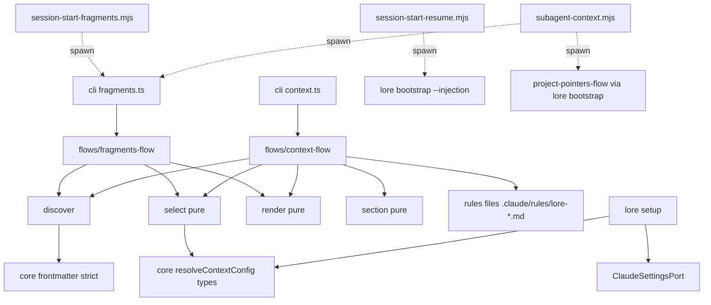

# Context fragments — config-driven layered injection into sessions and subagents

## Overview/Goal

Every rule text lore puts in front of a Claude Code model reaches it through one of four unrelated channels, each with its own copy and failure mode:

| Channel | Today | Measured defect |
|---|---|---|
| Project CLAUDE.md Z1 (`lore context refresh`) | projection of repo facts only | carries no rules |
| SessionStart Phase C (`lore governance corpus-workflow`) | 10,467-byte static prose injected every session | with Phase E bootstrap the hook stdout exceeds Claude Code's 10,000-char cap → persisted to disk, model sees a 2,000-char preview (GH #20; observed 2026-10-07 "Output too large (13.6KB) … Preview (first 2KB)") |
| SubagentStart (`subagent-context.mjs`) | per-agent-type text hard-coded in the hook, 1,200-char cap | outside any SSOT; not configurable |
| User `~/.claude/CLAUDE.md` | 16,615 chars hand-maintained, loaded by every subagent | subagents pay for main-only rules; `omitClaudeMd` is all-or-nothing across user/project/local |

Goal: one SSOT unit — the **context fragment** — routed by declared **audience** and **mode**, selected by **config**, rendered by **one binary-side renderer** to four outlets. Static text lives in lore-owned Claude Code rules files (`.claude/rules/lore-*.md`, `~/.claude/rules/lore-*.md` — D15: loaded at launch, re-injected after compaction, outside the CLAUDE.md byte ceiling); dynamic text is injected by hooks; subagents run with `omitClaudeMd: true` and receive exactly the fragments addressed to them.

Benchmark: Cursor rules (`cursor.com/docs/context/rules`, fetched 2026-10-07) — frontmatter-routed rule files (`alwaysApply`/`globs`/`description`), project + user + team layers, "Split large rules into multiple, composable rules". Claude Code `.claude/rules/*.md` + `paths:` (memory.md). Adopted: layered frontmatter-routed files. Replaced: glob routing → audience routing, because the routing key here is *who* (main / subagent type), not *which file is open*.

Relates to `spec-context-verb-family-two-zone-claude-md-anatomy-lore` (reuses `lore context refresh` as the writer verb and its five-state diverged_skip semantics, but no longer splices fragments into the CLAUDE.md Z1 — D15), SPEC-080 (bootstrap budget), SPEC-046 (asset SSOT + `lore setup`). **Amends SPEC-083** (D9).

## Scope

In:
- Fragment file format + Zod schema (`@lore/core`, browser-safe).
- Three layers with id-override: `assets/context/` (shipped) < `~/.config/lore/context/` (user) < `.lore/context/` (project).
- Config `context.language`, `context.fragments.disable` — legal in global and project config; pure `resolveContextConfig(global, project)` in `@lore/core`.
- New read-only verb `lore fragments render|check` (hook-facing, bootstrap-stage, no `bun:sqlite`).
- `lore context refresh` writes static main fragments as lore-owned rules files (D15): project `.claude/rules/lore-<id>.md`, and `--scope user` → `~/.claude/rules/lore-<id>.md`; per-file hash-precondition (CAS) writes plus pruning of stale `lore-*.md` files.
- Hooks: Phase C is REMOVED from `session-start-resume.mjs` (it keeps seat-briefing + bootstrap only); a NEW `session-start-fragments.mjs` (registered for startup/resume and matcher `compact`) is the only caller of `lore fragments render --outlet hook:session-start`; `subagent-context.mjs` becomes a thin caller of `--outlet hook:subagent-start`.
- `lore setup`: project `context.language` → Claude Code `language` (user scope from global config → `~/.claude/settings.json`; project override → `.claude/settings.local.json`) through a `ClaudeSettingsPort` that merge-writes only the `language` key.
- Shipped agents `assets/agents/lore-*.md` gain `omitClaudeMd: true`.
- SPEC-083 amendment: `corpus-workflow` prose → shipped static fragments; `lore governance corpus-workflow` retired; `seat-briefing` and `bootstrap-framing` stay with `lore governance`.
- Migration table for the owner's user CLAUDE.md → `~/.config/lore/context/` (data, not code).

Out: glob/path-triggered fragments; AI-judged relevance; dashboard UI; Codex/AGENTS.md outlet (outlet registry makes it additive later); third-party agents/skills.

## Fragment format

```markdown
---
id: comm-zh                      # unique per layer; same id in a higher layer replaces the lower one; render order = id ascending
title: 交流语言与输出风格
audience: [main, "subagent:*"]   # main | subagent:* | subagent:<agent_type>
mode: static                     # static | dynamic (see routing table)
when: { language: [zh] }         # optional; every key must match resolved config (registry-backed)
---
<markdown body — factual statements, not out-of-band "system" commands (hooks.md guidance)>
```

Routing (outlet registry):

| Outlet id | Receives | Written by |
|---|---|---|
| `rules:project` | audience `main`, mode `static`, layers shipped+project, **project config only** (the file is git-shared; no user layer, no global config, so every teammate renders identical bytes) | `lore context refresh` (CAS) |
| `rules:user` | audience `main`, mode `static`, layer **user only**, **global config only** | `lore context refresh --scope user` (CAS) |
| `hook:session-start` | audience `main`, mode `dynamic`, all three layers, merged config (project over global); plus stale-rules backstop (D7) | `session-start-fragments.mjs` (startup, resume, compact) |
| `hook:subagent-start` | audience `subagent:*` or `subagent:<type>`, mode static AND dynamic, all three layers, merged config (project over global) | SubagentStart hook |

## Module Boundary

- **Public API**
  - `@lore/core/context-fragments.ts` (browser-safe): `FragmentFrontmatterSchema`, `Fragment`, `Audience`, `OutletId`, `ResolvedContextConfig`, `resolveContextConfig(global, project)`, `WHEN_MATCHERS: Record<string, (want: string[], cfg) => boolean>`, `HOOK_STRING_CAP = 10_000`, `POINTER_CEILING = 600`, `NOTICE_RESERVE = 400`, `SUBAGENT_FRAGMENT_CAP`, `SESSION_FRAGMENT_CAP`, `LANGUAGE_NAMES`.
  - `service/context-fragments/discover.ts`: `discoverFragments(fs: FsReadPort, roots: FragmentRoots): Result<Fragment[], LoreError>` — fail loud on schema error / duplicate id within a layer / body containing `<system-reminder` (names file).
  - `service/context-fragments/select.ts` (pure): `selectFragments(all, { outlet, agentType?, config }): Fragment[]`.
  - `service/context-fragments/render.ts` (pure): `renderOutlet(sel, outlet): Result<Rendered, LoreError>`; `Rendered = { text; chars; fragmentIds }`; hook outlets over cap → `err(BUDGET_EXCEEDED)` with per-fragment sizes.
  - `service/context-fragments/section.ts` (pure): renders one rules file per static fragment (fingerprint line + body) — the ONLY owner of the `lore-<id>.md` file shape (D15).
  - `flows/fragments-flow.ts`: `runFragmentsRender(deps, { outlet, agentType?, cwd })`, `runFragmentsCheck(deps, root)`.
  - `flows/project-pointers-flow.ts`: the dynamic project pointers migrated from `subagent-context.mjs` (spawns `lore bootstrap`); appended by the hook after the fragment block; `check` budgets fragment block + pointer ceiling (600 chars) together.
  - `flows/context-flow.ts`: `runContextRefresh(deps, root, { scope })` calls discover → checkOverrides → select(rules:project|rules:user) → section.ts per-fragment file render, then CAS-writes each `lore-<id>.md` and prunes stale ones (D15); it does not splice fragments into CLAUDE.md; no discovery logic inside.
  - CLI: `lore fragments render --outlet <id> [--agent-type T] [--cwd P] [--explain]`, `lore fragments check`; `lore context refresh [--scope user]`.
- **Deps (all injected)**: `{ fs: FsReadPort & FsWritePort, home, xdgConfigHome, assetsRoot, globalConfig, projectConfig, claudeSettings: ClaudeSettingsPort }`.

## Structure

```
packages/core/src/context-fragments.ts
packages/lore/src/service/context-fragments/{discover,select,render,section}.ts
packages/lore/src/flows/{fragments-flow,project-pointers-flow}.ts
packages/lore/src/flows/context-flow.ts              (extended: scope, lore rules-file writes + prune, D15)
packages/lore/src/adapters/cli/commands/fragments.ts (new)
packages/lore/src/adapters/cli/commands/context.ts   (--scope user)
packages/lore/src/service/setup-*                    (ClaudeSettingsPort language write)
assets/context/*.md                                  (shipped fragments; manifest-tracked)
assets/hooks/session-start-resume.mjs               (Phase C removed)
assets/hooks/session-start-fragments.mjs            (new; only caller of --outlet hook:session-start)
assets/hooks/subagent-context.mjs                   (thin caller of --outlet hook:subagent-start)
assets/agents/lore-*.md                              (omitClaudeMd: true)
packages/core/src/config.ts                          (context.language, context.fragments.disable; GlobalLoreConfigSchema += context subset)
```

## Dependency Graph



## Design Decisions

| # | Decision | Choice | Rationale | Trade-off |
|---|---|---|---|---|
| D1 | SSOT unit | one markdown file per fragment, frontmatter-routed | each rule exists once; outlets are projections | more files |
| D2 | Layering | shipped < user < project, override by id — EXCEPT cross-file override/disable of a static `main` fragment, which D14 refuses; `disable` by id; order = id ascending | personal rules never ship; project can tighten | override hides shipped text → `--explain` prints id/layer/chars/reason |
| D3 | Language | lore config SSOT (owner: option A); setup projects it one-way into Claude Code `language` via `LANGUAGE_NAMES = { zh: "Chinese", en: "English", ja: "Japanese" }` (unknown code → setup exits VALIDATION_ERROR naming the code; extending = one map entry); `lore fragments check` exits non-zero when the Claude Code `language` value differs from the projection | one knob, drift is loud | setup must re-run after change |
| D4 | Static vs dynamic | static main → lore-owned Claude Code rules files (D15); dynamic → hooks | unscoped rules load at launch with the same priority as `.claude/CLAUDE.md` and are re-injected from disk after compaction (Claude Code memory.md "Rules without paths frontmatter are loaded at launch with the same priority as .claude/CLAUDE.md"; context-window.md "Project-root CLAUDE.md and unscoped rules — Re-injected from disk"), without consuming the CLAUDE.md byte ceiling; hooks are capped | rules files can lag the binary → D7 |
| D15 | Static outlet file shape (owner decision 2026-10-07, supersedes the earlier CLAUDE.md-Z1 target, which breached the root CLAUDE.md ceiling: this repo had 744 bytes of headroom against ~12KB of shipped static fragments) | one file per winning static `main` fragment: `rules:project` → `<project>/.claude/rules/lore-<id>.md`, `rules:user` → `<home>/.claude/rules/lore-<id>.md`; NO `paths:` frontmatter; first line is a fingerprint comment `<!-- lore:managed fragment=<id> hash=<8hex> -->` over the body; refresh (a) writes/updates each file via CAS, (b) leaves a file whose body no longer matches its own fingerprint untouched and reports `diverged_skip`, (c) DELETES `lore-*.md` files whose fragment no longer exists or is no longer selected, (d) never touches a rules file without the `lore-` prefix, and never writes CLAUDE.md for fragments (no Z1 `fragments` section). Prune (c) applies to a hand-edited `lore-*.md` too once its fragment is no longer selected — the reserved prefix declares lore ownership. Drift (D7, `rules_drift` finding naming the file) is reported only for a MANAGED project: one where a `lore-*.md` rules file exists, the project CLAUDE.md exists, or a non-shipped static main fragment is selected; an unmanaged project (fresh `lore init`, nothing rendered yet) reports no drift — the same rule as the former "no CLAUDE.md is not drift" (implemented in `fragments-flow.ts::detectProjectRulesDrift`). Each file is subject to the existing `context.memory_files.rules` budget | the `lore-` filename prefix is reserved for lore in both rules dirs; the feature had not shipped before D15, so no Z1 `fragments` section exists anywhere to migrate |
| D5 | Subagents | shipped agents `omitClaudeMd: true`; SubagentStart injects static+dynamic fragments addressed to them | partial-audience rules are a frontmatter list, not a copy | a subagent WITHOUT the flag (e.g. built-in claude-code-guide, third-party agents) loads CLAUDE.md and also receives SubagentStart fragments, so a fragment whose audience includes both `main` and `subagent:*` reaches it twice — accepted duplication (token cost only; Explore/Plan skip CLAUDE.md natively, general-purpose is denied in this repo) |
| D6 | Budget | the cap applies to the WHOLE string one hook entry emits (Claude Code measures each hook's string on its own — hooks.md "measures each string on its own, even when several hooks run for the same event"). SessionStart is therefore split into TWO hook entries: the existing `session-start-resume.mjs` keeps only seat-briefing + bootstrap framing + `lore bootstrap --injection` (SPEC-080 `char_budget`, default 8,000 ≤ 10,000; Phase C removed), and a new `session-start-fragments.mjs` emits ONLY `lore fragments render --outlet hook:session-start`, whose entire output — dynamic `main` fragment block + D7 notice/backstop + D12 error banner — is ≤ 10,000 chars: the block cap is `SESSION_FRAGMENT_CAP = HOOK_STRING_CAP − NOTICE_RESERVE` with `NOTICE_RESERVE = 400` (the notice line and the error banner are each ≤ 400 chars; the banner REPLACES the block); the D7 changed bodies use only what remains after block + notice, else the id list, itself truncated with `+N more` to fit; `hook:subagent-start` fragment block ≤ 9,400 chars (`SUBAGENT_FRAGMENT_CAP = HOOK_STRING_CAP - POINTER_CEILING`, `POINTER_CEILING = 600` reserved for project pointers, which are truncated at a line boundary to fit); `BUDGET_EXCEEDED` names fragments + sizes; `check` enumerates every outlet × agent type (non-empty set asserted) | GH #20 silent truncation becomes a refusal | authors must trim/split |
| D7 | Rules-file staleness | primary: `lore fragments check` exits non-zero when a lore rules file (`.claude/rules/lore-*.md`, or a missing/extra one) ≠ fresh render (pre-push, `lore setup`, `lore status`); backstop: the fragments SessionStart hook appends a notice line starting with the fixed marker `lore:stale-managed-context` + the changed static fragment bodies; backstop budget = 10,000 − (dynamic block chars + notice line chars); if the changed bodies exceed that remainder it appends the notice + the changed fragment ids only; hooks never write CLAUDE.md | no implicit writers → no race between concurrent sessions | one extra render per start |
| D8 | Concurrent refresh | CAS: read file + hash → splice → write only if on-disk hash unchanged, else exit non-zero (`CONFLICT`) | lost-update impossible; retry is safe (idempotent render) | a racing refresh must be re-run |
| D9 | Governance prose | SPEC-083 amended: `corpus-workflow` → shipped static `main` fragments; `lore governance corpus-workflow` retired; AC-083-1/2 re-baselined in the same slice | removes the 10,467-byte static payload from every session start (GH #20 root cause) | consumers run `lore context refresh` once (setup does it) |
| D10 | Compaction | SessionStart matcher `compact` re-injects dynamic `main` fragments | dynamic state otherwise lost after `/compact` | — |
| D16 | Rules writes are independent of the CLAUDE.md splice (autonomous decision 2026-10-07 during dogfood) | `lore context refresh` performs two independent write sets: (1) the CLAUDE.md facts-Z1 splice with its existing AC-CTX-8 admission, (2) the D15 rules files. A refusal of (1) — e.g. a never-adopted CLAUDE.md whose appended Z1 would breach the root ceiling — does NOT suppress (2); refresh still writes/prunes the rules files and then exits non-zero naming the CLAUDE.md refusal (never a silent success). A CAS conflict on any rules file still suppresses all rules writes (D8). | measured on this repo: refresh refused with 'CLAUDE.md is 729 lines … ceiling 220' because the hand-written root CLAUDE.md carries no Z1 markers, so fragments could never be rendered; D13/D15 already separate fragments from the Z1 machinery | exit code stays non-zero for a project whose CLAUDE.md is not adoptable, so callers (setup, CI) see the partial outcome |
| D14 | No main-session duplication + no cross-file override | each static `main` fragment reaches exactly one CLAUDE.md: shipped/project layers → `rules:project` (project config only), user layer → `rules:user` (global config only). A static `main` fragment can be overridden or disabled ONLY from the file-scope that renders it: a user-layer fragment or global `disable` targeting a shipped static `main` id, and a project-layer fragment or project `disable` targeting a user static `main` id, are both REFUSED by `lore fragments check` and by `lore context refresh` (non-zero exit naming the id; remedy printed: override it in the owning layer, or make it `dynamic`). Hook outlets keep full three-layer override | the project CLAUDE.md is git-shared, so per-person input would cause churn and false staleness for teammates; `~/.claude/CLAUDE.md` is shared by every project, so per-project input would make projects fight | Claude Code loads both the user and the project CLAUDE.md in a main session, so routing one layer to both would deliver it twice | a user can override a shipped fragment only by id in a project layer or disable it, not from the user layer |
| D11 | User scope | `rules:user` renders from the user layer only with **global config only** — project config never influences it | `~/.claude/CLAUDE.md` is shared by every project; project-dependent content would make projects overwrite each other | a project cannot disable a user static fragment (it can disable it for its subagents) |
| D12 | Hook failure | hooks never block start; on error they emit an `additionalContext` banner carrying the error code (never empty) | fail-loud without bricking | a few tokens |
| D13 | Verb split | read-only hook-facing `lore fragments`; CLAUDE.md writer stays `lore context` | one responsibility per verb; hook path free of Z1/Z2 write machinery | one more command |

## Perspective Tensions Resolved

| Tension | Perspectives | Resolution | Why |
|---|---|---|---|
| Keep user-scope static outlet vs drop it | Reuse (drop) vs owner intent (static in CLAUDE.md) | keep, constrained by D11 + D8 | owner wants static content loaded at launch (now via ~/.claude/rules per D15); cross-project fight removed by global-config-only rendering, lost update removed by CAS |
| One `context` verb vs split | Cohesion vs fewer commands | split (D13) | hook-facing read path must stay bootstrap-stage |
| Dynamic pointers inside render | Cohesion/Coupling | separate `project-pointers-flow`; render stays pure | render must not need a corpus |
| Closed `when`/outlet unions | Reuse | registries (`WHEN_MATCHERS`, outlet table) | new condition/outlet = one entry |
| Heavy deps vs hermetic tests | Testing | inject home/xdg/assetsRoot/configs/settings port | tests never touch real HOME |

## Migration: owner's `~/.claude/CLAUDE.md` (16,615 chars) → user-layer fragments

| Section (chars) | audience | mode |
|---|---|---|
| 语言 + 输出风格 (215) — `when: {language:[zh]}` | main, subagent:* | static |
| 研究优先 (197) | main, subagent:* | static |
| Agent Browser 持久化 Profile (1,333) | main, subagent:* | static |
| Lore FEED/PRODUCE (≈1,500) | main | static |
| Lore EXECUTE evidence/AC/oracle rules (≈3,500) | main, subagent:lore-implementer, subagent:tester | static |
| Lore CLOSE/handoff (≈1,200) | main | static |
| Skill 链式前置 (640) | main | static |
| 证据驱动决策 (445) | main, subagent:* | static |
| 行为准则 (1,897) | main, subagent:* | static |
| 测试约束 (584) | main, subagent:lore-implementer, subagent:tester | static |
| Context Hygiene (195) | main | static |
| 工具调用真实性 (484) | main, subagent:* | static |
| AI Agent 偏差锚点 (464) | main, subagent:* | static |
| 核心 MCP 工具 (178) | main, subagent:* | static |
| Subagent 派发 / Stop Protocol / 主 Agent 规划分发制 + Worktree 并发安全 (3,748) | main | static |

Estimate: `subagent:*` ≈ 5,200 chars; `subagent:lore-implementer` ≈ 9,300 + pointers ≤ 600. The oracle is `lore fragments check`, not this estimate; if it refuses, the EXECUTE fragment is split.

## Acceptance Criteria (script-mode drafts; every e2e runs with `HOME`/`XDG_CONFIG_HOME` = mkdtemp, cwd in a `lore init` throwaway corpus)

- AC-CF-1 Discovery override + duplicate refusal. Falsifier: remove the override branch.
- AC-CF-2 Selection positive AND negative: `--agent-type tester` includes `subagent:*`/`subagent:tester` bodies, excludes a `subagent:lore-reviewer`-only fragment, excludes a `when:{language:[en]}` fragment under `zh`, excludes an id in `fragments.disable`. Falsifier: treat `subagent:<type>` as `*`.
- AC-CF-3 Budget boundary: `hook:session-start` block of 9,600 chars (SESSION_FRAGMENT_CAP) passes and 9,601 fails; `hook:subagent-start` block of 9,400 passes and 9,401 fails; failures return `BUDGET_EXCEEDED` + per-fragment sizes. Falsifier: `>` → `>=`.
- AC-CF-4 `lore fragments check` exits 0 on shipped assets, enumerates ≥ (count of `assets/agents/*.md` + 1) agent types (asserted non-empty), exits non-zero on an oversized fixture and on lore rules-file drift.
- AC-CF-5 Language: global `zh` → setup writes `"language": "Chinese"` to `$HOME/.claude/settings.json` (temp HOME), only that key changes (other keys byte-equal); project `en` → `.claude/settings.local.json` gets `English` and user file unchanged. Falsifier: ignore project layer.
- AC-CF-6 D15: after `lore context refresh`, every winning static main fragment (shipped+project) exists as `.claude/rules/lore-<id>.md` with the fingerprint first line and the verbatim body, and CLAUDE.md contains no fragments section; a hand-edited lore rules file → next refresh reports `diverged_skip` and leaves its bytes unchanged; a fragment deleted from the project layer → its `lore-<id>.md` is removed on the next refresh while a non-lore `.claude/rules/team.md` control is byte-unchanged. Falsifier: overwrite instead of skip, or skip the prune.
- AC-CF-7 Wiring: compiled `dist/lore` + shipped `subagent-context.mjs`, payload `{agent_type:"lore-implementer", cwd}` → `additionalContext` contains a nonce present ONLY in a project-layer fixture fragment, and does NOT contain the old hard-coded executor text sentinel. Falsifier: hook keeps hard-coded text.
- AC-CF-8 GH #20 regression: compiled SessionStart hook on a fresh corpus → two SessionStart hook entries (resume + fragments) are registered and neither emits a string longer than 10,000 chars; sentinel sentence from `assets/governance/corpus-workflow.md` absent from hook output and present in a project `.claude/rules/lore-corpus-workflow-*.md` file.
- AC-CF-9 Every installed shipped agent (`lore setup` into temp HOME; ≥ 3 files asserted) parses with frontmatter `omitClaudeMd === true` (YAML boolean, not substring).
- AC-CF-10 Hook failure is loud: invalid fragment → hook exit 0, `additionalContext` contains the error code. Falsifier: swallow error → empty output.
- AC-CF-11 D10: settings registration contains SessionStart matcher `compact` pointing at the hook, and a compact-source payload re-emits a dynamic `main` fixture nonce.
- AC-CF-12 D7: a stale lore rules file → fragments SessionStart hook output contains `lore:stale-managed-context` + the changed fragment nonce; fresh rules files → neither; with a dynamic fixture block sized so the changed bodies exceed the remaining budget, the output contains the changed fragment ids, not their bodies, and is ≤ 10,000 chars.
- AC-CF-13 D8: two refreshes with an interleaved write → the second exits `CONFLICT`, file equals the first writer's bytes.
- AC-CF-14 D11: changing project `context.language` does not change `rules:user` render output (byte-equal).
- AC-CF-15 `lore context refresh --scope user` writes `<HOME>/.claude/rules/lore-<id>.md` for user-layer static main fragments only; `<HOME>/.claude/CLAUDE.md` and a non-lore `<HOME>/.claude/rules/mine.md` control are byte-unchanged.
- AC-CF-16 A fragment body containing `<system-reminder` → discover fails naming the file.
- AC-CF-18 D3 drift: Claude Code `language` set to a value different from the projection of `context.language` → `lore fragments check` exits non-zero naming both values; equal → exit 0; unknown `context.language` code → `lore setup` exits non-zero naming the code.
- AC-CF-17 SPEC-083 re-baseline: `lore governance corpus-workflow` exits non-zero with a pointer to `lore fragments`; `seat-briefing`/`bootstrap-framing` unchanged (byte-parity kept).

## Cross-cutting

- Security: fragments are injected verbatim; project layer has CLAUDE.md-equivalent trust; `<system-reminder` rejected (AC-CF-16).
- Performance: `lore fragments render` is bootstrap-stage (no `bun:sqlite`); target p95 < 150 ms on the shipped set, measured in AC-CF-7's e2e (10 runs).
- Observability: `--explain` per-fragment id/layer/chars/reason; hook writes chars to stderr.
- Concurrency: render read-only; writers are explicit and CAS-guarded (D8); no hook writes files (D7).

## Quality Gates (module)

- [x] No circular dependencies — flows → services → core; hooks reach the binary only via spawn.
- [x] Every module has single clear responsibility — discover (IO), select/render/section (pure), fragments-flow (read path), context-flow (CLAUDE.md writer), project-pointers-flow (dynamic corpus pointers).
- [x] Public API sufficient for black-box testing — pure functions + flows with full deps; CLI e2e with temp HOME.
- [x] Dependencies injectable — fs, home, xdg, assetsRoot, configs, ClaudeSettingsPort.

## Downstream Handoff

- implement: types above; no new third-party deps; file tree above; SPEC-083 amendment task first (AC-083 re-baseline recorded with original command, failure, why-correction).
- test: invariants = AC-CF-1..17; temp HOME mandatory; each AC paired with its named falsifier run red once.
- deploy: `lore setup` re-run required on consumers (writes lore rules files + language + hook matcher `compact`); assets manifest regen.


## Acceptance Criteria (structured)

- [⚑] [script] AC-CF-1: discoverFragments: a project-layer fragment with the same id as a shipped one replaces it in the result; two fragments with the same id inside one layer return err naming both file paths (describe 'AC-CF-1'). Falsifier: delete the id-override branch -> override test red.
  script: test — out=$(bunx vitest run packages/lore/tests/unit/context-fragments/discover.test.ts -t 'AC-CF-1' 2>&1); rc=$?; echo "$out" | tail -6; [ $rc -eq 0 ] && echo "$out" | grep -qE 'Tests +[0-9]+ passed' && echo 'AC-CF-1 PASS: layer override and duplicate-id refusal'
- [⚑] [script] AC-CF-2: selectFragments for outlet hook:subagent-start, agentType tester, language zh: includes subagent:* and subagent:tester fragments; excludes a subagent:lore-reviewer-only fragment, a when.language [en] fragment, and an id listed in context.fragments.disable (describe 'AC-CF-2'). Falsifier: treat subagent:<type> as subagent:* -> red.
  script: test — out=$(bunx vitest run packages/lore/tests/unit/context-fragments/select.test.ts -t 'AC-CF-2' 2>&1); rc=$?; echo "$out" | tail -6; [ $rc -eq 0 ] && echo "$out" | grep -qE 'Tests +[0-9]+ passed' && echo 'AC-CF-2 PASS: audience/when/disable selection positive and negative'
- [⚑] [script] AC-CF-3: renderOutlet: hook:session-start block of exactly 9,600 chars (HOOK_STRING_CAP 10,000 - NOTICE_RESERVE 400) returns ok and 9,601 returns err; hook:subagent-start block of exactly 9,400 chars (10,000 - POINTER_CEILING 600) returns ok and 9,401 returns err; every err is BUDGET_EXCEEDED listing each fragment id with its char count (describe 'AC-CF-3'). Falsifier: change the cap comparison > to >= -> boundary test red.
  script: test — out=$(bunx vitest run packages/lore/tests/unit/context-fragments/render.test.ts -t 'AC-CF-3' 2>&1); rc=$?; echo "$out" | tail -6; [ $rc -eq 0 ] && echo "$out" | grep -qE 'Tests +[0-9]+ passed' && echo 'AC-CF-3 PASS: hook string cap boundary'
- [⚑] [script] AC-CF-4: Compiled 'lore fragments check' exits 0 on the shipped assets and its JSON lists >= (count of assets/agents/*.md + 1) agent types checked; exits non-zero on an oversized fixture fragment and on a project .claude/rules/lore-*.md file that differs from a fresh render (or is missing/extra) (describe 'AC-CF-4', temp HOME).
  script: e2e — out=$(cd packages/lore && bun test tests/e2e/context-fragments-compiled.bun.test.ts -t 'AC-CF-4' 2>&1); rc=$?; echo "$out" | tail -6; [ $rc -eq 0 ] && echo "$out" | grep -qE '^ *[1-9][0-9]* pass' && echo "$out" | grep -qE '^ *0 fail' && echo 'AC-CF-4 PASS: check enumerates all agent types and refuses oversize and Z1 drift'
- [⚑] [script] AC-CF-5: With HOME and XDG_CONFIG_HOME set to mkdtemp dirs: global context.language zh -> 'lore setup' writes language Chinese into HOME/.claude/settings.json changing no other key (other keys byte-equal); project context.language en -> .claude/settings.local.json gets English and the user settings file is unchanged (describe 'AC-CF-5'). Falsifier: ignore the project layer -> red.
  script: e2e — out=$(cd packages/lore && bun test tests/e2e/context-fragments-compiled.bun.test.ts -t 'AC-CF-5' 2>&1); rc=$?; echo "$out" | tail -6; [ $rc -eq 0 ] && echo "$out" | grep -qE '^ *[1-9][0-9]* pass' && echo "$out" | grep -qE '^ *0 fail' && echo 'AC-CF-5 PASS: language projection to Claude Code settings, user and project scope'
- [⊘] [script] AC-CF-6: D15: after 'lore context refresh', every winning static main fragment (shipped+project) exists as .claude/rules/lore-<id>.md whose first line is the lore:managed fingerprint comment and whose body is verbatim, and CLAUDE.md contains no fragments section; a hand-edited lore rules file makes the next refresh report diverged_skip and leave its bytes unchanged; a fragment deleted from the project layer has its lore-<id>.md removed on the next refresh while a non-lore .claude/rules/team.md control stays byte-unchanged (describe 'AC-CF-6'). Falsifier: overwrite instead of skip, or skip the prune -> red.
  script: e2e — out=$(cd packages/lore && bun test tests/e2e/context-fragments-compiled.bun.test.ts -t 'AC-CF-6' 2>&1); rc=$?; echo "$out" | tail -6; [ $rc -eq 0 ] && echo "$out" | grep -qE '^ *[1-9][0-9]* pass' && echo "$out" | grep -qE '^ *0 fail' && echo 'AC-CF-6 PASS: project Z1 fragments section render and diverged_skip'
- [⚑] [script] AC-CF-7: Production wiring: compiled dist/lore plus the shipped assets/hooks/subagent-context.mjs, fed a SubagentStart payload {agent_type: lore-implementer, cwd: temp corpus}, emits hookSpecificOutput.additionalContext containing a nonce that exists only in a project-layer fixture fragment, and not containing the pre-change hard-coded executor sentinel text (describe 'AC-CF-7'). Falsifier: hook keeps its hard-coded text -> red.
  script: e2e — out=$(cd packages/lore && bun test tests/e2e/context-fragments-compiled.bun.test.ts -t 'AC-CF-7' 2>&1); rc=$?; echo "$out" | tail -6; [ $rc -eq 0 ] && echo "$out" | grep -qE '^ *[1-9][0-9]* pass' && echo "$out" | grep -qE '^ *0 fail' && echo 'AC-CF-7 PASS: subagent hook delivers project fragment via lore fragments render'
- [⚑] [script] AC-CF-8: GH #20 regression: on a fresh 'lore init' corpus after 'lore setup' (temp HOME), settings register two SessionStart hook entries (session-start-resume and session-start-fragments), neither compiled hook emits a string longer than 10,000 chars, the combined output does not contain a sentinel sentence taken from the former assets/governance/corpus-workflow.md, and that sentinel is present in a project .claude/rules/lore-corpus-workflow-*.md file (describe 'AC-CF-8').
  script: e2e — out=$(cd packages/lore && bun test tests/e2e/context-fragments-compiled.bun.test.ts -t 'AC-CF-8' 2>&1); rc=$?; echo "$out" | tail -6; [ $rc -eq 0 ] && echo "$out" | grep -qE '^ *[1-9][0-9]* pass' && echo "$out" | grep -qE '^ *0 fail' && echo 'AC-CF-8 PASS: session start output under cap and governance prose moved to Z1'
- [⚑] [script] AC-CF-9: After 'lore setup' into a temp HOME, at least 3 installed shipped agent files exist and every one parses with YAML frontmatter omitClaudeMd === true (boolean, not substring match) (describe 'AC-CF-9').
  script: e2e — out=$(cd packages/lore && bun test tests/e2e/context-fragments-compiled.bun.test.ts -t 'AC-CF-9' 2>&1); rc=$?; echo "$out" | tail -6; [ $rc -eq 0 ] && echo "$out" | grep -qE '^ *[1-9][0-9]* pass' && echo "$out" | grep -qE '^ *0 fail' && echo 'AC-CF-9 PASS: installed shipped agents set omitClaudeMd true'
- [⚑] [script] AC-CF-10: With an invalid fragment file in the project layer, the subagent hook exits 0 and its additionalContext contains the renderer error code (never empty output) (describe 'AC-CF-10'). Falsifier: swallow the error and print nothing -> red.
  script: e2e — out=$(cd packages/lore && bun test tests/e2e/context-fragments-compiled.bun.test.ts -t 'AC-CF-10' 2>&1); rc=$?; echo "$out" | tail -6; [ $rc -eq 0 ] && echo "$out" | grep -qE '^ *[1-9][0-9]* pass' && echo "$out" | grep -qE '^ *0 fail' && echo 'AC-CF-10 PASS: hook failure is loud and non-blocking'
- [⚑] [script] AC-CF-11: 'lore setup' registers a SessionStart hook entry with matcher compact for the session-start hook, and a compact-source SessionStart payload makes the hook re-emit a dynamic main fixture fragment nonce (describe 'AC-CF-11').
  script: e2e — out=$(cd packages/lore && bun test tests/e2e/context-fragments-compiled.bun.test.ts -t 'AC-CF-11' 2>&1); rc=$?; echo "$out" | tail -6; [ $rc -eq 0 ] && echo "$out" | grep -qE '^ *[1-9][0-9]* pass' && echo "$out" | grep -qE '^ *0 fail' && echo 'AC-CF-11 PASS: compact matcher registered and re-injects dynamic main fragments'
- [⚑] [script] AC-CF-12: When a project .claude/rules/lore-*.md file is stale versus a fresh render, the fragments SessionStart hook output contains the fixed marker lore:stale-managed-context and the changed fragment nonce; when the rules files are fresh, neither appears; with a dynamic fixture block sized so the changed bodies exceed the remaining budget (10,000 minus dynamic block minus notice line), the output lists the changed fragment ids instead of their bodies and is at most 10,000 chars (describe 'AC-CF-12').
  script: e2e — out=$(cd packages/lore && bun test tests/e2e/context-fragments-compiled.bun.test.ts -t 'AC-CF-12' 2>&1); rc=$?; echo "$out" | tail -6; [ $rc -eq 0 ] && echo "$out" | grep -qE '^ *[1-9][0-9]* pass' && echo "$out" | grep -qE '^ *0 fail' && echo 'AC-CF-12 PASS: stale Z1 backstop notice'
- [⚑] [script] AC-CF-13: CAS refresh: when a lore rules file's bytes change between refresh's read and its write, refresh returns err CONFLICT and leaves that file equal to the interleaved writer's bytes, writing nothing for it (describe 'AC-CF-13'). Falsifier: drop the hash precondition -> red.
  script: test — out=$(bunx vitest run packages/lore/tests/unit/context-fragments/refresh-cas.test.ts -t 'AC-CF-13' 2>&1); rc=$?; echo "$out" | tail -6; [ $rc -eq 0 ] && echo "$out" | grep -qE 'Tests +[0-9]+ passed' && echo 'AC-CF-13 PASS: compare-and-swap refresh refuses lost update'
- [⚑] [script] AC-CF-14: The rules:user outlet render is byte-equal under two different project context.language values (project config never influences user scope) (describe 'AC-CF-14'). Falsifier: pass merged project config into the user outlet -> red.
  script: test — out=$(bunx vitest run packages/lore/tests/unit/context-fragments/select.test.ts -t 'AC-CF-14' 2>&1); rc=$?; echo "$out" | tail -6; [ $rc -eq 0 ] && echo "$out" | grep -qE 'Tests +[0-9]+ passed' && echo 'AC-CF-14 PASS: user outlet independent of project config'
- [⚑] [script] AC-CF-15: 'lore context refresh --scope user' writes <HOME>/.claude/rules/lore-<id>.md for user-layer static main fragments only; <HOME>/.claude/CLAUDE.md and a non-lore <HOME>/.claude/rules/mine.md control are byte-unchanged (describe 'AC-CF-15').
  script: e2e — out=$(cd packages/lore && bun test tests/e2e/context-fragments-compiled.bun.test.ts -t 'AC-CF-15' 2>&1); rc=$?; echo "$out" | tail -6; [ $rc -eq 0 ] && echo "$out" | grep -qE '^ *[1-9][0-9]* pass' && echo "$out" | grep -qE '^ *0 fail' && echo 'AC-CF-15 PASS: user scope refresh writes only inside markers'
- [⚑] [script] AC-CF-16: discoverFragments returns err naming the file when a fragment body contains the literal <system-reminder (describe 'AC-CF-16').
  script: test — out=$(bunx vitest run packages/lore/tests/unit/context-fragments/discover.test.ts -t 'AC-CF-16' 2>&1); rc=$?; echo "$out" | tail -6; [ $rc -eq 0 ] && echo "$out" | grep -qE 'Tests +[0-9]+ passed' && echo 'AC-CF-16 PASS: reject system-reminder tag in fragment body'
- [⚑] [script] AC-CF-17: SPEC-083 re-baseline: compiled 'lore governance corpus-workflow' exits non-zero and its stderr names 'lore fragments'; 'lore governance seat-briefing' and 'bootstrap-framing' stdout remain byte-equal to their assets/constants (describe 'AC-CF-17').
  script: e2e — out=$(cd packages/lore && bun test tests/e2e/context-fragments-compiled.bun.test.ts -t 'AC-CF-17' 2>&1); rc=$?; echo "$out" | tail -6; [ $rc -eq 0 ] && echo "$out" | grep -qE '^ *[1-9][0-9]* pass' && echo "$out" | grep -qE '^ *0 fail' && echo 'AC-CF-17 PASS: governance corpus-workflow retired, other topics unchanged'
- [⚑] [script] AC-CF-18: Language drift: with Claude Code language set to a value different from the projection of context.language, 'lore fragments check' exits non-zero naming both values; when equal it exits 0; an unknown context.language code makes 'lore setup' exit non-zero naming the code (describe 'AC-CF-18', temp HOME).
  script: e2e — out=$(cd packages/lore && bun test tests/e2e/context-fragments-compiled.bun.test.ts -t 'AC-CF-18' 2>&1); rc=$?; echo "$out" | tail -6; [ $rc -eq 0 ] && echo "$out" | grep -qE '^ *[1-9][0-9]* pass' && echo "$out" | grep -qE '^ *0 fail' && echo 'AC-CF-18 PASS: language drift refused and unknown code refused'
- [⚑] [script] AC-CF-19: No main-session duplication: for a fixture with one static main fragment in each of the shipped, user and project layers, selectFragments for rules:project returns exactly the shipped and project ones and rules:user returns exactly the user one; the two id sets are disjoint (describe 'AC-CF-19'). Falsifier: include the shipped layer in rules:user -> red.
  script: test — out=$(bunx vitest run packages/lore/tests/unit/context-fragments/select.test.ts -t 'AC-CF-19' 2>&1); rc=$?; echo "$out" | tail -6; [ $rc -eq 0 ] && echo "$out" | grep -qE 'Tests +[0-9]+ passed' && echo 'AC-CF-19 PASS: each static main fragment routed to exactly one CLAUDE.md outlet'
- [⚑] [script] AC-CF-20: Cross-file override refusal: a user-layer fragment or a global context.fragments.disable entry targeting a shipped static main fragment id, and a project-layer fragment or a project disable entry targeting a user-layer static main fragment id, each make the check function return err naming that id; the same ids targeting dynamic or subagent-only fragments are accepted and applied (describe 'AC-CF-20'). Falsifier: allow cross-file override -> red.
  script: test — out=$(bunx vitest run packages/lore/tests/unit/context-fragments/select.test.ts -t 'AC-CF-20' 2>&1); rc=$?; echo "$out" | tail -6; [ $rc -eq 0 ] && echo "$out" | grep -qE 'Tests +[0-9]+ passed' && echo 'AC-CF-20 PASS: cross-file override resolved before routing; project targeting user static main refused'
- [⚑] [script] AC-CF-21: Git-shared determinism: the rules:project render is byte-equal across two runs that differ only in user-layer fragments and global config (context.language and disable) (describe 'AC-CF-21'). Falsifier: feed merged config or the user layer into rules:project -> red.
  script: test — out=$(bunx vitest run packages/lore/tests/unit/context-fragments/select.test.ts -t 'AC-CF-21' 2>&1); rc=$?; echo "$out" | tail -6; [ $rc -eq 0 ] && echo "$out" | grep -qE 'Tests +[0-9]+ passed' && echo 'AC-CF-21 PASS: project Z1 render independent of user layer and global config'
- [⚑] [script] AC-CF-22: D16: in a temp corpus whose hand-written CLAUDE.md has no Z1 markers and is close enough to the root ceiling that the appended Z1 breaches it, 'lore context refresh' exits non-zero with the ceiling message AND has written every winning static main fragment as .claude/rules/lore-<id>.md while CLAUDE.md is byte-unchanged (describe 'AC-CF-22'). Falsifier: return before the rules writes on CLAUDE.md refusal -> red.
  script: e2e — out=$(cd packages/lore && bun test tests/e2e/context-fragments-compiled.bun.test.ts -t 'AC-CF-22' 2>&1); rc=$?; echo "$out" | tail -6; [ $rc -eq 0 ] && echo "$out" | grep -qE '^ *[1-9][0-9]* pass' && echo "$out" | grep -qE '^ *0 fail' && echo 'AC-CF-22 PASS: rules files written despite CLAUDE.md admission refusal'

## Code anchors

- packages/core/src/context-fragments.ts
- packages/lore/src/service/context-fragments/discover.ts
- packages/lore/src/service/context-fragments/select.ts
- packages/lore/src/service/context-fragments/render.ts
- packages/lore/src/service/context-fragments/section.ts
- packages/lore/src/flows/fragments-flow.ts
- packages/lore/src/flows/project-pointers-flow.ts
- packages/lore/src/flows/context-flow.ts
- packages/lore/src/adapters/cli/commands/fragments.ts
- packages/lore/src/adapters/claude-settings-port.ts
- assets/hooks/session-start-fragments.mjs
- assets/hooks/subagent-context.mjs
- packages/lore/tests/e2e/context-fragments-compiled.bun.test.ts
