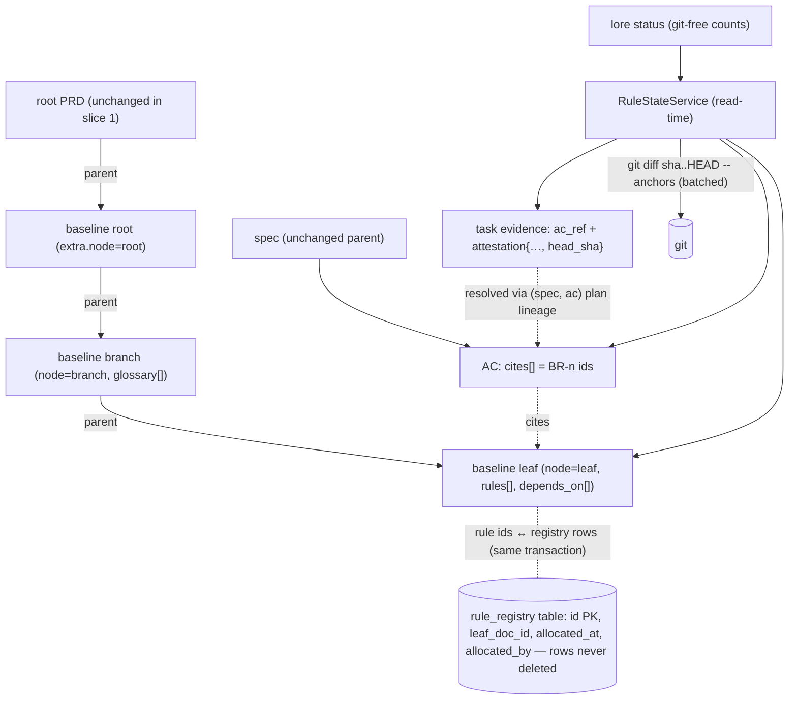

# Architecture: Baseline slice 1 — rules, citations, evidence-computed rule state, specification-branch pilot

Design spec (architecture mode) for slice 1 of `spec-product-baseline-architecture-trees-the-product-s-current` (PRD; BL-1, BL-2, BL-3, BL-9, BL-11, BL-12, BL-13, report-only citation, BL-7 pilot) under `adr-the-product-is-a-baseline-tree-specs-are-implementations`. Synthesized from a 6-role parallel evaluation (performance / security / DX / operations / cost / domain), 2026-10-07. Owner delegated all approvals from this point ("后面全自动", session 6b85319e): the design-approval gate was passed by that delegation, not by a human reading this text, and the HTML preview step was skipped for the same reason. This spec records every decision so it can be audited without that session.

## Overview/Goal

Slice 1 adds a first-class `baseline` document type (root / branch / leaf), rules with permanent corpus-wide ids held on leaves, an AC → rule citation field, and a read-time computation of each rule's verification state from attested evidence and code drift. Citation is report-only in this slice. The `specification` branch of lore's own baseline is migrated as a pilot that decides whether slice 2 (all branches + enforcing gate) proceeds.

## Scope

Goals: G1 a leaf's rules are addressable by a permanent id that is never reissued, under concurrent writers; G2 every rule shows a computed verification state carrying its inputs; G3 every AC can cite rules, and uncited / dangling / ambiguous citations are counted on `lore status`; G4 the pilot measures adjudication load against the 30% kill line and probe accuracy against ≥ 9/10 with 0 confident-wrong.

Non-goals (this slice): enforcing citation gate (slice 2); architecture tree, PRD split, SPEC-080 retirement, distribution / adoption mode (slice 3); HTTP / dashboard write surfaces for rules (slice 3); fixing the pre-existing wholesale-extra bypass for existing keys (issue #36 — this slice only guards its own new keys, through a mechanism #36 can reuse).

## Acceptance Criteria

Structured ACs (ids prefixed `AC-BLS1-` — unique corpus-wide on purpose, see QA-5) are declared with `lore ac add` and map 1:1 to the QA scenarios; each names the test file the red-first test task creates. Falsifiers are attached with `lore ac set` once the red tests exist (the spec is re-reviewed and re-approved in that same session, because `ac set` demotes).

| AC | QA | Oracle |
|---|---|---|
| AC-BLS1-1 | QA-1 concurrent allocation, never reissued | bun test `packages/lore/tests/unit/store/rule-registry.bun.test.ts` |
| AC-BLS1-2 | QA-2 replace guard on every surface | vitest `packages/lore/tests/unit/service/rule-service.test.ts` |
| AC-BLS1-3 | QA-3 status counts git-free, stale not_computed | vitest `packages/lore/tests/unit/service/rule-state-service.test.ts` |
| AC-BLS1-4 | QA-4 full state precedence + inputs + unknown reasons | vitest `packages/lore/tests/unit/service/rule-state-service.test.ts` |
| AC-BLS1-5 | QA-5 ambiguous ac_ref counted, never attributed | vitest `packages/lore/tests/unit/service/rule-state-service.test.ts` |
| AC-BLS1-6 | QA-6 dangling / inactive cites written + counted | vitest `packages/lore/tests/unit/service/ac-cite.test.ts` |
| AC-BLS1-7 | QA-7 BL-11 lint fixture | vitest `packages/lore/tests/unit/core/baseline.test.ts` |
| AC-BLS1-8 | QA-8 rollback leaves pre-existing outputs unchanged | bun test `packages/lore/tests/e2e/baseline-rollback.bun.test.ts` |
| AC-BLS1-9 | schema invariants: rules only on leaves, lifecycle forward-only, retired needs note, move keeps id | vitest `packages/lore/tests/unit/core/baseline.test.ts` |
| AC-BLS1-11 | pilot exit: adjudication ≤ 30%, probe ≥ 9/10 with 0 confident-wrong | ai rubric over the pilot assessment (replaced AC-BLS1-10, which was human-mode: the owner delegated approvals, so the pilot is graded by an independent agent per the A2/A3 protocol) |

## Quality Attribute Scenarios

| ID | Stimulus | Response | Measure |
|----|----------|----------|---------|
| QA-1 | 8 concurrent `lore rule add` against one or several leaves | every call gets a distinct id or a loud error; no id is ever issued twice, including after deprecate / retire / leaf deletion | parallel-spawn test, ≥ 8 writers, 0 duplicates; falsifier: an allocator computing max+1 outside the store transaction turns it red |
| QA-2 | A wholesale `set` (CLI, MCP `lore_set`, HTTP PATCH) touching `rules`, `depends_on`, `glossary`, `node`, `label` | refused in the service layer, naming the dedicated verb | test per surface entry point; falsifier: a drop-only guard (current behaviour for other keys) turns it red |
| QA-3 | `lore status --json` on the live corpus | returns rule counts by verification state without spawning git; `stale` reported as `not_computed` with a reason | p95 ≤ 1.5 s over 20 runs on a 1000-doc fixture corpus; test asserts no git spawn on the status path |
| QA-4 | `lore rule show <id>` / `lore baseline tree --states` | computes verified / stale / unverified / contradicted / unknown with inputs (AC key, evidence timestamp, commit sha, anchor paths) | ≤ 1 git spawn per distinct evidence commit; deterministic for a fixed (HEAD, corpus version) |
| QA-5 | Evidence whose `ac_ref` matches ACs in two specs | not attributed to either; counted as `ambiguous_ac_ref` | test with duplicated AC ids across two specs; falsifier: bare-id resolution turns it red |
| QA-6 | Citing a missing / deprecated / retired rule id (slice 1) | write succeeds, warning printed, counted in `cites_dangling` / `cites_to_inactive` | test asserts counts; falsifier: dropping the dangling cite instead of counting it turns it red |
| QA-7 | A rule statement containing a path that exists in the repo, a `#Symbol`, `fn()`, `--flag`, `ENV_VAR=`, or `a.b.c` config key | write succeeds, BL-11 warning names the offending token, counted in `rules_with_impl_detail` | fixture of allowed / forbidden strings |
| QA-8 | Rollback of slice 1 | soft-deleting all `baseline` docs and removing all `cites` leaves every pre-existing command's output unchanged; the registry table stays but is inert | e2e on a throwaway corpus |

## Architecture Diagram

## Components

### C1 — `baseline` DocType (`@lore/core`)
- `DocType` gains `baseline`; `DOC_TYPE_ROLE_MAP.baseline = "intent"`; `PARENT_TYPE_CONTRACT.baseline = ["prd", "baseline"]` with a superRefine: `node=root` ⇒ parent type prd; `node=branch|leaf` ⇒ parent type baseline whose node is root|branch; `rules` present only when `node=leaf`; `glossary` only on root|branch. `lore.tree.yaml`: prd → baseline (min 0) → baseline (recursive, unmodeled depth like knowledge→knowledge, recorded).
- `baselineExtraSchema`: `{ node, label?: string (display code, e.g. "ACDC"), rules?: BaselineRule[], depends_on?: string[], glossary?: GlossaryEntry[] }`.
- `BaselineRule`: `{ id: /^BR-[1-9][0-9]*$/, statement (1..500 chars), confidence: "established" | "undecided" | "unconfirmed" | "observed", enforced_by: "guaranteed" | "both" | "prompt-only", examples: string[1..3] (each ≤ 300), lifecycle: "live" | "deprecated" | "retired", retired_note?: string (required when retired) }`. `observed` = BL-12 "what the system does today; intent unconfirmed".
- `GlossaryEntry`: `{ term, meaning, note? }`.

### C2 — Rule registry + allocation (store)
- New table `rule_registry(id TEXT PRIMARY KEY, n INTEGER UNIQUE NOT NULL, leaf_doc_id TEXT NOT NULL, allocated_at TEXT NOT NULL, allocated_by TEXT NOT NULL)`; schema migration following the migration-010 pattern (one transaction with ROLLBACK on SQLite; `CREATE TABLE IF NOT EXISTS` idempotent on Turso). Rows are never deleted.
- `StoreInterface.allocateRuleAndUpdateLeaf(leafId, expectedVersion, buildExtra(id))`: in ONE store transaction, `n = COALESCE(MAX(n),0)+1`, insert registry row, CAS-update the leaf with the new rule, insert the version row. CAS failure rolls back the allocation (an id never referenced is never issued). Implemented in SQLiteStore, TursoStore (`client.transaction`) and InMemoryStore.
- Moving a rule to another leaf (leaf split): `StoreInterface.moveRule(ruleId, fromLeaf, toLeaf, versions)` — one transaction: remove from source extra, append to target extra, update `leaf_doc_id`. Id unchanged.
- Hot-leaf contention: the service re-reads and re-applies on CAS conflict at most 3 times with no timer (immediate), then fails loudly (`CONFLICT`).

### C3 — `RuleService` (service layer; CLI + MCP)
- `rule add <leaf> --statement --confidence --enforced-by --example…` → allocates `BR-n`.
- `rule set <BR-n> [--statement|--confidence|--enforced-by|--example…|--lifecycle deprecated|retired --note …|--move-to <leaf>]`. Lifecycle only moves forward (live → deprecated → retired, or live → retired); never back to live.
- Writers for the other guarded keys: `node` and `label` are set at creation by `lore baseline add <parent> --node root|branch|leaf --label <code> --title …` and changed only by `baseline set-label <node> <code>` (any node kind); `depends_on` is LEAF-level (the leaf rests on other leaves' rules, as in the reference method's `Depends on` table) and is written by `baseline depends <leaf> --add BR-m… --remove BR-k…`; `glossary` by `baseline glossary add|rm <node> --term --meaning`. The guard names these writers.
- Version semantics: rule writes log a version on the leaf; editing an approved leaf demotes it to draft (rules are the leaf's content — same reason `ac set` demotes).
- Replace guard (QA-2): a new table `DEDICATED_EXTRA_KEYS: Record<DocType, {key, writer}[]>` in core; `CorpusService.set` refuses any patch whose value for a registered key differs from the current one (deep-equal), naming the writer. Slice 1 registers `baseline: node, rules, depends_on, glossary, label`. Issue #36 can register existing keys in the same table.
- BL-11 lint (`lintRuleStatement`, pure, core): flags repo-relative paths that exist in the working tree, `#Ident`, `ident(`, `--flag`, `UPPER_SNAKE=`, dotted config keys of ≥ 3 segments; warns, never refuses, in slice 1; result stored nowhere — recomputed and counted on read.

### C4 — AC citation (`@lore/core` acceptance + `AcService`)
- `AcceptanceCriterion.cites?: string[]` (each `^BR-[1-9][0-9]*$`, unique, ≤ 10).
- Verb `lore ac cite <spec> <AC-id> <BR-n…> [--remove]`: does NOT demote; logs a version and an audit entry `operation: "cite"`. `ac add`/`ac set` also accept `--cite` (add follows add's no-demote rule; set follows set's demote rule).
- Slice 1 validation is report-only: unknown / deprecated / retired ids are written, warned, and counted.
- `ac add` output prints a one-line hint when an AC has no `cites` (discovery).

### C5 — Evidence commit pin (attestation)
- Runner-issued attestations (`lore verify`, `--capture`) gain `head_sha` (git HEAD at execution) and `worktree_dirty: boolean`. Self-reported evidence never carries them. Older evidence lacks them → staleness `unknown(no-commit-recorded)`.

### C6 — `RuleStateService` (read-time)
- Inputs: all baseline leaves, all specs' ACs with `cites`, task evidence resolved to `(spec_id, ac_id)` via the existing plan-lineage logic; evidence whose `ac_ref` resolves to more than one spec → `ambiguous_ac_ref`, excluded and counted.
- Per rule: citing executable ACs (script mode) = E. State precedence: `contradicted` (latest attested run of any AC in E failed) > `stale` (latest attested pass's `head_sha` differs from HEAD in any code anchor of the citing spec: `git diff --quiet <sha> HEAD -- <anchor paths>`, batched by distinct sha) > `verified` (≥ 1 AC in E with attested pass, not stale) > `unverified` (E empty, or no attested pass). `unknown(reason)` replaces `stale`/`verified` when the pass has no `head_sha`, was dirty, the sha is not an ancestor of HEAD, or git is unavailable / shallow — never silently verified.
- Every state is returned with its inputs. Two modes: `counts` (git-free, `stale` = `not_computed`) used by `lore status`; `full` used by `rule show` and `baseline tree --states`. Memo key (HEAD sha, max corpus version) printed as `computed_from`.
- 🟢 confidence never overrides `stale` / `contradicted` in any view.

### C7 — Views
- `lore baseline tree [--states] [--rule <BR-n>]`: root → branch → leaf with per-leaf counts; `--rule` prints one rule with citing ACs, state and inputs (folds `rule show`).
- `lore status --json` gains (only when ≥ 1 live baseline doc exists or ≥ 1 AC carries `cites`; otherwise the key and the default-output line are absent, so a corpus without baselines prints exactly what it printed before slice 1) `baseline: { rules_total, rules_by_lifecycle, rules_by_verification (stale: "not_computed"), rules_uncovered, rules_with_impl_detail, acs_total, acs_citing, acs_uncited, cites_dangling, cites_to_inactive, ambiguous_ac_ref, registry_mismatch }` and one default-output line when any warning count is non-zero.
- `lore status --check-baseline` (exit 3 on violation): registry ↔ leaf consistency (every live leaf rule id has a registry row pointing at that leaf; every registry row's id appears in exactly one leaf or in a soft-deleted leaf), no rule on a non-leaf, `depends_on` targets exist.

### C8 — Pilot (specification branch)
1. Freeze a new 10-question probe set (independent probe-setter, code-verified truth, no rule text quoted) BEFORE revising leaves.
2. Re-verify `knowledge-specification-branch-baseline-draft-from-experiment` against current main; create baseline root (slug `baseline-root`) → branch `specification` → leaves; allocate `BR-n` ids through `rule add`.
3. Map the ACs of the specification-branch specs with two independent mappers → adjudicate disagreements with a third independent agent (owner delegated) → write `cites` via `lore ac cite`.
4. Measure: adjudication rate vs 30% kill line; probe accuracy (≥ 9/10, 0 confident-wrong) with independent reader + grader; record in a knowledge assessment linked to the Ledger.
Naming: lore's own branch formerly called "baseline" is named `product-baseline` to avoid colliding with the type name.

## Data Flow — `lore baseline tree --rule BR-7 --states`
1. CLI → `RuleStateService.full({rule: "BR-7"})`. 2. Load leaf holding BR-7 (registry lookup) and all specs; collect ACs whose `cites` include BR-7. 3. For each AC, resolve plan lineage → tasks → evidence with matching `ac_ref`; drop ambiguous. 4. Pick latest attested result per AC. 5. Group passes by `head_sha`; one `git diff --quiet` per sha over the union of citing specs' anchors. 6. Apply precedence; return state + inputs + `computed_from`.

## Trade-off Decisions

| Decision | Choice | Rationale | Trade-off | Dissenting view |
|---|---|---|---|---|
| Rule content storage (Q1) | typed `leaf.extra.rules[]` | reuses versioning, diff, review; no join on read | cross-aggregate invariants need a check (C7 `--check-baseline`) | none |
| Rule id scheme (Q2) | global opaque `BR-<n>` + registry table; leaf `label` is display-only | ids survive leaf splits (reference method expects splits); permanence is the product's core promise; avoids expression indexes | ids are not self-describing; one new table | performance, security, DX, ops preferred leaf-prefix ids (readability, no table) |
| Citing demotes? (Q3) | no; logs a version + audit `cite` | citation links an existing acceptance; demoting 164 specs during migration would be churn with no information | approval does not certify the citation set (same as `ac add` today) | none |
| Evidence → AC (Q4) | `(spec, ac)` via plan lineage; ambiguous counted, never resolved | AC ids are not corpus-unique (observed) | some evidence unusable until ids are unique | none |
| Staleness (Q5) | commit-pinned diff, `unknown` on missing inputs; git-free in `status` | deterministic for (HEAD, corpus); never lies "verified" | needs a new attestation field; old evidence is `unknown` | cost: defer stale entirely |
| Baseline root (Q6) | under root PRD in slice 1 | no new tree-root special case before slice 3 | root moves in slice 3 | none |
| Verb count | 4 (`rule add`, `rule set`, `baseline tree`, `ac cite`) | each verb costs CLI + MCP adapters | `rule set` carries several modes | none |
| Guard scope | generic replace-guard table, registering only baseline keys | slice must not expand into #36; mechanism is reusable | existing keys stay bypassable until #36 | security: guard all keys now |

## Risk Registry

| Risk | Severity | Mitigation | Owner |
|---|---|---|---|
| Registry and leaf content diverge | high | single-transaction writes; `--check-baseline` exit 3; `registry_mismatch` count | implementer of C2/C7 |
| Turso migration not transactional | medium | idempotent `CREATE TABLE IF NOT EXISTS`; no data backfill in migration | C2 |
| Mixed binaries across machines (schema skew) | medium | existing `schema-skew` refusal; release note; table unused by older binaries | release |
| Report-only warnings ignored | medium | `status` default line + JSON counts; pilot measures them | C7 |
| Hot-leaf CAS conflicts during pilot | low | ≤ 3 immediate re-applies, then loud `CONFLICT`; pilot writes are sequential per leaf | C3 |
| Wrong `head_sha` trust (self-reported) | high | `head_sha` only inside runner-issued attestation; self-report never contributes to verified | C5 |
| Pilot passes on fresh leaves only | high | 4-week re-probe metric (PRD) — scheduled as a slice-2 entry criterion | plan |
| BL-11 false positives | low | warn-only, fixture-driven | C3 |

## Migration Plan

1. Phase A — core types, schemas, replace-guard table, lint (pure; no storage change). Rollback: revert commit.
2. Phase B — store: registry table migration + transactional allocate / move in SQLite, Turso, InMemory. Rollback: table inert; binary downgrade blocked by schema-skew (documented).
3. Phase C — services + CLI/MCP: `RuleService`, `ac cite`, attestation `head_sha`, `RuleStateService`, views, `status` fields, `--check-baseline`. Rollback: soft-delete baseline docs → outputs identical to pre-slice (QA-8).
4. Phase D — pilot on lore's own corpus (C8). Rollback: soft-delete pilot baseline docs; `ac cite --remove` (citations are additive metadata).
5. Exit to slice 2 only if: adjudication ≤ 30% of pilot ACs; probe ≥ 9/10 with 0 confident-wrong; `--check-baseline` green; QA-1…QA-8 green on main.

## Downstream contracts

- implement: TS types above (C1, C4, C5); no new dependencies; files: `packages/core/src/baseline.ts` (types, schema, lint), `packages/core/src/dedicated-extra-keys.ts`, store migration + methods in `sqlite-store.ts` / `turso-store.ts` / `in-memory-store.ts`, `packages/lore/src/service/rule-service.ts`, `rule-state-service.ts`, CLI `commands/rule.ts`, `commands/baseline.ts`, `ac cite` in `commands/ac.ts`, MCP tools; `status.ts` fields.
- test: invariants QA-1…QA-8 with named falsifiers; edge cases: lifecycle backwards move refused; rule on non-leaf refused; move keeps id; retired rule needs note; cite of the same id twice deduplicated; evidence without attestation never verifies.
- deploy: schema migration ordering (registry table before any binary writes rules); no env vars; no new health checks.

## Quality gate checklist (architecture mode)

- [x] Every NFR has an architectural response with a measurable target (QA-1…QA-8)
- [x] All tension points have decision + rationale (Trade-off Decisions)
- [x] High-severity risks have mitigations (Risk Registry)
- [x] Migration phases defined with rollback (Migration Plan)
- Cross-cutting: Security — STRIDE-lite by the security role (tampering via wholesale set → C3 guard; repudiation → audit `cite`; spoofed verification → attestation-only `head_sha`). Performance — QA-3/QA-4 budgets. Observability — `status` counts + default line. Privacy — no new personal data (actor ids already stored).

## Acceptance Criteria (structured)

- [⚑] [script] AC-BLS1-1: QA-1: with 8 or more concurrent rule allocations across one or several leaves, 0 rule ids are issued twice, and an id stays unissued after deprecate, retire or leaf deletion
  script: test — bunx --bun vitest run packages/lore/tests/unit/store/rule-registry.bun.test.ts
- [⚑] [script] AC-BLS1-2: QA-2: a wholesale set touching node, rules, depends_on, glossary or label on a baseline doc is refused in the service layer naming the dedicated verb, for the CLI, MCP and HTTP entry points
  script: test — bunx vitest run packages/lore/tests/unit/service/rule-service.test.ts
- [⚑] [script] AC-BLS1-3: QA-3: the status counts mode returns rule counts by verification state with 0 git spawns, reports stale as not_computed with a reason, and completes with p95 at most 1.5 s over 20 runs on a 1000-doc fixture corpus
  script: test — bunx vitest run packages/lore/tests/unit/service/rule-state-service.test.ts
- [⚑] [script] AC-BLS1-4: QA-4: full mode applies precedence contradicted > stale > verified > unverified, returns inputs per state, spawns at most 1 git process per distinct evidence commit, gives identical output for a fixed HEAD and corpus version, and returns unknown with a reason when head_sha is absent, the run was dirty, the sha is not an ancestor or git is unavailable
  script: test — bunx vitest run packages/lore/tests/unit/service/rule-state-service.test.ts
- [⚑] [script] AC-BLS1-5: QA-5: evidence whose ac_ref matches acceptance criteria in 2 or more specs is attributed to 0 rules and counted in ambiguous_ac_ref
  script: test — bunx vitest run packages/lore/tests/unit/service/rule-state-service.test.ts
- [⚑] [script] AC-BLS1-6: QA-6: citing a missing, deprecated or retired rule id writes the citation, prints 1 warning and increments cites_dangling or cites_to_inactive; ac cite logs 1 version and does not demote an approved spec
  script: test — bunx vitest run packages/lore/tests/unit/service/ac-cite.test.ts
- [⚑] [script] AC-BLS1-7: QA-7: the rule-statement lint flags every forbidden token in its fixture (existing repo path, #Symbol, call parens, --flag, UPPER_SNAKE=, 3-segment config key) and 0 tokens in the allowed fixture
  script: test — bunx vitest run packages/lore/tests/unit/core/baseline.test.ts
- [⚑] [script] AC-BLS1-8: QA-8: after soft-deleting every baseline doc and removing every AC citation in a throwaway corpus, the outputs of status, tree, list and ac list are byte-identical to a pre-slice control run
  script: test — bunx --bun vitest run packages/lore/tests/e2e/baseline-rollback.bun.test.ts
- [⚑] [script] AC-BLS1-9: Schema invariants: rules on a non-leaf node are refused, lifecycle never moves back to live, a retired rule without a note is refused, and moving a rule between leaves keeps its id
  script: test — bunx vitest run packages/lore/tests/unit/core/baseline.test.ts
- [·] [ai] AC-BLS1-11: Pilot exit: adjudicated mapping disagreements are at most 30% of the specification-branch ACs, and an independent blind reader scores at least 9/10 with 0 confident-wrong answers on a probe set frozen before the leaves were revised
  ai: Pass only if the pilot assessment records (a) the adjudication count and the AC total with a ratio at most 30%, and (b) 
- [✘] [ai] AC-BLS1-12: Pilot v2 exit (migration method v2, specification branch): placement disagreements needing adjudication are at most 30% of a NEW frozen AC sample of at least 60 ACs drawn from specs outside the v1 population, mapped by 2 independent agents under a written placement principle; 0 established or observed rules lack a citing script-mode AC; and an independent blind reader scores at least 9 of 10 with 0 confident-wrong answers on a NEW probe set of 10 questions frozen before any v2 leaf revision
  ai: Pass only if the v2 pilot assessment records all 5 numbers: (1) sample size >= 60 with its seed and freeze timestamp, (2
- [✘] [ai] AC-BLS1-13: Pilot v3 exit (specification + execution branches, method v2): on a NEW seeded sample of at least 60 ACs disjoint from the v1 and v2 samples, two independent mappers disagree on at most 30% at FULL granularity (exact BR id, branch name, ARCH or GAP) and at least 20 sampled ACs are placed on a BR rule by at least one mapper; 0 established or observed rules in either populated branch lack a citing script-mode AC; and a blind reader scores at least 9 of 10 with 0 confident-wrong on a NEW 10-question probe set, frozen before the first execution-branch baseline document, whose every question the placement ADR assigns to the specification or execution branch
  ai: Pass only if the v3 assessment records: (1) sample size >= 60 with seed and freeze time, disjoint from the v1 and v2 sam

## Code anchors

- packages/core/src/baseline.ts
- packages/core/src/dedicated-extra-keys.ts
- packages/lore/src/store/migrations/migration-013.ts
- packages/lore/src/service/rule-service.ts
- packages/lore/src/service/baseline-rule-ids.ts
- packages/lore/src/service/ac-citations.ts
- packages/lore/src/service/rule-state-service.ts
- packages/lore/src/service/rule-state-git-port.ts
- packages/lore/src/service/baseline-status.ts
- packages/lore/src/adapters/cli/commands/rule.ts
- packages/lore/src/adapters/cli/commands/baseline.ts
