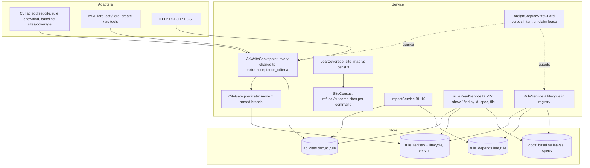
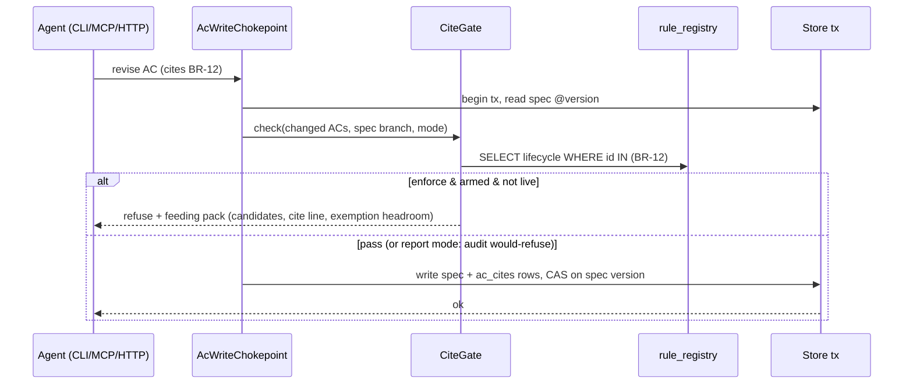

# Architecture: Baseline slice 2 — completeness census, per-branch citation gate, claim-scoped corpus authoring, then ten branch migrations

Design spec (architecture mode) for slice 2 of `spec-product-baseline-architecture-trees-the-product-s-current` (PRD v5: BL-4, BL-7 method v2 with completeness step, BL-10, BL-14, BL-15; slicing row 2). Synthesized 2026-10-08 from a 6-role parallel evaluation (performance / security / DX / operations / cost / domain). Owner chose option A after pilot v3 ("add the completeness check, then slice 2"), delegated approvals ("后面全自动"), and approved this design explicitly on 2026-10-08 (design-approval gate answered "批准，进入实现").

## Overview

Slice 1 made rules, citations and rule state exist; pilots v1–v3 made placement reproducible and rule truth evidence-backed. What is left is (1) a definition of "a leaf is complete" that a machine can check, (2) a citation gate that can be armed branch by branch without freezing spec work on the 877 uncited ACs, (3) a legal way for many sessions to author corpus content in parallel (today only the orchestrator on main can, issue #39), and (4) migrating ten branches. Slice 2 is therefore split: **2a machinery** (one plan), then **ten per-branch migration plans** that can run concurrently, each arming its own branch when its exit passes; **2c** closes with fidelity sampling and the resume diff once rules exist to sample.

## Scope

The goals and non-goals below define scope. Implementation plans: one plan for 2a (machinery, closed); the review-branch plan (probe-first, closed as a provisional pass); ONE fast-mode plan migrating the remaining 9 branches in parallel (owner, 2026-10-09; see Amendment log); one plan for 2c. The gate is armed only after all 12 branches are migrated (AC-BLS2-13).

### Goals / Non-Goals

Goals: G1 completeness is a mechanized oracle per leaf; G2 a citation gate with modes off/report/enforce, armed per branch, enforcing new and revised writes only, on every write path (CLI, MCP, HTTP, create, set); G3 corpus-authoring tasks executable from a worktree under a claim-scoped lease with real actor provenance; G4 rule lookup and impact (BL-10, BL-15 read path) served from transactional indexes, not by re-parsing the corpus; G5 ten branches migrated, each passing its own blind probe.

Non-goals: architecture tree, PRD split, SPEC-080 retirement, distribution/adoption to consumer projects (slice 3 — but every mode default here is chosen so a consumer upgrade refuses nothing); rewriting rules of the two populated branches beyond the completeness backfill.

## Acceptance Criteria

Structured ACs (`lore ac list` is the SSOT; ids `AC-BLS2-*`, unique corpus-wide). Each script AC names the test file its red-first task creates.

| AC | Covers | Oracle |
|---|---|---|
| AC-BLS2-1 | QA-3 AC write chokepoint on every entry point | vitest `packages/lore/tests/unit/service/ac-write-chokepoint.test.ts` |
| AC-BLS2-2 | C4 gate modes x armed branch, new/revised only, feeding pack | vitest `packages/lore/tests/unit/service/cite-gate.test.ts` |
| AC-BLS2-3 | QA-2 retire-vs-cite race | bun `packages/lore/tests/unit/store/cite-retire-race.bun.test.ts` |
| AC-BLS2-4 | C5 migration-014 indexes + mismatch count | bun `packages/lore/tests/unit/store/migration-014.bun.test.ts` |
| AC-BLS2-5 | C1/C2 census + coverage incl. not_measured (QA-4) | vitest `packages/lore/tests/unit/service/site-census.test.ts` |
| AC-BLS2-6 | C6 rule show/find/impact incl. cycles (QA-8) | vitest `packages/lore/tests/unit/service/rule-read-impact.test.ts` |
| AC-BLS2-7 | C6 feed governing-rules cap (QA-6) | vitest `packages/lore/tests/unit/service/feed-governing-rules.test.ts` |
| AC-BLS2-8 | C8 claim-scoped corpus authoring + provenance (QA-7) | bun `packages/lore/tests/integration/cli/corpus-scope-lease.bun.test.ts` |
| AC-BLS2-9 | snapshot narrowed to 4 doc types (QA-9 proxy) | vitest `packages/lore/tests/unit/service/rule-state-snapshot-scope.test.ts` |
| AC-BLS2-10 | exemptions: reason+expiry, 10% cap under concurrency | vitest `packages/lore/tests/unit/service/ac-exempt.test.ts` |
| AC-BLS2-11 | rollback: mode off / no baseline docs leaves outputs unchanged (QA-5) | bun `packages/lore/tests/e2e/baseline-slice2-rollback.bun.test.ts` |
| AC-BLS2-12 | specification + execution branches reach 0 coverage gaps | script over the live corpus (read-only) |
| AC-BLS2-13 | fast-mode arming exit: all 12 branches, cross-branch probe vs control | ai rubric |
| AC-BLS2-15 | census completeness and determinism | script: site-census-fidelity.test.ts |
| AC-BLS2-16 | review-branch exit (provisional pass) | ai rubric |
| AC-BLS2-17 | review confirmation via the cross-branch probe | ai rubric |
| AC-BLS2-18 | 9 fast-mode branches each migrated at 0 coverage gaps | ai rubric |
| AC-BLS2-14 | 2c fidelity >= 90% | ai rubric |

## Architecture Diagram

## Components

### C1 SiteCensus (completeness, BL-7 step 3)
- **Responsibility**: list every refusal/outcome emission site reachable from a command's service entry, keyed `file#symbol#code` (a `return err({code…})`, a gate predicate failure, or a recorded outcome). Static, deterministic; sites reached only through dynamic dispatch (predicate registry, hook) are reported as `not_measured`, never as covered.
- **Interface**: `lore baseline sites <command> [--json]`; library `listSites(commandEntry): Site[]`.
- **Measure today**: 377 `return err(` sites across service files (upper bound; reachability per command not yet traced).

### C2 LeafCoverage
- **Responsibility**: each leaf carries `site_map: {site → BR-n | "non-business:<reason>"}` (a new dedicated extra key, written only by its verb). Coverage = census(sites of the leaf's commands) vs site_map. Fails on any unmapped site, any site mapped to an unknown or inactive rule. `non-business` exclusions are counted and sampled by C7.
- **Interface**: `lore baseline coverage <leaf|branch> [--json]` (exit 0 only at 0 gaps and 0 not_measured unaccounted); `lore baseline map <leaf> --site <key> --rule BR-n | --non-business <reason>`.
- **Rule granularity it defines**: one rule per distinct business refusal or outcome; sites with the same business meaning map to one rule.

### C3 AcWriteChokepoint (closes #36 for ACs)
- **Responsibility**: every write that changes `extra.acceptance_criteria` — AcService verbs, `CorpusService.create` with ACs in extra, wholesale `set`/MCP `lore_set`/HTTP PATCH — passes through one service function. Two paths are sanctioned: the AcService verbs, and `create` (its inline criteria are treated as additions: same validation, same create-time wording check, same citation gate). A wholesale `set` (CLI, MCP, HTTP) that changes the array is refused unless byte-identical to the stored one. Writes `ac_cites` rows in the same transaction.
- **Interface**: internal `applyAcChange(spec, before, after, actor)`; refusal code `AC_WRITE_NOT_VIA_AC_VERB`.

### C4 CiteGate (BL-4)
- **Responsibility**: on an AC add or revise (not on untouched legacy ACs), refuse when the AC cites no live rule or cites a missing / deprecated / retired id — only if the gate mode is `enforce` AND the spec's branch is armed. In `report` mode it records a would-refuse audit row and passes. Liveness is read from `rule_registry.lifecycle` inside the write transaction (no check-then-write race with a concurrent retire).
- **Config**: `workflow.gates."ac-cite": { mode: off|report|enforce, armed_branches: [..] }`. Default: `off` when the corpus has no baseline docs, otherwise `report`. A spec's branch = the branch of the leaf most of its ACs cite; a spec citing nothing is "unplaced" and is treated as armed only when every branch is armed.
- **Exemptions**: `lore ac exempt <spec> <ac> --reason --expires --by` stored as rows; a grant that would exceed 10% of live ACs is refused (CAS on a counter, like rule-id allocation). Counted per branch in status.
- **Feeding pack on refusal**: top 5 candidate rules (by the spec's code anchors → the spec's branch → text match), a paste-ready `lore ac cite` line, and the remaining exemption headroom.
- **Placement in the baseline**: the gate's rules live in the specification branch (declare/revise leaves); "is this id live" depends on the product-baseline branch's lifecycle rule via Depends-on.

### C5 Rule indexes
- `rule_registry` gains `lifecycle` and `version` (kept in sync by every `rule set`); new tables `ac_cites(doc_id, ac_id, rule_id)` and `rule_depends(leaf_id, rule_id)`, written in the same transaction as their source doc. A status check reports any mismatch between the tables and the docs as a count (never silently repaired).

### C6 RuleReadService (BL-15 read path) and ImpactService (BL-10)
- `lore rule show <BR-n>` (statement, leaf, confidence, state, citing ACs), `lore rule find --spec <slug> | --file <path> | --text <q>` (file → specs whose code anchors cover it → their ACs' cites).
- `lore rule impact <BR-n>`: citing ACs + transitively dependent leaves via one recursive query; cycles reported with their member ids, never followed forever.
- Feed integration: `lore feed task-start` gains a "governing rules" section: rule id + statement only, cited rules first then by touched file, hard cap per surface (default 40 rules / ~2k tokens); overflow printed as a count.
- `RuleStateService.loadSnapshot` narrowed to baseline/spec/plan/task docs (today it parses every doc; `lore status --json` measured at 19.2 s).

### C7 Fidelity sampling (BL-14, slice 2c)
- Periodic sampled judging of (AC, cited rule) pairs and of `non-business` site exclusions; rule text passed as fenced, JSON-quoted data with a nonce delimiter; verdicts flag, never certify. Catch-all flag: a rule cited by more than a configured share of ACs.

### C8 Claim-scoped corpus authoring (fixes #39)
- **Responsibility**: a task may declare corpus intent on its claim (`lore claim --worktree … --corpus-scope <baseline-branch>`); the existing lease-fact mechanism in `ForeignCorpusWriteGuard` is widened so a worktree session holding that claim may write baseline docs of that branch, rules on its leaves, and `ac cite`/`baseline map` — and nothing else. Every such write carries the claim's actor, session and worktree in its version and audit rows (today AC audit rows say `actor: system`).
- The orchestrator remains the only approver; it no longer has to be the only writer.

## Data Flow — an armed-branch AC revision

## Quality Attribute Scenarios

| ID | Stimulus | Response | Measure |
|----|----------|----------|---------|
| QA-1 | `lore ac add/set/cite` in an armed branch | gate decision inside the write tx | p95 added latency <= 50 ms on a 1,500-rule corpus; 0 parses of non-baseline docs on this path |
| QA-2 | A rule is retired while another session cites it | exactly one of the two writes wins; the other is refused or its AC is flagged | 8-way parallel test, 0 ACs citing a retired rule without a flag |
| QA-3 | Wholesale `set` / MCP `lore_set` / HTTP PATCH / `create` changing an AC | refused unless byte-identical | one test per entry point, same refusal code |
| QA-4 | Coverage on a leaf with an unmapped site | exit non-zero naming the site | fixture with 1 unmapped + 1 dynamic site → reports 1 gap + 1 not_measured |
| QA-5 | Corpus upgraded with no baseline docs | gate mode resolves to off; outputs unchanged | rollback e2e as AC-BLS1-8 |
| QA-6 | `lore feed task-start` for a task whose spec cites 120 rules | capped section, overflow count | <= 40 rules printed, "+80 more" line |
| QA-7 | Two worktree sessions author two leaves of one branch | both land, distinct actors in audit | parallel test; audit rows carry each actor; a third session without corpus intent is refused |
| QA-8 | `rule impact` on a rule in a Depends-on cycle | cycle reported, terminates | fixture cycle of 3 leaves, output lists the cycle, < 1 s |
| QA-9 | `lore status --json` | narrowed snapshot | <= 5 s on today's corpus (19.2 s measured) |

## Trade-off Decisions

| Decision | Choice | Rationale | Trade-off | Dissenting view |
|---|---|---|---|---|
| D1 Slice shape | 2a machinery → 10 per-branch plans (parallel) → 2c fidelity + resume diff | all 6 roles; migration cost dominates, needs #39 and census first | three stages instead of one | none |
| D2 Completeness | mechanized census + site_map, agents only write rule text and justify non-business exclusions | all 6 roles; v3's only miss was an unstated refusal | census misses dynamic dispatch → reported as not_measured, never covered | none |
| D3 Gate scope | enforce new/revised ACs only; legacy uncited ACs counted, refused only when next revised | 877 uncited ACs would otherwise stall spec work | debt persists until touched | domain: armed branch must cite or exempt all old ACs — adopted as the branch EXIT bar (100% cited or exempt), not as a write refusal |
| D4 Arming | per branch, after that branch's exit passes (probe + coverage 0 gaps + 100% cited/exempt) | ops/dx/domain; vacuous vs done becomes visible per branch | mixed armed/unarmed state for weeks | none |
| D5 Gate config | three-state mode, default off without baseline docs, report otherwise | ops: today's two-state `enabled` defaults ON — would refuse consumer writes on upgrade | one more config shape | none |
| D6 Liveness source | registry `lifecycle` read inside the AC write tx | perf/ops: closes the retire-vs-cite race | lifecycle stored twice (leaf + registry) → mismatch count in status | none |
| D7 #39 | claim-scoped corpus intent on the existing lease fact | cost/dx/ops/security converge; reuses the guard | agents can write the live corpus — bounded to one branch, attributed | domain: separate seat identity — kept as the provenance requirement inside the lease |
| D8 Mappers | two mappers on the first 2 migrated branches; then one mapper + second mapper on LOW-confidence placements and a 20% random sample, IF those two branches stay <= 15% full-granularity disagreement | cost: second mapper earns its cost on ~1 in 9 ACs | some misplacement goes unseen; caught by C7 sampling | pilot method used two mappers everywhere |
| D9 BL-14 / resume diff timing | slice 2c, after branches exist | cost: nothing to sample before migration | PRD lists them in slice 2; they remain in slice 2, last stage | none |
| D10 Branch boundaries | re-test each branch's boundary (a term changes meaning) before its excavation; merging/recasting a branch (domain flagged session/context/autonomy and hygiene) needs an owner decision recorded as an ADR | domain; the 12-branch split was owner-approved | possible re-plan of 1–2 branches | domain wants the merge decided now |

## Risk Registry

| Risk | Severity | Mitigation | Owner |
|---|---|---|---|
| Gate certifies citations that a bypass path never checked (#36) | HIGH | C3 chokepoint lands before any branch is armed; QA-3 per entry point | 2a |
| Citation as ceremony (catch-all rules) | HIGH | feeding pack ranks by anchors; C7 catch-all flag; exemptions need reason + expiry | 2a / 2c |
| Census under-reports (dynamic dispatch) and a leaf reads "complete" | HIGH | not_measured is its own count; branch exit requires not_measured accounted (mapped or justified) | 2a |
| Agents writing the live corpus from worktrees damage it | MEDIUM | scope = one branch's baseline docs + cite/map verbs; CAS per doc; actor provenance; orchestrator approves | 2a |
| Retire-vs-cite race | MEDIUM | D6 + `--check-baseline` rescan | 2a |
| Mixed armed/unarmed state hides vacuous branches | MEDIUM | per-branch status block {mode, cited, uncited, exemptions, coverage gaps, not_measured, would_refuse_7d} | 2a |
| Status latency makes baseline checks unusable in hooks | MEDIUM | narrowed snapshot, QA-9 | 2a |
| Branch boundary wrong → mapper agreement drops | MEDIUM | D10 boundary test + per-branch two-mapper start (D8) | per-branch plans |
| Judge prompt injection through rule text | LOW | fenced JSON data, flag-only verdicts | 2c |

## Migration Plan

1. **2a machinery (one plan)**: C3 chokepoint → C5 indexes (migration-014: registry lifecycle/version, ac_cites, rule_depends, backfilled from docs in the same migration) → C4 gate (mode default off/report; no branch armed) → C1/C2 census + coverage → C6 read/impact + snapshot narrowing → C8 claim-scoped corpus intent. Backfill the two populated branches' site_maps with the new coverage tool (completeness for specification + execution). Exit: AC-BLS2-1..N attested; coverage of specification and execution at 0 gaps.
   **Rollback**: mode `off` restores slice-1 behaviour; migration-014 tables are additive (dropping them loses only derived indexes, rebuildable from docs); C3's refusal has a config kill switch recorded in audit.
2. **Arm specification and execution**: each needs 100% of its ACs cited or exempted (exemptions <= 10% overall) and a fresh blind probe frozen before the completeness backfill.
3. **Branch migrations — superseded 2026-10-09 by fast mode**: originally ten per-branch plans each ending in its own probe and arming. Now: freeze ONE 20-question cross-branch probe → excavate the 9 remaining branches in parallel → census/coverage to 0 gaps per branch → falsifying citations + downgrades → sampled fidelity → cross-branch probe vs corpus-only control (>= +2.0 of 20, 0 confident-wrong) → arm all branches together (AC-BLS2-13/18). **Rollback per branch**: remove it from `armed_branches`; its docs stay as report-only content.
4. **2c**: C7 fidelity sampling (>= 90% faithful) and the BL-15 resume diff (rules changed since claim).

## Downstream contracts

- **implement**: TS types — `Site {key: string; file: string; symbol: string; code: string; dynamic: boolean}`, `SiteMapEntry = {rule: string} | {nonBusiness: string}`, `CiteGateConfig {mode: "off"|"report"|"enforce"; armed_branches: string[]}`, `AcExemption {doc_id; ac_id; reason; expires_at; by; created_at}`; store migration-014; no new third-party dependencies (static census uses the TypeScript compiler API, already a root devDependency (typescript ^5.8.3, installed 5.9.3; verified 2026-10-08)).
- **test**: invariants QA-1..QA-9; refusal matrix per entry point × mode × armed; rollback e2e; parallel retire-vs-cite; coverage fixture with dynamic site.
- **deploy**: none beyond the store migration (additive, same release); consumer default resolves to `off`/`report`.

## Quality gates (architecture mode)

- [x] Every NFR has an architectural response with a measurable target (QA-1..QA-9)
- [x] All tension points have a decision + rationale (D1–D10)
- [x] High-severity risks have mitigations (bypass, ceremony, census under-report)
- [x] Migration phases defined with rollback (2a, arming, per branch, 2c)

### Amendment log
- 2026-10-08, AC-BLS2-1 re-baselined after red (task-skill-implement-ac-write-chokepoint-actor-provenance-on-ac). **Original**: create with criteria in extra was refused like a wholesale set (statement: "outside the AC verbs (create with criteria, wholesale set via CLI, MCP lore_set, HTTP PATCH) is refused ... 4 of 4 entry points"). **Failure it produced**: the implementation that satisfied it broke 14 test files that seed specs through create, and made the spec-create inline-AC wording check unreachable — i.e. it deleted the behaviour of established baseline rule BR-5 (criteria supplied at creation must meet the wording rule). **Why this is a correction, not a weakening**: create still passes through the chokepoint, so no AC write path bypasses it; refusing create would have removed a product rule, not closed a hole. The bypass the AC targets (#36: wholesale extra replacement) stays refused on all three adapters.

- 2026-10-08: index/exemption identity column renamed spec_id -> doc_id (the repo's drift-row census forbids the retired spec_* spellings); naming only, no behaviour change.

- 2026-10-08, AC-BLS2-3 re-baselined (strengthened). **Original command**: `cd packages/lore && bun test tests/unit/store/cite-retire-race.bun.test.ts && echo ...`. **Failure it hid**: the I6 implementer withheld the in-transaction liveness read and ran the race test 4 times — it stayed green, because a cite landing on a retired rule is still counted as flagged; the oracle could not falsify D6. **Why a correction, not a weakening**: the command now also runs tests/unit/store/cite-gate-in-tx.bun.test.ts, which retires the rule between the gate's early read and the write and goes red (2 failures) without the in-transaction read; the original assertions are kept.

- 2026-10-08, AC-BLS2-11 re-baselined (statement made true, oracle unchanged). **Original**: "With gate mode off, or with no baseline documents, every pre-existing command output is byte-identical to the slice-1 output". **What measurement showed**: with baseline docs and mode off, status --json gains the C4/C5 fields index_mismatch and exemptions_* (designed additions), so 'byte-identical' was literally false for that case. **Why a correction, not a weakening**: the no-baseline case keeps byte-identity; the mode-off case now states the property that matters (the gate has no effect) and names the only allowed status difference; the R11 test asserts exactly this, with positive controls proving the detectors see the gate when it is on.

- 2026-10-08, AC-BLS2-12 command re-baselined. **Original**: `lore baseline coverage <branch> && ...` (compiled binary). **Failure**: exit 4 census:typescript-unavailable — the compiled binary cannot load typescript (issue #58, a distribution defect independent of the backfill). **Why a correction, not a weakening**: the same coverage check now runs from source in this checkout, where it reported 0 gaps and 0 not_measured on all 16 leaves; the binary failure stays open and visible as #58 (a slice-3 distribution blocker), not hidden by this AC.

- 2026-10-08, AC-BLS2-15 ADDED (not a change to an existing AC): both branch backfills reached 0 gaps in worktrees but failed on main — the census depended on node_modules layout (#60) and missed refusals not built with err() and same-code different-field sites (#59). AC-BLS2-15 pins completeness and determinism; AC-BLS2-12 was re-measured under the fixed census (keys changed, both branches remapped).
- 2026-10-08, backfill delta after the citation gate merged: the gate added refusal sites to ac add/set/cite/create; the census surfaced them (gap) and rules BR-257..BR-260 were added to the cite leaf (BR-257/259 cited by AC-BLS2-2, BR-260 by AC-BLS2-3); BR-95 (undecided: 'will a gate refuse') deprecated because the gate now exists.

- 2026-10-09, AC-BLS2-16 ADDED (owner choice B): review-branch migration exit, registered before its plan and before any measurement.
- 2026-10-09, AC-BLS2-13 and AC-BLS2-16 re-baselined (owner choice A). **Original**: the deciding probe had to be frozen before the branch's FIRST document. **Failure**: the review branch's attempt 1 scored 8.5/10 with 0 confident-wrong (`knowledge-review-branch-migration-assessment-against-ac-bls2-16`); every miss was an absence (exit codes, a generic edit-keeps-approval rule), and under the original wording a branch that fails once can never be armed, since any later probe postdates the branch. **Why a correction, not a weakening, and what it costs**: the independence the original wording bought (the probe author cannot have seen the branch) is kept by requiring an author who never read the branch, writing from code only, frozen before the remediation revision; the earlier attempts stay on record and only one re-probe is allowed per remediation revision, so probe-shopping is visible and bounded. It IS weaker in one respect, stated plainly: the remediation is informed by attempt 1's failure categories (not its questions), so the re-probe measures a branch revised after a failure. The score bars (>= 9/10, 0 confident-wrong) are unchanged.

- 2026-10-09, AC-BLS2-13 and AC-BLS2-16 probe bar re-baselined from absolute to RELATIVE (owner choice A after the corpus-only control). **Original**: blind score >= 9/10 and 0 confident-wrong. **Failure**: review attempt 1 8.5/10, re-probe 7.5/10, both 0 confident-wrong; no baseline branch has reached 9/10 (v3 8/10). **Evidence for the change** (`knowledge-corpus-only-control-on-both-review-branch-probes`): on the same probes a corpus-only reader scored 7.0 and 6.5, so the baseline led by +1.5 and +1.0 (+1.0 and +1.0 under the graders' lenient readings) and let the reader commit correctly 7/10 vs 1-2/10; the absolute bar was measuring the probe protocol's appetite for code-level edge details (>= 4 prose-vs-code discriminators), not the baseline's value over the corpus, which is what PRD kill criterion (2) already names as the bar to beat. **What it costs, stated plainly**: this is a weaker bar decided after two failures; n = 2 probes on one branch; a branch can now pass at 7.5/10. It keeps 0 confident-wrong as an absolute floor and requires a control on every probe, so a branch whose corpus is already good must still beat it by a full point.

- 2026-10-09, AC-BLS2-17 ADDED and AC-BLS2-13 amended (owner choice A after the review-branch plan review escalated). **Problem**: the relative bar (+1.0 over the corpus-only control) was proposed by the orchestrator after both probes and controls were scored and equals the observed margin on the deciding probe, so the review branch's PASS under it is not an independent oracle. **Correction**: the relative bar is now pre-registered; the review result is recorded as a PROVISIONAL pass; arming review requires a binding confirmation probe frozen after this registration (AC-BLS2-17), and AC-BLS2-13 requires such a confirmation for any branch whose deciding probe predates the registration. Every later branch is measured against the bar as registered, so no further post-hoc bar is possible without another amendment.

- 2026-10-09, FAST MODE (owner: "migrate quickly; historical data need not be this strict", then option A). AC-BLS2-13 rewritten, AC-BLS2-17 rewritten, AC-BLS2-18 added. **Dropped**: a blind probe + control per branch (replaced by ONE 20-question cross-branch probe, frozen before the 9 remaining branches' first document, author never read any branch, baseline >= control + 2.0 of 20, 0 confident-wrong); 100% cited-or-exempt for legacy criteria (the gate refuses only added or revised criteria, so legacy uncited criteria never block); fidelity over every pair (now <= 20 sampled pairs per branch, >= 90%). **Kept**: rules checked against code; completeness census 0 gaps per branch; established/observed only with a falsifying script-mode citation; orchestrator re-runs every oracle on main. **Arming** now waits until all 12 branches are migrated. **Cost**: a branch can no longer be armed on its own evidence; a weak branch is detected only through the shared probe (>= 1 question per branch, so per-branch accuracy is not measured). AC-BLS2-16 (review exit, provisional pass) stays as recorded; AC-BLS2-17's separate confirmation probe is folded into the cross-branch probe.

- 2026-10-09, AC-BLS2-13 re-baselined after fast-mode attempt 1 failed (owner choice A: remediate and re-probe once). **Original (fast mode)**: the probe had to be frozen before the first document of the 9 fast-mode branches, with no re-probe clause. **Failure**: attempt 1 (`knowledge-fast-mode-migration-assessment-12-branches-populated`) had 1 confident-wrong and 78.6% sampled fidelity; under the original wording no later probe could ever qualify. **Why a correction, not a weakening**: it restores the one-re-probe-per-remediation-revision rule the owner had already approved for the review branch (dropped by oversight in the fast-mode rewrite, caught by the plan review); the score bars are unchanged; the fidelity sample must now be drawn after the last citation change, which is stricter.

- 2026-10-09, AC-BLS2-13 item (4) re-baselined (owner choice A after the fast-mode plan review escalated). **Original**: the fidelity sample must be drawn after the last citation change. **Problem**: after the post-remediation sample (205/224 = 91.5%, seed 20261010) the 19 cites its judges found unfaithful were removed; under the original wording that removal invalidates the sample, and every measure-then-remove cycle would invalidate the next one, so the bar could never be closed on a corpus that is also kept honest. **Why a correction, not a weakening**: only additions and repointings can introduce an unfaithful cite; removing a cite already judged unfaithful can only raise fidelity, so the measured rate is a lower bound on the post-removal state. Removals after measurement must be listed in the assessment.

## Acceptance Criteria (structured)

- [⚑] [script] AC-BLS2-1: Every write that changes a spec's acceptance criteria passes through one chokepoint: the AC verbs and create (inline criteria treated as additions with the same validation and gates) are the only sanctioned paths; a wholesale set via CLI, MCP lore_set or HTTP PATCH that changes the criteria is refused with one refusal code unless byte-identical; 3 of 3 wholesale entry points refused and create gated, all tested
  script: test — bunx vitest run packages/lore/tests/unit/service/ac-write-chokepoint.test.ts && echo 'AC-BLS2-1 PASS: all 4 entry points refuse a non-verb AC change with one code'
- [⊘] [script] AC-BLS2-2: The citation gate refuses an added or revised criterion citing no live rule only when mode is enforce AND the spec's branch is armed; report mode records 1 would-refuse audit row and passes; untouched legacy criteria are never refused; the refusal lists up to 5 candidate rules and a paste-ready cite line
  script: test — bunx vitest run packages/lore/tests/unit/service/cite-gate.test.ts && echo 'AC-BLS2-2 PASS: mode x armed matrix, legacy untouched, feeding pack with <=5 candidates'
- [⚑] [script] AC-BLS2-3: With 8 concurrent sessions retiring a rule while citing it, 0 criteria end up citing a retired rule without a flag; the liveness read happens inside the citing write's transaction
  script: test — bunx --bun vitest run packages/lore/tests/unit/store/cite-retire-race.bun.test.ts packages/lore/tests/unit/store/cite-gate-in-tx.bun.test.ts && echo 'AC-BLS2-3 PASS: race leaves 0 unflagged retired citations AND the liveness read is inside the write tx (in-tx test red without it)'
- [⚑] [script] AC-BLS2-4: Store migration 14 adds rule lifecycle and version to the registry plus citation and depends-on index tables, backfilled from documents; status reports any index-vs-document mismatch as a count, 0 on a clean corpus
  script: test — bunx --bun vitest run packages/lore/tests/unit/store/migration-014.bun.test.ts && echo 'AC-BLS2-4 PASS: migration-014 backfill matches documents; mismatch count 0'
- [⚑] [script] AC-BLS2-5: The site census lists every refusal site reachable from a command keyed file#symbol#code; coverage on a fixture leaf with 1 unmapped site and 1 dynamically dispatched site reports exactly 1 gap and 1 not_measured and exits non-zero
  script: test — bunx vitest run packages/lore/tests/unit/service/site-census.test.ts && echo 'AC-BLS2-5 PASS: census + coverage report 1 gap and 1 not_measured on the fixture'
- [⚑] [script] AC-BLS2-6: rule show prints a rule's statement, leaf, confidence, state and citing criteria; rule find resolves by spec, by file through code anchors, and by text; rule impact lists citing criteria and transitively dependent leaves and reports a 3-leaf depends-on cycle by its members in under 1 second
  script: test — bunx vitest run packages/lore/tests/unit/service/rule-read-impact.test.ts && echo 'AC-BLS2-6 PASS: show/find/impact incl. 3-leaf cycle reported and terminated'
- [⚑] [script] AC-BLS2-7: The task-start feed's governing-rules section prints at most 40 rules (cited first, then by touched file) and an overflow count line when more exist
  script: test — bunx vitest run packages/lore/tests/unit/service/feed-governing-rules.test.ts && echo 'AC-BLS2-7 PASS: governing rules capped at 40 with overflow count'
- [⊘] [script] AC-BLS2-8: A worktree session whose claim declares corpus scope for one branch can write that branch's baseline documents, rules, citations and site maps, with its own actor in every version and audit row; a session without that scope is refused; 2 parallel scoped sessions both land
  script: test — bunx --bun vitest run packages/lore/tests/integration/cli/corpus-scope-lease.bun.test.ts && echo 'AC-BLS2-8 PASS: scoped worktree corpus writes land with actor provenance; unscoped refused'
- [⚑] [script] AC-BLS2-9: The rule-state snapshot parses only baseline, spec, plan and task documents; a corpus with 1000 knowledge documents adds 0 parses to the snapshot path
  script: test — bunx vitest run packages/lore/tests/unit/service/rule-state-snapshot-scope.test.ts && echo 'AC-BLS2-9 PASS: snapshot parses 4 doc types only'
- [⚑] [script] AC-BLS2-10: A criterion exemption requires a reason, an expiry and an actor; a grant that would exceed 10% of live criteria is refused, also when 8 grants race
  script: test — bunx vitest run packages/lore/tests/unit/service/ac-exempt.test.ts && echo 'AC-BLS2-10 PASS: exemptions need reason+expiry; 10% cap holds under 8-way race'
- [⚑] [script] AC-BLS2-11: With no baseline documents, every pre-existing command output is byte-identical to slice 1; with baseline documents and gate mode off, the gate has no effect at all (0 refusals, 0 would-refuse audit rows, ac add/set/get/feed outputs identical to the no-baseline control apart from slice-1 baseline hints) and the status baseline block differs only by the C4/C5 fields index_mismatch and exemptions_*
  script: test — bunx --bun vitest run packages/lore/tests/e2e/baseline-slice2-rollback.bun.test.ts && echo 'AC-BLS2-11 PASS: mode off / no baseline docs: outputs byte-identical to slice 1'
- [⊘] [script] AC-BLS2-12: After the completeness backfill, the specification and execution branches each report 0 coverage gaps and 0 unaccounted not_measured sites on the live corpus (read-only check)
  script: other — bun run packages/lore/src/index.ts baseline coverage baseline-specification-and-acceptance && bun run packages/lore/src/index.ts baseline coverage baseline-execution && echo 'AC-BLS2-12 PASS: specification and execution report 0 coverage gaps (census run from source; binary path tracked as #58)'
- [⊘] [ai] AC-BLS2-13: Fast mode (owner choice A 2026-10-09): the gate is armed on a branch only after ALL 12 branches are migrated and (1) every branch's leaves report 0 coverage gaps; (2) 0 established or observed rules in any branch lack a citing live script-mode criterion; (3) one cross-branch blind probe of 20 questions, written from code only by an author who never read any baseline branch, frozen before the first document of the 9 fast-mode branches — or, after a recorded failed attempt, ONE re-probe per remediation revision frozen before that revision's first corpus write, earlier attempts kept on record — is answered by a reader holding all 12 branches at >= 2.0 points (of 20) above a corpus-only control reader on the same probe, with 0 confident-wrong for the baseline reader, separate graders, the same fixed scoring rules as the review attempts; (4) a sampled fidelity judge finds >= 90% faithful over up to 20 (criterion, rule) pairs per branch, drawn after the last citation addition or repointing (removals of cites judged unfaithful may follow the measurement and are recorded, since a removal cannot lower fidelity). Legacy criteria are NOT required to be cited or exempted: the gate refuses only added or revised criteria
  ai: Pass only if the fast-mode assessment records: per-branch coverage exit 0 for all 12 branches; established|observed rule
- [⚑] [ai] AC-BLS2-14: After all branches are armed, an independent sampled judge finds at least 90% of at least 100 sampled (criterion, cited rule) pairs faithful, and flags every rule cited by more than 5% of criteria as a probable catch-all
  ai: Pass only if the 2c fidelity record shows sample size >= 100 drawn by a recorded seed, faithful share >= 90%, rule text 
- [⊘] [script] AC-BLS2-15: The census is complete and deterministic: (1) every expression whose contextual type is the product error type is a site, whether or not it is wrapped in err(), including errors built in core pure functions and CLI usage refusals reachable from the command; (2) sites in one function with different field values are distinct keys; (3) the same commit yields byte-identical site keys under 2 different node_modules layouts
  script: test — bunx vitest run packages/lore/tests/unit/service/site-census-fidelity.test.ts && echo 'AC-BLS2-15 PASS: census sees non-err refusals, distinct fields, layout-independent keys'
- [⊘] [ai] AC-BLS2-16: Review branch migration exit (method v2, owner choice B 2026-10-09; re-probe and relative probe bar by owner choices A 2026-10-09): (1) on the deciding 10-question probe (every question assigned by the placement ADR to specification, execution or review, at least 6 to review) — either frozen before the first review-branch document (attempt 1) or a NEW set written from code only by an author who never read the branch and frozen before the remediation revision — a blind reader holding all three populated branches scores at least 1.0 point above a corpus-only control reader on the same probe, with 0 confident-wrong for the baseline reader, each graded by a separate agent under the same fixed rules, every attempt and its control kept on record; (2) lore baseline coverage on the review branch exits 0; (3) 0 established or observed review-branch rules lack a citing live script-mode AC whose named test fails if the rule is false; (4) every live spec placed in the review branch has 100% of its live criteria cited or exempted, with exemptions <= 10% of live criteria corpus-wide; (5) an independent judge finds >= 90% of the review branch's (criterion, cited rule) pairs faithful
  ai: Pass only if the review-branch assessment records each number: the deciding probe's creation time precedes the first rev
- [·] [ai] AC-BLS2-17: Review branch confirmation (fast mode, owner choice A 2026-10-09): the review branch's provisional pass under the post-hoc relative bar is confirmed only by the fast-mode cross-branch probe of AC-BLS2-13 (frozen after the relative bar's registration), whose review questions (>= 2 of 20) the baseline reader answers with 0 confident-wrong; no separate review-only probe is run
  ai: Pass only if the fast-mode assessment reports the review questions of the cross-branch probe separately: count >= 2, bas
- [⚑] [ai] AC-BLS2-18: Each of the 9 fast-mode branches (corpus, product-baseline, session, hygiene, autonomy, issue-loop, distribution, sync, context) exists as a branch with Boundary, glossary and leaves; every rule was checked against code (file:line recorded by its excavator); its leaves declare their commands and lore baseline coverage on the branch exits 0; established or observed rules each have a live script-mode citing criterion, all other rules are unconfirmed or undecided with an open question
  ai: Pass only if, for each of the 9 branches, the fast-mode record lists: leaf count, rule count by confidence, coverage exi
- [⚑] [script] AC-BLS2-19: Under ac-cite enforce on an armed branch, through the real AcService write path (describe 'cite gate admits exempted uncited criteria (#105)'): removing an exempted criterion's sole citation exits 0 and stores the criterion uncited; the same removal with an expired exemption, or with no exemption, exits 4 AC_CITE_REQUIRED and writes nothing; an exempted criterion revised to cite a retired rule is still refused; an exemption on a different criterion of the same spec admits nothing
  script: test — bunx --bun vitest run packages/lore/tests/unit/service/cite-gate-exemption.bun.test.ts && echo 'AC-BLS2-19 PASS: unexpired exemption admits an uncited criterion; expired/absent/other-criterion exemption and retired cites still refused'
- [⚑] [script] AC-BLS2-20: The census follows functions passed by dependency injection (describe 'census follows injected functions (#104)'): for 'uat record', the sites behind its injected createUatDoc/addLink (CorpusService._createImpl's extra.sub_type refusal, the store's insertWithProvenance/addLink) are listed; an injected call the census cannot resolve is reported as not measured, which makes coverage incomplete; never a silent omission
  script: test — bunx vitest run packages/lore/tests/unit/service/site-census-injection.test.ts && echo 'AC-BLS2-20 PASS: census reaches injected-function sites or reports them not measured'
- [⚑] [script] AC-BLS2-21: lore baseline fidelity --size N --seed S [--judges 2] --ai (describe 'fidelity sampling (C7)', InMemoryStore + recording stub AI): same corpus/size/seed -> identical pair list; size > pool -> exit 2, nothing stored; rule text is delivered inside a nonce delimiter and an injected instruction in it does not change the stub's parsed verdicts; a judge reply missing a pair -> exit 6, no record; two judges with 3 disagreements -> the 3 are listed and decided by the adjudicator; a rule cited by > 5% of citing criteria is listed as catch-all; no rule, citation or confidence changes
  script: test — bunx vitest run packages/lore/tests/unit/service/fidelity-sample.test.ts && echo 'AC-BLS2-21 PASS: deterministic sample, nonce-fenced data, exit 2/6 refusals, two-judge adjudication, catch-all list, read-only on rules'
- [⚑] [script] AC-BLS2-22: Session resume for a claimed task (describe 'resume lists rule changes since claim (BL-15)'): a governing rule whose statement, confidence or lifecycle changed after the claim's timestamp is listed with old and new value; a rule retired since the claim is listed as retired; with no change the output has the one line 'governing rules unchanged since claim'; a change made before the claim is not listed
  script: test — bunx vitest run packages/lore/tests/unit/service/resume-rule-diff.test.ts && echo 'AC-BLS2-22 PASS: resume shows rule changes since claim, retired listed, unchanged line, pre-claim changes excluded'
- [⚑] [script] AC-BLS2-23: lore baseline fidelity --exclusions (describe 'exclusion sampling (C7)'): a seeded sample of non-business site_map entries is judged by the stub AI, the record stores each verdict and the wrong share, same seed -> same entries, and no site_map changes
  script: test — bunx vitest run packages/lore/tests/unit/service/fidelity-sample.test.ts && echo 'AC-BLS2-23 PASS: exclusion sampling deterministic, recorded, read-only'

## Code anchors

- packages/lore/src/service/ac-write-chokepoint.ts
- packages/lore/src/service/ac-cite-gate.ts
- packages/lore/src/service/ac-exemption-service.ts
- packages/lore/src/service/site-census.ts
- packages/lore/src/service/site-census-nonbusiness.ts
- packages/lore/src/service/leaf-coverage.ts
- packages/lore/src/service/rule-read-service.ts
- packages/lore/src/service/impact-service.ts
- packages/lore/src/service/rule-index-queries.ts
- packages/lore/src/service/rule-index-loader.ts
- packages/lore/src/service/governing-rules.ts
- packages/lore/src/service/foreign-corpus-write-guard.ts
- packages/lore/src/store/migrations/migration-014.ts
- packages/lore/src/store/index-rows.ts
- packages/lore/src/service/fidelity-sample.ts
- packages/lore/src/service/resume-rule-diff.ts
