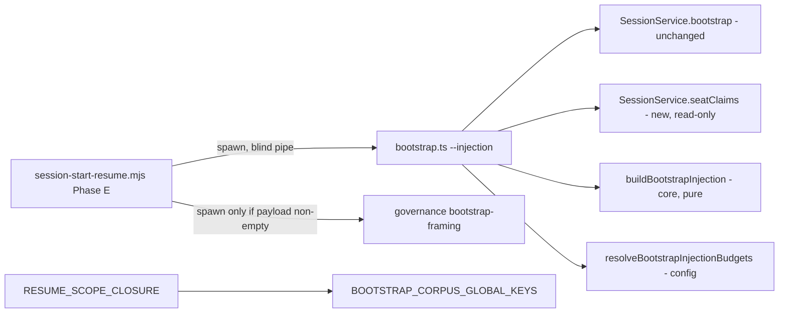

## Overview/Goal

The SessionStart hook injects `lore bootstrap --injection` into EVERY session. SPEC-080 (`spec-080-bootstrap-injection-projection-tier-1-tier-2-payload`) already split tier-1 (injected) from tier-2 (pulled), but tier-1 still carries corpus-global state. Measured on this repo 2026-10-11 (a real session-start payload):

| Injected field | Value that session received | Changes what the session does? |
|---|---|---|
| `my_claims`, `active_sessions` | `[]`, `[]` | no (empty) |
| `armed_gates` | 5 checkpoint names | no — a denial carries its own feeding pack (SPEC-049) |
| `root`, `strategy`, `corpus` | static pointers / totals | no — one `lore get` / `lore status` away |
| `pending_reviews` | count 266 + 3 slugs | no — maintenance queue, not this task |
| `latest_handoffs` | 3 plan handoffs | NEGATIVE — the feed rule forbids acting on them, so a counter-rule exists only to neutralize the injection |
| `archive_candidates` | 14 | no — `lore archive --sweep` territory |

A large part of the session governance prose exists only to defuse this payload: `BOOTSTRAP_SCOPE_DECLARATION`, `BOOTSTRAP_FRAMING_LINE`, the feed rule's "every field is corpus-global … never resume from an injected handoff pointer" paragraph, and `spec-session-start-handoff-neutrality-injection-drops-resume`. Meanwhile eight shipped skill/agent/rule assets instruct agents "bootstrap is hook-injected — consume it, do not re-call", which turns a pull-on-demand fact into a do-not-look rule.

**Goal (user decisions 2026-10-11)**: only a session opened in a linked worktree (a seat) is handed anything at start, and only that seat's own open items — unfinished claims recorded for the seat's branch, and (when the branch names a plan) that plan's newest handoff. A main-checkout session, or a seat with neither, is handed nothing. Corpus-global state becomes pull-only (`lore bootstrap`, `lore ready <plan>`, `lore pending`, `lore list --type plan`). The full report (`lore bootstrap --json`, MCP `lore_bootstrap`) is unchanged.

**Why `my_claims` goes too**: under run identity (`adr-run-identity-is-issued-by-lore-and-attested-by-the-harness` §1–2) SessionStart registers a NEW main run, which holds no claim at that instant; claims are taken only by implementer subagents (SubagentStart — never reached by this injection). `my_claims` also still filters by actor string (`session-service.ts` `claim.by !== by`), a pre-run-identity key. At session start it is structurally empty or a stale-`LORE_ACTOR` false positive.

**Why the seat keeps something**: the hook's 100%-delivery rationale (SPEC-080 §Hook role) holds only for signals the agent would not know to ask for AND that change its behaviour whatever the task. A session opened in a worktree where a previous run died mid-task has exactly that: an unfinished claim recorded with `--worktree <this branch>` (`taskClaimSchema.worktree`, packages/core/src/task-workflow.ts), and the seat plan's newest handoff (`spec-session-start-handoff-neutrality-injection-drops-resume` D1/D2). The hook's `seatBranchForBootstrap` is the raw `git rev-parse --abbrev-ref HEAD` of that worktree — the same string an implementer records via `--worktree "$(git branch --show-current)"` — so the match is exact string equality.

## Scope

In scope:
- `packages/core/src/session.ts` — `buildBootstrapInjection` contract, `BootstrapInjection` schema, `BOOTSTRAP_SCOPE_DECLARATION`, `BOOTSTRAP_FRAMING_LINE`, `BOOTSTRAP_INJECTION_KNOWN_KEYS` → split into `BOOTSTRAP_CORPUS_GLOBAL_KEYS` + `BOOTSTRAP_RESUME_CLOSURE_KEYS` (D8), `RESUME_SCOPE_CLOSURE` wording.
- `packages/core/src/config.ts` — `workflow.bootstrap_injection.{max_active_plans,max_handoffs,max_pending_slugs}` retired; `char_budget` kept.
- `packages/lore/src/service/session-service.ts` — new read method `seatClaims(seat)`; `bootstrap()` untouched.
- `packages/lore/src/adapters/cli/commands/bootstrap.ts` — `--injection` composes report + seat claims; the EXISTING `--seat-worktree <dir>` (SPEC-057 D2) becomes consulted and REQUIRED with `--seat-branch` in `--injection` mode — its `process.cwd()` default is removed for that mode, and either flag without the other exits 2 (D11); prints NOTHING (exit 0) when the payload is empty.
- `assets/hooks/session-start-resume.mjs` Phase E — passes `--seat-worktree` (the seat's `git rev-parse --show-toplevel`, realpath) with `--seat-branch` (D11); its own comment stops calling the bootstrap hook-injected; empty stdout + exit 0 is "nothing to inject", not degradation; framing spawned only when a payload exists.
- Shipped prose that tells agents to consume the injection instead of pulling (exhaustive list in D7).
- Baseline leaf `baseline-start-a-session`: BR-328, BR-329, BR-981 rewritten in place; leaf Constraint paragraph + Current values table.

Out of scope (unchanged, REGRESSION surface):
- `BootstrapReport`, `bootstrapReportSchema`, `SessionService.bootstrap`, plain `lore bootstrap [--json]`, MCP `lore_bootstrap` — byte-identical.
- Phase D seat briefing (BR-1019), `session-start-fragments` hook, SPEC-057 seat resolution, `deriveResumeHint`.
- BR-331 (archived tasks keep their claim in the full report) — not decided here; the NEW seat-claims read filters terminal tasks itself (D3).
- Existing specs SPEC-080 / context-provenance / handoff-neutrality and their ACs — execution records, never edited (ADR-041). Their retired assertions are removed from the old test files; NEW behaviour is asserted only in NEW test files (D10). Per-AC supersession has no tool support: issue #154.

## Module Boundary

**Public API (changed)** — `@lore/core` `session.ts`:
- `buildBootstrapInjection(input: BootstrapInjectionInput, budgets): BootstrapInjectionResult` — still pure, still the SOLE owner of injection selection + budget. Returns `{payload: null, json: ""}` when there is nothing to inject.
- `BootstrapInjectionBudgets` → `{ charBudget: number }` only.
- `bootstrapInjectionSchema` — exact key set, `.strict()`.
- `BOOTSTRAP_INJECTED_KEYS` (new, exported): the closed allowlist `scope_declaration, resume_hint, seat_claims, budget_exceeded`.
- `bootstrapSeatClaimSchema` / `BootstrapSeatClaim` (new): `{task_slug, plan_slug, claimed_at, stale}`.

**Public API (new)** — `SessionService.seatClaims(seat: BootstrapSeatSignal): Promise<Result<BootstrapSeatClaim[], LoreError>>` (reuses the existing `{branch, worktree}` signal type — no third name for the seat) — read-only; every task whose `extra.claim.worktree` equals `seat.branch`, OR is an ABSOLUTE path that resolves to the same directory as `seat.worktree` (D11, D12), and whose status is not `archived`/`deprecated`, sorted `claimed_at` ascending; staleness by the same `claimTtlMinutes` as `bootstrap()`.
- `BOOTSTRAP_CORPUS_GLOBAL_KEYS` (rename of `BOOTSTRAP_INJECTION_KNOWN_KEYS`): the full-report fields that are pull-only. `RESUME_SCOPE_CLOSURE` derives its field list from it.

**Internal**: count caps, dead-plan filter, `omitted` ledger, D8 unknown-field append loop — all deleted (they served fields no longer injected).

**Dependencies**: `BootstrapReport` (unchanged) + `SessionService.seatClaims`. No new package dependency. `my_claims` stays in the full report (not this spec's to remove) but never enters the injection.

## Structure

```
packages/core/src/session.ts                       # projection + constants (changed)
packages/core/src/config.ts                        # retire 3 knobs, keep char_budget
packages/lore/src/service/session-service.ts       # + seatClaims(BootstrapSeatSignal), injected realpath port
packages/lore/src/adapters/cli/commands/bootstrap.ts   # compose; empty payload → no stdout
assets/hooks/session-start-resume.mjs              # Phase E empty handling + spawn order
assets/context/corpus-workflow-1-feed.md           # FEED bullet rewritten
assets/agents/lore-explorer.md                     # pull instead of consume
assets/skills/shared/lore-cli-map.md
assets/skills/shared/project-context-loading.md
assets/skills/lore-operate/SKILL.md
assets/skills/lore-plan/references/mode-resume.md
assets/skills/lore-plan/references/mode-list.md
assets/skills/lore-plan/references/mode-create.md
assets/skills/lore-plan/references/workflow-examples.md
assets/project/CLAUDE.md.template                  # `lore bootstrap` line says pull-on-demand
# NEW test files — the only place new behaviour is asserted (D10)
packages/core/tests/unit/bootstrap-seat-injection.test.ts
packages/lore/tests/unit/service/session-service-seat-claims.test.ts
packages/lore/tests/unit/hooks/session-bootstrap-seat-injection.test.ts
packages/lore/tests/e2e/session-start-seat-injection-hook-compiled.bun.test.ts   # AC-SI-12 live hook -> binary wiring
packages/lore/tests/e2e/bootstrap-seat-injection-compiled.bun.test.ts
# OLD test files — retired assertions DELETED, nothing new added
packages/core/tests/unit/bootstrap-injection.test.ts
packages/core/tests/unit/bootstrap-injection-provenance.test.ts
packages/lore/tests/unit/hooks/session-bootstrap-injection.test.ts
packages/lore/tests/e2e/bootstrap-injection-compiled.bun.test.ts
packages/lore/tests/e2e/context-provenance-compiled.bun.test.ts
packages/lore/tests/e2e/governance-bootstrap-framing-compiled.bun.test.ts
packages/lore/tests/e2e/context-fragments-compiled.bun.test.ts
# regression run; only the argv expectation the new flag changes is updated
packages/lore/tests/unit/hooks/session-seat-injection.test.ts
# constant rename only (rename-only edits; no assertion changes)
packages/lore/tests/unit/adapters/mcp-session-tools.test.ts
packages/lore/tests/integration/cli-feed-task-start.bun.test.ts
packages/core/tests/unit/resume-coverage-constants.test.ts
packages/lore/tests/unit/flows/feed-flow-resume-closure.test.ts
```

## Public Interface (TypeScript)

```ts
export const BOOTSTRAP_INJECTED_KEYS: ReadonlySet<string>;      // scope_declaration, resume_hint, seat_claims, budget_exceeded
export const BOOTSTRAP_CORPUS_GLOBAL_KEYS: ReadonlySet<string>; // root, active_plans, pending_reviews, armed_gates,
                                                                // latest_handoffs, corpus, active_sessions, archive_candidates, strategy

export interface BootstrapInjectionBudgets {
  charBudget: number; // default 8000, compact-serialized length
}

export interface BootstrapSeatClaim { task_slug: string; plan_slug: string; claimed_at: string; stale: boolean }

export interface BootstrapInjectionInput {
  report: BootstrapReport;
  seat: { branch: string; worktree: string; planResolved: boolean; claims: BootstrapSeatClaim[] } | null; // null ⇔ main checkout
}

export interface BootstrapInjection {
  scope_declaration: string;                 // BOOTSTRAP_SCOPE_DECLARATION, always first
  resume_hint?: BootstrapResumeHint;         // present iff seat.planResolved && report.resume_hint !== null
  seat_claims: BootstrapSeatClaim[];         // seat.claims verbatim (may be [] when resume_hint fired it)
  budget_exceeded?: true;                    // present-iff-true, payload intact
}

export interface BootstrapInjectionResult {
  payload: BootstrapInjection | null;        // null ⇔ nothing personal to inject
  json: string;                              // "" ⇔ payload === null
}

export function buildBootstrapInjection(
  input: BootstrapInjectionInput,
  budgets: BootstrapInjectionBudgets,
): BootstrapInjectionResult;
```

Trigger predicate (the ONE place it is decided): `seat !== null && (seat.claims.length > 0 || (seat.planResolved && report.resume_hint !== null))`. A seat whose branch names no plan (e.g. a harness `worktree-agent-*` branch) still gets its claims; it never gets a resume pointer (BR-326).

New constant texts (exact wording is the implementer's; these clauses are required and asserted by CONTENT on the exported constant — identity alone would let the old corpus-global wording pass, AC-SI-1(g)):
- `BOOTSTRAP_SCOPE_DECLARATION`: states the payload holds ONLY the open items of the worktree this session sits in (unfinished claims recorded for its branch; that plan's newest handoff) and that corpus-wide state is NOT included and must be pulled.
- `BOOTSTRAP_FRAMING_LINE`: one line naming the pull commands `lore bootstrap`, `lore ready <plan>`, `lore pending`.
- Neither text contains `corpus-global` or `every plan`, and neither implies the claimed run has died (a live second session in the same seat sees a fresh claim).

## Dependency Graph



No cycles: core ← lore CLI ← hook (process boundary).

## Design Decisions

| # | Decision | Choice | Rejected | Rationale |
|---|---|---|---|---|
| D1 | What is injected | Seat sessions only: unfinished claims recorded for the seat branch + seat-plan `resume_hint` | (B) config allowlist of fields; (C) inject nothing; (D) keep `my_claims`; (E) seat: handoff only | User decisions 2026-10-11. B re-enables the noise this spec removes. C/E lose the "a run died mid-task in this worktree" signal. D is structurally empty under run identity (Overview). |
| D2 | Empty case | Binary prints NOTHING, exit 0; hook renders no block, no framing, no degradation | print `{}` / a "nothing to inject" line | Any text is a per-session cost with zero information; the pull commands are already in CLAUDE.md template + feed rule. |
| D3 | Where seat claims come from | New read `SessionService.seatClaims(seat)`, filtering archived/deprecated tasks | add a field to `BootstrapReport` | Keeps the full report byte-identical for every call, seat or not (SPEC-057 frozen baseline untouched). Filtering terminal tasks here avoids inheriting BR-331's archived-claim noise; BR-331 itself stays undecided. |
| D4 | SPEC-080 D8 unknown-field OCP rule | REVERSED — closed allowlist `BOOTSTRAP_INJECTED_KEYS`; a new report field is never auto-injected | keep append-unknown | Default is now silence; adding an injected field must be a deliberate spec decision. Schema `.strict()` makes an unlisted key fail loudly. |
| D5 | Retired knobs `max_active_plans/max_handoffs/max_pending_slugs` | Still parsed, now OPTIONAL with no schema default (a `.default()` makes "set" undetectable); ONE stderr deprecation line PER SET KEY, once per process; values unused | remove from `.strict()` schema (hard parse failure in consumer configs); keep silently | Removal breaks every config that set them; silent acceptance is a no-silent-fallback violation. Precedent: `workflow.gates."task-claim"` deprecation. |
| D6 | Hook Phase E order | Spawn `bootstrap --injection` FIRST; spawn `governance bootstrap-framing` only when its stdout is non-empty | keep framing first | Saves one process spawn per session in the common (empty) case; framing without payload would be misleading (existing backstop comment). |
| D7 | Compensating prose | Rewrite every shipped "hook-injected … consume, don't re-call" instruction to "pull with `lore bootstrap` / `lore ready` / `lore pending` when needed" (files listed in Structure); feed rule keeps "resume only on a pasted ticket" and the three-source labelling duty, drops the field enumeration and "do not re-fetch" | leave prose, rely on agents | Prose saying "already injected, do not re-call" would make agents blind to state that is no longer injected — a lying corpus. |
| D8 | Constant split | `BOOTSTRAP_INJECTION_KNOWN_KEYS` is retired. `BOOTSTRAP_CORPUS_GLOBAL_KEYS` = the pull-only full-report fields (root, active_plans, pending_reviews, armed_gates, latest_handoffs, corpus, active_sessions, archive_candidates, strategy). `BOOTSTRAP_RESUME_CLOSURE_KEYS` = `BOOTSTRAP_CORPUS_GLOBAL_KEYS` ∪ {resume_hint, my_claims}; `RESUME_SCOPE_CLOSURE` derives from it, so the shipped resume-ticket wording still names every report field as outside a ticket's scope (adding `strategy`, losing nothing). | (B) a plain rename (membership silently changes: drops resume_hint/my_claims, adds strategy, so the ticket closure stops naming two fields); (C) keep the old name | The old name asserts these keys are injected; after this spec that is false (corpus must not lie). B changes shipped ticket wording as a side effect of a rename. |
| D9 | Spec form | New spec, linked `relates-to` to SPEC-080 + context-provenance + handoff-neutrality; those stay unedited | edit SPEC-080 in place | Specs are execution records (ADR-041); only the baseline (BR-328/329/981) is current state and is edited in place. |
| D10 | Where new tests live | NEW files only; retired assertions DELETED from old files | rewrite old test cases in place | An old AC's command still points at its old file; rewriting that file in place would make the old AC re-verify green against behaviour it does not describe. Deleting the retired cases makes it fail or run zero matching cases instead. Residual gap: #132 (a stale ✔ keeps showing), #154 (no per-AC superseded state). |
| D11 | How a claim is matched to the seat | Match `claim.worktree` against BOTH the seat branch name and the seat worktree path (realpath-normalised); the hook passes both | (B) branch name only; (C) worktree path only | `claim.worktree` holds either form today: the CLI help names a path and `lore done` removes by path, while consumer rule text prescribes `$(git branch --show-current)` — issue #158 is open on exactly that mismatch. Measured 2026-10-11 on plan-documents-are-living-or-records-record-edit-gate: claims recorded by path were removed by `lore done`, the one recorded by branch name reported "gone". B silently injects nothing for every path-recorded claim; C does the same for every branch-recorded claim. Accepting both keeps the injection correct whichever way #158 resolves; when #158 normalises the stored form, the dead half of the match is removed under that issue. |
| D12 | Path normalisation for the D11 match | `SessionService` takes an injected `realpath` port (default `fs.realpathSync.native`). Both the claim path and `seat.worktree` go through it; a path that no longer exists (ENOENT — e.g. `lore done` already removed it) falls back to `path.resolve` of the string, explicitly and documented, never a swallowed error; a NON-absolute `claim.worktree` (a branch name, `.`, empty) is compared as a branch only and never as a path; an empty string matches nothing. Trailing slashes and `..` are removed by resolution. | (B) direct `node:fs` in the service; (C) string equality on raw paths | B makes the InMemoryStore suite depend on the real filesystem and hides the ENOENT branch. C fails the macOS case measured in review: a claim recorded as `/tmp/x` while `git rev-parse --show-toplevel` prints `/private/tmp/x`. |

## Old ACs whose test cases are retired (old ACs NOT edited)

| Old AC | Spec | Test cases deleted from its file | Replaced by |
|---|---|---|---|
| AC-080-1 | SPEC-080 | field order / caps 5-3-3 / omitted ledger / unknown-field append | AC-SI-1 |
| AC-080-3 | SPEC-080 | injection key-order list | AC-SI-2 |
| AC-080-6 | SPEC-080 | count knobs reach the payload | AC-SI-4 |
| AC-CP-* (framing / scope_declaration value) | context-provenance | assertions pinning the old corpus-global wording | AC-SI-1 (identity with the new constants) |
| AC-096-1 | handoff-neutrality | ordinary-session payload key list | AC-SI-1 (d) |

The implementer lists every deleted case in its commit message (old assertion, why it is retired, replacing AC). Old ACs keep their historical evidence; their re-verification is expected to fail or select zero cases from now on (#132, #154).

## Test Plan (six-dimension)

- **HAPPY** — a claim recorded with the seat's branch name and one recorded with the seat's worktree path (absolute, or reached through a symlink) both match (D11); seat with one unfinished claim, no plan → keys exactly `[scope_declaration, seat_claims]`; seat naming plan with handoff → `[scope_declaration, resume_hint, seat_claims]`.
- **NEGATIVE** — `seat === null` with a report full of plans/handoffs/pending/my_claims → `payload === null`, `json === ""`. Seat with no claims and no resolved plan → null. Seat claims for ANOTHER branch, or recorded with ANOTHER worktree's path → excluded by `seatClaims`.
- **BOUNDARY** — claim on an archived task with matching worktree → excluded; `charBudget` smaller than the payload → `budget_exceeded: true`, payload intact, nothing sliced.
- **ERROR** — `bootstrapInjectionSchema.strict()` rejects a payload carrying `pending_reviews`; retired config knob → exactly one deprecation line per process.
- **STATE** — `seat === null` but `report.resume_hint` and `report.my_claims` non-empty → still null (handoff neutrality + run identity). Stale seat claim (older than TTL) → included with `stale: true`.
- **REGRESSION** — `lore bootstrap --json` key set unchanged (10 keys on a fresh corpus, + `strategy` when a baseline root exists); MCP shape pin; SPEC-057 frozen baseline green; hook non-zero exit still degrades; backstop still drops oversize payload.
- **E2E** — compiled `dist/lore` on a throwaway corpus (never repo `.lore/`).

## Delivery surface & fresh-install verification

Ships on two surfaces: the binary (`buildBootstrapInjection`, `bootstrap.ts`, constants) and `assets/` (hook + prose, embedded via the assets manifest; consumer copies converge on `lore setup`). Fresh-install probe: AC-SI-2 runs `dist/lore` against `mkdtemp` + `lore init`, main-checkout and `--seat-branch` cases. Convergence probe (removal-shaped defect, both ends of the diff): AC-SI-5 greps the SHIPPED `assets/` tree for the retired instruction (old end) AND requires the pull instruction present (new end).

Old-binary / new-hook skew: new hook + old binary → old payload rendered (no worse than today). New binary + old hook → old hook reads empty stdout as `lore bootstrap failed (exit 0)` degradation — loud, converges on `lore setup`.

## Edge cases a real seat hits

- Detached HEAD in a linked worktree: the hook already synthesises `worktree-<sha>` as the branch, so a branch-recorded claim cannot match; the path half (D11) still does. `git branch --show-current` records an empty string there, which matches nothing (D12).
- A live second session in the same seat sees the first session's fresh claim (`stale: false`); the declaration wording must not say the claimed run died.
- Old hook + new binary (before `lore setup` converges the hook): the old Phase E reads empty stdout + exit 0 as a failure and prints a degradation line on main-checkout sessions. Accepted: both ship in the same binary release and `lore setup` converges them; recorded here so it is not mistaken for a regression of this spec.

## Acceptance Criteria

Declared as structured ACs (AC-SI-1 … AC-SI-12) via `lore ac add`; see the structured list (`lore ac list`).

## Quality Gate (module mode)

- [x] No circular dependencies — core ← CLI ← hook; constants consumed downward only.
- [x] Single responsibility — `buildBootstrapInjection` decides selection + budget; hook pipes; config resolves.
- [x] Public API sufficient for black-box testing — pure function + `seatClaims` read + exported key sets + CLI stdout.
- [x] Dependencies injectable — budgets and the `seat` signal (or `null`) are parameters, no IO in core; `SessionService` takes the realpath port as a constructor dependency (D12).


## Acceptance Criteria (structured)

- [⚑] [script] AC-SI-1: buildBootstrapInjection unit suite (new file): (a) seat=null with a report full of plans, handoffs, pending, my_claims and a resume_hint -> payload null, json ''; (b) seat with one claim, planResolved=false -> Object.keys(payload) deep-equals [scope_declaration, seat_claims]; (c) seat planResolved with non-null resume_hint and no claims -> [scope_declaration, resume_hint, seat_claims] with seat_claims []; (d) seat with no claims and planResolved=false -> null; (e) charBudget below payload length -> budget_exceeded true, payload intact; (f) bootstrapInjectionSchema.strict rejects a payload carrying my_claims or pending_reviews; (g) scope_declaration === BOOTSTRAP_SCOPE_DECLARATION, and that constant contains the substrings 'this worktree' and 'not included' (case-insensitive) and contains neither 'corpus-global' nor 'every plan'; BOOTSTRAP_FRAMING_LINE contains 'lore bootstrap', 'lore ready' and 'lore pending'; every payload key is in BOOTSTRAP_INJECTED_KEYS and none in BOOTSTRAP_CORPUS_GLOBAL_KEYS; (h) seat planResolved=true, resume_hint=null, no claims -> null. Smallest red mutation: adding my_claims back to the payload literal fails (b) and (f); dropping the resume_hint !== null term of the trigger fails (h).
  script: test — bunx vitest run packages/core/tests/unit/bootstrap-seat-injection.test.ts
  other_command=1
- [·] [script] AC-SI-2: Compiled dist/lore on a mkdtemp + lore init throwaway corpus: (a) bootstrap --injection without --seat-branch, even after a task is claimed -> exit 0 and stdout exactly empty; (b) a task claimed with --worktree feat-x, then bootstrap --injection --seat-branch feat-x --seat-worktree <a dir> -> JSON keys [scope_declaration, seat_claims] naming that task; (b2) a task claimed with --worktree <absolute dir D>, then --seat-branch other --seat-worktree <D reached through a symlink> -> seat_claims names that task; (b3) the reverse: claim recorded as the symlink path, --seat-worktree the real path (the macOS /tmp vs /private/tmp case) -> matches; a claim recorded with a trailing slash also matches; a claim whose recorded directory no longer exists still matches its own path string and never throws (D12); (c) --seat-branch other-branch with an unrelated --seat-worktree -> stdout empty; (d) after lore done archives that task -> stdout empty; (e) plain bootstrap --json keeps exactly the 11-key set on a fresh corpus, re-measured 2026-10-19 (active_plans, active_sessions, archive_candidates, architecture, armed_gates, corpus, latest_handoffs, my_claims, pending_reviews, resume_hint, root); (f) on a corpus holding a plan with a handoff, a seat whose branch names that plan gets resume_hint, and an unrelated seat branch gets none (BR-326); (g) --seat-branch without --seat-worktree, or the reverse, in --injection mode exits exactly 2. Smallest red mutation: printing '{}' for the empty case fails (a); realpath on only one side fails (b2) or (b3); forcing planResolved=true fails (f). (CORRECTED 2026-10-19: (e) gains pull-only `architecture` (SPEC-205 BL-6); was: the same command, failing 'AC-SI-2 (e) keeps exactly the 10-key set' on the extra key; still an exact sorted list.)
  script: e2e — bun run build && bunx --bun vitest run packages/lore/tests/e2e/bootstrap-seat-injection-compiled.bun.test.ts
  other_command=2
- [⚑] [script] AC-SI-3: Hook Phase E with a stub lore that records its argv: (a) bootstrap --injection exit 0 + empty stdout -> hook output has no bootstrap fence, no framing line, NO degradation entry, and the stub records that governance bootstrap-framing was NOT spawned; (b) non-empty payload -> framing line then json fence (unchanged rendering); (c) non-zero exit still yields a 'lore bootstrap' degradation entry; (d) payload over INJECTION_BACKSTOP_CAP still drops the whole block with a degradation entry; (e) started from a SUBDIRECTORY of a linked worktree, the recorded argv carries --seat-branch and --seat-worktree equal to the realpath of that worktree's top level; started in the main checkout it carries neither; (f) the hook source contains no 'hook-injected'. Smallest red mutation: restoring the old else-branch that degrades on empty stdout fails (a); dropping --seat-worktree from the spawn args fails (e).
  script: test — bunx vitest run packages/lore/tests/unit/hooks/session-bootstrap-seat-injection.test.ts
  other_command=1
- [·] [script] AC-SI-4: Retired config knobs: a throwaway corpus whose .lore/config.yaml sets workflow.bootstrap_injection.max_active_plans, max_handoffs and max_pending_slugs -> dist/lore bootstrap --injection exits 0 and stderr carries exactly one deprecation line per set key (asserted by count); char_budget=50 with a seat claim -> payload has budget_exceeded true and parses as JSON (never sliced). Smallest red mutation: deleting the deprecation emit makes the count 0.
  script: e2e — bun run build && bunx --bun vitest run packages/lore/tests/e2e/bootstrap-seat-injection-compiled.bun.test.ts
  other_command=2
- [⚑] [script] AC-SI-5: Shipped prose no longer tells agents the bootstrap is hook-injected: a case-insensitive grep of assets/ for the retired instruction needles (hook-injected, hook injects, already injected, injected at session start, injected by the hook, consume it directly, do not re-fetch it yourself, consume don't re-call, do not re-derive it, already carries active_plans) exits exactly 1, AND each of the 10 named files (feed rule, lore-explorer agent, lore-cli-map, project-context-loading, lore-operate, lore-plan mode-resume/mode-list/mode-create/workflow-examples, CLAUDE.md.template) names lore bootstrap as an on-demand pull on one line. Measured red before implementation: 12 needle hits (11 prose + the hook comment, which the hook task removes under AC-SI-3(f)); positive needle absent in all 10 files.
  script: other — grep -rniE "hook-injected|hook injects|already injected|injected at session.?start|injected by the (session.?start )?hook|consume it directly|do not re-fetch it yourself|consume, don't re-call|do not re-derive it|already carries active_plans" assets/; test $? -eq 1 && for f in assets/context/corpus-workflow-1-feed.md assets/agents/lore-explorer.md assets/skills/shared/lore-cli-map.md assets/skills/shared/project-context-loading.md assets/skills/lore-operate/SKILL.md assets/skills/lore-plan/references/mode-resume.md assets/skills/lore-plan/references/mode-list.md assets/skills/lore-plan/references/mode-create.md assets/skills/lore-plan/references/workflow-examples.md assets/project/CLAUDE.md.template; do grep -qE "lore bootstrap.*on demand|on demand.*lore bootstrap" "$f" || { echo "MISSING on-demand pull pointer: $f"; exit 1; }; done && echo 'AC-SI-5 PASS: no shipped asset calls bootstrap hook-injected; all 10 name lore bootstrap as an on-demand pull'
  other_command=1
- [⚑] [script] AC-SI-6: Monorepo typecheck exits 0 with BootstrapInjection | null, the narrowed BootstrapInjectionBudgets and the renamed key-set constants.
  script: tsc — bun run typecheck
  other_command=2
- [⚑] [script] AC-SI-7: Embedded assets manifest is fresh after the hook and prose edits: embed-assets-manifest --check exits 0 (exit 3 = stale).
  script: build — bun scripts/embed-assets-manifest.mjs --check
  other_command=4
- [⚑] [script] AC-SI-8: The retired constant name BOOTSTRAP_INJECTION_KNOWN_KEYS has zero hits in package src and tests, and RESUME_SCOPE_CLOSURE names every member of BOOTSTRAP_RESUME_CLOSURE_KEYS (= BOOTSTRAP_CORPUS_GLOBAL_KEYS plus resume_hint and my_claims, D8) — exhaustive-set assertion, not substring.
  script: test — ! grep -rn BOOTSTRAP_INJECTION_KNOWN_KEYS packages/core/src packages/lore/src packages/core/tests packages/lore/tests && bunx vitest run packages/core/tests/unit/resume-coverage-constants.test.ts packages/lore/tests/unit/flows/feed-flow-resume-closure.test.ts
  other_command=1
- [·] [script] AC-SI-9: REGRESSION: the SPEC-057 frozen session-service baseline stays green — the full report is untouched. session-service.test.ts loses only its retired AC-080-2 omitted-plan caps case (it called the retired maxActivePlans projection; D10, needle checked by AC-SI-11) and is otherwise unedited.
  script: test — bunx vitest run packages/lore/tests/unit/service/session-service.test.ts
  other_command=4
- [⚑] [script] AC-SI-10: SessionService.seatClaims(seat: BootstrapSeatSignal) on InMemoryStore with an injected realpath port (no real filesystem): returns exactly the tasks whose extra.claim.worktree equals seat.branch, or is an absolute path resolving through the port to the same directory as seat.worktree (D11/D12); fixtures: symlink-recorded claim vs real seat path and the reverse both match; trailing slash matches; a port that throws ENOENT falls back to path.resolve and still matches the identical string; a relative claim ('.', 'foo') is compared only as a branch; an empty claim.worktree matches nothing; excludes another branch's claims, another worktree's path, claims with no worktree, and archived or deprecated tasks; marks a claim older than claimTtlMinutes stale:true; sorted claimed_at ascending; writes nothing (store write spy count 0). Smallest red mutation: dropping the terminal-status filter includes the archived fixture; resolving only the seat side fails the symlink-recorded fixture.
  script: test — bunx vitest run packages/lore/tests/unit/service/session-service-seat-claims.test.ts
  other_command=1
- [⚑] [script] AC-SI-11: Retired assertions are deleted from the old test files (spec D10), so old ACs cannot re-verify green against new behaviour, and nothing is hidden by skipping: packages/core/tests/unit/bootstrap-injection.test.ts, whose every case asserted retired SPEC-080 behaviour, no longer exists; none of the five surviving old files nor session-service.test.ts carries corpus-global scope wording, an INJECTION_CONTRACT_ORDER pin, a count-knob literal or the maxActivePlans projection option, or a .skip( / .todo( call. Measured red 2026-10-12 on the task-1 branch: 3 hits, all in session-service.test.ts's AC-080-2 case. Residual: retired behaviour asserted in wording these needles do not match is caught only by diff review (plan invariant I2).
  script: test — ! grep -nE 'scope_declaration.*(corpus-global|every plan)|INJECTION_CONTRACT_ORDER|max_active_plans: *[0-9]|maxActivePlans|\.(skip|todo)\(' packages/core/tests/unit/bootstrap-injection-provenance.test.ts packages/lore/tests/unit/hooks/session-bootstrap-injection.test.ts packages/lore/tests/e2e/bootstrap-injection-compiled.bun.test.ts packages/lore/tests/e2e/context-provenance-compiled.bun.test.ts packages/lore/tests/e2e/context-fragments-compiled.bun.test.ts packages/lore/tests/unit/service/session-service.test.ts && test ! -e packages/core/tests/unit/bootstrap-injection.test.ts && echo 'AC-SI-11 PASS: retired bootstrap-injection.test.ts removed; no retired injection assertion or skip in the surviving old test files'
  other_command=4
- [⚑] [script] AC-SI-12: Live wiring, hook -> binary -> seatClaims: in a throwaway git repo with a linked worktree and a mkdtemp + lore init corpus, a task claimed with --worktree <the linked worktree's absolute path>, the real assets/hooks/session-start-resume.mjs run with the compiled dist/lore on PATH from a subdirectory of that worktree emits a bootstrap fence whose JSON seat_claims names the task; the same hook run in the main checkout emits no bootstrap fence and no degradation entry. Smallest red mutation: the hook omitting --seat-worktree makes the seat run exit 2 (AC-SI-2(g)) and the fence disappears.
  script: e2e — bun run build && bunx --bun vitest run packages/lore/tests/e2e/session-start-seat-injection-hook-compiled.bun.test.ts
  other_command=4

## Code anchors

- packages/core/src/session.ts#buildBootstrapInjection
- packages/lore/src/adapters/cli/commands/bootstrap.ts
- assets/hooks/session-start-resume.mjs
- packages/core/src/config.ts
- packages/lore/src/service/session-service.ts#SessionService
- packages/lore/src/adapters/real-realpath-port.ts
- packages/core/tests/unit/bootstrap-seat-injection.test.ts
- packages/lore/tests/unit/service/session-service-seat-claims.test.ts
- packages/lore/tests/e2e/bootstrap-seat-injection-compiled.bun.test.ts
- packages/lore/tests/unit/hooks/session-bootstrap-seat-injection.test.ts
- packages/lore/tests/e2e/session-start-seat-injection-hook-compiled.bun.test.ts
