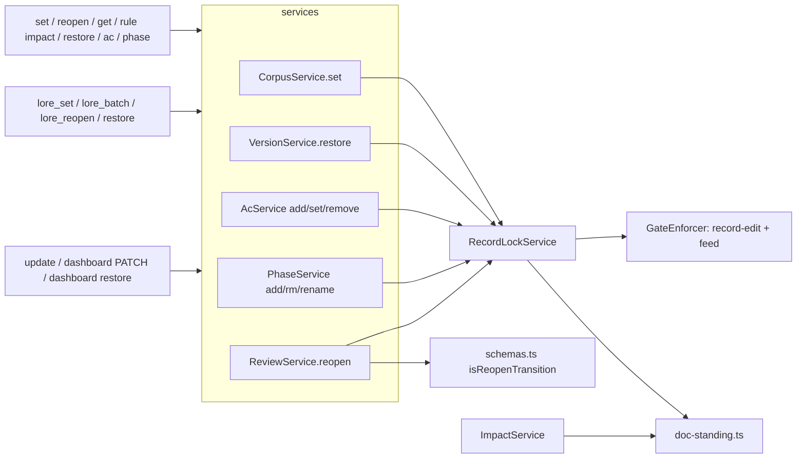

## Overview/Goal

ADR-041 (`adr-the-product-is-a-baseline-tree-specs-are-implementations`) makes the baseline tree the product's only current form and specs implementations of it. Nothing in the binary encodes that split. Editing an approved spec only demotes it to draft (BR-722); no gate, `get` line or feed tells an agent that a spec, AC, plan, task, ADR or knowledge record is a record that a behaviour change must not rewrite. Issue #155. Motivating case: the paused bootstrap-injection initiative (`knowledge-handoff-agent-session-cb37af5d`), where the correct split — edit BR-328/329/981 in place, open a new spec instead of editing SPEC-080, put new tests in new files — came only from reading ADR-041 by hand.

**Measured (read-only `.lore/lore.db`, versions in the 30 days to 2026-10-11)**: body/title edits made to an already-approved document — spec 24 edits on 5 docs (22 rewrites, 2 pure appends; one spec alone 13), plan 14 on 8 (9 rewrites), knowledge/retro 4 on 3, adr 2 on 2, knowledge/research 1, baseline 24 on 20 (living, unaffected). No spec has ever reached `active` or `archived` (121 approved, 52 deprecated), so the lock is defined by "ever approved / ever claimed / plan closed" (BR-1047), not by lifecycle status alone.

**Goal**: every document kind is classified `living | record` in ONE core table; a record locks when settled; the service layer refuses every rewrite of a locked record with a feeding pack naming the sanctioned path; two audited exits (correction, reopen-before-evidence); `lore get` and `lore rule impact` show the split so an agent always knows which documents to change in place and which to replace.

**Benchmarks (user-approved 2026-10-11)** — all lock at acceptance, allow minor corrections through a separate channel, and replace substantively with a new document the old one points to:
- Python PEP 1 (https://peps.python.org/pep-0001/): "PEPs are no longer substantially modified after they have reached the Accepted, Final, Rejected or Superseded state"; "a PEP is considered a historical document rather than a living specification"; living behaviour docs are "maintained elsewhere"; `Replaces` / `Superseded-By` headers.
- Rust RFCs (https://github.com/rust-lang/rfcs/blob/master/README.md): "once accepted, RFCs should not be substantially changed. Only very minor changes should be submitted as amendments. More substantial changes should be new RFCs, with a note added to the original RFC."
- Nygard ADRs (https://cognitect.com/blog/2011/11/15/documenting-architecture-decisions): "If a decision is reversed, we will keep the old one around, but mark it as superseded."

## Scope

Implements baseline leaf `baseline-keep-a-record-unchanged` (BR-1046..BR-1054). Cross-referenced (boundary notes, 2026-10-11) from `baseline-revise-a-document` (BR-722 narrowed), `baseline-restore-an-earlier-version` (BR-772), `baseline-fast-track-ledger-records`, `baseline-submit-a-document-for-review` (BR-307).

In scope:
- `@lore/core`: standing table + pure lock resolver (new `packages/core/src/doc-standing.ts`, browser-safe); a reopen-only status edge in `schemas.ts`.
- Service: gate checkpoint `record-edit`, enforced via `RecordLockService.assertEditable` from EVERY rewrite path: `CorpusService.set` (body/title difference, `extra.sub_type` change), `VersionService.restore`, `AcService` add/set/remove, `PhaseService` add/rm/rename on a closed plan. `cite` is NOT gated.
- Correction exit on every set entry point: CLI `lore set` (both call sites), MCP `lore_set` and `lore_batch` set, HTTP update route, dashboard PATCH.
- Reopen exit: `lore reopen <spec> --reason` + MCP `lore_reopen`.
- `lore get`: `Standing:` line, `Corrections: N`, "Later changed by" list.
- `lore rule impact`: `living` / `records` groups.
- Shipped prose that prescribes editing an existing spec in place (D9) and every repo text the `ac add` reversal (D12) falsifies.

Out of scope:
- Per-AC superseded state — #154.
- The paused injection initiative — resumes after this lands and is checked against this mechanism.
- Retroactive changes to any existing document: the gate is forward-only (D8).

## Module Boundary

**Public (`@lore/core`, `doc-standing.ts`)** — data + pure resolution only, no user-facing prose:
- `DocStanding = "living" | "record"`
- `StandingRule = { kind: "fixed"; standing: DocStanding } | { kind: "by-sub-type" } | { kind: "by-plan-state" }`
- `DOC_TYPE_STANDING: Record<DocType, StandingRule>` — exhaustive.
- `KNOWLEDGE_SUB_TYPE_STANDING: Record<KnowledgeSubType, DocStanding>` — exhaustive.
- `resolveLock(input: LockInput): LockState` — switch on `StandingRule.kind` with a `never` default, so a new rule kind fails `tsc`.

**Public (`@lore/core`, `schemas.ts`)**: `REOPEN_ALLOWED_TYPES = ["spec"] as const` + `isReopenTransition(type, from, to)`; `VALID_TRANSITIONS` unchanged (approved → draft stays refused for `lore set --status`).

**Public (service)**:
- `RecordLockService` (new): `facts(doc)`; `assertEditable(doc, op, patch?)`. REQUIRED constructor dependency of `CorpusService`, `VersionService`, `AcService`, `PhaseService`, `ReviewService` — never optional, so an unwired service fails to construct (D17).
- `SetOptions.correction?: { reason: string }`; `ReviewService.reopen(specId, reason, seams?)`.
- `ImpactService.impact` output gains `living: string[]`, `records: {slug: string; acId?: string}[]`.
- The refusal text (`RECORD_CHANGE_PATH`) lives with the `record-edit` checkpoint's `feed()` in the service layer (D18).

**Internal**: `RecordLockService` facts — ever-approved (version history has a status `approved`), ever-claimed (audit `claim` action not followed by that claim's own rollback), member-plan status for a phase. The evidence count for reopen is owned by `ReviewService.reopen`, through the SAME AC-coverage query `ac-service.ts` already uses for plan-member AND ad-hoc governed tasks (`ac-service.ts:986`, `:1023`) — no second evidence query, and none in `RecordLockService`.

**Dependencies**: `StoreInterface`, `GateEnforcer`, `checkpoint-registry` (+ `GateContext` fields, `feed()`, `PREDICATE_CONTRACTS` entry, explicit exclusion from `ALL_GATE_CHECKPOINTS` like `task-create`), config `workflow.gates."record-edit".enabled` (catch-all `GatesConfigSchema`, no schema edit).

## Structure

```
packages/core/src/doc-standing.ts                      # NEW: tables + resolveLock
packages/core/src/schemas.ts                           # REOPEN_ALLOWED_TYPES + isReopenTransition
packages/core/src/index.ts                             # exports
packages/lore/src/service/record-lock-service.ts       # NEW: facts + assertEditable
packages/lore/src/service/checkpoint-registry.ts       # "record-edit": context, feed (RECORD_CHANGE_PATH), contract
packages/lore/src/service/predicate-contracts.ts       # record-edit contract
packages/lore/src/service/corpus-service.ts            # set(): difference-based trigger, sub_type, correction (one version)
packages/lore/src/service/version-service.ts           # restore(): gate
packages/lore/src/service/ac-service.ts                # add/set/remove: gate; header rewritten (D12)
packages/lore/src/service/phase-service.ts             # add/rm/rename on closed plan: gate
packages/lore/src/service/review-service.ts            # reopen()
packages/lore/src/service/impact-service.ts            # living / records
packages/lore/src/service/rule-index-queries.ts        # computeImpact groups
packages/lore/src/app.ts                               # wire RecordLockService (required)
packages/lore/src/adapters/cli/commands/set.ts         # --correction (both call sites)
packages/lore/src/adapters/cli/commands/reopen.ts      # NEW
packages/lore/src/adapters/cli/commands/get.ts         # Standing / Corrections / Later changed by (via RecordLockService)
packages/lore/src/adapters/cli/commands/rule.ts        # impact groups
packages/lore/src/adapters/cli/commands/ac.ts          # demotion-notice comments (~989-1000) rewritten for D12
packages/lore/src/adapters/cli/index.ts                # register reopen
packages/lore/src/adapters/mcp/tools.ts                # lore_set + lore_batch set correction; lore_reopen
packages/lore/src/adapters/http/routes.ts              # correction on update
packages/lore/src/adapters/http/dashboard-routes.ts    # correction on PATCH; restore route refused via service
assets/skills/lore-design/SKILL.md                     # prose (D9)
assets/skills/lore-design-ui/SKILL.md
assets/skills/lore-design-ui/references/mode-ui.md
assets/skills/lore-session-capture/references/knowledge-types.md
assets/context/corpus-workflow-2-produce.md
CLAUDE.md                                              # §Document Lifecycle + standing lesson ~line 170 (repo doc, same merge — D12)
# NEW tests
packages/core/tests/unit/doc-standing.test.ts
packages/lore/tests/unit/service/record-lock-gate.test.ts
packages/lore/tests/unit/service/record-lock-ac-restore.test.ts
packages/lore/tests/unit/service/record-reopen.test.ts
packages/lore/tests/unit/service/impact-service-standing.test.ts
packages/lore/tests/unit/adapters/http-record-lock.bun.test.ts
packages/lore/tests/e2e/record-lock-compiled.bun.test.ts
```

## Public Interface (TypeScript)

```ts
export type DocStanding = "living" | "record";
export type StandingRule =
  | { kind: "fixed"; standing: DocStanding }
  | { kind: "by-sub-type" }
  | { kind: "by-plan-state" };

export const DOC_TYPE_STANDING: Record<DocType, StandingRule>;
// prd, baseline: fixed living · spec, adr, task: fixed record · knowledge: by-sub-type · plan, phase: by-plan-state
export const KNOWLEDGE_SUB_TYPE_STANDING: Record<KnowledgeSubType, DocStanding>;
// reference, skill, prompt: living · ideation, retro, research, assessment, handoff, uat: record

export interface LockInput {
  type: DocType;
  status: DocStatus;
  subType?: KnowledgeSubType;   // required for knowledge — missing throws
  everApproved?: boolean;       // required for spec, adr, knowledge-record — missing throws
  everClaimed?: boolean;        // required for task — missing throws
  planStatus?: DocStatus;       // required for plan (own status) and phase (member plan) — missing throws
}

export type LockReason = "approved" | "claimed" | "closed";
export type LockState =
  | { standing: "living" }
  | { standing: "record"; locked: false }
  | { standing: "record"; locked: true; reason: LockReason };

export function resolveLock(input: LockInput): LockState;
// spec | adr | knowledge(record): locked "approved" iff everApproved
// task: locked "claimed" iff everClaimed
// plan, phase: living while planStatus ∉ {archived, deprecated}; else record locked "closed"

export const REOPEN_ALLOWED_TYPES: readonly ["spec"];
export function isReopenTransition(type: DocType, from: DocStatus, to: DocStatus): boolean;

// service
export type RecordEditOp = "content" | "kind" | "restore" | "criteria" | "phase-structure";
export interface SetOptions { /* existing … */ correction?: { reason: string } }
export interface ReopenSeams { afterStatusWrite?: () => Promise<void> } // test-only seam (AC-DR-4)
```

Refusal: `VALIDATION_ERROR`, `field: "gate:record-edit"`, exit 4; message = `<slug> is a locked record (<reason>).` + the change paths that apply to its kind. Empty correction reason → exit 2, nothing written.

## Dependency Graph



No cycle: core is a leaf; `RecordLockService` depends only on store, enforcer, core.

## Design Decisions

| # | Decision | Choice | Rejected | Rationale |
|---|---|---|---|---|
| D1 | Lock point (user) | Ever approved (spec/adr/knowledge record), ever claimed (task), plan closed (plan/phase) | lock once executed; lock only when archived; lock by current status set | Benchmarks lock at acceptance. Status alone mislabels a draft that is deprecated or a never-claimed task archived by cascade (bundle review finding). |
| D2 | Table location | `doc-standing.ts`, sibling of `DOC_TYPE_ROLE_MAP` | column on `DOC_TYPE_ROLE_MAP` | Different question; same exhaustive-`Record` guarantee. |
| D3 | Plan standing (user) | Living while open, record once archived/deprecated | lock at approval; append-only | 14 post-approval plan edits / 30 days are prescribed Decisions-Log/replan updates. |
| D4 | Enforcement (user) | Refuse (exit 4) + audited correction | warn only | Unenforced otherwise (North Star Q3). |
| D5 | Reopen (user) | Approved spec, zero evidence, reason → draft via a reopen-only edge `isReopenTransition`; count AFTER the status write; if evidence appeared, stay draft and exit 4 — re-approval goes through review (BR-1054) | compensating write back to approved; generic approved→draft edge | Writing approved directly would skip spec-promote and review-judgment gates and race other edits in the draft window. A draft spec with evidence is loud: every downstream claim is refused until it is re-reviewed. |
| D6 | One gate, every rewrite path | `assertEditable` in set / restore / ac add-set-remove / phase add-rm-rename(closed plan) | per-adapter checks | Service-layer gates cover CLI/MCP/HTTP/dashboard identically. |
| D7 | Note on the original | Derived at read time from incoming links of newer docs | write a note into the old record | Writing it would edit the record. |
| D8 | Back-catalog | Forward-only, no exemption list | grandfather; sweep-edit | No stored doc violates a write-time rule; ≈45 record edits / 30 days now take correction, reopen or new-spec — intended. B1 watches. |
| D9 | Shipped prose | Five assets: decide by `lore get`'s Standing — not locked: edit; locked, no evidence: `lore reopen`; locked with evidence: new spec + `relates-to` | leave prose | Prose prescribing in-place edits collides with the gate on every design run. |
| D10 | Ever-claimed | Audit `claim` action not rolled back by its own failed write | current `extra.claim` | A released task was executed (BR-1047); a rolled-back claim never was. The implementer verifies the rollback's audit shape before relying on it. |
| D11 | Config | `workflow.gates."record-edit".enabled` (default on), disabled → `config_disabled` skip audit | new config block | One gate-knob mechanism (BR-1053). |
| D12 | `lore ac add` on an approved spec | REVERSED: today succeeds without demoting (CLAUDE.md §Document Lifecycle "lore ac add does NOT demote"; `ac-service.ts` header) → now refused on a locked spec, like `ac set` / `ac rm` | keep `ac add` open | An added criterion changes what was accepted — a new spec's job. The same merge rewrites the CLAUDE.md lifecycle paragraph, its two-writer asymmetry note and the `ac-service.ts` header. |
| D13 | `extra.sub_type` | Changing a knowledge record's kind on a locked doc is refused (op `kind`) | ignore extra | Flipping retro → reference would unlock it (bundle review). |
| D14 | Trigger | Body/title compared to the stored values (difference), not field presence | presence-based | The dashboard and MCP send content on tag/priority saves; presence would refuse legitimate metadata edits. |
| D15 | Correction write | Exactly one version; skips BR-722 demotion and the ledger re-approve write | reuse set's normal path | The normal path writes two versions for ledger records and demotes others (bundle review). |
| D16 | Phase structure on a closed plan | Gated (op `phase-structure`) | scope out | BR-1046 makes a closed plan's phases records; leaving structure writes open would leave a rewrite path. |
| D17 | Wiring | `RecordLockService` is a required constructor dependency | optional dependency | Optional lets unit tests pass while `app.ts` leaves `restore` or `ac add` ungated (bundle review). |
| D18 | Refusal prose location | Checkpoint `feed()` in the service layer; reopen wording added by the reopen task | constant in `@lore/core` | Core stays data-only; the gate task must not advertise `lore reopen` before it exists. |

## Pre-registered branch

| # | Trigger (14 days after landing, from audit) | Path A | Path B |
|---|---|---|---|
| B1 | corrections ÷ (corrections + refusals) on spec docs | ≤ 50% → keep | > 50% → report the list to the user; never loosen silently |

## Concurrency (North Star question 2)

- Edit vs claim on one task: the claim writes a version; the edit's stale read is refused (exit 5, BR-732).
- Reopen vs evidence: evidence lands on task docs, outside the spec's version check. Reopen counts AFTER its status write (seam `afterStatusWrite`); evidence found → spec stays draft, exit 4, re-review required (BR-1054). Never written back to approved.
- Phase edit vs plan archive: the plan's status lives on another doc, so a phase write can pass the gate while the plan is being archived. Residual, accepted: the archive cascade runs after; the phase write is in the version log and visible.
- Two corrections on one record: optimistic concurrency (exit 5).

## Test Plan (six-dimension)

- **HAPPY** — living baseline edit; draft spec edit; correction on locked retro (one version, still approved, reason recorded); reopen of evidence-free spec → draft.
- **NEGATIVE** — approved spec: body edit, title-only edit, `extra.sub_type` change, `ac add/set/rm`, restore → refused, version count unchanged; `ac cite` accepted; claimed-then-released task edit refused; closed plan phase add refused.
- **BOUNDARY** — identical content + tag change on a locked record accepted (D14); open approved plan edit accepted; draft-then-deprecated spec not locked; never-claimed archived task not locked; rolled-back claim not locked.
- **ERROR** — `resolveLock` missing a required fact throws; empty correction reason exit 2; reopen with evidence exit 4 naming count; `lore set --status draft` on approved spec still refused.
- **STATE** — gate disabled → BR-722 behaviour + one `config_disabled` skip audit; evidence appears at `afterStatusWrite` → spec draft, exit 4.
- **REGRESSION** — claim, evidence, link, invalidate, anchor add, phase add on open plan, rule set, approve on locked docs succeed.
- **E2E** — compiled `dist/lore` on `mkdtemp` + `lore init`: CLI set/restore/ac add refusals, correction, reopen, get rendering, MCP `lore_set` + `lore_batch` + `lore_reopen`.

## Delivery surface & fresh-install verification

Binary (core table, gate, service exits, `get`/`impact` rendering, MCP/HTTP/dashboard arguments) + `assets/` prose (embedded manifest; consumers converge on `lore setup`). Fresh-install probe: AC-DR-5 builds `dist/lore` and drives a `mkdtemp` + `lore init` corpus end to end. Prose convergence probe (removal-shaped): AC-DR-7 asserts the retired instruction absent AND the new three-way decision present in every shipped file.

## Acceptance Criteria

Structured: AC-DR-1 … AC-DR-10 (`lore ac list`). Each statement names its smallest red mutation.

## Quality Gate (module mode)

- [x] No circular dependencies — core ← RecordLockService ← services ← adapters.
- [x] Single responsibility — core classifies; RecordLockService gathers facts and enforces; checkpoint `feed()` owns refusal prose; adapters pass `correction` / call `reopen`.
- [x] Public API sufficient for black-box testing — pure `resolveLock`, service methods on InMemoryStore with the `afterStatusWrite` seam, CLI/MCP/HTTP observable behaviour.
- [x] Dependencies injectable — store, enforcer, config and the reopen seam are injected; `RecordLockService` is required, never optional.

## S3 bundle review (2026-10-11) — applied in one edit pass

Three lenses over spec + plan + baseline leaves: cross-document contradiction (10 findings), module design (12), plan audit (5). Re-review (changed items only) found 1 MAJOR + 4 MINOR, applied: CLAUDE.md line ~170, `ac.ts` comments, plan counts, leaf wording, `rule-index-queries.ts`, evidence-count ownership. Applied in the first pass: reopen edge + no direct re-approval (D5, BR-1050/1054, BR-307 note); BR-722 narrowed; `ac add` reversal named (D12); ledger correction single-version (D15, ledger leaf note); lock by ever-approved/claimed (D1, BR-1047); restore note (BR-772 leaf); phase structure gated (D16); `extra.sub_type` (D13); difference trigger (D14); batch/HTTP/dashboard paths + AC-DR-10 (HTTP); required DI (D17); refusal prose moved (D18); reopen CLI/MCP in AC-DR-5; build step in AC-DR-5; AC-DR-7 needles tightened; `uat` naming (BR-1046); BR-1048 names reopen.


## Acceptance Criteria (structured)

- [⚑] [script] AC-DR-1: doc-standing unit suite: (a) DOC_TYPE_STANDING / KNOWLEDGE_SUB_TYPE_STANDING key sets deep-equal the DocType / KNOWLEDGE_SUB_TYPES arrays; (b) table-driven resolveLock: spec/adr/knowledge-record locked 'approved' iff everApproved (a draft-then-deprecated spec is NOT locked); task locked 'claimed' iff everClaimed (never-claimed archived task NOT locked); plan and phase living unless planStatus archived|deprecated, then locked 'closed'; reference/skill/prompt knowledge, baseline, prd always living; (c) each missing required fact (subType, everApproved, everClaimed, planStatus) throws; (d) isReopenTransition true only for spec approved->draft, and VALID_TRANSITIONS still lacks approved->draft. Smallest red mutation: classifying knowledge 'research' as living fails (b).
  script: test — bunx vitest run packages/core/tests/unit/doc-standing.test.ts
- [⚑] [script] AC-DR-2: CorpusService.set on InMemoryStore: approved spec body edit, title-only edit, and extra.sub_type change on an approved retro -> err field 'gate:record-edit', version count unchanged; identical content + new tags on the locked spec succeeds (difference trigger); draft spec and baseline edits succeed; open approved plan edit succeeds, archived plan edit refused; claimed-then-released task refused; task whose only claim was rolled back by its own failed write is editable; correction {reason:'typo'} on an approved retro -> exactly ONE new version, status approved, reason in version change_summary and audit; correction reason '' -> err, no write; gate disabled -> BR-722 demotion + exactly one config_disabled skip audit naming the doc. Smallest red mutation: removing assertEditable from set lets the first case through.
  script: test — bunx vitest run packages/lore/tests/unit/service/record-lock-gate.test.ts
- [⚑] [script] AC-DR-3: On locked records via services: AcService add/set/remove on an approved spec -> err 'gate:record-edit', criteria unchanged; cite succeeds; VersionService.restore on an approved ADR -> same refusal, no version; PhaseService add/rm/rename on an archived plan -> refused, on an open plan -> succeeds. Non-rewrite writes on locked docs succeed: claim, evidence, link, invalidate, anchor add, rule set, approve. Services cannot be constructed without RecordLockService (constructor type requires it; asserted by a tsc-level @ts-expect-error case). Smallest red mutation: dropping the gate call from AcService.add lets the add through.
  script: test — bunx vitest run packages/lore/tests/unit/service/record-lock-ac-restore.test.ts
- [⚑] [script] AC-DR-4: ReviewService.reopen: approved spec, zero evidence (counted through the same AC-coverage query as ac-service for plan-member AND ad-hoc tasks), reason -> draft, one status version + audit with reason; evidence only on an ad-hoc governed task -> refused naming 1; 3 evidence rows -> refused naming 3; empty reason -> err, no write; non-spec -> err naming the type; seam afterStatusWrite inserts evidence -> spec stays draft, err names the evidence, no write back to approved; CorpusService.set with status draft on an approved spec is still refused. Smallest red mutation: counting only plan-member tasks misses the ad-hoc case.
  script: test — bunx vitest run packages/lore/tests/unit/service/record-reopen.test.ts
- [⚑] [script] AC-DR-5: Compiled dist/lore (built by the command) on a mkdtemp + lore init corpus: approve a spec; lore set --content exits exactly 4 with stderr containing 'locked record' and 'lore reopen'; lore restore and lore ac add on it exit exactly 4; lore set --correction 'typo' exits 0 and lore get shows 'Standing: record', 'locked (approved)', 'Corrections: 1'; a newer spec linked relates-to appears under 'Later changed by'; a knowledge reference shows 'Standing: living'; on a second evidence-free approved spec lore reopen --reason r exits 0 and get shows draft; via the MCP stdio server on the same corpus, lore_set and lore_batch set on the locked spec return gate:record-edit and lore_reopen succeeds on a third spec. Smallest red mutation: not wiring RecordLockService into VersionService makes lore restore exit 0.
  script: e2e — bun run build && bunx --bun vitest run packages/lore/tests/e2e/record-lock-compiled.bun.test.ts
- [⚑] [script] AC-DR-6: ImpactService.impact(BR-n) on a fixture with one leaf, one dependent leaf and two citing specs returns living deep-equal [leaf, dependent-leaf] and records deep-equal the two {slug, acId} pairs, alongside the unchanged citingCriteria/dependentLeaves/cycles fields; the CLI text rendering prints a 'Living' group before a 'Records' group. Smallest red mutation: putting citing specs under living fails the deep-equal.
  script: test — bunx vitest run packages/lore/tests/unit/service/impact-service-standing.test.ts
- [⚑] [script] AC-DR-7: Shipped prose no longer prescribes rewriting an existing spec in place: case-insensitive grep of assets/ for 'update or extend', 'update existing (lore set <spec', 'governing spec: lore set <spec', 'edit the existing|approved spec' exits exactly 1, AND each of lore-design SKILL, lore-design-ui SKILL, lore-design-ui mode-ui, lore-session-capture knowledge-types and the PRODUCE rule contains all three of 'Standing', 'lore reopen', 'relates-to'. Measured red 2026-10-11: 4 needle hits. Residual: a file can still reword the old instruction while carrying the three tokens.
  script: other — grep -rniE "update or extend|update existing \(.lore set <spec|governing spec: lore set <spec|edit the (existing|approved) spec" assets/; test $? -eq 1 && for f in assets/skills/lore-design/SKILL.md assets/skills/lore-design-ui/SKILL.md assets/skills/lore-design-ui/references/mode-ui.md assets/skills/lore-session-capture/references/knowledge-types.md assets/context/corpus-workflow-2-produce.md; do for n in "Standing" "lore reopen" "relates-to"; do grep -q -- "$n" "$f" || { echo "MISSING '$n' in $f"; exit 1; }; done; done && echo 'AC-DR-7 PASS: no shipped asset prescribes rewriting an existing spec in place; all 5 files carry the Standing / lore reopen / relates-to decision'
- [⚑] [script] AC-DR-8: Monorepo typecheck exits 0 with the exhaustive DOC_TYPE_STANDING / KNOWLEDGE_SUB_TYPE_STANDING Records (adding a DocType member without classifying it is a tsc error).
  script: tsc — bun run typecheck
- [⚑] [script] AC-DR-9: Embedded assets manifest is fresh after the prose edits: embed-assets-manifest --check exits 0 (exit 3 = stale).
  script: build — bun scripts/embed-assets-manifest.mjs --check
- [⚑] [script] AC-DR-10: HTTP and dashboard surfaces on a throwaway corpus: PUT/PATCH update of a locked spec's content via routes.ts and dashboard-routes.ts PATCH -> 4xx carrying gate:record-edit, version unchanged; the same with a correction field and non-empty reason -> 2xx, one version, status kept; dashboard restore of a locked ADR -> refused; a dashboard save that resends identical content with a changed tag -> 2xx. Smallest red mutation: dropping the correction field mapping in routes.ts makes the correction request refused.
  script: test — bunx --bun vitest run packages/lore/tests/unit/adapters/http-record-lock.bun.test.ts

## Code anchors

- packages/core/src/doc-standing.ts
- packages/lore/src/service/record-lock-service.ts
- packages/lore/src/service/corpus-service.ts
- packages/lore/src/service/checkpoint-registry.ts
- packages/core/src/doc-standing.ts#resolveLock
- packages/lore/src/service/record-lock-service.ts#RecordLockService
- packages/lore/src/service/review-service.ts
- packages/lore/src/adapters/cli/commands/reopen.ts
- packages/lore/src/adapters/cli/commands/get.ts
- packages/lore/src/service/rule-index-queries.ts
- packages/lore/tests/unit/service/record-lock-gate.test.ts
- packages/lore/tests/unit/service/record-reopen.test.ts
- packages/lore/tests/e2e/record-lock-compiled.bun.test.ts
- packages/lore/tests/unit/service/impact-service-standing.test.ts
- packages/core/tests/unit/doc-standing.test.ts
