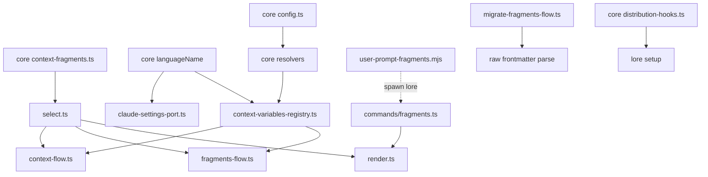

# Fragment injection timing: one `inject` enum, a per-turn UserPromptSubmit outlet, and `context.artifact_language`

## Overview/Goal

When a context fragment reaches the model is today implied by three frontmatter fields read together — `audience` (main / `subagent:*` / `subagent:<type>`), `mode` (static / dynamic) and `delivery` (rules / skill) — and `matchesOutletRouting` (`packages/lore/src/service/context-fragments/select.ts`) decodes the combination. Measured state (2026-10-23, all three layers, 25 fragments): every fragment is `mode: static`; a dynamic main-session fragment has had no outlet since `hook:session-start` was retired (BR-1066, BR-912), so one of the three fields carries no information and the rest encode a timing nobody can read off the file.

The owner also needs a timing lore cannot express: re-inject a short rule on EVERY user turn (UserPromptSubmit), so it sits next to the newest message instead of only at launch. The first user is the language/output-style fragment `user-00-comm-zh`, whose line "代码/注释/文档：English" is hard-coded although the conversation language next to it is already config-driven (`context.language`).

Goal:
1. One explicit frontmatter field `inject: [launch | on-demand | subagent-start | user-prompt]` (+ optional `agents:` filter) replaces `audience`, `mode` and `delivery`; routing becomes a lookup on that field.
2. A new outlet `hook:user-prompt`, delivered by a new UserPromptSubmit hook, renders the `user-prompt` fragments on every turn.
3. A config key `context.artifact_language` (language of code, comments and docs) exposed to fragment text as `{{lore:artifact_language}}`.

Benchmark: Cursor rules (`cursor.com/docs/context/rules`) route each rule by one explicit application type (`alwaysApply` / agent-requested by `description` / `globs` / manual), not a combination of fields. Adopted: one timing field. Claude Code hooks (`code.claude.com/docs/en/hooks`, read 2026-10-23): UserPromptSubmit `hookSpecificOutput.additionalContext` on exit 0 is added to context and "inserts it into the conversation at the point where the hook fired" (so it stays in the transcript); strings over 10,000 chars are replaced by a file path + 2,000-char preview; default timeout 30 s, and on timeout "The prompt still reaches Claude without that context".

Relates to (approved and locked, so this spec carries the change set instead of editing them): `spec-context-fragments-config-driven-layered-rule-injection`, `spec-rule-store-git-tracked-fragment-selection-on-demand-skill`, `spec-one-upgrade-reminder-at-session-start-covers-the-global`, `spec-lore-owned-agent-context-is-generated-from-templates-and`, `spec-two-helper-agent-types-lore-reader-and-lore-implementer` (AC-AT-4), `spec-defect-clusters-round-2-part-d-store-selection-runs` (AC-DC2-27), `spec-always-loaded-lore-fragments-state-the-rule-only-reasoning` (AC-RW-1, assets manifest freshness).

## Scope

In:
- `FragmentFrontmatterSchema` (`packages/core/src/context-fragments.ts`): add `inject`, `agents`; remove `audience`, `mode`, `delivery` and their exported constants/types (`AUDIENCE_PATTERN`, `FRAGMENT_MODES`, `FRAGMENT_DELIVERIES`, `Audience`, `FragmentMode`, `FragmentDelivery`).
- Selection, render caps, check, refresh, `context list` (text and `--json`) and run composition re-keyed to `inject`.
- New outlet id `hook:user-prompt` in `OUTLET_IDS` and every exhaustive switch over it.
- New shipped hook `assets/hooks/user-prompt-fragments.mjs`, registered for `UserPromptSubmit` by `lore setup`.
- Config `context.artifact_language` (global + project); registry variable `artifact_language`; one shared code → name resolver.
- `lore migrate fragments --scope user|project [--apply]`.
- Every shipped fragment (`assets/context/*.md`) and this repo's project fragments (`.lore/context/*.md`, git-tracked source) rewritten to `inject`; the assets manifest regenerated.

Out: the owner's user-layer files (`~/.config/lore/context/*.md`) are data, migrated after landing by running the shipped command; moving `user-00-comm-zh` to `inject: [user-prompt, subagent-start]` is an owner config edit. Glob/path triggers. Projecting `artifact_language` into a Claude Code setting (none exists). Codex/AGENTS.md outlets.

## Design

### Injection timings

| `inject` value | Outlet(s) | Reaches | Delivered by |
|---|---|---|---|
| `launch` | `rules:project`, `rules:user` | main session | lore-owned rules file `.claude/rules/lore-<id>.md` (loaded at launch, re-injected after compaction) |
| `on-demand` | `skills:project`, `skills:user` | main session | lore-owned skill `skills/lore-<id>/SKILL.md`; requires `description`; must be the only value |
| `user-prompt` | `hook:user-prompt` (new) | main session, every turn | `assets/hooks/user-prompt-fragments.mjs` → `lore fragments render --outlet hook:user-prompt` |
| `subagent-start` | `hook:subagent-start` | helper agents (all, or those in `agents`) | `assets/hooks/subagent-context.mjs` (unchanged) |

### Frontmatter

```ts
export const INJECT_TIMINGS = ["launch", "on-demand", "user-prompt", "subagent-start"] as const;
export type InjectTiming = (typeof INJECT_TIMINGS)[number];
/** Timings that reach the main session; a fragment names at most one. */
export const MAIN_SESSION_TIMINGS: ReadonlySet<InjectTiming> = new Set(["launch", "on-demand", "user-prompt"]);

// FragmentFrontmatterSchema (strict):
//   id, title                         unchanged
//   inject: InjectTiming[]            non-empty, unique
//   agents?: string[]                 non-empty; only with "subagent-start"; absent = every helper type
//   when?: { language?: string[] }    unchanged
//   description?: string              required iff "on-demand" (<= SKILL_DESCRIPTION_MAX)
// Refusals (each names the field): duplicate inject value; more than one main-session timing;
//   on-demand together with any other value; agents without subagent-start;
//   on-demand without description; description without on-demand.
// Retired keys: the schema declares audience / mode / delivery as optional keys whose presence is refused
//   with a message naming `lore migrate fragments` (declared, so `.strict()` does not pre-empt the message
//   with a generic "unrecognized key").
```

Check keeps its any-helper row and still reports it as `subagent:*` (BR-913, AC-CF-4, AC-DC2-27 unchanged); `enumerateAgentTypes` collects `agents` values instead of parsing audience strings.

### Migration mapping (`lore migrate fragments`)

| Old (`audience` / `mode` / `delivery`) | New |
|---|---|
| contains `main`, delivery absent or `rules`, static | `launch` |
| `[main]`, `delivery: skill` | `on-demand` (description kept) |
| contains `subagent:*` | add `subagent-start`, no `agents` |
| contains `subagent:<type>` entries and no `subagent:*` | add `subagent-start`, `agents: [<type>, ...]` |
| `main` + `subagent:<type>` (e.g. evidence-attestation) | `[launch, subagent-start]`, `agents: [<type>]` |
| `mode: static` | dropped |
| `mode: dynamic`, helper-only audience | mapped as above (today it already renders at helper start) |
| `mode: dynamic` with `main` | refused naming the file (its outlet is retired; the owner picks `user-prompt` or `launch` by hand) |
| `delivery: skill` with any `subagent:` entry | refused naming the file (on-demand admits no other timing, D2; the owner splits it into an on-demand and a subagent-start fragment by hand) |

Shipped set after migration (from today's frontmatter): ac-design, corpus-workflow-*, dispatch-bundle, worktree-dispatch → `[launch]`; agent-rules → `[subagent-start]`, `agents: [lore-implementer, lore-reader]`; ask-then-execute → `[launch, subagent-start]`; evidence-attestation → `[launch, subagent-start]`, `agents: [lore-implementer]`. This repo's project layer: no-write-live-corpus, test-runner-split → `[subagent-start]`, `agents: [lore-implementer, lore-reader]`; scoped-oracles-in-worktrees → `[launch, subagent-start]`, `agents: [lore-implementer]`.

Command: `lore migrate fragments --scope user|project [--apply]` (`--scope` required; `user` needs no corpus, `project` needs a lore project root). Preview (default) writes nothing and prints one line per fragment file (`<path>: <old> -> <new>`, `unchanged`, or `refused: <reason>`). `--apply` rewrites only the frontmatter lines (body bytes unchanged) with a per-file hash precondition. Exit: 5 if any file changed concurrently (that file untouched), else 4 if any file was refused, else 0; files that can be migrated are migrated in every case. A second `--apply` prints every migrated file `unchanged`.

`lore setup` migrates automatically (owner decision 2026-10-23): it runs the same flow with apply for the user layer, and for the project layer when run inside a lore project, before it refreshes rules files; it prints the same per-file lines. A refused or conflicting file does not stop the rest of setup, but setup then exits with the migrate exit code (5 > 4) naming each such file — never a silent skip. So upgrading lore and running `lore setup` is the whole upgrade path; `lore migrate fragments` stays for preview and standalone use.

### `hook:user-prompt` outlet

- Layers: shipped + user + project, same id override as the other outlets. Config: project over global.
- Selection: fragments whose `inject` contains `user-prompt`, then `when`, then disable — each disable list applies only to the fragments it may legally disable (BR-905: a shipped fragment by the project list, a user fragment by the user list, a project fragment by the project list).
- Overrides: the render runs `checkOverrides`; an illegal override of a main-session fragment makes the render fail with the banner (unlike helper start, BR-911).
- Shipped fragments never name `user-prompt`: per-turn cost is the user's or the project's choice (`lore fragments check` refuses it, finding kind `shipped_user_prompt`).
- Cap: `USER_PROMPT_FRAGMENT_CAP = 1_000` chars for the whole block (blank separators counted): the block is re-sent every turn and stays in the transcript; the measured first user (`user-00-comm-zh` body) is 209 chars. At the cap ok; one over → `BUDGET_EXCEEDED` naming every fragment and its size; `lore fragments check` reports it as finding kind `cap`.
- Render answer (`commands/fragments.ts`): `{"hookSpecificOutput":{"hookEventName":"UserPromptSubmit","additionalContext":"<block>"}}`; an empty selection prints `{}` and exits 0.
- Failure: exit 0 with the existing banner (≤ `HOOK_BANNER_CAP`) naming the error code (BR-908).
- Hook `assets/hooks/user-prompt-fragments.mjs` (new; `user-prompt-turn-start.mjs` stays a stdout-silent turn-state producer):
  1. Fast path (conservative): reads the frontmatter block (between the first two `---` lines) of every `*.md` in the user context dir and the project context dir; when NO frontmatter block contains the token `user-prompt` anywhere (flow list, block list or any other spelling), prints `{}` and exits 0 without spawning lore. Any mention → spawn; a false positive only costs one spawn, a false negative is impossible for a schema-valid file because `inject` values are the literal enum strings. The hook is global, so a session with no per-turn fragment must not pay a process spawn per turn; shipped fragments cannot name the timing, so these two layers decide.
     Directory resolution mirrors lore exactly: user dir = `resolveUserConfigDir` (`$LORE_CONFIG_HOME` > `$XDG_CONFIG_HOME/lore` > `~/.config/lore`) + `/context`; project dir = the project root lore resolves from `--cwd` + `/.lore/context`. The precedence is pinned by AC-IT-4 (a fixture under `$LORE_CONFIG_HOME` is found while a decoy under `~/.config/lore` is ignored). An unreadable directory counts as "mentions" (spawn, so lore reports the real error).
  2. Otherwise spawns `lore` from PATH (as `subagent-context.mjs` does) with `fragments render --outlet hook:user-prompt --cwd <cwd>`, timeout 3 s; spawn failure / timeout / non-zero / non-JSON → `[user-prompt-fragments] lore fragments render failed: <reason>` as additionalContext, exit 0.
- Registration: `HOOK_REGISTRATIONS` `{ file: "user-prompt-fragments.mjs", runner: "node", event: "UserPromptSubmit" }` + its `HOOK_DENY_CAPABILITY` row; hook-count pins in `distribution-hooks.test.ts`, `assets-ssot.test.ts`, `real-setup-ports.test.ts`; assets manifest regenerated (`bun scripts/embed-assets-manifest.mjs`).
- Performance (measured 2026-10-23, `dist/lore fragments render --outlet hook:subagent-start` on a throwaway corpus, 10 runs): 387–523 ms per spawn; `lore --version` alone 298 ms. Gate: AC-IT-4 asserts the median of 10 spawning renders < 2,000 ms (~4x headroom) and that the fast path answers without lore on PATH.

### `context.artifact_language`

- Schema: optional `artifact_language` beside `language` in `ContextFragmentsSettingsSchema` (global) and `contextConfigSchema` (project); `ContextConfigLayer`, `toContextLayer` (`commands/context.ts`, used by refresh and setup) and `loadContextLayer` (`commands/fragments.ts`) carry it.
- Resolution per outlet: same layer routing as `resolveIntegrateFloor` (user outlets → global; project outlets → project; hook outlets → project over global). Keeps BR-902.
- Code → name: one pure core function `languageName(code, field): Result<string, LoreError>` over `LANGUAGE_NAMES`, used by `claude-settings-port.ts`, the check's drift test and the variable (today the mapping is duplicated in two places).
- Variable: registry entry `{ name: "artifact_language", source: "config", outlets: OUTLET_IDS }`; `configVariableValues` returns `Result` (callers in `context-flow.ts` and `fragments-flow.ts` propagate it): unknown code → `VALIDATION_ERROR` naming `context.artifact_language`, the layer and the known codes; unset at that outlet → the key is absent, so a fragment naming it makes the set invalid naming file, line and name (BR-1095).

### Other consumers re-keyed

- `checkOverrides` ownership: "fragment with a main-session timing" replaces `isStaticMain`.
- `checkDynamicMainFragments` and finding kind `dynamic_main` deleted (no `mode` exists).
- Duplicate-line main-session group (built in `runFragmentsCheck`) = rules + skills + `hook:user-prompt` (BR-1067); `CHECK_OUTLETS` gains `hook:user-prompt`.
- `lore context list`: text rows `(<layer>, <inject comma-joined>, N chars)`; `--json` rows carry `inject: string[]` instead of `delivery`.
- Run composition (`commands/run.ts`): a main run records `rules:user`, `rules:project` and `hook:user-prompt`.

## Design Decisions

| # | Decision | Chosen | Rejected | Why |
|---|---|---|---|---|
| D1 | Shape of the timing field | `inject` list replaces the three fields (owner, 2026-10-23) | keep them and add an override | two sources of "when" need a conflict rule; `mode` carries zero information |
| D2 | Main-session duplication | at most one of launch / on-demand / user-prompt; on-demand alone | any combination | the same text at launch and every turn is read twice (BR-1067); a skill also injected at helper start is no longer on-demand |
| D3 | Helper type filter | optional `agents`, only with subagent-start | `subagent:<type>` strings inside `inject` | keeps `inject` a closed `z.enum` |
| D4 | Re-injection frequency | every turn (owner, 2026-10-23) | every N turns; first turn + after compaction | stateless across concurrent sessions; launch already covers first turn + compaction |
| D5 | Per-turn cap | 1,000 chars | 10,000 | ~1M chars over 100 turns at 10,000; 1,000 ≈ 5x the first user's 209 |
| D6 | Hook file | new `user-prompt-fragments.mjs` | stdout from `user-prompt-turn-start.mjs` | that hook's silence is pinned; one hook, one job |
| D7 | Per-turn latency | in-hook fast path + shipped never per-turn + 3 s timeout | always spawn | ~0.4 s spawn per turn in every session of every lore user otherwise |
| D8 | Disable at the per-turn outlet | each list only for what it may legally disable | union both lists (helper-start rule) | the per-turn block reaches the main session, where BR-905 governs |
| D9 | Old-format files | refused by the schema; `lore setup` migrates them automatically (owner, 2026-10-23); `lore migrate fragments` for preview/standalone | accept both formats; manual migrate only | no dual-format period; the upgrade path a user already runs fixes them |
| D10 | `artifact_language` in project rules files | allowed, from the git-tracked project config only | refuse at `rules:project` | `.lore/config.yaml` is version-controlled (`.gitignore` `!.lore/config.yaml`), so one commit renders one byte set; BR-1096 restated |

## Dependency Graph



No cycles: core imports nothing from packages/lore; the hook reaches lore only through the CLI; the migrate flow parses raw frontmatter and does not use the new schema's refusal path.

## Acceptance Criteria

Declared with `lore ac add` (AC-IT-1 .. AC-IT-11). Summary: 1 schema; 2 selection per outlet + legal disables; 3 per-turn cap boundary; 4 production wiring, fast path, latency gate; 5 migrate command; 6 artifact_language unit + compiled refresh; 7 no residual retired fields, shipped and project sets clean, agents name installed types; 8 check-level duplicate group + cap finding + shipped per-turn refusal; 9 context list text + JSON; 10 override legality per timing; 11 run composition.

## Cross-cutting

- Security: fragment text is injected verbatim as before; the `<system-reminder` refusal applies to the new outlet unchanged; the hook's fast path only reads frontmatter lines.
- Performance: see the outlet section (gate in AC-IT-4).
- Observability: render failures surface as the banner in the model's context and on stderr (BR-908).

## Downstream handoff

- implement: types above; files in Structure; no new dependencies. New compiled tests carry `// @spawns dist/lore` and put the dist dir first on PATH (pattern: `context-fragments-compiled.bun.test.ts`).
- test: invariants = AC-IT-1..11; temp HOME and `mkdtemp` + `lore init` corpus; never the repo's `.lore/` database.

## Structure

```
packages/core/src/context-fragments.ts          (INJECT_TIMINGS, schema, OUTLET_IDS, USER_PROMPT_FRAGMENT_CAP, resolvers, languageName)
packages/core/src/config.ts                     (context.artifact_language, global + project)
packages/core/src/distribution-hooks.ts         (registration + deny capability)
packages/lore/src/service/context-fragments/{discover,select,render,section,duplicates}.ts
packages/lore/src/service/context-variables-registry.ts
packages/lore/src/flows/{fragments-flow,context-flow,selection-flow}.ts
packages/lore/src/flows/migrate-fragments-flow.ts   (new)
packages/lore/src/adapters/claude-settings-port.ts
packages/lore/src/adapters/cli/commands/{fragments,context,run,migrate}.ts
packages/lore/src/generated/assets-manifest.ts  (regenerated)
assets/hooks/user-prompt-fragments.mjs          (new)
assets/context/*.md, .lore/context/*.md         (frontmatter rewritten)
```


## Acceptance Criteria (structured)

- [⚑] [script] AC-IT-1: FragmentFrontmatterSchema accepts inject lists built from launch, on-demand, user-prompt and subagent-start (agents only beside subagent-start, description exactly when on-demand) and refuses, each naming the offending field: an empty or duplicate inject; two main-session timings (launch+user-prompt, launch+on-demand, on-demand+user-prompt); on-demand with subagent-start; agents without subagent-start; on-demand without description; description without on-demand; a frontmatter carrying audience, mode or delivery is refused with a message containing 'lore migrate fragments', not a generic unrecognized-key message (describe 'AC-IT-1'). Falsifier: drop the main-session-timing refinement -> the launch+user-prompt case goes red.
  script: test — f=$(mktemp); bun run test:file packages/core/tests/unit/context-fragments-inject.test.ts -t 'AC-IT-1' > "$f" 2>&1; rc=$?; tail -6 "$f"; [ $rc -eq 0 ] && grep -qE 'Tests +[1-9][0-9]* passed' "$f" && echo 'AC-IT-1 PASS: inject schema accepts valid timings and refuses each illegal combination and the retired fields'
  other_command=1
- [⚑] [script] AC-IT-2: selectFragments over one fixture set (launch, on-demand, user-prompt, subagent-start without agents, subagent-start with agents [lore-reader]): rules:* returns only the launch one, skills:* only the on-demand one, hook:user-prompt only the user-prompt one, hook:subagent-start with agentType lore-implementer the no-agents one and not the lore-reader one, with lore-reader both. At hook:user-prompt a user-layer per-turn fragment is dropped by the user disable list but NOT by the project list, a project-layer one by the project list but NOT by the user list, and one whose when.language excludes the resolved language is dropped (describe 'AC-IT-2'). Falsifier: union the two disable lists at hook:user-prompt -> the user-fragment-in-project-list case goes red.
  script: test — f=$(mktemp); bun run test:file packages/lore/tests/unit/context-fragments/select-inject.test.ts -t 'AC-IT-2' > "$f" 2>&1; rc=$?; tail -6 "$f"; [ $rc -eq 0 ] && grep -qE 'Tests +[1-9][0-9]* passed' "$f" && echo 'AC-IT-2 PASS: each outlet selects exactly its inject timing, agents filter honoured'
  other_command=1
- [⚑] [script] AC-IT-3: renderOutlet for hook:user-prompt: a block of exactly 1,000 chars (USER_PROMPT_FRAGMENT_CAP, blank separators counted) returns ok and 1,001 returns err BUDGET_EXCEEDED listing every fragment id with its char count (describe 'AC-IT-3'). Falsifier: change the cap comparison > to >= -> the 1,000 case goes red.
  script: test — f=$(mktemp); bun run test:file packages/lore/tests/unit/context-fragments/render.test.ts -t 'AC-IT-3' > "$f" 2>&1; rc=$?; tail -6 "$f"; [ $rc -eq 0 ] && grep -qE 'Tests +[1-9][0-9]* passed' "$f" && echo 'AC-IT-3 PASS: per-turn cap boundary 1000 ok 1001 refused'
  other_command=1
- [⚑] [script] AC-IT-4: Production wiring with compiled dist/lore (dist dir first on PATH), temp HOME and a mkdtemp+lore init corpus: after 'lore setup', settings register a UserPromptSubmit entry running user-prompt-fragments.mjs; the shipped hook fed a UserPromptSubmit payload {cwd, prompt} with a project-layer user-prompt fixture prints hookSpecificOutput.hookEventName 'UserPromptSubmit' whose additionalContext contains that fixture's nonce and not a launch fixture's nonce; a user-layer fixture written with a block-style list (inject: then '- user-prompt') under $LORE_CONFIG_HOME is injected while a decoy per-turn fixture under HOME/.config/lore is not; with no per-turn fragment in either layer it prints '{}' even with PATH lacking lore (fast path, no spawn); with an invalid user-prompt fragment it exits 0 and additionalContext contains the error code; with a PATH 'lore' stub that sleeps 10 s it exits 0 within 5 s with additionalContext containing 'render failed'; 'lore fragments render --outlet hook:bogus' exits exactly 2 listing hook:user-prompt; the median wall time of 10 spawning renders is < 2000 ms (describe 'AC-IT-4'). Falsifier: make the fast path match only 'inject: [' lines -> the block-style case goes red.
  script: e2e — f=$(mktemp); bunx --bun vitest run packages/lore/tests/e2e/user-prompt-hook-compiled.bun.test.ts -t 'AC-IT-4' > "$f" 2>&1; rc=$?; tail -8 "$f"; [ $rc -eq 0 ] && grep -qE '^ *Tests +[1-9][0-9]* passed' "$f" && ! grep -qE '^ *(Tests|Test Files) .*[0-9]+ failed' "$f" && echo 'AC-IT-4 PASS: UserPromptSubmit hook registered and delivers user-prompt fragments via the compiled binary'
  other_command=1
- [⚑] [script] AC-IT-5: Compiled 'lore migrate fragments' (--scope user with a temp HOME, --scope project with a temp project) over one fixture per old shape (main rules, main skill, subagent:*, subagent:<type> list, main+subagent:<type>, dynamic helper-only, dynamic main, skill with a subagent: entry): preview writes nothing (all bytes equal) and prints one line per file; --apply rewrites each per the mapping table with body bytes unchanged, migrates all but the dynamic-main and skill+helper ones and exits exactly 4 naming both; after deleting those two fixtures, 'lore fragments check' exits exactly 0 and a second --apply prints every file unchanged and exits 0; omitting --scope exits exactly 2. Setup path: with fresh old-format user and project fixtures (plus one dynamic-main file), compiled 'lore setup' rewrites the migratable ones to inject, writes their rules files, names the dynamic-main file and exits exactly 4; without the refused file a second 'lore setup' exits 0. Flow unit test: a file changed between the flow's read and its write (injected beforeWrite) yields the conflict outcome with exit code 5 and leaves that file's bytes as the concurrent writer left them (describe 'AC-IT-5'). Falsifier: drop the migrate call from setup -> the setup case goes red.
  script: e2e — f=$(mktemp); bunx --bun vitest run packages/lore/tests/e2e/migrate-fragments-compiled.bun.test.ts -t 'AC-IT-5' > "$f" 2>&1; rc=$?; tail -8 "$f"; [ $rc -eq 0 ] && grep -qE '^ *Tests +[1-9][0-9]* passed' "$f" && ! grep -qE '^ *(Tests|Test Files) .*[0-9]+ failed' "$f" && g=$(mktemp) && { bun run test:file packages/lore/tests/unit/flows/migrate-fragments-flow.test.ts -t 'AC-IT-5' > "$g" 2>&1; rc2=$?; tail -6 "$g"; [ $rc2 -eq 0 ] && grep -qE 'Tests +[1-9][0-9]* passed' "$g"; } && echo 'AC-IT-5 PASS: migrate fragments maps every old shape, setup migrates, concurrent change refused'
  other_command=3
- [⚑] [script] AC-IT-6: Unit: with global context.artifact_language en and project ja, a fragment line naming {{lore:artifact_language}} renders 'English' at rules:user and skills:user, 'Japanese' at rules:project, hook:user-prompt and hook:subagent-start; the rules:user render is byte-equal under project ja and project unset; an unknown code (xx) returns VALIDATION_ERROR naming context.artifact_language, the layer and the known codes; unset at an outlet makes expansion return err naming file, line and artifact_language. Compiled: with a temp HOME whose global config sets en and a user launch fragment naming the variable, 'lore context refresh --scope user' writes a rules file containing 'English' (proves toContextLayer carries the key) (describe 'AC-IT-6'). Falsifier: drop artifact_language from toContextLayer -> the compiled case goes red.
  script: test — f=$(mktemp); bun run test:file packages/lore/tests/unit/context-fragments/artifact-language.test.ts -t 'AC-IT-6' > "$f" 2>&1; rc=$?; tail -6 "$f"; [ $rc -eq 0 ] && grep -qE 'Tests +[1-9][0-9]* passed' "$f" && g=$(mktemp) && { bunx --bun vitest run packages/lore/tests/e2e/artifact-language-compiled.bun.test.ts -t 'AC-IT-6' > "$g" 2>&1; rc2=$?; tail -6 "$g"; [ $rc2 -eq 0 ] && grep -qE '^ *Tests +[1-9][0-9]* passed' "$g" && ! grep -qE '^ *(Tests|Test Files) .*[0-9]+ failed' "$g"; } && echo 'AC-IT-6 PASS: artifact_language resolves per outlet layer, reaches the compiled refresh, unknown and unset fail loud'
  other_command=3
- [⚑] [script] AC-IT-7: No residual retired fields: no frontmatter line of assets/context/*.md or .lore/context/*.md starts with audience:, mode: or delivery:; files under packages/*/src/** and assets/hooks/** contain none of FRAGMENT_MODES, FRAGMENT_DELIVERIES, AUDIENCE_PATTERN, isStaticMain, checkDynamicMainFragments, FragmentMode, FragmentDelivery, dynamic_main, frontmatter.audience, frontmatter.delivery; and (compiled, temp project) every agents value in the shipped set equals the name: of a file in assets/agents/*.md, 'lore context refresh' writes a rules file for every shipped launch fragment and none for agent-rules, and 'lore fragments check' exits exactly 0 on the shipped set (describe 'AC-IT-7').
  script: e2e — ! grep -lE '^(audience|mode|delivery):' assets/context/*.md .lore/context/*.md && ! git grep -nE 'FRAGMENT_MODES|FRAGMENT_DELIVERIES|AUDIENCE_PATTERN|isStaticMain|checkDynamicMainFragments|FragmentMode|FragmentDelivery|dynamic_main|frontmatter\.(audience|delivery)' -- 'packages/*/src/**' 'assets/hooks/**' && f=$(mktemp) && { bunx --bun vitest run packages/lore/tests/e2e/fragments-inject-compiled.bun.test.ts -t 'AC-IT-7' > "$f" 2>&1; rc=$?; tail -8 "$f"; [ $rc -eq 0 ] && grep -qE '^ *Tests +[1-9][0-9]* passed' "$f" && ! grep -qE '^ *(Tests|Test Files) .*[0-9]+ failed' "$f"; } && echo 'AC-IT-7 PASS: retired fields gone from assets, project fragments and source; shipped set refreshes and checks clean'
  other_command=1
- [⚑] [script] AC-IT-8: Check level, through runFragmentsCheck (not a hand-built group): the same non-heading line in a launch fragment and a user-prompt fragment yields a duplicate_line finding; the same line in a user-prompt fragment and a subagent-start-only fragment yields none; a user-layer per-turn block of 1,001 chars yields a cap finding for hook:user-prompt; a shipped-layer fragment naming user-prompt yields a shipped_user_prompt finding; each case exits the check result non-ok (describe 'AC-IT-8'). Falsifier: leave hook:user-prompt out of the main duplicate group -> the first case goes red.
  script: test — f=$(mktemp); bun run test:file packages/lore/tests/unit/flows/fragments-check-inject.test.ts -t 'AC-IT-8' > "$f" 2>&1; rc=$?; tail -6 "$f"; [ $rc -eq 0 ] && grep -qE 'Tests +[1-9][0-9]* passed' "$f" && echo 'AC-IT-8 PASS: check groups the per-turn block with the main session, caps it, refuses shipped per-turn'
  other_command=1
- [⚑] [script] AC-IT-9: Compiled 'lore context list' in a temp project with a project fragment of inject [launch, subagent-start] prints a line containing '(project, launch,subagent-start, ' and no line containing ', rules,' or ', skill,'; 'lore context list --json' gives that row inject equal to ["launch","subagent-start"] and no delivery key on any row (describe 'AC-IT-9').
  script: e2e — f=$(mktemp); bunx --bun vitest run packages/lore/tests/e2e/fragments-inject-compiled.bun.test.ts -t 'AC-IT-9' > "$f" 2>&1; rc=$?; tail -8 "$f"; [ $rc -eq 0 ] && grep -qE '^ *Tests +[1-9][0-9]* passed' "$f" && ! grep -qE '^ *(Tests|Test Files) .*[0-9]+ failed' "$f" && echo 'AC-IT-9 PASS: context list shows inject timings'
  other_command=1
- [⚑] [script] AC-IT-10: Override legality per timing (checkOverrides and the hook:user-prompt render): a project fragment reusing a user launch, on-demand or user-prompt fragment's id, and a user disable-list entry naming a shipped launch fragment, are each refused naming the id; the hook:user-prompt render with such an override returns err (banner path) while hook:subagent-start with the same fixture still renders; a project fragment reusing a subagent-start-only user fragment's id, and a user disable-list entry naming one, are accepted (describe 'AC-IT-10'). Falsifier: treat user-prompt as helper-only in the ownership predicate -> the user-prompt case goes red.
  script: test — f=$(mktemp); bun run test:file packages/lore/tests/unit/context-fragments/select-inject.test.ts -t 'AC-IT-10' > "$f" 2>&1; rc=$?; tail -6 "$f"; [ $rc -eq 0 ] && grep -qE 'Tests +[1-9][0-9]* passed' "$f" && echo 'AC-IT-10 PASS: main-session timings keep the override ownership rule, helper-only stay free'
  other_command=1
- [⚑] [script] AC-IT-11: Run composition: for a main run the recorded composition lists rules:user, rules:project and hook:user-prompt, and for a subagent run only hook:subagent-start (describe 'AC-IT-11'). Falsifier: omit hook:user-prompt from the main composition -> red.
  script: test — f=$(mktemp); bun run test:file packages/lore/tests/integration/cli/run-composition.bun.test.ts -t 'AC-IT-11' > "$f" 2>&1; rc=$?; tail -6 "$f"; [ $rc -eq 0 ] && grep -qE 'Tests +[1-9][0-9]* passed' "$f" && echo 'AC-IT-11 PASS: main run composition records the per-turn outlet'
  other_command=1

## Code anchors

- packages/core/src/context-fragments.ts#INJECT_TIMINGS
- packages/core/src/context-fragments.ts#USER_PROMPT_FRAGMENT_CAP
- packages/lore/src/service/context-fragments/select.ts#selectFragments
- assets/hooks/user-prompt-fragments.mjs
- packages/lore/src/flows/migrate-fragments-flow.ts
- packages/lore/src/service/context-variables-registry.ts#configVariableValues
- packages/lore/tests/e2e/user-prompt-hook-compiled.bun.test.ts
